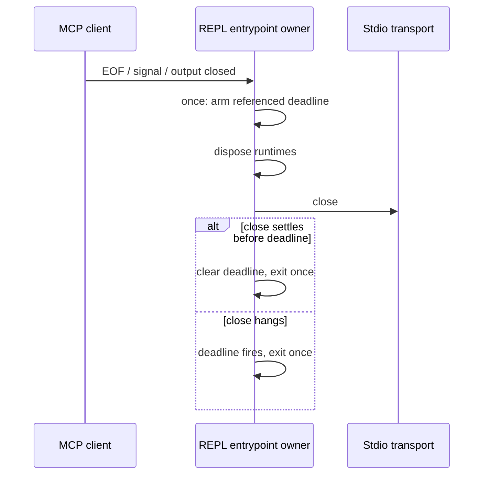

# Node REPL process shutdown

The MCP entrypoint owns shutdown. stdin EOF/close, output pipe closure and SIGINT/SIGTERM enter a single shutdown operation. Before disposing runtimes or closing the transport, start one referenced 1500 ms deadline. Repeated shutdown requests must neither restart cleanup nor extend the deadline. Normal completion clears it and exits immediately; rejection or a synchronous cleanup error also exits. A hanging transport close cannot keep an orphan REPL alive indefinitely.

This deadline applies only after shutdown starts. Long running cells and normal idle sessions are unaffected. No configuration or environment variable is added. The outer process-tree owner remains responsible if the JavaScript event loop itself is blocked.

Acceptance: fake-timer tests cover a hanging close, repeated signals, early success, rejected close and synchronous failure. The deadline must exist before cleanup begins and remain referenced. Real stdio process tests cover normal EOF and SIGTERM. Windows signal differences are exercised through injected lifecycle events; POSIX process-tree escalation is verified separately by the Host tests.
