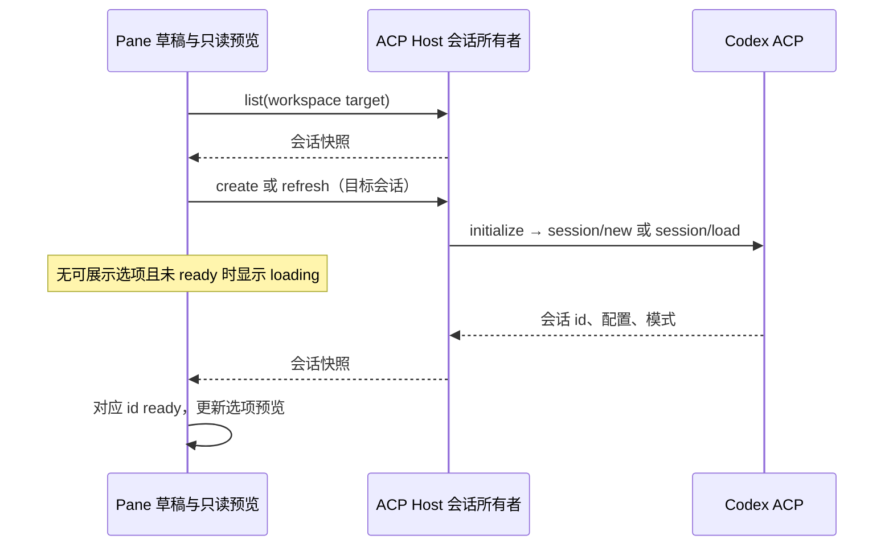

# Issue #46：偶发卡顿调查

调查日期：2026-10-10。结论：已核实条目和截图，尚未确认截图中的卡顿根因；本次仅记录调查，不修改运行行为。

## 条目与基线

- GitHub 条目：[caiqiqqq/zcode-private#46](https://github.com/caiqiqqq/zcode-private/issues/46)，标题「程序有时候会出现卡顿问题」，OPEN，无评论；正文与提供的引用一致。
- 创建时间为 2026-10-10 10:10:28（Asia/Shanghai）。截图没有可核实的拍摄时间、持续时间、操作步骤和构建号，不能把 issue 创建时间当成故障时间。
- 当前 HEAD 为 `95f068335158fbe47be6361a7a0df7787873e406`，与 GitHub API 查询到的私有仓库 main 一致。freshness 检查通过，但它比较的是公共 `origin/main`，不是私有 main；本分支没有 upstream。
- 当前安装的 CodeVori 为 1.0.3，`app.asar/out/metadata/build-meta.json` 的 `buildCommitId` 为 `95f06833`，构建时间为 2026-10-10T08:26:52.688Z。它晚于 issue 创建时间，不能用当前构建状态证明截图所在旧构建的问题已修复。
- 开始调查时工作树干净。未启动子智能体，未向 GitHub 写入评论、关闭 issue、提交或推送。

## 截图对应的源码链路

截图显示 Codex ACP 的空会话界面，输入区提示「正在读取智能体选项…」。该提示不是 CPU 卡顿探针，也不直接由 `listAgentConfigs` 的加载状态控制。

- `packages/ui/src/v4/composer/useAcpComposerConfigPreview.ts:47`：选择了 Agent、会话未 ready、没有错误且没有可展示的配置或模式时显示 loading。
- `packages/ui/src/v4/SessionPane.tsx:640`：预览使用 `acpConversation.selected/ready/error`；`:4881` 将 loading 传给 composer。
- `packages/ui/src/v4/composer/AcpComposerConfigControls.tsx:110`：loading 对应禁用按钮和上述文字。
- `packages/ui/src/v4/useAcpConversation.ts:231`：先读取 Host 会话列表；列表成功后才允许自动建立草稿连接。
- 同文件 `:348` 的 `connectNew` 调用 `acpService.create`；`:431` 的 `refreshSession` 调用 `refresh`；创建或恢复成功后将对应 id 标为 ready。
- `packages/services/src/acp/acpServiceImpl.ts` 的 `create`/`attach`：Host 是会话、连接及接受输入的所有者。
- `packages/services/src/acp/acpStdioConnection.ts:246`：连接包含进程启动、`initialize`、MCP 配置转换与 `session/new` 或 `session/load`，选项随结果返回。启动握手已有 20 秒超时。

本次不改变 workspace identity 隔离、owner/lease、接纳队列、stale-response 守卫，也不改变 Desktop continuous 与手机 replayable 的投递语义。

## 运行证据与限制

只读分析当天本机桌面日志，以下为截至本次采集时的已完成服务端调用统计，单位毫秒。未保存用户消息、凭据或原始业务数据到本报告。

| 方法 | 调用数 | 中位数 | 最大值 |
| --- | ---: | ---: | ---: |
| acp.create | 6 | 1196.4 | 1534.0 |
| acp.refresh | 284 | 1.9 | 6302.7 |
| acp.list | 667 | 8.6 | 593.0 |
| acp.listAgentConfigs | 31 | 4.7 | 30.9 |
| acp.readAttachment | 3805 | 19.6 | 443.4 |
| acp.submitPrompt | 123 | 93.8 | 844.1 |

- 09:45–10:15 的已完成 ACP RPC 没有超过 1000 ms 的记录；其中 `refresh` 最大 18.3 ms。但截图时间未知，且只有完成调用会记录耗时，不能排除当时存在未完成请求。
- `packages/rpc/src/logging-middleware.ts:40` 的计时仅包住服务端 `inner.call`，不包含之前的排队、之后的传输和 Renderer 消费。上述数据不能证明端到端没有卡顿。
- 18:13 附近一次进程读数：Renderer 约 116% CPU、RSS 约 1.2 GB。3 秒原生线程采样中大量主线程栈进入 V8 调用，JIT 函数无法映射回具体源码；随后 CPU 和 RSS 有回落。已确认短时高负载，未确认对应用户操作，不能据此认定内存泄漏、某个组件循环更新或与截图同因。
- 当天日志未检出 `webContents unresponsive`。现有监听位于 `packages/desktop/src/main/desktopStabilityTelemetry.ts:851`；没有该事件不等于没有短时卡顿。
- 会话目录有 84 个 JSON 快照，总量约 20.2 MiB，最大单文件约 4.4 MiB。侧栏和会话列表当前传递完整快照，因此全文读取、克隆、传输和投影是需要 profile 验证的候选热点；这些体量本身不是根因证据。

## 验证与下一步

- `node scripts/check-workspace-freshness.mjs`：通过；另行用 GitHub API 校验私有 main SHA。
- `pnpm typecheck`：失败。当前工作树没有 `node_modules`，缺少 `zod`、Node 类型和 workspace 包等；不能将缺依赖产生的诊断归因于本次文档变更。
- `pnpm lint`：失败，找不到 `oxlint`。首次检查使用系统 Node 22.17.0；另用当前安装应用提供的 Node 24.14.0 复核检查环境，依赖缺失仍须解决。
- 没有稳定复现用例，未执行 UI E2E，也未声称已完成性能修复。

下一次卡顿需要记录准确时间、触发操作、持续时间、构建号，以及界面是否还能输入/切换。优先在可复现的隔离开发实例采集 Renderer CPU profile，区分 Host 调用等待与 Renderer 同步处理，再对应到函数和会话更新。若是握手等待，继续定位 `initialize`、`session/new/load` 和 MCP 阶段；若是 Renderer 热点，量化完整快照的消费成本。确认瓶颈后才制定行为 spec、回归用例和修复方案。
