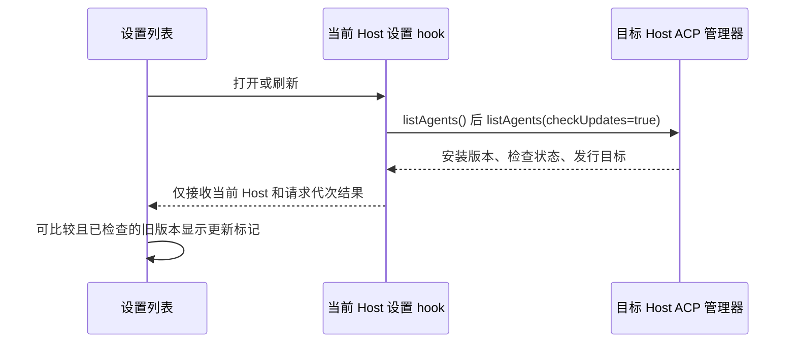
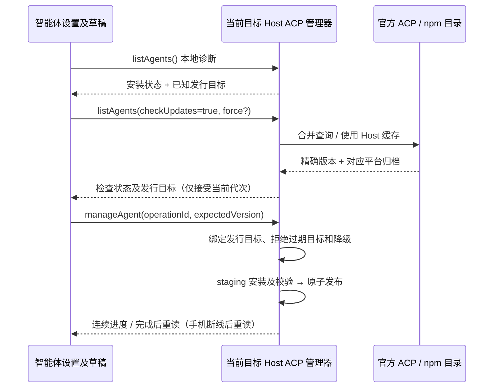

# ACP 智能体设置

## 目标

在设置页的“Agent SDK 管理”分区管理目标 Host 的内置 ACP 智能体。现有 API 模型和 ZCode Agent 保持独立。

## 设置导航

“Agent SDK 管理”归入“基础设置”，紧跟“模型设置”、位于“工作树”之前；“Agent 能力”分组不再重复显示该入口。桌面与 Web、宽屏与窄屏使用同一份设置导航配置。导航仍使用 `acpAgents` section ID，复用现有选中状态、页面及跳转意图，不新增入口或状态所有者。

验收：实际设置页中两个入口相邻、同属基础设置且 Agent SDK 管理仅出现一次；点击仍打开智能体管理页面，从该页返回或切回模型设置可正常导航。平台配置中的顺序一致。

## 连接配置字段（2026-10-20）

- 所有智能体详情移除原始 `KEY=value` 环境变量编辑器及其说明，只保留已有的结构化连接字段、认证方式和供应商操作。Codex 继续使用原生配置。没有受支持字段的智能体仅展示原生配置指引。
- 目标 Host 仍是已保存变量的唯一所有者；面板保留当前 Host、当前 Agent 的一份完整草稿，字段更新只修改对应键，经既有 `updateAgent` 保存。隐藏的已有自定义变量不得因打开、切换、修改字段或保存而丢失；清空字段只移除对应键，认证互斥规则继续生效。不迁移或清理用户变量，不更改协议、启动环境或远程恢复语义。
- 保存失败保留草稿并展示原有错误；保存成功继续按提交草稿版本清理，迟到回执不能覆盖新输入或其他 Host。

```text
连接字段 → 当前 Host/Agent 完整草稿 → updateAgent → 目标 Host 设置
                                                  └─ 下一次连接读取
```

验收：Claude、Gemini 及无预置字段的智能体均没有原始变量输入框；凭据默认隐藏。用 fake Host 验证字段保存、清空和刷新后自定义变量仍保留、切换不串草稿，宽窄屏可操作且无横向溢出；不读取真实凭据或请求模型。

## 智能体品牌图标

- 左侧列表和右侧详情标题使用当前智能体对应的品牌图标，覆盖目录中的全部 15 个内置智能体；两处复用 UI 层唯一的静态 ID → 图标映射，不以名称、安装状态或当前模型推断图标。
- 图标随应用打包，使用 ACP 官方目录或品牌素材，记录资源来源。打开设置页、切换智能体以及断网时均不下载远程图片，不等待 Host 诊断结果才显示图标。
- 保留列表 `size-4`、详情标题 `size-5` 的尺寸和现有两栏布局。彩色图标保留品牌色，单色图标跟随主题的前景色；浅色、深色及窄屏图标导航均应清晰可辨。图标仅作装饰，文字名称、按钮可访问名称和窄屏提示继续表达智能体身份。
- 图标组件不持有会话、Host、启用、安装或认证状态。切换仍由设置页现有选择状态管理，资源失败不修改管理状态或触发连接；新增内置智能体必须同步提供图标。

验收：使用假的 Host 渲染真实设置页，逐一点击全部 15 个智能体，验证列表与详情图标一致、资源本地可加载、品牌之间没有误用同一通用机器人图标；在浅色/深色及桌面/窄屏下验证尺寸、键盘选择和无横向溢出，不请求真实账户配置或模型。

## ACP 发行更新检查

### Node.js / npm 环境检查（恢复）

- npm 发行智能体在适配器检查之前展示 Node.js / npm 环境项，包含目标 Host 实测的 Node、npm 版本和当前安装目标的 Node 版本范围。缺失或版本不兼容时默认展开，在详情上方提示安装/升级，并提供 Node.js 官方下载入口；只打开文档，不自动改动用户环境。提示用户在实际运行的 Host 安装后重启该 Host 并刷新。
- 目标 Host 是环境诊断和兼容性结论的唯一所有者。发行检查读取同包精确版本的 npm `engines.node`，按标准 SemVer 范围比较（包括或条件、上限和预发行）；需求与发行目标版本一起绑定。不将某个固定最低版本套用到所有智能体；未检查或未声明要求时明确显示未知，不宣称兼容。新增协议字段可选，以兼容旧 Host。
- 安装/升级在原有 admission 中重新探测 Node/npm；未取得需求的目标先查询同包精确版本元数据，失败时说明无法检查并拒绝 npm 安装。Node/npm 缺失、Node 版本不可识别或不满足已知范围时，在执行 npm 和修改安装目录前拒绝，错误包含当前版本与所需范围。卸载及二进制发行不受 Node/npm 限制，已有会话及聊天快速可用性检查不增加版本命令或网络请求。
- UI 只展示当前 Host 投影，版本不兼容时禁用安装/升级，保留卸载。沿用现有刷新、请求代次和跨 Host 隔离；Desktop 连续操作进度与手机断线后重读最终状态的规则不变。

```text
设置刷新 → 目标 Host 解析精确发行版本及 engines.node + 探测 Node/npm → UI 环境提示
安装请求 → 同一 Host 绑定发行目标 → 重查环境/校验要求 → npm staging 安装 → 原子发布
                                             └─ 不兼容：拒绝并保留既有安装
```

验收：Node 22.17.0 安装要求 `>=24.16.0 <25 || >=26.1.0` 的 OpenClaw 被拦截；24.14.0、25.x 和预发行不误判通过，24.16.0、24.19.0、26.1.0 通过。缺失 Node/npm、无要求、需求查询失败、错包/错版本/无效范围、版本检查后环境变化、目标并发刷新均覆盖；本地与远端结论隔离，二进制安装和卸载不受影响。交互 E2E 验证环境项/顶部提示、下载入口、安装/升级禁用、刷新恢复、窄屏/主题与 Host 切换，使用假 Host 不安装真实包。

### 左侧列表更新提示（issue #143）

- 左栏每个智能体从当前目标 Host 的同一份 `IAcpService.listAgents` 投影版本状态：仅发行检查为 `checked`、有现用版本且现用版本可比较并低于发行目标时显示“更新”标记；不把内置目标、检查失败、无法检查或不可比较的版本宣称为新版本。禁用的已安装智能体仍可提示更新，原有就绪/缺失/禁用状态点保留且含义不变。
- 桌面列表提供可见的更新文字，窄屏图标列表提供更新图形；两者在按钮可访问名称和悬停提示中包含目标版本，不只靠颜色传达。选择智能体后仍由右侧版本检查项说明现用版本和操作，不在列表触发安装。
- 目标 Host 的 ACP 管理器仍是版本和检查结果唯一所有者；设置 hook 仅持有当前 Host 投影。首次本地诊断后沿既有流程后台检查，刷新、安装/保存后的重读、远端切换和断线都重新投影，不新增请求、缓存或跨 Host 状态。



验收：用假 Host 验证检查前不提示、检查成功后仅旧版本提示，最新/较高/未知版本、失败和无法检查均不误报；验证禁用项、刷新后消失、切换 Host 的迟到响应不串状态；宽窄屏、浅深主题下状态点和更新标记各自可辨，键盘选择与可访问名称均可用。

- 目标 Host 的 ACP 管理器是发行目标、检查缓存和安装操作的唯一所有者。`IAcpService.listAgents({ checkUpdates: true, force: false })` 查询官方 ACP Registry（`https://cdn.agentclientprotocol.com/registry/v1/latest/registry.json`）；同 Host 合并在途查询，成功检查缓存 10 分钟。普通 `listAgents()`、聊天 `listAvailableAgents()`、`resolveLaunch()` 不联网。进入设置页先显示本地诊断，再后台检查更新；“检查更新”使用 `force: true`，刷新不卸载表单，不清空未保存草稿。远端只查询对应 Host，断线不回落本机。
- 用明确的内置 ID 映射和已知包名选择发行项。npm 只接受同一包的精确稳定版本；官方目录缺项或该 ID 的发行方式不符合已有接入时，查询该内置包在 npm 官方 Registry 的 `latest` 元数据，并校验包名与稳定版本。二进制只接受当前平台、原有入口和兼容的 ACP 参数；远端命令、环境变量与包名不能改变既有启动契约。目录没有当前平台发行项时说明不支持托管安装，已有系统安装仍可使用。二进制使用目录提供的精确归档 URL，提供 SHA-256 时下载必须校验。
- `AcpAgentInfo.updateCheck` 投影 `unchecked / checked / error / unavailable`、来源 `builtin / acp-registry / npm` 和检查时间。`registryVersion` 表示当前可安装的具体目标，不再声称内置 pin 是远端最新版。目录/网络/元数据错误保留上次完整发行目标（首次错误保留内置目标），明确显示检查失败；二进制缺项显示无法检查。不会把错误投影为“已是最新版本”。安装就绪与认证状态不受发行检查影响。
- 版本状态比较实际使用版本和发行目标，支持数字版本、SemVer 预发行及 Cursor 日期版本。实际版本较低显示“可更新至 …”，即使是系统安装也提供安装托管新版的入口。达到或超过目标时不提供降级；无法识别版本时显示注意，不声称最新。托管版升级与系统版安装都不会改写系统命令，不自动安装、降级或重启已有 ACP 会话。
- 安装/升级携带用户看到的 `expectedVersion`。Host 在包操作 admission 时绑定一份不可变的版本和平台归档元数据；若目标已变化则拒绝并要求重新检查，若实际使用版本高于目标则拒绝降级。旧调用不带预期版本时使用当前 Host 目标，保持调用兼容。npm 安装精确 `package@version` 并验证实际包版本；二进制验证归档、入口、伴随文件及可选校验和。仍使用 staging 和原子发布，任何失败保留之前完整可用安装。废弃的 `ZCODE_ADAPTER_CHANNEL` 继续清理，不恢复渠道 UI。
- UI 只拥有请求代次、加载状态和草稿。检查、保存、安装结果须同时匹配当前 Host 和请求代次；旧检查不能覆盖更新后的安装状态，确认框的迟到操作不能提交到已离开的 Host。安装先进度订阅，再提交唯一 `operationId`，结束后从同一 Host 重读。桌面用连续进度，手机重连用 `listAgents` 重读最终状态；均不改变会话 revision、owner/lease 或快照恢复链路。



验收：假官方目录中 Codex 2.0.1 与系统 1.13.1 显示可升级，npm 假命令实际请求并安装 2.0.1；本机与远端缓存隔离、缓存和强制刷新、并发查询合并；普通诊断及聊天查询不联网；缺项的同包 npm 查询、错包/坏版本/网络失败不伪造新版；较高版本和过期安装目标被拒绝；检查期间目录变化不改变已 admission 的安装版本；二进制平台 URL 与显示版本一致、缺平台及坏 SHA 不替换旧安装。交互 E2E 验证后台检查、手动检查、系统/托管更新按钮、草稿保留、错误状态、窄屏布局和跨 Host 迟到结果隔离，使用 fake Host，不安装真实包、不请求模型。

## Codex 原生配置管理（新增）

- Codex 详情页在运行环境诊断后展示认证方式、API URL、API Key 和官方模型列表，Codex 不显示通用环境变量编辑器，旧版 Agent env 保留在目标 Host，仍按现有启动优先级生效，不因隐藏而删除。其它智能体使用结构化连接字段。认证方式包含官网订阅与自定义接口。设置页读取目标 Host 启动环境中的 `CODEX_HOME`（缺省为用户主目录下 `.codex`），从原生 `auth.json` 和 `config.toml` 投影已选认证方式、当前 provider 的 URL、API Key 与默认模型；不能把 `OPENAI_BASE_URL` 等进程环境变量当成原生配置已经保存。原生配置属于 Codex CLI，本机和远端只读写各自目标 Host 的文件，ZCode 的 Agent `env` 仍由现有 `updateAgent` 独立维护。
- Host 的 `IAcpService.readCodexConfig()` 返回结构化配置与文件版本标记，`listCodexModels()` 从该 Host 实际运行的 `codex-acp` 所依赖的 Codex CLI 执行 `debug models --bundled` 得到官方目录；不得混用 PATH 上另一个 Codex 版本，不能伪造静态模型。适配器或命令不可用时给出明确失败，页面仍可编辑认证配置，模型列表显示读取错误。目录查询只在进入 Codex 面板或用户刷新时发生，不阻塞其它智能体或聊天模型菜单。只返回可见模型的 slug 与名称，不把大型目录经 RPC 传给 UI。
- `updateCodexConfig()` 是唯一原生写入命令。Host 串行化同一进程内的 Codex 修改，读当前文件、检验传入的版本标记、防止另一个窗口或 Codex CLI 修改之后旧草稿覆盖，并只修改所拥有的根键、选定 provider 的 URL 及 auth 对象内的认证字段；保留其它 TOML 节、注释与 JSON 字段。原生文件以私有权限和临时文件原子替换；解析失败、版本冲突或无法读取时拒绝写入，不从空文件恢复覆盖。配置保存失败后重新读取目标 Host，错误不包含密钥或原始文件内容。设置页草稿版本只在该 Host 与 Codex 面板内有效，异步旧结果不得覆盖新输入。
- 新连接的环境变量以原生文件为准：官网订阅清除继承或旧 Agent 设置中的 `OPENAI_API_KEY`、`OPENAI_BASE_URL` 和 `OPENAI_MODEL`；自定义接口用原生文件中当前 provider 的 URL、auth.json 的 Key 和根 `model` 覆盖同名的旧环境变量。其它旧版 Agent 变量仍保留并参与启动，原生文件缺失时继续保留原有启动行为。此投影只在连接启动时执行，不引入认证结果缓存。
- 选官网订阅时清除专用 provider 的选择、设置 `auth_mode=chatgpt` 与 `OPENAI_API_KEY=null`，保留原有订阅 tokens；未登录只显示目标 Host 的 `codex login --device-auth` 指引，不把选中方式或已有环境变量当作已登录。自定义接口显式选择 ZCode 专属 `model_providers.zcode`，设置 `wire_api=responses`、`requires_openai_auth=true` 与自定义 `base_url`，把 API Key 写入原生 `auth.json`，不更改其它 provider。任意方式都在下一次新建或重连 ACP 进程时生效，运行中连接不会静默重启；原有 API Provider、ZCode 会话及高级环境变量不会被替换。
- 官方模型列表可从当前适配器的真实目录选择默认模型，保存到原生 `config.toml` 根键 `model`。切换认证方式不自动改变默认模型；若当前默认模型不在目录里，显示其原始值以便用户自行修正。只读目录不修改 `model_catalog_json` 或 Codeg 的目录文件，避免一个过期或不完整的目录覆盖 Codex 自带及 Codeg 生成的完整模型表。自定义模型增删及目录覆盖需另立完整契约后实现。

```text
Codex 面板草稿 → IAcpService.read/list/update → 目标 Host 的 Codex 原生文件
                                              └─ 下一次 resolveLaunch → codex-acp → Codex CLI 读取文件
官方模型刷新 → 目标 Host 实际适配器所依赖的 Codex CLI → 只读目录投影
```

验收：本机与远端目标 Host 的配置隔离；官方目录只来自对应适配器；认证方式、URL、Key、默认模型保存后重新读取并在新连接由同一 `CODEX_HOME` 生效；保存过程中外部文件更新产生版本冲突而不覆盖外部内容；现有环境变量输入框、API/ZCode 模式与其它智能体设置仍可用；交互 E2E 使用假的 Host/CLI/原生文件，不进行真实模型请求。

## Gemini 认证与适配器选项

- Gemini 的认证下拉与 Codeg 保持相同的七项和顺序：自定义接口、Google 登录（OAuth）、Gemini API Key、Vertex AI（ADC）、Vertex AI（服务账号）、Vertex AI API Key、模型供应商。不显示“使用原生配置”。未显式选择的旧配置按 URL、Gemini Key、Google Key、服务账号文件、项目/区域顺序推断，没有凭据时显示 Google 登录；进入页面和切换下拉只改变 UI 草稿，不执行登录或原生文件写入。旧配置仍在未显式保存认证时沿用原生启动行为。
- 认证方式、Model、API URL/Key、Google Cloud 项目/区域、服务账号路径共用当前 Host、当前 Agent 的一份完整草稿，经 `updateAgent` 保存。文档按钮打开 Gemini 官方认证文档，不自动登录或发送模型请求。
- “模型供应商”参照 Codeg 按智能体区分的供应商绑定，不复用 ZCode 仅支持 OpenAI/Anthropic 协议的 API 供应商。Gemini 原生协议供应商由同一目标 Host 的 ACP 管理器持有，在 Gemini 页面选择、添加、编辑或删除（不另建页面）；每项保存稳定 UUID、名称、Gemini 原生 API URL、Key 与可选模型。目录经 `IAcpService.listGeminiProviders/updateGeminiProviders` 访问，严格协议校验、版本冲突保护、同进程串行及跨 Host 原子锁、私有权限和原子替换；写入时其它窗口返回可重试的忙碌错误，不用等待超时掩盖并发。不存在时返回空目录，损坏时拒绝覆盖。错误和日志不含凭据。
- 供应商模式的 Agent 设置仅保存 `ZCODE_GEMINI_PROVIDER_ID` 和认证方式，URL/Key/Model 显示所选供应商的只读投影，不再复制保存第二份凭据。显式进入该模式可选首项；没有供应商或绑定已经删除时显示提示、禁止保存配置且新连接拒绝启动，不能退回旧 Key/模型。切到其它认证方式清除绑定；新连接重读供应商最新 URL/Key/Model，空模型会清掉旧/继承模型。目录编辑不会修改 API/ZCode 供应商或已连接进程。选择供应商本身不保存 Agent 配置。
- 供应商目录的 UI 仅保存目标 Host 投影与未提交表单；请求代次及组件卸载防止迟到读取/保存回执跨 Host 写入。目录编辑期间表单禁用，版本冲突保留表单并重读目录，删除需确认；刷新可重新读取外部修改。桌面与手机复用目标 Host RPC，远端断线不回落本机，也不新建 Host。
- Host 保存 `ZCODE_GEMINI_AUTH_MODE`，共享协议验证所选方式；结构化输入按现有互斥规则清理非当前方式的凭据，保留无关变量与 Model。原生方式下通过结构化字段新填 Gemini Key 时显式选择 API Key 方式，新填自定义 URL 时显式选择自定义方式。Host 启动时再次隔离继承的冲突变量，规范化旧变量别名；OAuth 不带旧 Key/URL，Vertex 设置真实的 `GOOGLE_GENAI_USE_VERTEXAI`。没有显式方式的旧设置继续按旧行为启动。
- 下一次启动 Gemini 时，Host 按明确选择将 Gemini 原生 `settings.json` 的 `security.auth.selectedType` 投影为 `oauth-personal`、`gemini-api-key`、`gateway` 或 `vertex-ai`。路径遵循 CLI 的 `GEMINI_CLI_HOME`（CLI 用户主目录，其下 `.gemini/settings.json`），未配置则用 Host 用户主目录。原子写入私有权限文件，只修改认证类型，保留无关字段；坏 JSON/不可读文件拒绝启动，不覆盖原文件，不修改 OAuth tokens，不把 Key 再复制到原生文件。配置变化只影响新建/重连进程。
- 不展示“由 Agent 自行处理文件与命令”的只读状态。当前 ZCode ACP 从不声明或提供 `fs/*` 与 `terminal/*`，因此这项在当前实现中恒为启用，不展示没有可修改状态的只读开关；不能提供可关闭却没有 Host 执行能力的假开关。原有 `session/request_permission` 授权请求和工具通知不变。
- 智能体详情不展示“适配器版本”渠道选择；版本检查项仍展示当前版与已解析的发行目标版以及适用的安装/升级/卸载操作。npm 安装和升级只请求已解析发行目标的精确版本，并验证实际 package.json 版本；失败保留原托管包，绝不自动降级。旧设置中的 `ZCODE_ADAPTER_CHANNEL=latest` 不影响安装、不展示在环境变量编辑器或传给 Agent；下次保存该智能体设置时移除这个废弃键。已经安装的较高版本不自动替换，沿用版本检查项的操作限制。API/ZCode 与其它认证设置不变。

```text
Gemini 认证/连接字段 → 同一 Agent 草稿 → updateAgent → 目标 Host 私有设置
Gemini 供应商表单 → updateGeminiProviders(预期版本) → 同一 Host 私有供应商目录
                                                         ├─ resolveLaunch → 按绑定读最新供应商 → 隔离凭据 → 原生认证类型 → Gemini ACP
                                                         └─ manageAgent → 已绑定发行目标 staging 安装/校验 → 原子发布
其它 Host 与 Agent 的草稿、原生文件和已连接进程不参与此更新
```

验收：七项认证的准确顺序、无原生选项、旧配置推断及打开页面不写入；条件字段正确投影草稿，密码默认隐藏，无原始编辑器，互斥凭据清理且保留无关变量；慢保存/切 Agent 不串草稿；临时目录验证供应商绑定、重启、最新凭据、空模型清理、切换解绑、无效绑定拒绝、版本冲突/坏文件不覆盖和 Host 隔离；用临时 HOME 与假 Gemini 验证各方式的环境和 selectedType，legacy 不写文件；npm 假命令验证旧 latest 标志不触发 latest 请求、只安装已绑定的精确版本、失败保留旧包；真实桌面 E2E 检查七项、供应商空状态/只读投影、管理表单与切换、没有渠道选择，仅操作未保存草稿并恢复，不读取真实凭据、不安装真实包、不调用模型。

## 产品规则

- 设置目录包含 Codeg 当前的 15 个内置智能体，顺序为 Claude、Codex、Gemini、OpenClaw、OpenCode、Cline、Hermes、CodeBuddy、Kimi Code、Pi、Grok、Cursor、DeepSeek Harness、Qoder、Antigravity。聊天模型菜单仅投影当前目标 Host `listAvailableAgents()` 中同时 `enabled` 且 `ready` 的内置智能体，保留目录顺序；系统安装和托管安装都按 Host 的可启动探测结果判断，单有厂商原生命令不算 ACP 适配器。统一的协议目录定义 ID、名称、命令及 ACP 启动参数；既有 `codex`、`claude` ID 和会话文件不迁移。Codeg 用户自行注册的自定义智能体不属于内置目录。
- 页面读取当前设置上下文的 `IAcpService`。工作区身份规则 `workspaceIdentity?.trim() || workspacePath` 仅用于定位正确的目标 Host；不在这个设置页读取或展示会话。
- 列表与详情通过目标 Host 的 `IAcpService` 获取；没有工作区时使用本机 Host，远程工作区断线时不回落到本机执行管理命令。
- 目标 Host 管理 Codeg 当前固定目录中的 12 个 npm 发行包和 3 个平台二进制（OpenCode、Cursor、Antigravity）；内置包名与启动参数由 Host 接入目录维护，远端检查解析精确版本及当前平台 URL；未检查或查询失败时保留已知发行目标。安装已绑定的精确版本。npm 版安装在 ZCode 数据目录的独立 prefix；二进制下载到同一数据目录的隔离版本目录，完成校验后原子发布，不覆盖系统命令。启动时优先使用托管版本，缺失时接受 PATH 中已有的对应 ACP 命令。卸载只清理本智能体的托管目录；失败时保留先前完整可用版本。部分智能体仍需自行登录或配置，安装成功只代表可启动，不代表账户可用。
- 对每个智能体展示实际可启动的路径、安装来源、检测到的版本、目标版本与环境检查。Codex/Claude 原生命令只作诊断展示，不能替代 ACP 适配器；Pi 的 `pi` 命令是 `pi-acp` 的运行前提。原生提供 ACP 的 CLI 使用目录中的 ACP 参数启动。npm 版需要 Node/npm 来安装、Node 来运行；二进制版不以 Node/npm 缺失阻断安装和启动。平台无发行包时明确显示不支持托管安装，但仍可探测系统命令。安装、升级、卸载为用户显式触发的操作，安装过程按操作 ID 推送进度；同一 Host 一次只执行一个包操作。卸载只删除 ZCode 托管的包，绝不删除系统安装；没有托管包时不可卸载。
- PATH 中已有适配器且可比较的现用版本达到或超过已解析的发行目标版本时，按 Codeg 的版本状态规则视为满足要求：显示现用与目标版本，不提供安装较旧托管版的操作或降级提示，继续使用系统适配器。系统版低于目标或无法比较时仍可显式安装托管版，安装前显示现用和目标版本、说明新连接会优先使用托管包，并要求确认。缺失适配器时可安装。已经托管的版本达到或超过目标版本时，不提供“升级到目标版本”操作；不能把降级称为升级。此变更仅调整设置页的诊断和操作投影，不迁移适配器或改变 Host 的探测、启动优先级；现有连接不受影响。
- 启用和环境变量配置由目标 Host 持久化为用户级设置（私有权限，原子替换）。禁用后拒绝新建或重新连接该 Agent，会话历史仍可读；运行中的连接不被强制终止，设置改动在下一次连接生效。环境变量只传给对应 Agent 进程，不复制 API Provider 的密钥，也不出现在安装日志中。
- 智能体设置中的常用环境变量参照 Codeg 的各 Agent 映射，只展示该 Agent 真正支持、且由启动进程读取的键；例如 Claude 的 `ANTHROPIC_AUTH_TOKEN`/`ANTHROPIC_BASE_URL`、Qoder 的 `QODER_PERSONAL_ACCESS_TOKEN`、DeepSeek 的 `DEEPSEEK_API_KEY`/`DEEPSEEK_BASE_URL`。没有对应环境变量的原生登录和配置项，不显示虚假的通用 `OPENAI_API_KEY`/URL 字段。Qoder 额外提供明确的 `qoder login` 操作指引；托管安装时需给出目标 Host 上可执行的命令。PAT 用密码框显示，留空并保存会删除该 Agent 的键；不要在示例、日志、错误或截图中明文回显它。系统已有浏览器登录凭据由 Qoder CLI 自行管理，不能把仅有适配器安装状态显示成已登录。
- 常用字段使用每个 Agent 一份完整未保存草稿，字段更新只修改对应键并保留其它变量。保存时一次性替换目标 Agent 的变量 map；成功后仅在提交的草稿仍是当前版本时清空草稿，防止慢速保存覆盖期间的新输入。编辑不得跨智能体或跨 Host 串值。空值移除当前 Agent 自己的键；其他 Agent、API Provider、系统登录状态不被改写。Claude 的 `ANTHROPIC_AUTH_TOKEN` 与 `ANTHROPIC_API_KEY` 分别显示，不把已有 API Key 写成另一种认证方式；各智能体的实际模型环境变量按需提供，Qoder 模型继续由会话的 ACP 配置选择，Cursor 不显示无效的 URL 或模型环境变量。
- Codeg 的 `agent_setting.env_json` 与 ZCode 的目标 Host 设置分别持久化，ZCode 不在每次打开页面时隐式读取另一个应用的数据库，也不将本机 Codeg 配置应用到远端 Host。针对本机已有 Codeg 配置的一次性迁移经 ZCode 现有 `updateAgent` 路径写入目标 Host，并保留 ZCode 原有的变量和启用状态；之后仍由 ZCode 自己的 Host 负责配置及新连接的环境变量，Codeg 后续改动不自动同步。
- Antigravity 的常用凭据随显式选择的认证方式显示：个人 OAuth 没有凭据框；企业 OAuth 显示项目及区域；Gemini API Key 显示 `GEMINI_API_KEY`；Agent Platform 显示 `GOOGLE_API_KEY` 或未填写 Key 时的项目及区域。切换方式时在草稿中清理当前面板所拥有的其它认证方式凭据，保留无关行；没有显式选择认证方式时遵循原生配置，不擅自切换 OAuth 或清理已有凭据。后端启动时按所选方式隔离继承的环境变量。
- 对外管理操作需校验 Agent、动作、操作 ID 和环境变量输入；安装失败不写成功状态，使用本地真实探测结果重新展示。目标 Host 的探测与启动使用同一个解析规则；NPM 前置检查不代表 Agent 已登录，登录失败仍由现有 ACP 会话错误报告。
- 新建或恢复 ACP 会话时，目标 Host 复用菜单可启动性检查的设置、托管包校验、PATH 解析和启用规则，直接解析本次启动命令；不得在连接前执行 Node、npm 或适配器的 `--version` 诊断，也不缓存认证结论。完整版本诊断仍仅由智能体设置页请求。Qoder 的认证提示只能在 Qoder 实际连接返回指定错误后展示，不以本地凭据推断代替 ACP 握手。
- Antigravity 的 `AGY_AUTH_METHOD` 可选择 `oauth-personal`、`oauth-business`、`gemini-api-key` 或 `agent-platform`；Host 将已选择的方法及必要的 GCP 项目/区域写入 Agent 自有的 `settings.json`，保留文件中无关字段；切换方式时清理继承的非当前方式凭据。未选择方式时沿用文件已记录的方式，文件为空才采用个人 OAuth 默认值。不能把文件中的认证方式只当作进程环境变量传递。
- 左侧始终显示 15 个内置智能体；切换智能体只改变右侧的详情投影。选择 Codex 时只显示一个 Codex 原生配置块、不显示通用环境变量编辑器；选择 Gemini 或其他智能体时不保留 Codex 的配置 DOM、模型或凭据表单，且显示当前智能体的环境变量编辑器。非 Codex 智能体的环境变量草稿仍按 Agent ID 保存在当前目标 Host 的面板内，切换不串值也不触发保存。
- 右侧展示智能体名称、ACP 命令、接入说明和适配器管理。移除“工作区会话”及空闲、运行中、已中断、会话配置项、会话错误等统计和相应加载/空状态；进入设置页不调用 `IAcpService.list(workspace)`，不订阅 `onDynamicSessionChanged`，也不创建 ACP 会话。聊天页仍通过原有 Host 会话协议读取和更新会话。
- Agent SDK 管理沿用模型设置的标题、说明、刷新入口、左栏宽度与窄屏图标导航；列表和详情为并列的 `rounded-xl` 面板。右栏参照 Codeg 的 Agent SDK 管理：顶部独立标题栏展示名称、发行类型/ACP 标记、启用开关与说明，下方为可滚动的检查项和环境变量配置。不再把所有诊断值平铺为输入框，也不嵌套适配器管理卡片。长路径换行，窄屏两栏仍可操作和滚动；使用 ZCode 的主题、字体与表单组件。
- 右栏依目标 Host 的 `listAgents` 结果投影 ACP 启动命令（实际命令、参数、来源和路径）和版本状态（现用与发行目标版本，以及允许的安装/升级/卸载操作）；npm 发行额外在前面展示 Node.js / npm 环境项。安装按钮根据 Node/npm 可用性、已知 Node 版本兼容性与发行类型禁用，Pi 等运行前提仍由 Host 判断。版本可比较且现用版本达到或超过已解析的发行目标时版本检查通过；版本较低或无法比较时提示注意，缺失时提示缺失。每项有实际结果对应的状态标记和可展开详情；正常项默认收起，缺失或需要关注的项默认展开。检查项总览可展开或收起全部。探测结果只说明目标 Host 的命令与安装状态，不声称已验证账户登录或连接能力。安装进度和错误仍在对应详情中可见。
- 没有工作区时通过本机 Host 读取全局 Agent 管理状态。
- 首次读取或刷新失败显示错误，保留页面的刷新入口；旧快照不作为当前 Host 的成功结果继续展示。
- 工作区、身份或远程 attachment 变化时，旧管理请求必须失效，不能把旧 Host 的数据写入新页面。
- 同路径的远程工作区可能拥有不同身份；设置页只有精确匹配当前身份的 tab 才能向 ACP 页面传递 `remoteSessionId` 和远程目标，断连时等待目标 Host 恢复。
- 未来 ACP 增加智能体时，必须同步扩展协议目录、Host 发行目录、页面文案和聚合测试。

## 状态所有者与事件顺序

```text
设置页当前目标 Host
        │
        └─ IAcpService.listAgents / updateAgent / manageAgent
                 └─ 目标 Host 持久化设置、探测命令、管理独立安装目录
                         │
                         ├─ 新会话/重连使用同一设置与启动解析器
                         └─ 设置页仅投影 loading / error / agents / selectedAgent
                                 └─ 卸载或换 Host 时丢弃旧 generation；刷新通过请求代次隔离迟到结果

聊天菜单打开 → UI 递增请求代次 → 当前 Host IAcpService.listAvailableAgents
                                      └─ 读取启用设置、托管包和系统命令就绪状态
                                             └─ 返回 enabled / ready
                                                    └─ UI 仅接受同 Host、同代次的结果

切换 ACP Agent → UI 订阅并读取目标 Host 已保存会话列表
                    ├─ 新草稿：Host create(deferPersistence) → 启动解析（无版本命令） → ACP initialize → session/new → 内存草稿及模式/配置
                    └─ 历史会话：Host refresh → 启动解析（无版本命令） → ACP initialize → session/load → 原会话模式/配置
                           └─ 连接就绪后输入框才允许发送；登录失败在此时展示并可重试

首次发送 → UI 保留 prompt commandId → Host prompt 复用预连接的 sessionId
              └─ Host 验证附件并 admission → 同步写入首条消息及会话记录 → Agent 收到消息

旧空会话在选择时 refresh → Host 检查 loadSession 能力并用原生 ID 调用 session/load
                    ├─ 成功：保留原显示会话及最新目录
                    └─ 仅 session/load 失败且无消息/目标：同一 Host 为同一工作区创建新会话
                           ├─ 尽可能按新目录恢复旧配置，失败项在新会话提示
                           ├─ 原会话文件和原生 ID 保留；标记为已由新会话接替
                           └─ 返回新显示 ID，UI 切换选择并按 revision 合并通知
```

- `IAcpService`/Host 是适配器管理的事实源；组件只拥有当前页面选择项、加载状态、错误和未保存的环境变量草稿。设置页不维护会话快照。
- 组件卸载或目标 Host 改变时释放包操作进度订阅；任何迟到的管理结果或事件都不能更新新目标。
- 包操作先订阅进度，再提交唯一操作 ID；完成后重读 Host 状态。离开页面只解除 UI 订阅，Host 包操作与会话所有者不转移。桌面连续事件提供实时进度；手机断线后重新调用 listAgents 获取事实状态，不依赖事件回放。聊天页原有 ACP 会话快照与移动端恢复语义保持不变。
- 聊天菜单挂载和每次打开时从当前 Workspace 的 `IAcpService.listAvailableAgents()` 读取精简的 `{agent, enabled, ready}` 状态；目标 Host 与会话启动共用设置、托管包校验、系统 ACP 命令发现及 Pi 伴随命令判断，但此读取不启动 Node/npm 或任何智能体的 `--version` 进程。设置页的 `listAgents()` 继续提供完整版本与环境诊断。读取期间及失败时不显示未确认可用的 ACP 项，API 模型和“管理模型”入口继续可用，再次打开菜单可重试。服务或远程 attachment 变化时旧请求失效，不能把旧 Host 的可用项显示在新 Host。已选中的运行会话仍显示其当前目标并遵循原有会话生命周期；被禁用或卸载的目标不再出现在后续菜单选择中。状态事实仅由 Host 持有，菜单只保留一次读取的投影与请求代次，不持久化第二份设置。此方法经原有本地/远端 `IAcpService` 通道传输，响应使用共享协议的严格类型与运行时校验，不另建 Host 或协议状态。
- 聊天模型菜单的智能体列表超过可用高度时仅纵向滚动，分隔线不得扩大滚动内容宽度；列表及“管理模型”保持原有可点击区域，在桌面窗口和窄屏 Web 下均不出现横向滚动条。
- 聊天输入框选择 ACP 智能体后，按 Codeg 的连接时序预连接目标 Host 的适配器；新草稿调用 `create({deferPersistence:true})` 完成 `session/new` 并取得实时模式和配置，但只在 Host 内存保留，不写会话文件，也不进入历史列表。选择历史会话立即 `refresh` 并调用 `session/load`。登录或认证是适配器连接前置条件，未登录时选择即可显示适配器的真实错误，不能把“可启动”误作“已登录”。列表读取和连接完成后输入框才允许发送；API 模型和 ZCode 会话继续走原有路径。
- ACP 错误由目标 Host 保留原文，聊天 UI 只在当前智能体为 Qoder 且错误原文精确等于 `Authentication required: Authentication is required.` 时，将首页连接横幅、对话错误和已保存会话错误投影为“Qoder 无法建立会话：没有可用的登录凭据。请在 设置 → 智能体 → Qoder 中重新登录，然后重新打开该会话。”；其他 Qoder 错误及其他智能体的认证错误仍显示原文。此规则只改变显示，不改写 Host 错误、会话状态或预连接顺序。设置页目前仅提供适配器和环境变量管理，没有内置 Qoder 登录动作；文案中的重新登录仍依赖 Qoder 自身的登录流程。
- 首次发送沿用同一输入框的正文、附件和文件引用，复用刚建立的 ACP 原生会话；Host 验证内容和权限并接受首条消息时，一次性把内存草稿转为持久会话，记录首条用户消息，然后发送到 Agent。连接失败不会生成历史记录；发送前的校验失败保留可重试草稿；Agent 执行失败保留已提交的对话和错误。关闭或切换目标时清理未提交的草稿连接；已发送或有用户内容的历史会话不被清理。手机远控/桌面均调用目标 Host，断线重连只恢复已提交记录，未发送草稿需重新预连接。
- 新草稿由当前面板生成 `createRequestId`，Host 按工作区身份、路径、智能体及请求 ID 合并并发创建；RPC 回执丢失后的连接重试复用原 ID。首次发送及 prompt 重试保留同一个 `commandId`，并发点击仅提交一次。只有当前目标 Host 和当前智能体可以接收迟到连接结果；迟到的草稿连接必须关闭。模型、模式和思考档位始终由 Agent 返回的目录与 Host 快照持有，预连接后即可操作；点击“新建会话”新建内存草稿，仍等首条消息才落盘。
- ACP 已提交会话由目标 Host 持久化；旧版已经保存的零修订空白会话仅在当前 Host 连接还存活时列出，Host 重启后不列出，用户选择该智能体时预连接新的内存草稿。旧 JSON 暂保留以便核查，不迁移或覆盖原生会话 ID。其余历史会话在选择时尝试恢复。若适配器不支持 `loadSession`，或失败发生在 `session/load`，且旧会话空闲、无消息、无目标，Host 为它创建新的显示会话，按新 Agent 的选项目录尽量恢复原有配置，并将旧会话标记为已接替；旧文件及原生 ID 不改写，后续列表不再选中它。用户明确改过配置但尚未发消息的旧会话也适用；不能靠 `revision` 判断是否有用户输入，因为目录刷新也会增加修订。无法恢复的配置在新会话提示，不把旧值作为已应用的事实。有消息或目标的会话恢复失败时仍保留原错误和明确的新建操作。初始化、新建会话的认证失败、缺少 API Key 等错误保持可见，不误判为旧会话失效或无限重试；菜单的适配器可启动状态不代表账号已认证。
- 发行包设置属于目标 Host，不按工作区复制；会话所有权、workspaceIdentity、remoteSessionId 和现有 session revision 不变。旧用户若已自行安装适配器，首次读取自动识别而不迁移或改写系统安装。

## 验收场景

1. 设置侧栏的“Agent 能力”分组出现“智能体”，点击后打开 ACP 智能体设置页。
2. 设置列表显示 15 个内置智能体；聊天输入框的模型切换器只显示目标 Host 已启用且可启动的 ACP 适配器。左侧紧凑列表与右侧独立详情并列。右侧标题、标记、开关、说明和检查项参考 Codeg 布局；切换列表项后右侧详情随之变化，且没有工作区会话统计块或选择工作区的会话占位提示。
3. 有工作区时进入或检查更新只查询目标 Host 的 `listAgents`；不调用 `list(workspace)`，不订阅 `onDynamicSessionChanged`。聊天页原有 ACP 会话仍可恢复和使用。
4. 点击检查更新会强制查询远端发行并重新读取安装状态；读取失败时显示错误并可再次检查，草稿保留。
5. 没有工作区时仍可查看和管理本机适配器，且不创建 ACP 会话。
6. 窄窗口下左侧收为图标导航，右侧详情可滚动、长路径不溢出；键盘可选择智能体和展开检查项，开关、安装确认、环境变量校验和刷新仍可操作，设置页原有其它分区和设置功能不受影响。
7. 本机和远端分别显示各自 Host 的真实安装状态；在无工作区时可管理本机。远端断连时不运行本机安装。仅有厂商 CLI 而未装 ACP 适配器时显示适配器缺失；缺少 Node/npm 或 Node 不满足目标要求时 npm 托管安装不可用，二进制安装不受影响；PATH 中有自装适配器、托管安装和安装失败分别显示正确诊断。npm Agent 显示环境、适配器和版本三项，二进制仍为适配器与版本两项。
8. 启用开关和环境变量跨 Host 重启保留；禁用时不能创建/恢复该 Agent 的 ACP 会话，另一 Agent 与 ZCode/API 会话不受影响。改动后正在运行的会话继续使用启动时配置，页面提示重连后生效。
9. 安装、升级和卸载的进度和失败可以观察；卸载托管包不影响用户系统命令，包操作并发只能执行一项。Web、桌面和手机远控通过同一个目标 Host 服务调用，断线后可刷新到最终状态。
10. 系统版高于或等于目标版时（例如 Codex ACP 2.0.1 与目标 2.0.1），版本检查通过，展示两个版本号，但不出现降级提示和托管安装按钮；刷新后仍使用系统版。系统版较旧或无法识别时仍可点击安装并确认；缺失适配器时可安装。托管版达到或超过目标版时升级按钮禁用，保持当前版本。
11. 逐一检查 15 个 ID 的命令、参数及发行目标；系统已有 npm Agent 能创建 ACP 会话，保持原生 `configOptions` / `modes`。二进制在有平台发行包时可托管安装并运行，没有平台发行包时允许系统命令；Pi 缺少 `pi` 时说明依赖并拒绝新连接。失败安装、断网、坏包或缺失启动文件不会覆盖既有托管版。Codex/Claude 旧会话仍能恢复，ZCode 和 API 切换保持原有路径。
12. 用会写入标记文件的假 `--version` 脚本验证菜单精简查询完全不运行版本命令，且已启用系统版、托管版、禁用、缺失和缺少伴随 `pi` 命令的结果与完整诊断的 `enabled/ready` 一致。真实桌面菜单首次打开和再次打开时 ACP 项无需等待版本检查；在设置页更改启用或安装状态后重开菜单及时更新，远端切换后不显示旧 Host 的选项。
13. 使用可观测假 ACP 连接测试：选择智能体即启动一次 `session/new`、取得模式与配置，不落盘或进入列表；首次发送沿用原生 ID，只提交一次原文并将首条消息与会话落盘。重复点击、创建 RPC 回执丢失、发送失败重试不能重复建会话或丢草稿；切换智能体/关闭面板时旧草稿连接关闭。旧版空白 Claude、Codex、DeepSeek 持久会话重启后不再出现；有配置的历史会话选择时 `session/load`，失败时按旧 Host 接替语义执行。有消息或目标的会话失败仍显示原错误并保留原始 ID。未登录 Qoder 在选择时只对指定原文显示上述中文提示，无历史记录；同一错误出现在对话或已保存会话时文案一致；其他错误保留原文，API/ZCode 发送路径不受影响。
14. 打开含多个 ACP 智能体的聊天模型菜单：菜单高度受限时列表可纵向滚动，纵向滚动条存在时其滚动容器 `scrollWidth` 不大于 `clientWidth`，最后一个智能体及底部“管理模型”仍可选择；在窄屏 Web 宽度下重复检查。
15. 交互 E2E：选中已登录适配器时出现实时模型和模式，首次发送前没有新历史文件；假 ACP Host 返回指定 Qoder 认证错误时首页横幅显示上述中文提示且发送不可用，切换其他智能体同文错误与 Qoder 其他错误仍显示原文。使用假 ACP Host 验证选择 `create(deferPersistence)` → 首问 `prompt`、首问落盘及原消息；模拟丢失创建 ACK 后重试同一 ID。选历史会话时立即 `refresh`；切回 API/ZCode 可按原路径发送。
16. 启动耗时回归：假适配器的 `--version` 命令写标记，菜单读取和系统/托管适配器的 `resolveLaunch` 均不触发该标记；设置页 `listAgents` 仍进行版本诊断。禁用、缺失、Pi 前置 CLI、托管版 Node 与 Antigravity 认证文件的启动规则保持一致。用本机未登录 Qoder 仅测握手和错误，不发送模型请求；分别记录列表、启动解析、ACP 初始化和报错耗时，不能将 Qoder 自身初始化耗时归功于 Host 优化。
17. 智能体环境变量：在 Claude、Qoder、DeepSeek 等非 Codex 目录项中检查常用字段映射为各自真实键，Qoder PAT 默认隐藏；输入、清空后只修改对应键，切换智能体/Host 不串值，保存和下次连接后读取同一目标 Host 设置。模拟慢速保存期间继续输入，新输入不被旧回执清掉。没有受支持字段的非 Codex 智能体仅显示原生登录/配置说明，无原始编辑器；错误变量名不应被当成可登录凭据。桌面、Web 和远程 Host 走原有 IAcpService 通道；不发付费模型请求。
18. 在桌面设置页选择 Claude、Gemini 及无预置字段的智能体后，均不显示原始 `KEY=value` 编辑器；选择 Codex 时仅显示原生配置。用脱敏假数据走字段编辑、清空、保存、刷新、新建连接的完整路径，确认未展示的已有变量保留，`env` 与启动环境键值一致。Codeg 本机迁移时只导入当前 Agent 的有效变量，保留 ZCode 中已有键及启用状态；验证仅以键名、键数和等值比较报告结果，不输出凭据值。远端 Host、其他 Agent 不被本机迁移影响。
19. 切换回归 E2E：在已打开的智能体设置页连续执行 Codex → Gemini → Codex → Claude → Codex 三轮，再遍历全部 15 个智能体；每一步检查选中项、右侧详情 ID、Codex 仅有原生配置块、其它智能体仅有自己的环境变量编辑器，且文件/命令只读开关均不显示，不能随切换累积。Codex 原生配置读取尚未完成时切走，也不能在迟到回执后把 Codex 内容插回其他智能体。此用例只点击导航并统计元素，既不读取输入框值，也不保存或发送模型请求。

交互 E2E：在桌面设置页检查独立标题栏、标记/开关、npm 环境项、适配器及版本检查状态与展开内容、环境变量区；对照模型设置确认左栏宽度及选中态。依次选择 15 个智能体，检查目录顺序、发行类型、命令参数、正常项默认收起、缺失或注意项默认展开、全部展开/收起与刷新后的状态。以 PATH 中 Codex ACP 1.13.1、固定目标 1.10.0 的 Host 打开版本项，验证版本检查通过、两个版本号可见、没有降级提示和安装按钮，刷新后不变；以较旧系统版或无法比较的版本验证安装确认（只取消，不实际下载安装），以托管高版本验证升级按钮禁用。展开适配器验证路径与来源；Node/npm 缺失或 Node 不兼容时展示顶部安装提示、当前版本和目标范围，npm 安装按钮禁用，二进制不受影响。检查窄窗口、长路径、键盘展开、环境变量校验，并确认无工作区会话统计。再回到聊天输入框，验证菜单只包含已启用且可启动的 ACP 项；在设置页禁用、启用、卸载或安装后重新打开菜单，列表分别移除或增加该项，不需重启桌面。仅有原生厂商 CLI、Pi 缺少伴随命令、Host 读取失败时菜单不显示对应 ACP 项；API 模型及管理入口仍可用。已连接的 ACP 会话遵循原有生命周期。远端 Host 和手机远控的连接/断线场景在有可用目标时验证，断线时不可回落本机安装。本仓库无统一 E2E 命令，真实安装可用隔离数据目录手动验证；自动测试使用假命令和本地临时目录，不调用付费模型。
