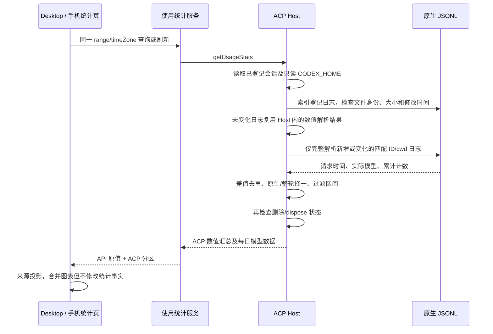

# ACP 应用使用统计

## 产品规则

设置页通过既有 getAppUsageSnapshot/getUsageStats 获取同一 Host 的 API 与 ACP 用量。Codex 的 prompt response 仍不得充当整轮计量，但设置页查询和刷新会回溯已登记 Codex 会话的原生 JSONL，不要求会话重新连接、Agent 启用或安装，不启动进程。不扫描未登记的 Codex 会话、不读取另一 Host 的文件。

使用日志中的 token_count.total_token_usage 连续差值计量每次请求，重复累计通知贡献 0。首个有效累计从 0 起算；累计下降时重建基线，该段不伪造差值；后续连续增长才计入。输出已含 reasoning，缓存属于输入，不重复相加。时间取 token_count 自带时间；模型取该轮 turn_context.model，绝不取 API 默认 GLM 或当前配置模型。未提供模型的已知用量保留为未知模型；无时间的用量只进全部时间，不放入近 7/30 日。无日志、损坏、不匹配或超限仍保留已确认的旧整轮事实，未知轮数如实显示。

原生日志存在可靠报告时，同一 Codex 会话使用原生请求记录；不会与 usageTurns 或 nativeUsage 会话累计再相加。不同 Host 会话指向同一个原生 ID/cwd 时，只汇总一次用量。原生 task_started/turn_context 与 task_complete 给出轮次边界；已计量用户轮次要求有时间可关联、已完成且有可确认用量，不能把部分请求或含未知段的轮次称为整轮已计量。历史缺少消息日期时仍能从原生请求恢复 Token，但不伪造用户消息时间。

Claude 和其它已确认整轮仍按用户消息时间聚合，并提供每日模型用量。来源选择为全部、API、各 ACP；全部来源的趋势和模型饼图必须包含 ACP，图例使用“Agent · 实际模型”与 API 模型区分。单独 ACP 也展示其趋势和模型饼图。API 的活跃度与时长仅在 API 来源展示，不把缺失的 ACP 指标补成 API 的数值。

### 每日模型趋势（issue #87）

- 图例表示所选时间范围内有已确认用量的模型，不表示每个模型当天都被使用。当天缺失或为 0 的模型在趋势投影中为空点，不画零值曲线、普通点或 hover 高亮点；单日正用量仍显示实际点。不跨空日期连接曲线。
- 趋势图列出范围内全部正用量模型，不截掉第七个及之后的模型。图例按钮支持鼠标、键盘和手机切换模型可见性，关闭大用量模型后纵轴仅按剩余模型的真实峰值计算，方便查看小用量。
- 图例显隐仅由图表组件持有，不写入 Host、统计快照或持久化，不触发请求。来源或时间范围切换时恢复全部可见；刷新保持当前选择。tooltip 只显示当日可见的正用量项及其合计，累计摘要和模型饼图保持原统计口径。
- 回归覆盖昨天 GLM 正用量、今天 GLM 为 0 且 Codex 有用量；今天不得出现 GLM 高亮点或 tooltip 项。覆盖亿级 Codex 与万级 GLM、超过六个模型、关闭所有模型后重新打开、切换来源/范围复位；桌面和手机明暗主题执行真实组件 E2E。

```text
同一 Host 的 API/ACP 已确认事实 → 来源/范围投影 → 每日趋势
                                        ↑ 图表组件的本地显隐选择
                                        └ 不写回、不请求、不改变远端事实
Desktop 与手机均只读取原有快照；显隐选择不参与连续流或恢复链路。
```

### 统计页面样式与 Token 活动

- 全部来源、API、每个 ACP（包括没有可确认用量的历史来源）均显示 Token 活动，位置统一在来源摘要之后、趋势图之前；每日、每周、累计三个模式都可切换。
- Token 活动沿用 API 原有的全年展示语义，使用已有 `all` 快照和其中的时区、截止日期，展示最近 52 个自然周；上方时间范围只筛选来源明细、趋势图及模型用量。切换来源时活动图只读投影到对应来源，不新增服务查询或持久化状态。
- API 活动读取原有每日热力图事实；ACP 活动只合计该 Agent 的 `dailyUsage` 中有日期的模型 Token；全部来源按同日相加 API 与各 ACP，不能借用 API 活动填充 ACP。强度按当前来源的可见日期峰值重新计算。无日期用量不能编造日期，缺失每日用量时仍显示空网格并说明活动图仅包含有日期的 Token。
- API 保留真实每日消息轮数提示；ACP 和全部来源没有完整每日轮次事实，提示仅显示 Token，不将缺少轮数或工具次数写成已知 0。未知轮次继续在 ACP 摘要中显示。
- 各来源共用摘要指标布局：数字 `text-ui-lg`、标签 `text-ui-base`、居中、桌面竖分隔线、窄屏纵向排列。来源标题统一放在摘要外；ACP 特有模型和未知说明另放明细卡。
- 活动、趋势、模型图卡片统一 `rounded-xl bg-surface p-4`，标题与内容左边缘对齐；模型 ID 统一等宽字体。来源或范围变化直接显示完整曲线/圆环，不重播绘制动画，避免 100% 圆环暂时缺口和曲线暂时缺段。
- 本次不修改 Host、共享协议、计量或远端恢复语义；旧快照缺少可选 `dailyUsage` 时兼容为空活动，查询失败仍沿用现有错误展示。

隔离 UI E2E 可通过 `ZCODE_USAGE_E2E_ORIGIN` 指定本工作树的 Vite 地址，优先于默认 `http://localhost:5174`。该变量仅用于测试夹具导航，不改变产品连接配置；地址不可用时测试失败，不改连其它服务器。

## 所有者、接口与时序

原生 Agent 日志是原生请求事实来源，ACP Host 是应用会话及统计查询所有者。扩展现有有界异步 reader，读取期间只留数值、时间和模型信息；不向 UI 传原文、路径、凭据，不建立另一累计值写路径，不将历史累计写入 usageTurns。共享 AcpAppUsageAgent 增加可选 dailyUsage；旧客户端/历史快照兼容。AgentManager 公开只读 resolveCodexHome，统计查询不调用 resolveLaunch。



同一 Host 内并发 all/7d 查询共享正在进行的历史读取。ACP 服务持有非持久化、有界的原生数值解析缓存；每次查询和刷新仍重新索引目录并校验文件，不按超时判断新鲜度。仅当 CODEX_HOME、唯一匹配文件、规范化 workspacePath、文件身份、大小、纳秒修改时间及状态变更时间均未变化时复用结果。范围和时区只作用于数值投影，切换范围不重新解析未变化日志。文件追加、截断、覆盖、移动、删除、重复 ID、workspace 路径重定向或 CODEX_HOME 切换后不能返回旧缓存；变化文件完整重新解析，沿用累计重置与截断尾行规则。损坏或不可读文件不缓存失败；读前和读后文件版本不同的结果可以用于本次只读快照，但不进入缓存。

缓存仅包含原有用量、请求时间、模型与轮次边界，不保留原始消息；最多保留 128 份日志且请求记录与轮次边界合计不超过 100,000 项，超限只影响缓存复用，不截断有效统计。未登记的缓存项在下次查询清理。Host dispose 清空缓存，迟到读取不能重新填充；不同 Host 不共享缓存，无 schema 或持久数据迁移。查询不修改会话 revision，不创建/恢复会话，因此不干扰 desktop-continuous 消息流或 web-remote-replayable 快照链路。删除/dispose 后迟到的文件结果不能复活统计项。保留 workspaceIdentity/remoteSessionId 路由，仅 owning Host 执行 IO。读取沿用文件/目录/行大小限额和单文件数值记录限额，截断尾行不参与统计。

## 验收

- API GLM + Codex GPT 同时存在，全部来源/单独来源、7d/30d/all 数值及图例正确，无默认模型归属。
- 未连接、禁用、旧快照会话也能从匹配的原生文件补回历史；重复刷新及重复会话引用不重复计数。
- 重复 token_count、模型切换、跨日、缺日期/模型、累计重置、无效 ID/cwd、截断和限额均有测试。
- Codex 原生与旧 usageTurns 不重复相加；缺少可验证文件时仍保留旧整轮事实。
- 统计读取中删除/关闭 Host，迟到结果不回写或重新出现。
- 同一 Host 连续查询不同范围复用未变化日志；追加和覆盖后立即反映新数值，截断尾行完成后重新读取，不重计累计通知。
- 日志删除、重复 ID、cwd 不匹配、CODEX_HOME 切换及 Host dispose 后旧数值不泄漏；新 Host 独立读取，失败修复后可以重新计量；缓存容量超限时结果仍完整。
- 桌面/手机明暗主题 E2E 验证真实设置页来源切换与图表；typecheck、lint、格式和架构检查执行并报告真实结果。
- 单测验证 API/ACP/全部来源活动隔离、同日相加、多模型合计、无日期/无每日用量、52 周范围与时区、不改写原始快照。
- E2E 遍历全部来源、API、每个 ACP：每种来源都有活动图，三种模式正确切换；ACP 无每日用量仍保留网格，提示不伪造消息轮数；切换 7d/30d/all 不清空全年活动。
- 桌面和 375px 手机明暗主题下检查摘要字号、对齐、分隔线、卡片标题边距、模型字体与无横向溢出；单模型 100% 圆环始终完整。

## 本地验证（2026-10-09）

- Node 24.14.0、pnpm 10.33.2：来源投影和全年活动单测 6/6 通过。隔离 UI E2E 遍历全部来源、API 和 15 个 ACP 来源，覆盖三种活动模式、来源数值隔离、缺少每日用量、范围切换及 1440px/375px 明暗主题；摘要字体/分隔线、图表边距、完整曲线与 100% 圆环检查通过。
- `pnpm typecheck` 通过。首次检查缺少 CLI workflow 包的类型构建产物；执行现有 `pnpm --filter '@zcode/dynamic-workflow*' -r build` 后重新完整检查通过，未修改这些包的源码。
- `pnpm lint` 为 0 错误、72 条既有警告；目标文件格式检查、`git diff --check` 通过；架构检查的 baseline/new 均为 0。
- 变更仅涉及 UI、spec 和测试。Host/Service 仍是统计事实所有者；新增活动图是纯只读投影，不改变查询、写入或 Desktop/手机恢复时序。E2E 使用固定服务快照，没有读取真实会话或验证真实远控连接。
