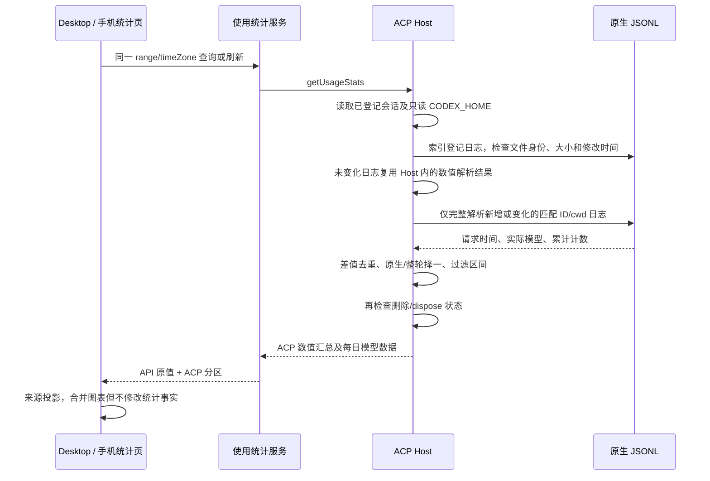

# ACP 应用使用统计

## 产品规则

设置页通过既有 getAppUsageSnapshot/getUsageStats 获取同一 Host 的 API 与 ACP 用量。Codex 的 prompt response 仍不得充当整轮计量，但设置页查询和刷新会回溯已登记 Codex 会话的原生 JSONL，不要求会话重新连接、Agent 启用或安装，不启动进程。不扫描未登记的 Codex 会话、不读取另一 Host 的文件。

使用日志中的 token_count.total_token_usage 连续差值计量每次请求，重复累计通知贡献 0。首个有效累计从 0 起算；累计下降时重建基线，该段不伪造差值；后续连续增长才计入。输出已含 reasoning，缓存属于输入，不重复相加。时间取 token_count 自带时间；模型取该轮 turn_context.model，绝不取 API 默认 GLM 或当前配置模型。未提供模型的已知用量保留为未知模型；无时间的用量只进全部时间，不放入近 7/30 日。无日志、损坏、不匹配或超限仍保留已确认的旧整轮事实，未知轮数如实显示。

原生日志存在可靠报告时，同一 Codex 会话使用原生请求记录；不会与 usageTurns 或 nativeUsage 会话累计再相加。不同 Host 会话指向同一个原生 ID/cwd 时，只汇总一次用量。原生 task_started/turn_context 与 task_complete 给出轮次边界；已计量用户轮次要求有时间可关联、已完成且有可确认用量，不能把部分请求或含未知段的轮次称为整轮已计量。历史缺少消息日期时仍能从原生请求恢复 Token，但不伪造用户消息时间。

Claude 和其它已确认整轮仍按用户消息时间聚合，并提供每日模型用量。来源选择为全部、API、各 ACP；全部来源的趋势和模型饼图必须包含 ACP，图例使用“Agent · 实际模型”与 API 模型区分。单独 ACP 也展示其趋势和模型饼图。API 的活跃度、时长与热力图仅在 API 来源展示，不把缺失的 ACP 指标补成 API 的数值。

## 所有者、接口与时序

原生 Agent 日志是原生请求事实来源，ACP Host 是应用会话及统计查询所有者。扩展现有有界异步 reader，读取期间只留数值、时间和模型信息；不向 UI 传原文、路径、凭据，不建立另一累计值写路径，不将历史累计写入 usageTurns。共享 AcpAppUsageAgent 增加可选 dailyUsage；旧客户端/历史快照兼容。AgentManager 公开只读 resolveCodexHome，统计查询不调用 resolveLaunch。

同一 Host 内并发 all/7d 查询共享正在进行的历史读取。ACP 服务持有非持久化、有界的原生数值解析缓存；每次查询和刷新仍重新索引目录并校验文件，不按超时判断新鲜度。仅当 CODEX_HOME、唯一匹配文件、规范化 workspacePath、文件身份、大小、纳秒修改时间及状态变更时间均未变化时复用结果。范围和时区只作用于数值投影，切换范围不重新解析未变化日志。文件追加、截断、覆盖、移动、删除、重复 ID、workspace 路径重定向或 CODEX_HOME 切换后不能返回旧缓存；变化文件完整重新解析，沿用累计重置与截断尾行规则。损坏或不可读文件不缓存失败；读前和读后文件版本不同的结果可以用于本次只读快照，但不进入缓存。

缓存仅包含原有用量、请求时间、模型与轮次边界，不保留原始消息；最多保留 128 份日志且请求记录与轮次边界合计不超过 100,000 项，超限只影响缓存复用，不截断有效统计。未登记的缓存项在下次查询清理。Host dispose 清空缓存，迟到读取不能重新填充；不同 Host 不共享缓存，无 schema 或持久数据迁移。查询不修改会话 revision，不创建/恢复会话，因此不干扰 desktop-continuous 消息流或 web-remote-replayable 快照链路。删除/dispose 后迟到的文件结果不能复活统计项。保留 workspaceIdentity/remoteSessionId 路由，仅 owning Host 执行 IO。读取沿用文件/目录/行大小限额和单文件数值记录限额，截断尾行不参与统计。

## 验收

- API GLM + Codex GPT 同时存在，全部来源/单独来源、7d/30d/all 数值及图例正确，无默认模型归属。
- 未连接、禁用、旧快照会话也能从匹配的原生文件补回历史；重复刷新及重复会话引用不重复计数。
- 重复 token_count、模型切换、跨日、缺日期/模型、累计重置、无效 ID/cwd、截断和限额均有测试。
- Codex 原生与旧 usageTurns 不重复相加；缺少可验证文件时仍保留旧整轮事实。
- 统计读取中删除/关闭 Host，迟到结果不回写或重新出现。
- 同一 Host 连续查询不同范围复用未变化日志；追加和覆盖后立即反映新数值，截断尾行完成后重新读取，不重计累计通知。
- 日志删除、重复 ID、cwd 不匹配、CODEX_HOME 切换及 Host dispose 后旧数值不泄漏；新 Host 独立读取，失败修复后可以重新计量；缓存容量超限时结果仍完整。
- 桌面/手机明暗主题 E2E 验证真实设置页来源切换与图表；typecheck、lint、格式和架构检查执行并报告真实结果。
