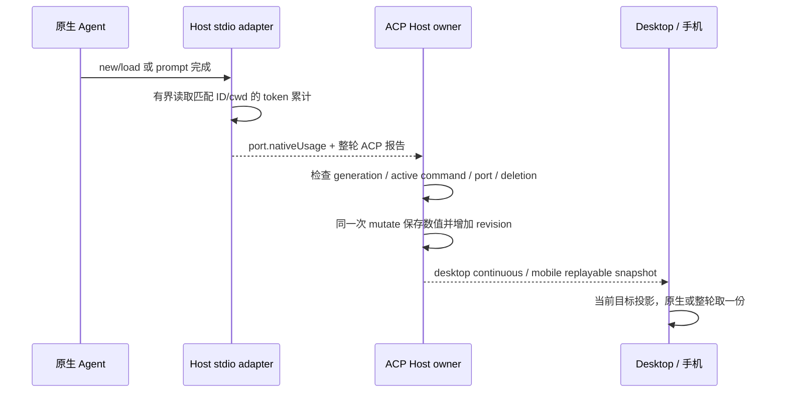

# ACP 上下文与 Token 统计

## 产品规则

上下文容量沿用 ACP `usage_update.used/size`，表示当前模型窗口占用。输入、输出、缓存读取、缓存写入、总量和缓存命中率独立显示，容量未知时仍可查看已知 Token 统计。缓存读取和写入是输入的子集；总量 = 输入 + 输出；命中率 = 缓存读取 / 输入。输入为 0 或缓存读取缺失时命中率未知；真实 0% 必须显示。缺失统计显示 `—`，不能补成 0，也不能推断系统提示词、MCP 或 skills 占比。

优先展示匹配当前原生会话 ID 的原生累计报告（标记“Agent 累计”）。没有原生报告时汇总 Host 已确认的整轮报告（标记“已统计轮次”及轮数），不把历史未测轮次声称为完整会话累计。两种来源互斥，禁止重复相加。旧报告没有缓存字段时仍展示输入/输出，但对应缓存维度未知；只有所有已统计轮次都提供某维度才求和。

## 所有者及接口

ACP Host 是唯一快照所有者。共享 token schema 增加可选 `cacheReadTokens/cacheWriteTokens`；会话增加可选 `nativeUsage: {nativeSessionId, usage}`。字段可选兼容旧快照。原生报告不写入 `usageTurns`，避免将恢复历史量归给当前用户回合、破坏设置页时间区间统计。

Claude ACP 的已确认整轮响应保留缓存字段和模型行；模型汇总缺少任何缓存维度时该维度未知。Codex ACP 的响应只含最后一次请求，仍不计整轮。

Codex stdio adapter 在 new/load 完成及 prompt 完成后，按启动进程的 CODEX_HOME（含 HOME/USERPROFILE、~ 规则）异步读取 sessions 中匹配原生 UUID 的 JSONL。只接受 session_meta.id 与 cwd 同时匹配的文件，只提取 token_count.info.total_token_usage 的最新有效累计值；重复通知不相加，计数重置采用 Agent 当前累计值。缓存写入未报告则未知，不从 reasoning 输出重复计数。读取有目录数/深度/文件大小上限，不读取 archived_sessions、父会话或任意 ID 拼接的路径；异常、未刷盘及不支持格式返回未知。只传递数值，不传递原生消息、路径或凭据。

原生读取失败清空该次连接的报告；已有 Host 快照可保留上一次已确认值直到下一份报告，运行时更新频率为回合完成/重新连接，不使用轮询或延时重试。当前已连接的显式 refresh 不额外扫描文件。

远程文件由远程 owning Host 读取，workspaceIdentity/remoteSessionId 路由沿用已有合同；Renderer 无文件读取、第二份累计状态或额外会话。stop/delete/断开后迟到的结果不得写入；原生 ID 不匹配不得展示。API 对话原有容量和缓存显示保持当前行为。

## 验收

- Claude 已知缓存保留，缺失字段未知；模型汇总不重复主循环。
- Codex 自定义 CODEX_HOME、恢复旧会话累计、多条/重复/重置报告、错误 ID/cwd、截断和损坏文件均有测试；读失败不阻断对话。
- Host 首次建立、恢复和完成回合保存原生报告；重启读取快照，stop/delete 后不接受迟到结果；设置统计不混入历史累计。
- 当前选中 ACP 独立展示统计，切换 Agent/API 不串数据；容量未知仍显示 Token；0% 正确，未知缓存为 `—`。
- 桌面与手机、明暗主题 E2E 验证真实共享输入框/统计浮层；类型、Lint、架构检查实际执行。

设置页的历史请求回溯与来源图表另遵循 [ACP 应用使用统计](./acp-app-usage.md)；会话累计仍不直接充当按日或按轮事实。
