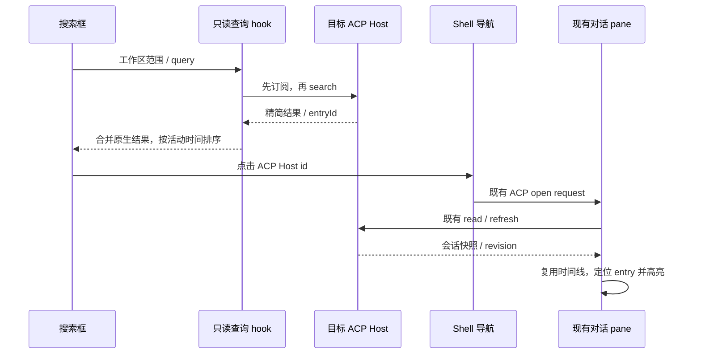

# ACP 会话搜索

## 产品规则

- Command Center 的“全部”和“任务”（含 `#` 前缀）同时搜索当前窗口已打开工作区的原生/API 与 ACP 历史。沿用现有搜索浮层、快捷键、结果样式、展开方式与搜索历史，不新增页面。
- ACP 搜索匹配会话标题、用户消息和助手消息正文，忽略大小写并修剪查询首尾空白。只检索持久化且含已接受用户输入的会话；排除 provisional、superseded、已删除、其它 workspace identity/path 的快照。工具输入、输出、认证及配置不作为正文搜索源。
- 空查询的“最近任务”合并两类会话，按实际最后活动时间降序，排除当前会话。ACP 时间继续复用已接受 entry 时间和冻结的 legacySavedAt；查看、刷新和搜索不改变活动时间。
- ACP 正文命中返回最多五条消息摘要及稳定 entryId；标题命中也能列出结果。结果按会话最后活动时间排序，采用现有数量上限。
- 搜索和最近任务点击原生结果沿用原生导航；点击 ACP 结果复用侧栏的准确 Host id 恢复。搜索本身不创建连接、不认证、不发送提问。点击才使用既有恢复规则；恢复失败仍保留历史正文和错误提示。
- 正文结果在同一个 ConversationTimeline 定位并高亮对应 entry；ACP 对话内查找复用相同查找工具。标题或已变化正文没有命中时正常打开会话，不伪造命中。

## 状态所有者与边界

- IAcpService/目标 Host 是已接受 ACP 会话、entries、revision 和快照的唯一所有者。新增只读 `search` 查询；列表和搜索共用现有 scoped 历史读取，不写原生 tasks-index，不把 ACP id 当 taskId。
- 查询输入与精简结果在 shared ACP 协议中定义严格 schema，结果只包含导航/展示元数据和有上限的文本摘要。无数据迁移、第二份正文索引或独立持久缓存。
- UI hook 使用现有 workspace 服务解析，贯穿 workspaceIdentity 和 remoteSessionId；identity 无法解析的远端不回落本地 Host。一个 Host 查询失败不清空其它 Host 或原生结果；记录无正文/凭据的日志。
- hook 仅在浮层打开且需要会话列表时订阅。先订阅后查询，事件驱动重查；每个目标的请求序号拒绝旧查询回包，cleanup 拒绝旧 Host/旧 query 回包。结果属于只读投影，关闭浮层停止观察。
- Shell 继续拥有会话导航和 ACP pane open request。Command Center 放到同一 Shell 内，直接复用既有原生/ACP 选择处理；App 只持有原有浮层开关、快捷命令与短暂高亮请求。
- 搜索高亮请求明确区分 native taskId 与 ACP sessionId/entryId，并核对工作区身份和选中的会话。只有目标主 pane 消费 ACP 请求，旧请求不能高亮新会话。

Desktop continuous 和 mobile replayable 均查询原有 Host attachment；不改 stream、snapshot 或重连协议。恢复后的 revision 与显示事实仍取同一个 Host，UI 的过期查询不能覆盖新请求。

## 验收与验证

1. Host 测试：标题、非标题的用户/助手正文、大小写、空查询、摘要上限、真实活动排序；排除空草稿、替代/删除会话、工具内容及同路径不同 identity；查询不启动适配器，不修改快照/revision。
2. UI 纯逻辑测试：两类结果合并、去重、排序、数量限制；ACP entryId 关联共享查找索引；原生 snippet 语义不变。
3. Desktop E2E：以现有已接受 ACP 历史执行标题及助手独有正文搜索，点击后准确恢复 Agent 和会话，只有一个 composer，正文高亮定位可用；空查询显示最近 ACP；原生查询和文件/命令范围保留。
4. 远端相同路径但不同 identity、延迟旧查询和删除事件使用隔离数据验证；窄屏采用同一个浮层且无横向溢出。手机真实 attachment 可用时验证 replay 恢复；环境不可用时明确报告未做真机验证。
5. 执行实际可用的相关测试、E2E、pnpm typecheck、pnpm lint 和修改后架构检查，报告既有失败与新失败。
