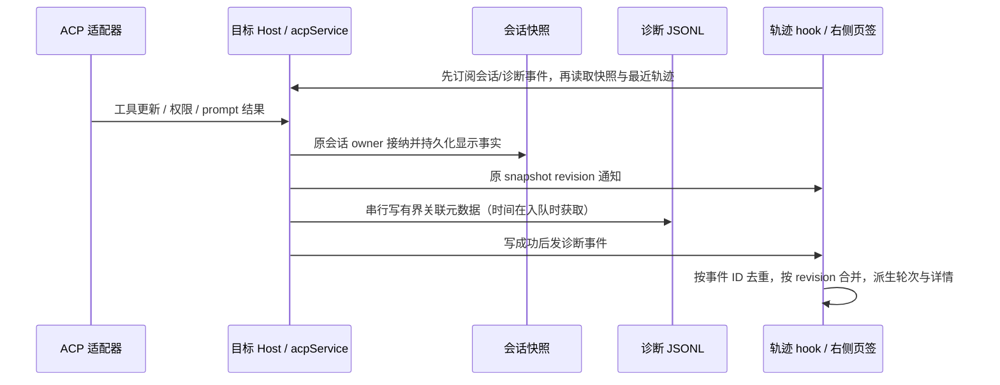

# ACP 调用轨迹完善

## 产品规则

- 复用会话菜单的“查看调用轨迹”和现有右侧页签。按已接受的提问分轮，显示真实提问、回复、工具、授权事件、结束原因、耗时及适配器已上报的 Token。支持正文搜索、失败轮筛选、折叠和手动刷新；打开页签时自动接收后续更新。
- 工具参数、结果及 diff 文本从 ACP `tool_call` / `tool_call_update` 或 `session/request_permission.toolCall` 获取并进入既有 Host 会话快照，每个参数/结果/输出详情有界，超限显式说明截断。局部更新保留此前字段，明确空结果可以清除旧内容。没有上报参数、结果或起始状态时显示未知；单独收到权限中的工具信息也不能推断工具已经执行，不捏造数据或执行耗时。
- 诊断 JSONL 继续仅保存事实元数据：唯一事件 ID、Host 接收时间、用户/工具行索引、状态、Host 权限请求 ID、权限决策类型和 ACP stop reason。提问、回复、参数、结果、错误正文、路径、环境和凭据不能进入诊断日志；详情只从原会话快照读取。每轮保存其接纳时的选项和本轮错误，后续切换模型/成功不能改写旧轮事实。
- 旧会话没有关联信息的事件独立显示为旧版事件；可以展示已保存对话/工具，但不能根据时间猜测事件属于哪一轮，不能反推底层模型调用。ACP 未暴露的内部模型 HTTP 请求/响应仍显示能力边界。
- 达到日志上限后轮转保留最近记录并记录截断事实，不能永久停止记录。读取最多最近 500 个事件，界面提示历史事件可能不完整；会话正文持久化不受轮转影响。

## 所有者、接口与事件顺序

- Host 是唯一事实所有者；UI hook 只有只读投影，不发 `create` / `refresh` / `prompt`，不连接或认证智能体。
- `IAcpService.getExecutionTrace` 保持数组返回及旧元数据兼容；新增 scope-aware `onDynamicExecutionTraceChanged`，协议类型和 runtime schema 从 shared 公开入口导出。
- identity key 使用 `workspaceIdentity?.trim() || workspacePath`，文件操作用真实 path。事件按目标 workspace 隔离；远端由原 workspace 服务连接路由，断连不回落本地。
- Desktop 订阅连续流；手机远控重连重新订阅并读最新快照/最近日志恢复，不把连续诊断通知当作永久回放。旧请求、旧连接 generation、旧轮完成、删除后的写入均不能覆盖当前投影或复活文件。

## 验收

1. 两轮同时使用同名工具 ID，事件精确关联各自用户/工具行；更新只含 status 时此前参数与结果保留。接纳幂等命令只产生一次轨迹，旧连接更新被拒绝。
2. fake stdio Agent 发送 rawInput/rawOutput、diff、空结果和 stop reason，验证协议映射及有界快照；JSONL 不含任何正文或测试凭据。
3. 授权请求/允许/拒绝、异常中断、用户停止都按真实顺序显示；旧失败轮的错误不被下一轮清除。终态不能被迟到更新改写。
4. 重启恢复日志、轮转后继续记录最近事件；删除等待 pending writes 并删除日志。错误 scope 不能读取、订阅到其它 workspace 的轨迹。
5. E2E 在宽屏浅色和窄屏深色中打开真实轨迹组件，展开工具参数/结果、搜索及筛选，接收实时事件/快照，模拟初始读取迟到、切换会话、断连/重连及关闭；没有跨会话闪现或额外 Agent 命令。
6. 实际执行相关 service / mapping / projection 单测、交互 E2E、typecheck、lint 与架构检查，报告真实结果。

## 本轮验证（2026-10-08）

- 范围为 shared 协议、services 的 ACP owner 和 UI 轨迹投影；Host 仍是唯一事实所有者，事件顺序与接收时间、snapshot revision、event ID 的合并规则见上图。20 个文件净增加约 2060 行，包含测试与说明；未纳入无关的 scheduler map 文件。
- 服务、stdio、工具映射、工作流及用量回归 50 项通过；轨迹投影 3 项通过。真实组件 E2E 通过，覆盖宽屏浅色、窄屏深色、搜索/筛选/折叠、实时更新与去重、迟到读取、删除、远程重连及订阅清理。
- `pnpm typecheck`、`pnpm lint`、`pnpm architecture:check --changed`、改动文件格式检查和 `git diff --check` 均通过。Lint 为 0 错误、72 条已有警告；架构为基线 0、新增 0。功能索引 YAML、节点唯一性、边的端点/等级和 ACP 源码种子已验证。
- E2E 使用模拟 Host，stdio 测试使用本地假适配器，未发送真实模型请求。旧会话未保存的参数、结果、选项和关联事件无法回填；ACP 未暴露的模型 HTTP 调用无法还原。
