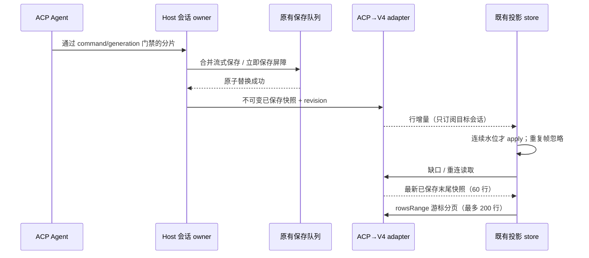

# ACP 复用 V4 对话投影

## 产品规则与边界

长历史不再随每个 ACP 分片发送到 Renderer。侧栏、搜索失效通知与完成通知使用 `listSummaries/onDynamicSessionSummaryChanged`；摘要只保留最近用户行的有界展示信息和活动时间。正文仅由选中会话订阅。显式导出、执行轨迹和内部任务仍可读取完整历史，旧内部 `list/read/onDynamicSessionChanged` 契约保留。

Host `IAcpService` 仍是会话、接纳队列、revision、落盘和运行代际的唯一所有者。新的 adapter 只将已保存事实投影成 V4 行，不改变 admission、owner/lease、workspaceIdentity/path、remoteSessionId 或 stale run 门禁。显示行映射移至 shared 纯函数，Host 与旧 UI 展示共用同一规则，行号由原始 entry 下标决定。

复用 shared V4 的 snapshot 工厂、row.delta/row.upserted/row.appended、coalesce、wire encoder/assembler 与协议预算；同一 Host/workspace/会话的多个分屏复用 SessionDataLayer 租约与单条正文物理订阅，最后一个视图离开才释放。UI 复用 ConversationProjectionStore 的缺口恢复、幂等应用、历史分页和旧请求守卫。该 store 的传输契约缩小为只读投影端口，原 API transport 继续实现完整接口。ACP 命令仍走原 IAcpService，不能调用 API command 入口。

## 时序及恢复

ACP revision 可因原有写入合并跳号，V4 `fromSeq/toSeq` 表示前后已保存水位，不要求每个 token 一个连续整数。logEpoch 由 Host 生命周期和会话 id 派生。订阅先建立通知监听再读取 initial；复用 ACK activation barrier 暂存早到帧，先应用 initial 后处理在线帧。旧目标、旧 subscription、旧水位不能污染新选择。

桌面 continuous 直接接收已保存增量；手机 replayable attachment 恢复后读取同一 owner 的最新末尾快照。ACP 文件不是 API 的事件 journal，本版本不伪造 resume：缺口统一走既有 store 的 snapshot recovery，用户可重新分页读取历史。保留原始诊断关联，不把 initial/recovery 当实时分片。删除和 Host 关闭释放派生状态及观察，不能重建会话文件。

历史分页保持稳定 rowId/turnId 和实际总数；首屏按需补齐缺失的首轮 header。轮次导航、分享和搜索跳转通过既有分页方法补全目录，不能把摘要中的局部 entry 下标用作全局行号。完整命令 ACK 仍按原 admission 验证，通过后仅将摘要保留在 UI；不能用流式通知代替 durable ACK。

## 验收

1. 3440 条以上、约 6 MiB 合成历史：列表及普通流式通知不包含历史正文；追加单字产生 row.delta，wire 大小不随旧历史增长。初始最多 60 行，分页最多 200 行。
2. user/thought/tool/plan/compaction、失败、停止及终态的投影与原 mapper 一致；保存失败无成功通知，已保存终态包含全部分片。旧内部完整快照测试继续通过。
3. 早于 read ACK 的通知、重复/缺口、snapshot recovery、跨 workspace identity、切换选中会话、分页期间新分片、删除/关闭均不重复、不倒退、不串字。
4. 真正的 hook + V4 store + timeline 在 1280px/375px 验证流式、分页与恢复；不得用计时器掩盖同步问题。
5. 执行相关服务/UI 测试、E2E、typecheck、lint 和 changed architecture；本地合成测试不代表安装版或真实远程手机问题已修复。

## 本地验证（2026-10-12）

- Node 24.14.0。3440 条合成历史的首屏为 60 行；正文追加复用 `row.delta`。真实 Channel RPC 测试验证摘要及选中正文通知小于 15 KiB，且不含历史正文；分页、重复帧、早到通知、缺口、同 revision 内容失败恢复、跨 identity 和共享分屏订阅均有回归。
- UI/传输相关单测 47/47 通过。Host 相关测试 63/64 通过；唯一失败是既有 `acpService` 附件测试漏掉 `endedAt` 预期。用改动前 HEAD 的 Host 实现复测同一测试，仍失败；未将其计为通过。
- 浏览器流式时间线、草稿复用、归档选择、轮次导航/附件、完成通知、状态面板、执行轨迹共 7 个 E2E 脚本通过。覆盖桌面和窄屏、明暗主题、假 Host 的远端重连与旧请求失效；流式测试的 Host 数据来自实际保存及 V4 编码，截图已检查。其余已有 fake Host fixture 通过仅测试使用的 adapter 更新新契约，生产代码没有旧全文流 fallback。
- 根目录 `pnpm typecheck` 通过；`pnpm lint` 为 0 错误、74 项已有警告；`pnpm architecture:check --changed` 为当前/基线/新增 0。修改模块为 shared、services、ui、zcode-cli，均使用公开入口；Host owner、写入顺序及原 admission 保持不变。
- 额外运行 CLI bootstrap 的单包 `typecheck` 未完成：本地缺失 `@zcode/contracts`、`@zcode/core`、`@zcode/adapters` 等内部包的构建产物，产生模块解析和连带类型错误。该结果与根目录类型检查分开报告。
- 未打包、安装、提交、推送或合并。仍需更新运行版本后结合实际会话日志确认用户遇到的延迟改善；本地合成验证不证明上游生成时间或真实手机网络延迟消失。
