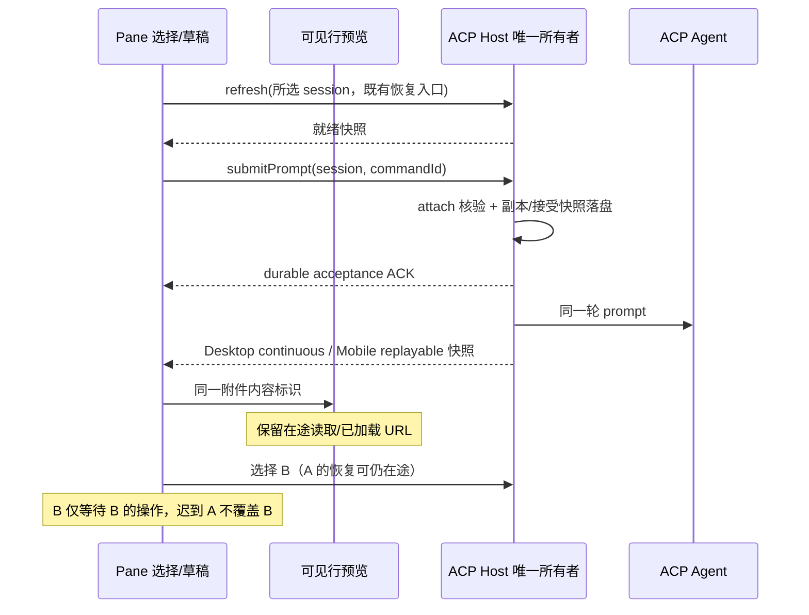

# ACP 切换、状态更新与发送等待

## 产品规则、所有者及边界

- ACP Host 仍是连接、已接受输入、队列、附件副本与 revision 的唯一所有者；UI 仅拥有选择意图、尚未接受的草稿、操作等待及可见行的临时预览 URL。
- 可见消息的图片/视频预取按附件的有效 ref、MIME、原序号及 workspace/session/reader/row target 标识生命周期。连续事件或重连快照即使克隆了附件数组，只要这些输入相同，不取消读取、不销毁 URL、不重新读取。附件目标或读取 Host 改变、行卸载时仍取消并释放；不新增跨会话内容缓存。
- 同一 Agent 的旧会话恢复/配置/停止操作不得阻塞新选中的会话。等待状态绑定完整 workspace target、草稿 epoch、Agent 和会话 id；草稿连接等待仅作用于无选择的对应草稿。旧响应仍需经过既有 request/revision/selection 守卫。
- 已就绪会话发送直接调用 `submitPrompt`，不再串行调用重复 `refresh`。Host 的 admission 仍核验连接、权限、能力、附件及幂等键，失败保留草稿；确认丢失沿用同 commandId 的 read 对账。不能提前把 UI 就绪当作 Host 接受。
- 不改变 owner/lease 或跨 Host 路由，不缩短超时来掩盖同步问题，不改主智能体或委派规则。

## 验收

- 真实 SessionPane/图片组件 + synthetic Host：同一可见行生命周期内的 idle/running 连续克隆快照保持图片 URL 和读取次数（当前轮在 live tail/虚拟历史之间移动时沿用原重挂载规则）；新增或替换 ref 读取新内容，切换会话不会显示旧图片。1280/375px 都覆盖。
- 真实 useAcpConversation：A 恢复挂起时选择同 Agent 的 B，B 就绪后可发送，迟到 A 不影响 B；idle/running 输入都只经过 submitPrompt，不产生发送前 refresh。错误与旧响应隔离仍成立。
- 运行现有图片/队列/草稿/归档回归，以及 typecheck、lint、changed architecture 和改动格式检查。日志证据与 synthetic 验证不能表述为已安装应用的性能修复。

## 本地验证（2026-10-09）

- 当天运行日志中 `acp.readAttachment` 37,216 次，最长 8,714.3 ms；`acp.submitPrompt` 67 次，中位 57.0 ms、最长 430.6 ms；`acp.refresh` 最长 6,290.5 ms。这些是服务端 RPC 耗时，不包含排队、Renderer 消费及 Agent 请求时间，不能证明每次半分钟卡顿都来自同一原因。保存的 Agent 事件另有 12 条 `Reconnecting... 1/5`，属于 Agent 重连事实。
- 同一测试用例通过临时 baseline 模块验证旧源码：A 恢复未完成时 B 在 3 秒检查内仍不可用；4 次克隆快照新增 8 次图片读取。当前源码中 B 不等待 A，克隆快照既不增加已加载图片读取，也不取消尚未返回的图片读取。
- Node 24.14.0：UI 读取/行投影/admission 19 项与 Host 会话/队列 48 项共 67 项通过。5 组 E2E 通过：会话等待隔离与发送、图片/时间轴、草稿复用、归档、消息队列；覆盖 1280/375px、附件替换及拒绝重试。图片/队列/时间轴沿用真实组件与 synthetic Host，无真实模型请求。
- 动态工作流依赖构建后根 `pnpm typecheck` 通过；`pnpm lint` 0 errors、72 warnings；架构 current/baseline/new 均为 0；改动格式与 `git diff --check` 通过。首轮检查受缺失依赖产物影响，不计为通过。
- 状态所有者和协议不变，源码仅修改 ui 模块，净增 29 行。未构建或替换已安装应用，未提交、推送；真实使用的端到端卡顿需新版运行验证。
