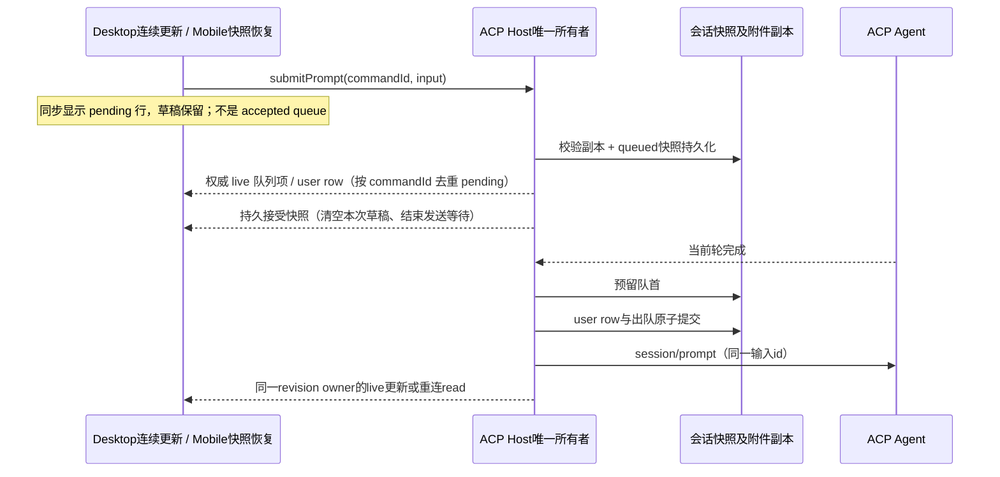

# ACP 用户消息队列

## 产品规则

- ACP 运行中仍可从现有 composer 提交下一条消息；Host 接受排队输入后立即清空本次草稿，不等待 Agent 完成。ACP 使用顺序 `session/prompt`，不声称支持运行中 guide/steer。
- 空闲且无队列时沿用普通 prompt；运行中或已有队列时新输入追加队尾，不能越过已暂停的旧项。不同 Agent、Host、workspace identity、路径及 session 的队列互不借用。
- 运行中或已有队列时，提交开始立即在队列面板显示正文摘要与“正在添加”状态，不等待 Host 校验、复制附件或落盘。该行只是当前 pane 的 pending overlay，不计入已接受数量，不允许编辑、删除、排序、立即发送或恢复。
- Host 的同 commandId 队列项、user row 或删除凭证出现后，pending 行立即让位于权威投影；ACK 返回后结束 pending。失败移除 pending 行、保留草稿和原幂等键。等待期间的新输入、其他分屏、切换 Agent/workspace/session 不被旧回包影响；没有 timer、提前成功确认或自动重放。
- 复用现有队列面板，支持删除、拖动排序、直接编辑排队正文、立即发送和恢复。ACP 编辑在对话框中保存正文，保留附件及工作区引用；不会把远端附件转换为本地草稿。正在提升的项不可修改。
- 正常完成后在同一连接空闲时按 FIFO 自动发送。停止、Agent 错误/主动取消/拒绝/限额、进程断开及 Host 重启暂停剩余队列；恢复是显式操作，busy 时只武装自动发送。立即发送取消当前轮并等待旧连接关闭，再发送指定项；其他项保持此前的暂停/自动状态。
- 图片和普通附件在排队 admission 前校验并复制到已有 attachment store；快照仅保存 refs、名称、MIME、大小。工作区文件沿用资源引用，执行时重新验证。能力/IO 校验失败不入队、不清空草稿。排队最多 100 项。

## 所有者、接口与持久化

- `IAcpService.submitPrompt` 与 `prompt` 共用同一 Host admission 路径、commandId 幂等键与执行任务。`submitPrompt` 在 user row 或队列项成功持久化后返回严格校验的 `AcpSession`，不等待 Agent 整轮结束；`prompt` 保留整轮完成语义供工作任务、委派及内部通知使用。
- Composer 以 `submitPrompt` 返回的匹配会话/commandId 快照为接受凭证，实时事件只更新投影。通知丢失时也立即结束发送等待、清理本次冻结的草稿和附件；之后输入的内容、其它分屏及其它 workspace 不被清理。准备中重复提交复用同一接受 Promise；停止、移除、进程退出和 Host 关闭结束尚未接受的等待。
- 接受前校验或落盘失败保留草稿；接受后 Agent 的错误属于当前轮。接受 ACK 丢失时读取同一 Host 权威快照对账，结果未知保留草稿与原 commandId，不自动重放。旧 Host 缺少 `submitPrompt` 时提示升级并保留草稿，不回退到等待整轮的旧接口。

- `createAcpService` 是 accepted queue、dispatch reservation、revision 和取消栅栏的唯一 Host owner。每 session 串行短 admission/队列操作；长 Agent prompt 不持锁。Renderer 仅持编辑表单/未提交草稿，读取 `AcpSession.queue`。
- `useAcpConversation` 只拥有发送中的临时展示描述，按 Host attachment、workspace identity/path、Agent、session 隔离；它不修改 `AcpSession.queue`。共享队列面板把 pending 状态放在同一个有限高度列表中。输入框仍在持久接受确认后清理。
- shared 新增有默认空队列的 ACP schema；旧 JSON 和旧远端快照可以读取。`IAcpService.submitPrompt` 是 Composer 提交入口，与内部 `prompt` 共用唯一 admission；commandId 同时用于排队和 user entry 幂等。
- 同一 Host RPC 新增 delete/edit/reorder/sendQueuedNow/setQueueAutoDrain 接口，严格解析参数，并核验 workspace identity/path/session。删除和编辑失败不得伪造成功。reserved 项保持可见直到已发送 user row 与出队在同一次快照提交中落盘。
- 删除保留 commandId 接受凭证，避免原 prompt 的迟到重试重新创建已删除项；重复删除可安全重试。
- 在重启恢复时，剩余项重置 queued、autoDrain=false；已落盘 user row 不自动重发，即使进程在发送边界崩溃。断开的旧 generation、迟到 stop/回复不得覆盖新轮或重新消费输入。
- 队列附件在删除时清理、发送时转交历史 user row，删除会话清理全部副本。通知/委派结果不得越过用户队列；内部通知不是另一条用户队列。

## 验收

- fake ACP Host 测试 running 入队、FIFO、并发提交、commandId 重试、预留期间不能编辑、附件不可变及磁盘失败回滚。
- stop/cancel、error/exit、移除、旧结果、Host 重启、busy 恢复、立即发送、排序、删除和编辑均不重复执行、不丢掉剩余项；跨 workspace/session 的请求拒绝。
- admission 测试同时识别排队快照和 user row；丢失全部实时通知且 Agent 未完成时接受确认仍返回，旧 prompt 仍等待整轮；ACK 丢失通过 read 对账，不用 timer 推测接受。覆盖准备期间并发相同 commandId、落盘失败、取消/移除/退出/关闭与迟到错误。
- 真实 RPC + composer 验证接受通知丢失仍释放发送按钮；同 Agent 双分屏、Desktop continuous 与 Mobile reconnect read 均不重复执行，不串清草稿。
- E2E 使用真实 composer/queue panel 与 fake Host，在 1280/375px 提交 running 输入、编辑/删除/立即发送/恢复及重连快照，不调用真实 Agent。
- E2E 用手动释放的 admission Promise 模拟几秒无 ACK：释放前 pending 正文与状态可见、Host 队列仍为空、草稿保留且无操作按钮；覆盖失败回滚、实时接受先于 ACK、不丢新输入、无通知 ACK、双分屏切换与 continuous/replayable，在 1280/375px 验证。
- 执行相关 Node 测试、E2E、根 typecheck/lint、changed architecture 与改动文件格式检查；报告实际结果。

## 本地验证（2026-10-08）

- Node 24.14.0。相关 Host/UI/附件/权限/插件/工作流/委派及侧栏测试 71 项通过；追加关闭期间复制用例后，队列与附件生命周期 20 项通过，共 72 个独立测试。
- `acpMessageQueue.e2e.mjs` 在真实 SessionPane/composer/shared queue panel 上使用假 Host，验证 running 入队及草稿清空、编辑、删除、拖动排序、立即发送、停止/恢复和重连快照，在 1280px/375px 和亮/暗主题通过。不连接真实 Agent。
- 根 typecheck 通过；Lint 0 errors、72 个存量 warnings；改动文件格式检查及 `git diff --check` 通过。架构 current/baseline/new 均为 0。
- 修改沿用 shared/services/ui 模块，源码净增 699 行。Host 仍是唯一队列/admission owner，附件 IO 属于既有 store，桌面连续事件和手机重连 read 使用同一持久 revision，无 Renderer 接受队列或新 runtime。
- 验证的是本地源码与隔离 fixture，未重新打包/替换已安装应用。

## 发送接受确认验证（2026-10-09）

- Node 24.14.0、pnpm 10.33.2。相关 Host/UI/附件/工作任务/委派/工作流/用量回归共 97 项通过，包括真实 RPC 无通知接受、整轮完成兼容、准备中重复 commandId、落盘失败、诊断失败、接受后模型错误及停止/移除/退出/关闭生命周期。
- 两组真实 composer E2E 通过：队列操作与重连、双分屏真实 RPC 无接受通知、迟到 ACK 保留新输入、continuous/replayable attachment 场景及 1280/375px 亮暗主题。Synthetic Host 不调用真实 Agent。
- 根 typecheck 通过；Lint 0 errors、72 个存量 warnings；changed architecture current/baseline/new 均为 0；改动格式及 `git diff --check` 通过。功能图 YAML 解析、54 个唯一节点、89 条关系端点及 ACP seed 路径验证通过。
- 隔离生产 Host/Renderer 构建通过，产物包含 `submitPrompt` 与升级提示；存在构建 chunk size/plugin timing 提示。未打包、替换已安装应用、提交或推送。
- GitHub 连接失败导致 freshness fetch 未完成；cached-ref freshness 相对 origin/main ahead 17 / behind 0，不声称实时远端同步。

## 添加队列即时反馈验证（2026-10-09）

- 临时摘要复用 `useAcpConversation` 的发送状态，仅属于 UI；Host accepted queue、commandId 接受边界与草稿清理时机不变。抽出共享行组件，队列面板和行组件分别保持在 400 行以内，源码净增 89 行，改动模块为 ui。
- 14 项 Node 单测通过。真实 composer 的手动 admission 栅栏 E2E 在 1280/375px 的 1 秒断言窗口内显示 pending，而 Host 尚未接受；验证失败保留原草稿/commandId、live-before-ACK 去重、无通知 ACK 和等待期间的新输入。验证的是即时反馈，不声称 Host 持久接受耗时缩短。
- 3 组 E2E 通过：ACP 队列操作、分屏/continuous/replayable 与长列表 pending 可见性、API 共享队列操作反馈；亮暗主题截图留在隔离临时目录。synthetic Host 不调用真实 Agent，不访问用户历史。
- Node 24.14.0、pnpm 10.33.2。首次 typecheck 因未生成 dynamic-workflow 依赖产物失败，执行两个包现有 build 后根 typecheck 通过。Lint 0 errors、72 个现有 warnings；changed architecture current/baseline/new 均为 0，改动格式与 diff 检查通过。
- 未打包、替换已安装应用、提交或推送。
