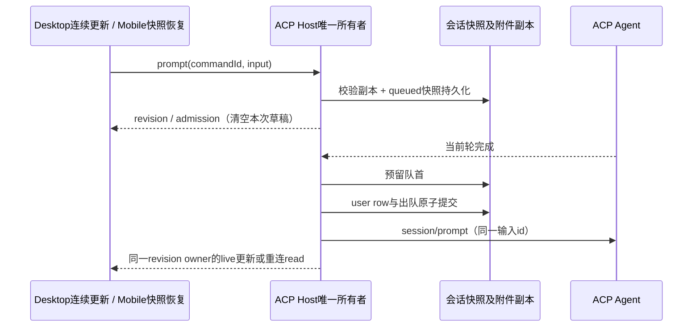

# ACP 用户消息队列

## 产品规则

- ACP 运行中仍可从现有 composer 提交下一条消息；Host 接受排队输入后立即清空本次草稿，不等待 Agent 完成。ACP 使用顺序 `session/prompt`，不声称支持运行中 guide/steer。
- 空闲且无队列时沿用普通 prompt；运行中或已有队列时新输入追加队尾，不能越过已暂停的旧项。不同 Agent、Host、workspace identity、路径及 session 的队列互不借用。
- 复用现有队列面板，支持删除、拖动排序、直接编辑排队正文、立即发送和恢复。ACP 编辑在对话框中保存正文，保留附件及工作区引用；不会把远端附件转换为本地草稿。正在提升的项不可修改。
- 正常完成后在同一连接空闲时按 FIFO 自动发送。停止、Agent 错误/主动取消/拒绝/限额、进程断开及 Host 重启暂停剩余队列；恢复是显式操作，busy 时只武装自动发送。立即发送取消当前轮并等待旧连接关闭，再发送指定项；其他项保持此前的暂停/自动状态。
- 图片和普通附件在排队 admission 前校验并复制到已有 attachment store；快照仅保存 refs、名称、MIME、大小。工作区文件沿用资源引用，执行时重新验证。能力/IO 校验失败不入队、不清空草稿。排队最多 100 项。

## 所有者、接口与持久化

- `createAcpService` 是 accepted queue、dispatch reservation、revision 和取消栅栏的唯一 Host owner。每 session 串行短 admission/队列操作；长 Agent prompt 不持锁。Renderer 仅持编辑表单/未提交草稿，读取 `AcpSession.queue`。
- shared 新增有默认空队列的 ACP schema；旧 JSON 和旧远端快照可以读取。`IAcpService.prompt` 是唯一用户提交入口，commandId 同时用于排队和 user entry 幂等。
- 同一 Host RPC 新增 delete/edit/reorder/sendQueuedNow/setQueueAutoDrain 接口，严格解析参数，并核验 workspace identity/path/session。删除和编辑失败不得伪造成功。reserved 项保持可见直到已发送 user row 与出队在同一次快照提交中落盘。
- 删除保留 commandId 接受凭证，避免原 prompt 的迟到重试重新创建已删除项；重复删除可安全重试。
- 在重启恢复时，剩余项重置 queued、autoDrain=false；已落盘 user row 不自动重发，即使进程在发送边界崩溃。断开的旧 generation、迟到 stop/回复不得覆盖新轮或重新消费输入。
- 队列附件在删除时清理、发送时转交历史 user row，删除会话清理全部副本。通知/委派结果不得越过用户队列；内部通知不是另一条用户队列。

## 验收

- fake ACP Host 测试 running 入队、FIFO、并发提交、commandId 重试、预留期间不能编辑、附件不可变及磁盘失败回滚。
- stop/cancel、error/exit、移除、旧结果、Host 重启、busy 恢复、立即发送、排序、删除和编辑均不重复执行、不丢掉剩余项；跨 workspace/session 的请求拒绝。
- admission 测试同时识别排队快照和 user row；事件/ACK 丢失通过 read 对账，不用 timer 推测接受。
- E2E 使用真实 composer/queue panel 与 fake Host，在 1280/375px 提交 running 输入、编辑/删除/立即发送/恢复及重连快照，不调用真实 Agent。
- 执行相关 Node 测试、E2E、根 typecheck/lint、changed architecture 与改动文件格式检查；报告实际结果。

## 本地验证（2026-10-08）

- Node 24.14.0。相关 Host/UI/附件/权限/插件/工作流/委派及侧栏测试 71 项通过；追加关闭期间复制用例后，队列与附件生命周期 20 项通过，共 72 个独立测试。
- `acpMessageQueue.e2e.mjs` 在真实 SessionPane/composer/shared queue panel 上使用假 Host，验证 running 入队及草稿清空、编辑、删除、拖动排序、立即发送、停止/恢复和重连快照，在 1280px/375px 和亮/暗主题通过。不连接真实 Agent。
- 根 typecheck 通过；Lint 0 errors、72 个存量 warnings；改动文件格式检查及 `git diff --check` 通过。架构 current/baseline/new 均为 0。
- 修改沿用 shared/services/ui 模块，源码净增 699 行。Host 仍是唯一队列/admission owner，附件 IO 属于既有 store，桌面连续事件和手机重连 read 使用同一持久 revision，无 Renderer 接受队列或新 runtime。
- 验证的是本地源码与隔离 fixture，未重新打包/替换已安装应用。
