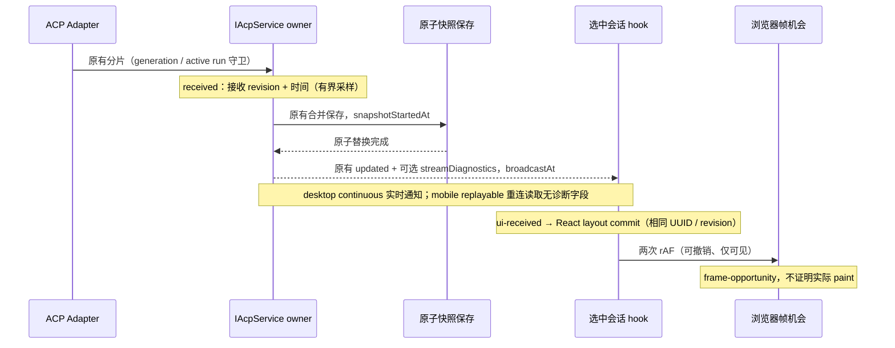

# ACP 输出停顿取证（issue #88）

## 规则与所有者

- 本次增加观察记录，不宣称修复已观察到的 Renderer 停顿。Host 仍唯一持有正文、revision、admission、owner/lease 与持久化顺序；采集器只保留可丢弃的时间元数据，不保存或补发正文。
- Host 接纳正文、思考、压缩摘要分片时观察接收时间、revision、分片字符数、类型和 entry 序号；不扫描/序列化正文。最多保留 64 个会话各自的一份最新元数据，删除/关闭清理，无额外计时器。
- 新段首片、相邻分片间隔至少 1000 ms、以及持续输出每隔至少 1000 ms 采样接收/广播。广播在原子替换成功之后、通知之前观察；记录快照开始和广播时间。采样的 updated 通知携带可选 streamDiagnostics，包含该快照覆盖的最新接收时间/revision；合并时 receivedRevision 可小于快照 revision。用随机 Host UUID + 快照 revision 关联通知，receivedRevision 关联接收。不要求每个 token 都有样本。
- 元数据不写入 AcpSession、磁盘快照或 list/get。旧 Host 没有字段时继续工作；新字段有共享协议运行时 schema。重连 list/replay 不伪造 live 流时延；旧 revision、旧目标、删除后和未选中会话不产生 UI 观察。
- Renderer 在原有 hook 接纳选中会话通知时记录 ui-received；选中快照的 React layout commit 记录 ui-commit；仅可见页面安排两次 requestAnimationFrame 后记录 frame-opportunity。这表示浏览器获得提交后的帧机会，不证明像素已绘制。切会话/Host、新 revision、卸载、后台时撤销或跳过旧帧回调。
- 时间戳为观察时的壁钟，日志写盘可能更晚。UI 本地接收至 commit/frame 的耗时与 Host 本地接收至 snapshot/broadcast 的耗时分开记录；跨机器时钟差不能当网络耗时。
- 复用既有 [diagnostics] 异步日志入口及 14 天保留策略；每个 Host 或 Renderer 采集器最多 240 行/分钟，包含 suppressed 计数。sink 失败只丢诊断，不改变原成功/异常、保存屏障、事件顺序和状态。
- 所有记录白名单化，只允许随机 UUID、静态阶段/分片类型和数值；不输出 messageId、commandId、workspace identity/path、remoteSessionId、正文、工具参数、URL 或凭据。

## 验收

1. 首字、持续输出、工具交错、完成、合并快照的接收/广播记录能按 UUID/revision 关联；磁盘无 streamDiagnostics，旧通知兼容。
2. 真实 ACP hook + timeline 在桌面/手机宽度观察首字、后续和终态，接收/commit/frame 记录可关联；回放不重复文字、不伪造 live 时延。
3. 新 revision/切会话/切目标/卸载/后台时旧帧不误记；sink 抛错不阻断正文和终态。
4. 突发不会逐 token 落日志，64 槽位和 240 行限频真实生效；记录不含合成私密正文、路径、URL、工具参数或凭据。
5. 执行采集器/服务测试、交互 E2E、pnpm typecheck、pnpm lint 与 changed architecture。安装版未替换时明确说明，现场闭环需要包含本次改动的构建。

## 验证与使用（2026-10-12）

- Node 24.14.0 / pnpm 10.33.2；RPC/Host/stdio 28 项、UI 投影/观察器/生产诊断 22 项测试通过。512 个单字突发仍合并为一次完整快照广播；新测试覆盖限频、64 槽位、旧终态、新 revision、后台/owner 切换、sink 失败及历史不含元数据。
- 真实 Host 保存的合成通知进入真实 useAcpConversation 与时间轴，在 1280/375px 验证首字/持续/终态的接收、commit、帧机会关联，以及旧通知/回放和日志 sink 失败；现有 performanceDiagnostics E2E 同样通过。截图已检查，无横向溢出；未建立真实手机远控连接，也未请求真实模型。
- pnpm typecheck 通过；pnpm lint 为 0 错误、74 条现有警告；changed architecture 当前/基线/新增违规均为 0；改动文件格式和 whitespace 检查通过。涉及 rpc/shared/services/ui 四个模块，14 个文件，净增 905 行（源码 454 行，其余为 spec/测试）；业务状态所有者和原保存顺序保持原边界。
- 使用包含本次源码的构建复现后，在默认 `~/.zcode/v2/logs/YYYY-MM-DD.diagnostics.log` 中查 `acp-host-stream` 和 `renderer-acp-stream`，按 sessionId/revision 关联。receivedRevision 可能小于快照 revision；广播记录携带最新分片接收时间，即使合并掉的接收 revision 没有单独日志，仍可比较本地接收到快照开始/广播的区间。结合 renderer-loop 的长任务/事件循环窗口继续取证，不由缺失或被限频的样本推断根因。
- 未构建、替换或重启已安装应用；这次交付是诊断记录，不是现场卡顿修复证明。
