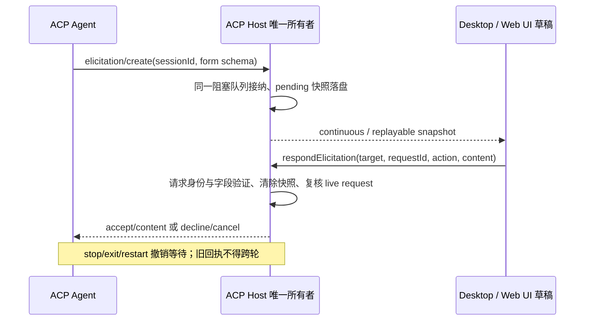

# ACP 结构化用户输入

## 产品规则与边界

- ACP `elicitation/create` 的 session-scoped `form` 由现有 ACP Host 接纳，展示交互表单，回传 `accept/content`、`decline` 或 `cancel`；不把回答作为新的聊天消息发送。
- 支持字符串、enum/oneOf 单选、数字、整数、布尔与 enum/anyOf 字符串多选。必填、长度、格式、pattern、数值及选择数量约束在 Host 回传前验证。秘密字段使用密码输入；答案不写入诊断日志或持久快照。
- 不声明 URL 或 request-scoped 认证交互支持。未知模式、未知字段类型、错误 session 和历史重放请求取消，不伪造用户答案。不将 assistant 文字推测为审批。
- API AskUserQuestion 与 ACP 工具审批语义不变。完全访问模式不自动回答结构化提问。默认值不视为授权，不预选答案。

## 状态所有者与接口

- 现有 ACP Host 是阻塞请求、顺序、revision 与回答 admission 的唯一所有者。工具审批与表单共用一个请求队列，首项分别投影为 pendingPermission 或 pendingElicitation；两者不会同时可回答。
- `IAcpService.respondElicitation` 带 workspaceIdentity/path、remoteSessionId、session id 和 request id；Host 验证隔离、当前 request 与 live generation，完成清除快照后才能唤醒适配器。同 request 的重复或迟到回答报过期，不能再次唤醒。
- UI 仅保存未提交表单草稿，通过现有 ACP hook 访问服务。请求/会话切换重置草稿；提交等待不重复发送，失败保留答案可重试。
- 停止、删除、连接退出、回合结束及 Host 重启清除阻塞请求；未回答请求按 cancel 完成，不允许旧进程/旧轮回答到达新轮。
- 适配器使用 SDK typed handler 的 request signal 处理 `$/cancel_request`。Agent 自身取消/自动结束提问时只撤销同一请求，不停止整个回合或取消排在前面的工具审批。
- Desktop continuous 与 Web remote replayable 都使用同一 Host 快照和服务命令：Web 断开再连接可重建尚存活的请求；Host 重启不会恢复已丢失的适配器等待对象。

公开服务调用示例（回答键来自 Host 请求字段，不能用标签替代）：

```ts
await acp.respondElicitation({
  workspacePath,
  workspaceIdentity,
  remoteSessionId,
  id: session.id,
  requestId: request.requestId,
  action: "accept",
  content: { choice: "yes" },
});
```



## 验收场景

- Wire fixture 确认 capability `elicitation.form`，真实 `elicitation/create` 来回传送；不同 session、未知 schema/mode、历史重放不展示，不返回 accept。
- Host fixture 覆盖多字段类型与约束、权限/表单顺序、错误 workspace/request、重复回答、停止/退出/重启和迟到旧轮回答。答案不出现在快照或 metadata 诊断。
- 真实 ACP hook/交互组件 E2E，1280/375px、明暗主题：点击同意回传选项值、文字/密码和多题回传字段 key；拒绝/取消；重连展示等待请求；提交失败保留草稿；切换请求不串答案。
- 回归现有 ACP permission、队列和 wire tests；运行 typecheck、lint、changed architecture、格式检查。Synthetic 测试不作为真实模型必然调用提问工具的证明。
