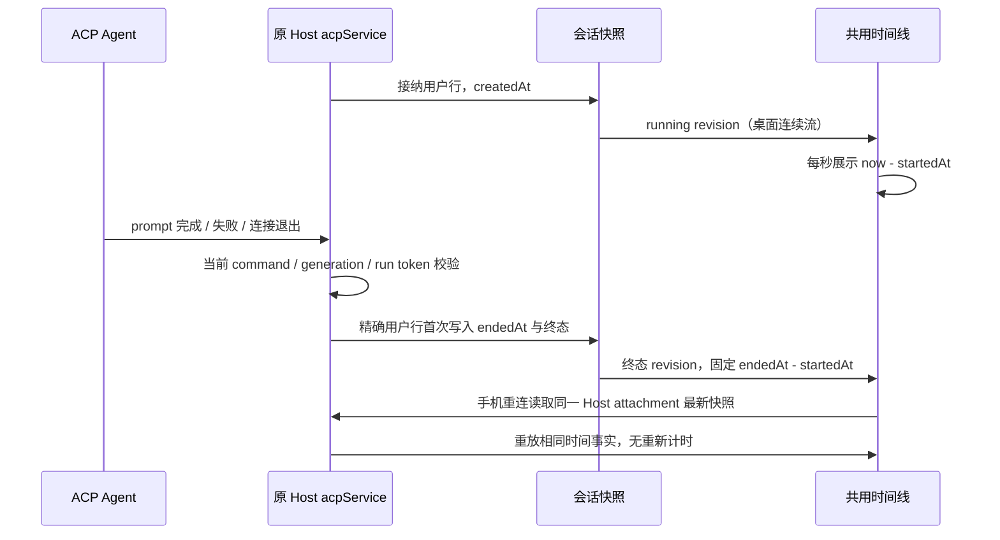

# ACP 对话工作耗时

## 产品规则与事实所有者

- ACP 与 API 共用对话时间线的“工作中 / 已工作”耗时展示。ACP 从 Host 接纳用户行的 `createdAt` 开始计时；包含权限等待等墙钟时间，不声称是适配器内部有效计算时间。
- `acpService` 是唯一事实所有者。在正常结束、执行失败、用户停止及当前连接退出时，把接收时刻作为可选 `endedAt` 保存到对应 `user:${commandId}` 行，和终态一起持久化、广播。首次结束后不能被重复结束或旧 run 覆盖；未接纳的输入不生成时间事实。
- UI 只投影这些字段到共用 `turnHeader.startedAt / endedAt`，运行中由既有每秒时钟派生展示值，结束后固定。不能以首个回复、下一条提问、诊断日志或文件时间推测结束时间。
- 旧快照缺少开始时间（ACP 投影为 0）时不显示耗时；缺少结束时间的完成轮也不显示耗时。重启恢复的 running 轮没有真实结束事实，不以恢复时间补写；已经保存的时间随快照恢复。
- shared 的 ACP 用户行 schema 增加可选非负有限 `endedAt`；旧快照兼容，不修改 CLI/API 有效工时所有权或计量方式，不增加 RPC 或 UI 状态副本。

## 事件顺序与交付边界

- 用户停止沿原 stop 栅栏记录结束时间；迟到 prompt 结果不能覆盖。幂等 key 是已有 `commandId`，workspace/remote identity、owner/lease、连续与可恢复链路保持既有路由。

## 验收场景

1. 接纳后尚无回复也显示并递增“工作中 N 秒”；成功结束显示固定耗时，下一轮不改变上一轮。
2. 执行失败、停止、适配器退出保存各自时间；停止后的迟到结果不能改写，重载仍保持原值。
3. 旧快照缺少开始/结束时间、重启恢复的未知终止轮均不生成错误或不断增长的历史耗时。
4. 宽屏浅色与手机窄屏深色 E2E 使用真实时间线和模拟快照，覆盖递增、完成固定、快照恢复、未知时间与 API 有效工时优先。
5. 执行相关 Host 与投影测试、E2E、typecheck、lint 和架构检查，报告实际结果。

## 验证记录（2026-10-09）

- Host 轨迹、消息队列与流式快照回归 38 项通过；UI 行投影与工具分组 19 项通过。快照测试追加停止后迟到结果及重启未知结束时间断言，10 项复跑通过。
- `acpWorkDuration.e2e.mjs` 使用真实时间线、模拟 Host 快照，在 1280px 浅色与 390px 深色通过递增、完成固定、快照恢复、旧时间缺失、恢复中断与 API 有效工时优先验证；未发送真实模型请求。
- 工作流依赖产物补齐后 `pnpm typecheck` 通过；`pnpm lint` 为 0 错误、72 条已有警告。架构检查为基线 0、新增 0，改动文件格式与 `git diff --check` 通过。
- 改动位于 shared、services、ui；原 Host 保持唯一时间事实所有者，顺序见上图。没有新增服务、RPC、状态缓存或队列；没有提交、推送或发布。
