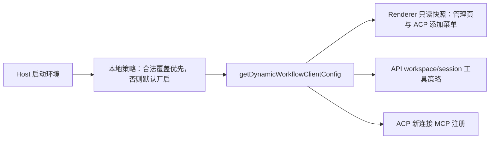
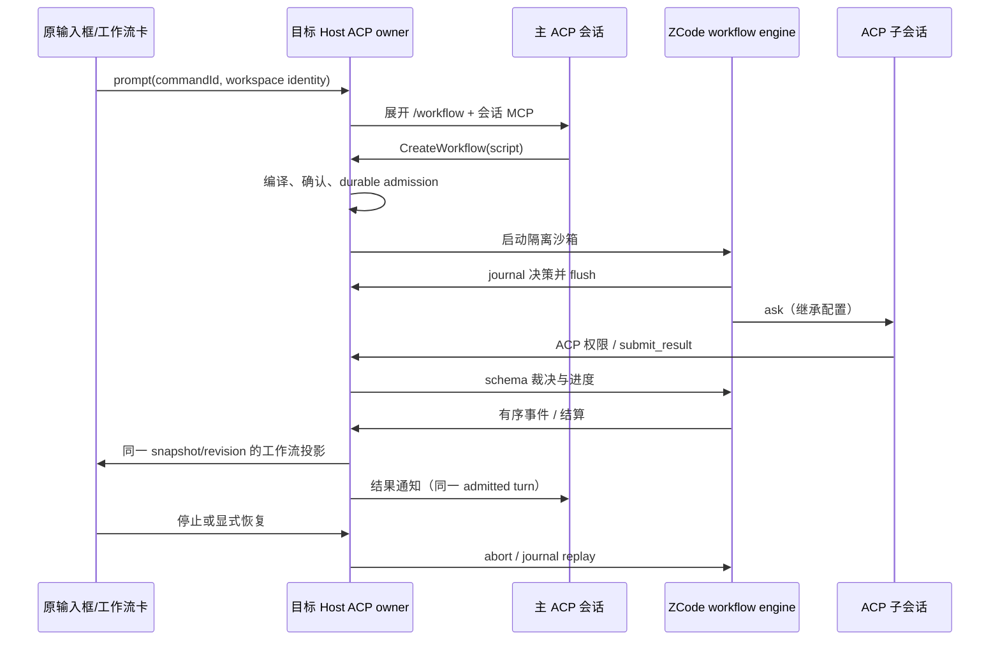

# ACP 工作流

## 产品规则

- 工作流是本地能力，默认开启；管理页、API 工具策略和 ACP 新连接使用目标 Host 的同一份本地配置，不读取服务端 `dynamicWorkflow` 灰度。`ZCODE_DYNAMIC_WORKFLOW_MODE` 的合法值覆盖默认值，开发、Preview、正式包和独立 Web/server Host 均保留该覆盖；`disabled` 显式关闭，`alwaysOn` / `onDemand` 开启，缺省或非法值回到 `alwaysOn`。
- 配置沿用 `getDynamicWorkflowClientConfig` 接口，由 Host 解析进程环境，Renderer 只读快照；调整环境后须重启 Host。已有活跃连接不热撤工具，不中断已接受的运行；关闭后新 ACP 连接不提供工作流 MCP，`/workflow` 不得声称可调用不存在的工具。历史、产物读取及已有运行的停止/恢复保持原有归属校验。
- API 与 ACP 在原有输入框的 `+ → 工作流` / `/workflow` 入口启动工作流。ACP 原文保留在历史中；Host 展开命令并提供真实的工作流工具，不能把裸命令当作已执行。
- ACP 的 `CreateWorkflow` 使用 ZCode 的公开 dynamic-workflow 编译器、引擎和隔离沙箱。子代理创建独立的 ACP 会话，继承启动时父会话的智能体、模型、模式及配置；不依赖 API 凭据，不改动 API 工作流路径。
- 主代理通过会话绑定的 stdio MCP 使用 `ReadWorkflowInstructions`、`CreateWorkflow`、`GetWorkflowRun`、`CancelWorkflowRun`、`ResumeWorkflowRun`，工具声明准确的必填参数。子代理只获得本 actor 的 `submit_result`；提交由引擎进行 schema 校验和修复裁决。子代理继承脚本定义的角色指令。
- 编译失败不弹执行确认、不创建 run；编译成功展示名称、完整脚本及命令清单，用户明确允许后才启动。确认区对长脚本提供滚动。子代理的 ACP 权限请求仍进入同一确认区，多个请求串行呈现；拒绝、停止、删除、退出都释放等待。取消单个 run 只释放它的权限请求，不影响同会话的主回合或其它 run。
- 支持串行、并行、共享 actor 上下文、typed/untyped ask、阶段、进度报告、世界读取/命令及文件/Markdown 产物。世界命令只能执行编译期声明的字面量，受启动确认和取消信号约束。
- 运行记录与有界投影保存在目标 Host。对话复用现有 `WorkflowRunDigest` / `WorkflowTimeline`，提供停止与恢复；内容产物的药丸经目标 Host 校验归属并解析 journal 中的最新版文件，再交给现有文件预览入口。结果回传主 ACP 智能体，由它在原对话继续总结，不新增对话页面。工作流可能在主回合仍占用连接时先结算；通知排队，并在主回合释放连接后自动送达。同一次通知失败保留结果供下一轮送达，不忙循环重试。
- 停止保留已完成步骤；恢复重放原脚本、实参、模型配置和 journal，复用已完成结果，不能自动重放未知的写操作。Host 重启从 journal 恢复全部 run，包括已 durable admission 但尚未写入会话投影的 run，将孤儿 running 收敛为 stopped/interrupted；用户显式恢复。历史读取和模型选择不启动工作流。
- 本次入口是对话内工作流；设置中的保存工作流目录与 API 启动器保持各自现有语义。ACP 工具可以读取工作区脚本启动，不将 ACP 会话 ID 送到原生 API 启动器。
- Desktop 的 main、window Host 与 scheduler ESM 产物内联工作流编译器时，必须让其 TypeScript CommonJS 依赖可读取 Node 内建模块及自身文件路径；冷启动时 main 和 Host 均须正常加载，工作树等 Host RPC 方法须由当前运行版本提供。dev 的 Renderer 热更新不代表既有 Host 已更新，跨进程接口变更后应重启整个 Desktop 进程树，不能只刷新页面。

## 所有者与接口

- `ICodingPlanSubscriptionService.getDynamicWorkflowClientConfig` 保留兼容接口及 `forceRefresh` 参数，但仅返回 Host 本地策略，不发网络请求、不读账号或订阅；API workspace/session 策略与 ACP 连接注册复用此接口。独立构造 ACP service 时使用同一个 shared 纯解析器。
- `AcpService`：会话、命令 admission、workspace identity、权限队列、snapshot/revision 和 MCP 生命周期的唯一所有者。
- 会话内 `AcpWorkflowHost`：run admission/取消/恢复；公开引擎拥有 actor/node 调度与 schema 裁决，ACP driver 只执行边界副作用。
- journal adapter：单份 run/actor/node/event 状态，串行原子异步落盘；执行外部副作用前必须等待 journal flush，失败直接停止，不能吞掉持久化错误。
- `AcpSession.workflowRuns` 使用共享 V4 schema/reducer；Host 创建的工具 entry 携带严格 `workflow` 字段，UI 不依据适配器工具标题伪造原生工作流。
- `IAcpService.cancelWorkflow` / `resumeWorkflow`：携带 workspacePath、workspaceIdentity、remoteSessionId、id、runId。run 必须归属于该会话，命令重复取消幂等，重复恢复共享 admission。
- `IAcpService.getWorkflowArtifact`：在同一工作区与会话作用域查 run 的 journal，按产物 id 返回已完成的最新版文件路径，不使用 renderer 推导的 URI；目标 Host 的 `FileService` 仍是预览读取入口。
- MCP token 只保存在 Host 内存和启动环境，不进入会话、日志、UI/RPC。绑定父会话或 actor；断连即撤销。只监听 loopback，不接受任意 workspace/run/token 组合。

Desktop continuous 和手机 replayable 读取同一 Host snapshot、revision 与有界 workflowRuns；renderer 不另建队列或执行器。子连接/迟到 prompt 结果必须检查 run 活体与连接 generation；停止/删除后不得重建 entry 或启动新 actor。

## 验收

0. 无账号、离线、上游下发 `disabled` 时，本地默认配置仍为 `alwaysOn/default` 且不发配置请求；合法环境覆盖生效，非法值回默认。Desktop 正式包与 Preview 均不丢弃/改写合法覆盖。Desktop 和窄屏 Web 管理页显示「工作流」并能进入模板列表；显式关闭时隐藏入口，新 ACP 连接不提供工作流工具；已有运行记录仍可读。
1. `/workflow` 保留用户原文，传给 ACP 的内容包含真实工具使用说明；原 `+` 菜单可选工作流，API 行为不变。
2. 真实编译器/沙箱/引擎 + fake ACP 执行并行及 typed ask；正确结果送回主代理；错误提交返回 schema violations，修复后完成。
3. 启动拒绝不创建 run/actor；并行子任务权限按序展示，拒绝或停止不悬挂。
4. 启动时继承智能体、模型和权限配置；恢复仍使用原配置，无 API 请求。
5. 停止取消在飞 ACP、沙箱和世界命令，保留 journal；重复恢复不重复启动；重启后明确 interrupted，恢复不重复已完成步骤。
6. 跨 workspace identity/session/run 的读取、取消、恢复和失效 token 全部拒绝。
7. UI E2E 在原对话显示相同工作流进度卡、停止/恢复和结果；不用付费智能体完成验证。
8. 执行 root typecheck、lint、architecture 检查及相关 service/交互验证，报告真实结果。
9. 冷启动重新构建的 Desktop main/Host/scheduler；断言 main 不因内联 TypeScript 的 `require("fs")` 或 `__filename` 崩溃，Renderer 与 Host 连接后调用只读失败路径的工作树 RPC 返回结构化 `not-repository`，而不是 `Method not found`。
