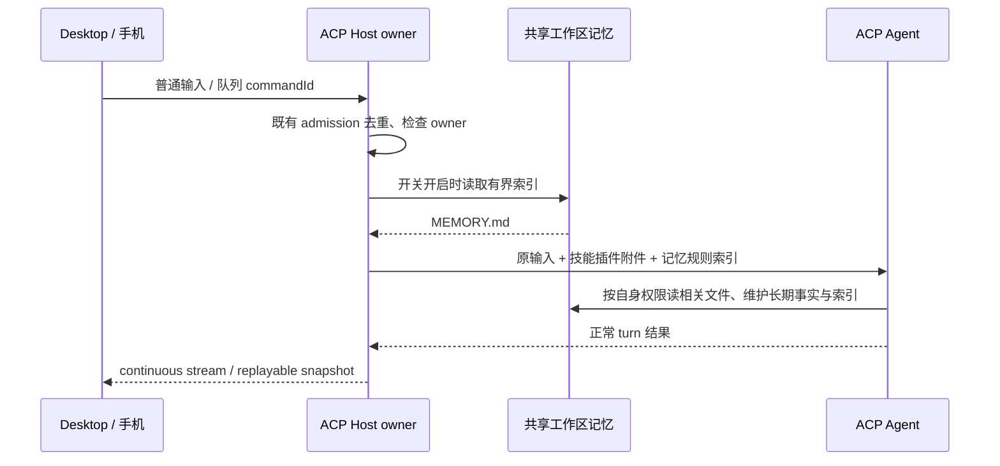

# ACP 工作区记忆

## 产品规则

- 开启工作区记忆后，ACP 与 API 主会话共享当前 Host profile 的 `cli/memories/projects/<key>/memory`，不迁移或复制已有文件。
- key 由 `workspaceIdentity.trim()` 优先、规范化 workspacePath 回退决定；采用现有 API 的 slug、SHA-256 前 16 位及 Windows 路径大小写规则。
- ACP 每次实际提交普通用户输入（含队列输入）前读取设置及该工作区 `MEMORY.md`，附加有界索引，以及与 API 相同的记忆格式和维护规则。无索引时仍提供目录与规则。
- ACP 在当前用户 turn 内通过自身文件工具按规则保存长期事实、更新索引；尊重智能体自身权限。没有相关事实或没有写权限时无需写入。不另起模型、隐藏提取 turn 或绕过授权；API 原有后台提取逻辑不变。
- 开关关闭时不读取或创建记忆目录，不注入规则；开启/关闭在 ACP 下一次提交生效。已发送的上下文仍属于外部 Agent，关闭不能撤回历史上下文。
- 保留原始用户文本、附件与技能/插件上下文。注入内容不写入会话展示文本或日志。普通重试由既有 commandId admission 去重；恢复与新会话重新读取同一份磁盘事实。

## 所有者与接口

- 记忆文件仍是唯一持久化事实，API Runtime 与 ACP Agent 是现有文件工具的消费者/写入者；Host 不保存第二份缓存或生成摘要。
- shared/node 公开工作区记忆路径解析与提示规则，CLI 与 services 复用；services 的记忆 adapter 负责安全目录准备、稳定读取及截断。
- ACP Host 在 prompt admission 前通过可注入 memoryContext port 加入上下文；node 装配使用当前 Host 的设置和 data root。Desktop continuous 与手机 replayable 请求进入同一 owner，不由 Renderer 注入或提取。

## 失败与边界

- 缺失索引是空记忆；目录/文件符号链接、越界、读取过程变化或 IO 错误拒绝注入，沿既有 prompt 失败路径报告，不发送未经验证内容。
- 索引最多 200 行、25,000 字符；读取复用 MemoryService 的稳定句柄及 5 MiB 上限。索引以 JSON 文本封装，避免正文关闭上下文分隔符。
- 远程工作区在目标 Host 读取，身份隔离仍贯穿 workspaceIdentity；不从本地桌面读取另一 Host 的文件。
- 自动维护是 ACP Agent 当前 turn 的文件工具行为，无法承诺每次一定生成记忆或获得写权限；不影响正常对话的完成语义。

## 验收

1. API 已有索引随 ACP prompt 注入，Agent 写入后的索引在下一轮可见；会话历史仍只有用户原输入。
2. 相同 identity/不同路径共享；不同 identity/相同路径隔离；无 identity 保留旧 API 路径，Windows 大小写规则不变。
3. 关闭开关无 IO；空目录可初始化，空索引不伪造内容；长索引截断，链接/异常文件拒绝读取。
4. 技能插件与附件同时保留；accepted command 重试不再次读取/发送；新建和恢复会话读取最新文件。
5. 不增加后台 ACP turn、模型选择、usage 统计或跨会话的写入队列。
