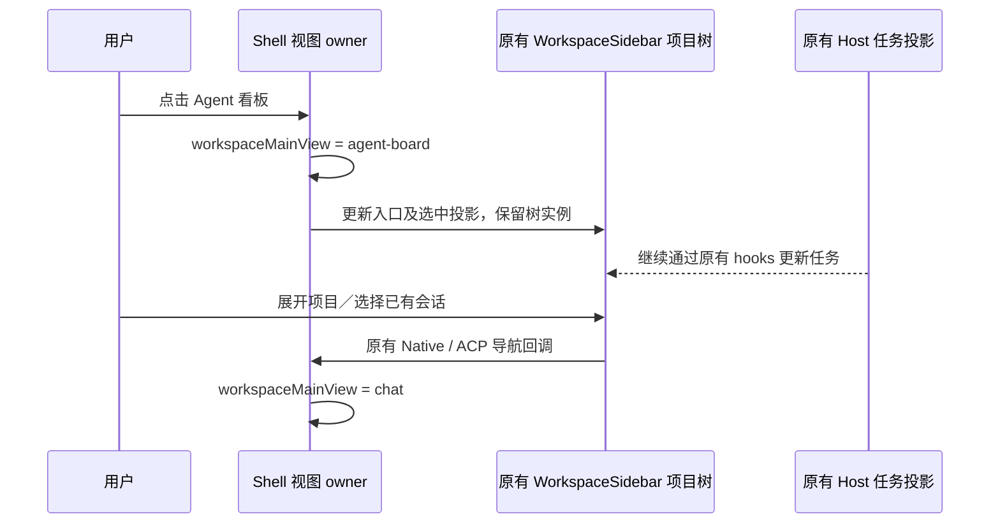

# Agent 看板共用项目任务树

## 产品规则

- 点击侧栏的 Agent 看板后，主区域仍显示 Agent 看板；下方继续显示与仓库面板相同的项目／分组任务树。
- 不再把任务树替换成“所有项目、独立任务、常用项目、查找全部项目”的专用统计导航，也不显示该导航中的状态数量。
- 复用现有的项目／分组切换、未读筛选、排序、项目展开和任务行，不维护另一份看板项目树。
- 在仓库面板、Agent 看板、会话之间切换时，同一任务树保持挂载，项目展开状态及展示偏好保持不变。
- 从 Agent 看板的任务树点击 Native 或 ACP 会话，通过现有 Shell 导航打开对应会话；保留 workspaceIdentity 和 remoteSessionId 的原有路由语义。
- 看板主区域继续提供项目筛选、搜索、状态筛选及数量统计。点击侧栏看板入口本身不创建、执行或修改任务。
- Agent 看板覆盖会话区域时，任务树不把旧会话标记为当前页面；返回会话后恢复现有选中投影。
- 桌面和手机 Web 使用相同任务树语义，支持中英文及浅色／深色主题。
- 保留当前产品的双栏侧边布局：最左侧 48px 竖排快捷栏（新建、搜索、自动化、插件），右侧是面板入口及项目任务树。点击 Agent 看板不能隐藏快捷栏、恢复旧版横向文字入口或改变两栏的先后关系。
- 快捷栏独立于项目树／文件树的滑动区域；侧栏整体收起时才由顶部浮层补充新建入口。窄屏给项目树预留可用宽度，工具栏允许换行。

## 状态所有者和接口

- Shell 的 workspaceMainView 唯一持有主区域视图状态。
- WorkspaceSidebar 唯一组合侧栏导航与现有任务树；agentBoardActive 仅控制入口选中和会话行选中投影，不决定替换任务树。
- Tab store 继续持有工作区、身份、路由及项目展开状态；现有侧栏偏好继续持有项目／分组展示方式。
- 原有任务列表 hooks 从 Host 读取任务投影；不新增 Host 状态、列表缓存、写入路径或远端协议。
- Agent 看板主区域的筛选继续由 agentBoardStore 持有，和侧栏项目树的展示偏好分离。
- `WorkspaceSidebarActionRail` 仅展示现有操作和状态，复用原有导航及新建回调；不引入第二份视图或任务状态。合并时保留主分支已有的快捷栏、待办任务统一列表及创建入口，项目树仍由现有 owner 持有。

## 失败及迁移边界

- 沿用任务树现有加载、空列表和远端断连语义；不回退到旧统计导航。
- 无持久化 schema 或业务数据迁移，不改看板追踪范围、任务状态或会话绑定。
- 发布范围为本 spec、侧栏的共享树修正及专用回归测试；任务初始快照中的无关文档变更仅保留在任务分支，不发布到主分支。

## 验收场景

1. 从真实 Shell 的仓库面板点击 Agent 看板，入口选中、主区域切换，项目／分组工具栏和项目下的真实任务行仍可见，旧统计导航消失。
2. 在两种面板间往返，验证树节点实例及项目收起状态保持；收起的项目可在看板下重新展开。
3. 在项目与分组展示方式下重复切换，偏好不重置；Agent 看板下点击 Native／ACP 任务能打开正确会话。
4. 看板下没有旧会话的当前行标记；返回已有会话后主区域显示相应会话标识。
5. 中英文、浅深主题及桌面／手机尺寸下通过相同交互，页面无横向溢出，无任务创建或执行命令。
6. Agent 看板和仓库面板往返时，四个快捷图标保持同一节点、位于项目树左侧且可访问；截图同时包含竖排快捷栏、项目树和真实看板主区域，不能用旧布局或主区域占位符作为效果证据。

回归入口：`node packages/ui/test/agentBoardProjectTree.e2e.mjs`。测试使用真实 Shell、侧栏、项目行、任务行、顶部导航及 Agent 看板；Host 使用合成数据，无关页面使用隔离 fixture。浏览器截图不模拟 macOS 原生窗口按钮，不代表已更新用户安装版本。
