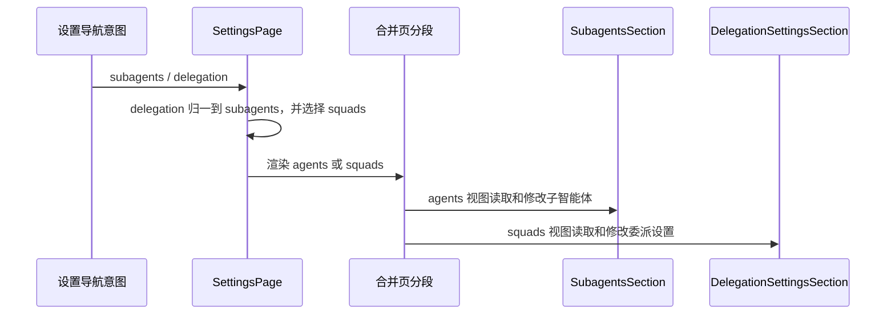

# 智能体与小队设置页

## 产品规则

- 设置侧边栏只显示一个“智能体与小队”入口；入口内提供“智能体”和“小队协作”两个分段视图。
- “智能体”视图继续管理现有子智能体配置；“小队协作”视图继续管理现有多智能体委派配置。
- 两个视图复用现有组件、hooks、服务和持久化，各自仍是对应配置的唯一读写路径。切换视图只改变页面局部选择，不重置或复制业务状态。
- 既有 `subagents` 导航进入“智能体”；既有 `delegation` 导航进入“小队协作”。旧导航 ID 保留为兼容输入，不再作为单独的侧边栏入口。
- 用户直接打开设置页时默认显示“智能体”视图；设置页打开期间收到旧 `delegation` 意图时，合并入口和“小队协作”视图同时生效。
- 布局遵循 `DESIGN.md`：使用语义主题色与 `text-ui-*` 字级，内容宽度适配桌面和窄屏，不依赖固定屏幕宽度。

## 状态所有者与接口

- `SettingsPage` 拥有一级设置 section 和当前内部视图选择。
- `settingsNavigation` 保留既有 `SettingsSectionId` 协议，并把 `delegation` 解析到 `subagents` 合并入口；原导航事件中的 section 值用于选择内部视图。
- `SubagentsSection` 继续通过现有子智能体服务管理配置；`DelegationSettingsSection` 继续通过现有委派设置 hook 管理协作配置。
- 内部视图切换只影响 Renderer 局部 UI，不写服务端状态。

## 验收场景

1. Web、桌面平台配置都只渲染一个智能体设置导航入口，且不再出现单独的多智能体协同入口。
2. 合并页可在“智能体”和“小队协作”间切换，两个视图都展示原有内容。
3. `subagents` 导航定位到“智能体”；`delegation` 导航定位到“小队协作”，包括设置页已打开时收到的导航事件。
4. 未带显式导航意图地打开设置时默认显示“智能体”；主题和窄屏布局不产生溢出。
