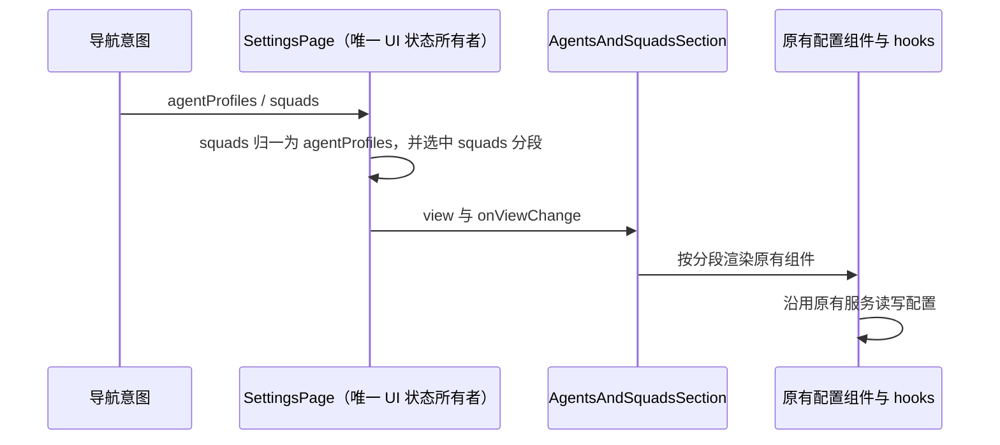

# 智能体与小队设置页

## 产品规则

- 将智能体档案（`agentProfiles`）和小队（`squads`）合并为一个“智能体与小队”设置入口，内部使用“智能体”和“小队”两个分段。
- `SubagentsSection` 不属于本次合并；`delegation` 继续遵循主分支的独立导航和隐藏策略，不映射到合并页。
- 复用 `AgentProfilesSection`、`AgentSquadsSection` 及其 hooks、服务和持久化，不新增业务写入路径。切换分段只改变局部 UI 选择。
- `agentProfiles` 是合并入口的规范 ID；旧 `squads` 意图进入同一入口并选中“小队”。显式 `agentProfiles` 意图选中“智能体”。冷启动与已打开页面都遵守同一规则。
- 普通打开合并页默认显示“智能体”；上次保存的旧 `squads` 位置仍可恢复到“小队”。导航意图消费后不应影响后续打开。
- 使用主题语义色、`text-ui-*` 字级、现有分段组件和宽内容容器，兼容桌面及窄屏 Web、中英文。

## 状态所有者与接口

- `SettingsPage` 是一级设置 section 和内部 `AgentSettingsView` 的唯一状态所有者；`AgentsAndSquadsSection` 是受控展示组件。
- `settingsNavigation` 保留旧 `SettingsSectionId` 输入，通过 `resolveSettingsSection` 将 `squads` 映射为 `agentProfiles`；原始意图用于选中分段。
- `AgentProfilesSection` 和 `AgentSquadsSection` 仍通过原有 hooks 读写服务端配置；局部选择不写入服务端、不复制配置。
- 存储不可用时沿用现有安全回退，不影响通过同窗口事件导航；本次不改变远程 workspace 身份、同步或委派语义。

## 验收场景

1. Web、macOS、Windows 的设置配置均只保留一个档案/小队入口；子智能体入口与主分支的协同隐藏策略保持独立。
2. 页面分段能切换到真实的智能体档案和小队内容；新建、编辑、删除、冲突、远程不可用行为继续由现有组件处理。
3. 冷启动和已挂载时的 `squads` 意图均定位“小队”；`agentProfiles` 意图定位“智能体”。消费一次性意图后不残留。
4. 1280px 与 375px 下页面没有横向溢出，两个分段均可访问；中英文标签正确。
