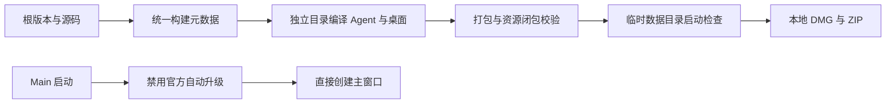

# CodeVori 首个安装版本

## 产品规则与边界

- CodeVori 首个本地安装版本为 `1.0.0`，根 `package.json` 是应用版本唯一来源；构建 metadata、关于窗口和安装包均消费它。
- 共享品牌的 `.mjs` 公开入口同时提供 `.d.mts` 声明，允许未启用 `allowJs` 的 Agent 和 RPC 消费者从干净源码构建；声明只是公共类型契约，不维护第二份运行时状态。
- 首先交付 macOS arm64 的 DMG 与 ZIP，名称为 CodeVori，使用已确认的 V 图标，保留原作者和许可证。
- 本分支已移除官方登录与升级入口。正式包也不得向 ZCode 官方更新源轮询、下载或执行强制升级，避免独立版本号被官方最低版本拦截或安装包被官方产品覆盖。Main 唯一决定关闭这两个入口，复用现有 updater 禁用状态，不增加设置或另一套更新服务。
- API、ACP、用户目录和原有会话持久化兼容不变；智能体适配器的安装与版本检查独立于桌面应用升级，不受影响。
- 构建在独立目录进行，重新编译当前源码的 Agent、插件和原生工具，不覆盖正在运行的开发版产物或真实用户数据。仅生成本地安装包，不发布 GitHub Release。
- 缺少 Developer ID 和公证凭据时使用本地 ad-hoc 签名，修复 Electron 重命名及资源变更后的签名完整性；不跳过 arm64 必需的签名步骤。明确实际签名与公证状态，不将本地启动成功等同于 Gatekeeper 公证通过。

## 所有者与顺序

## 验收

1. 安装包、Info.plist、app.getVersion 与关于信息均为 `1.0.0`，显示名为 CodeVori，架构为 arm64。
2. 以全新临时用户目录启动打包版，主窗口正常挂载并显示免登录任务界面；不触发官方强制升级窗口。
3. updater 状态为 `idle / enabled:false`，手动检查返回跳过，切换旧配置中的预览更新开关也不能发出官方升级请求。
4. 内置 Agent、ACP 服务和 Computer Use 插件资源齐全；ASAR 依赖闭包及原生平台校验通过。
5. 打包后实际执行隔离启动 E2E，并检查 DMG 与 ZIP 的完整性和校验和。

## 本次构建验证

- 在独立 worktree 中使用 Node 24.14.0 / pnpm 10.33.2，重新构建 Agent、Computer Use 原生插件及桌面 production 产物；electron-builder 显式使用 `--publish never`。
- `pnpm typecheck`、架构检查通过；Lint 为 0 errors、72 条已有 warnings；改动文件格式检查通过。
- 9 项品牌、公开类型入口和 Computer Use 打包测试通过，正式安装版本的隔离启动 E2E 通过，覆盖版本、免登录输入框、更新器禁用、手动检查跳过和旧预览更新设置。
- 最终 ASAR 的 74 项运行时依赖闭包、原生平台资源、内置 Agent 与新构建内容一致性、产品图标均通过校验；深度签名完整性检查通过。
- DMG 为 179.1 MiB，ZIP 为 172.0 MiB；DMG 校验和及 ZIP 完整性检查通过。产物使用 ad-hoc 本地签名，未 Apple 公证；Gatekeeper 评估为 rejected，不宣称可信发行签名已通过。
- 改动归属 shared、desktop 及构建配置。Main 唯一决定关闭官方升级，updater 继续拥有已有状态与事件；没有新增业务持久化或手机/桌面协议变化。版本与构建修复尚未另行提交。
