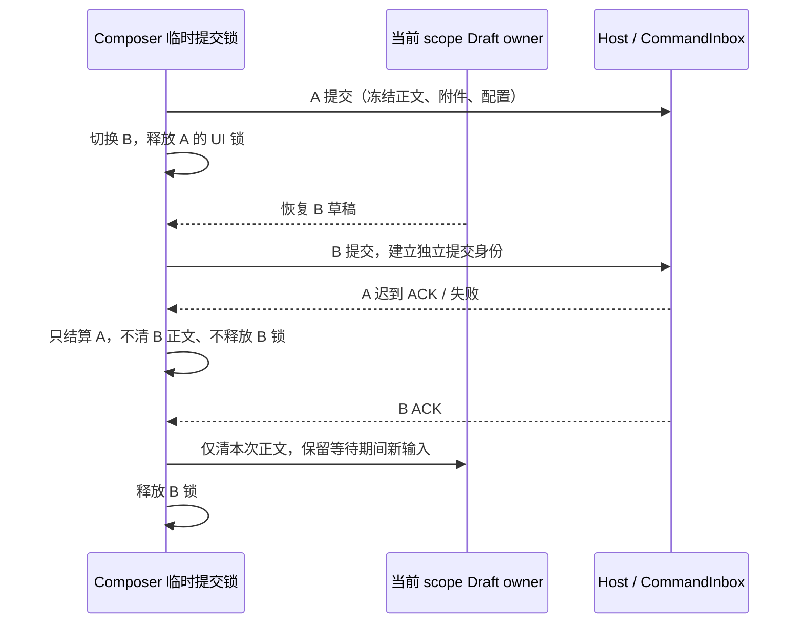

# 发送等待与会话切换隔离

## 产品规则

- 发送等待只阻止同一输入框目标的重复提交。切换会话或 workspace 后，新目标按自己的正文、附件、模型及连接状态裁决发送，不能继承旧目标的提交锁。
- 切换不取消已经交给 Host 的命令，也不自动重放。旧请求的成功、失败、确认框及 finally 不得清空新正文、弹出旧队列确认或释放新请求的锁。
- 发送成功只移交提交时冻结的附件与上下文。同目标失败保留原草稿；当前目标已经离开时，不把旧正文恢复到新编辑器。
- 新任务首发 promotion 仍由既有 Draft owner 清空并转移草稿；已发送正文不能在新会话或下一次新建任务中复活。
- 长 SQL 与普通正文遵守相同发送规则，既有长粘贴转附件阈值不变。

## 所有者与边界

- ConversationComposer 唯一拥有临时提交锁，用每次提交的身份区分旧完成与当前请求；目标由 workspace identity/path 与 composer scope 确定。
- useDraftConfigControl 保持正文及配置唯一所有者，附件保持既有 scope store；Host / CommandInbox 保持 accepted 输入、owner/lease、幂等与 admission 所有权。
- Desktop continuous 与手机 Web replayable 共用同一 Composer 规则，不改变协议、路由或恢复链路。

## 验收

- 真实 Composer / Lexical + synthetic admission：A 等待时切到 B，粘贴阈值以内的单行 SQL，可以立即提交；约 20k 字符 SQL 沿用转附件路径并能提交。同目标重复点击或 Enter 不重复发送。
- B 提交仍等待时，A 成功或失败不得释放 B 锁、清空 B 新输入或显示旧确认框；B ACK 后解锁，等待期间新正文保留。
- 同路径不同 workspace identity 隔离；当前请求失败仍可重试原草稿。
- draft 首发 promotion 清掉已发送正文，后续新输入保留；发送拒绝保留可重试草稿。
- 覆盖 1280/375px、浅深主题与 continuous/replayable 目标，并回归 ACP 发送与切换测试。执行 typecheck、lint、changed architecture 与改动格式检查。
