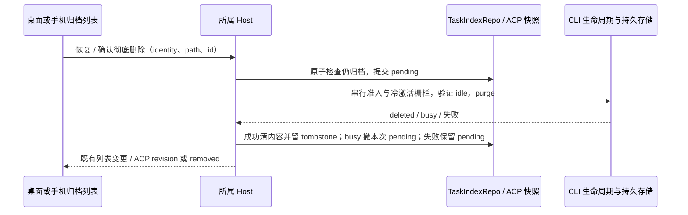

# 已归档对话与彻底删除

## 产品规则

设置页的“数据与统计”菜单提供“已归档对话”分区，工作区侧栏任务工具栏不再提供归档入口或归档视图开关。分区统一展示 API/ZCode 与 ACP 历史，保留恢复、确认彻底删除与批量清理功能；桌面与手机 Web 使用同一设置分区导航、上次停留记忆和布局。

归档保留正文、会话身份和工作区身份；恢复返回普通列表，不新建会话或自动发送。归档中心包含当前工作区及本机持久存储中已有归档的工作区，不因关闭工作区 tab 丢失记录；远端必须解析到原 Host，断连时不允许写入，也不回落本机服务。

归档历史可查看；继续对话前须先恢复。彻底删除必须二次确认，清理 ZCode 管理的正文、队列、会话设置、搜索内容及专属附件。工作区原文件、Git 分支、工作树、独立子对话及外部 Agent 自有历史不属于删除范围。关联任务记录保留，其对话读取返回已不存在，不自动运行、合并或恢复。

运行中、待交互、已接受队列或关联工作流仍活跃时拒绝彻底删除，不自动取消工作。删除确认与执行之间另一端已恢复时跳过删除。批量操作逐项报告成功、跳过和失败，不将失败项隐藏。

## 所有者与接口

- API/ZCode 的 membership 与删除进度唯一归属 `TaskIndexRepo`。`deletionState=pending` 存在既有 `meta_json` 中，不修改 SQLite 表结构；pending 禁止恢复和其它状态写入。`deleteArchivedTask(s)` 委托所属 Agent 的新 `session/purge`，不复用仅关闭运行时的 `deleteSession`。
- CLI `SessionStorePort.purgeSession` 在既有 SQLite 事务中删除会话数据，并验证 workspace identity/path；同一会话的冷激活与 purge 共用生命周期栅栏，V4 admission 继续由原 `CommandInbox` 串行。busy 拒绝发生在清理之前，允许清除本次 pending；未知执行失败保留 pending，显式重试继续清理。
- 成功后 index 保留仅含必要身份的 deleted tombstone，清空标题、正文索引和其它内容元数据；迟到 snapshot 不得重新填充 tombstone。无 pending 时保留既有软删除接口语义。
- ACP 状态仍唯一归属所属 Host 的快照。新增归档条件删除入口，archive/restore 与删除检查使用同一 queue gate，清理进度保存在既有 JSON 快照中；失败可重试。原 draft cleanup 的 `remove(provisionalOnly)` 语义不变。
- 已知归档工作区查询仅发现本 Host 的持久记录，不创建 Agent、不连接远端。UI hook 只合并 scope 与订阅读取结果，不成为归档状态所有者。
- 设置分区只复用既有归档列表与 Host hooks；导航沿用设置历史对话意图桥，聊天壳层是会话选择唯一所有者。查看本地历史可重新打开已关闭 tab；远端以 identity 精确激活现有 attachment，缺失时拒绝，不能创建本地 tab。设置导航记忆属于 UI 偏好，不写入会话归档事实。

```text
设置菜单 → 设置页 activeSection=conversationArchive → 既有归档 hooks → 原 Host
查看历史 → 既有设置历史导航意图 → 聊天壳层 → 激活所属 workspace → 选择原会话
恢复/删除 → 既有 Host 命令 → 列表事件刷新（设置页不自行判定完成）
```



Desktop continuous 与 mobile replayable 复用同一 Host owner 和既有事件；重连重新读取持久归档/pending/tombstone。UI 不凭请求发出就删除行，旧 list/旧 Host 回包不能复活删除记录。

## 验收场景

1. API/ACP 归档后消失于普通列表，归档列表可查看；重启仍可恢复，ID 与正文保持。
2. 关闭本地工作区 tab 后其归档仍可见；同路径不同远端 identity 不合并，断连不能恢复/删除。
3. API 彻底删除后 SQLite 正文、队列、设置与搜索数据不存在；其它会话、子对话及项目文件保留，重复删除幂等。
   CLI 同时清理按会话归属的 artifact 和派生媒体缓存；其它持久对话仍引用的 artifact 保留，防止独立 fork 历史失效。
   Host 删除 ZCode 自有的 legacy/import 迁移快照，保留外部 Agent 的原始历史文件。
4. 运行/等待/队列/工作流活跃时拒绝，原运行不受影响；并发恢复先提交则删除跳过，pending 提交后恢复拒绝。
5. 清理失败、清理成功但索引提交失败及 Host 重启后均可重试；pending 不可继续输入，迟到快照不覆盖进度或补回删除内容。
6. ACP 清理删除专属附件和快照，重复请求或迟到更新不复活；外部 Agent 历史与独立委派子会话保持。
7. 桌面/窄屏、浅色/深色、键盘/触屏验证归档文字入口、恢复、确认取消、失败提示与禁用状态；同时验证两种交付语义的刷新/重连。
8. 设置菜单只有一个“已归档对话”分区；导航记忆、显式直达、API/ACP 查看历史保持路径和 identity，侧栏任务视图不再切换至归档。缺失远端 attachment 不产生本地 tab。

验证使用隔离临时存储和当前真实组件 E2E，执行相关 Node 测试、根及 CLI typecheck/lint、架构检查；真实手机或远端环境不可用时明确记录未验证范围。

## 本次本地验证

- 23 项相关测试通过：index intent/retry/tombstone、native service 批量结果、ACP 清理失败重启、关联任务保护、SQLite 内容和附件清理、CLI 生命周期与 busy 拒绝。
- `conversationArchive.e2e.mjs` 通过桌面/375px、浅色/深色四种组合；真实归档组件使用隔离 Host fixture。ACP archive selection 回归通过（临时放宽导航等待，避免开发服务首轮编译超时）。
- 根及 CLI typecheck 通过；根 Lint 73 warnings、0 errors；架构检查 0 violations；全部变更文件格式检查及 `git diff --check` 通过。
- CLI 全量 Lint 未通过：现有 debug、telemetry、contracts 等文件超过 `max-lines` 限制。既有 ACP goal/attachment 测试的 `endedAt` 断言失败，使用 HEAD 实现复现了相同失败。
- 旧 workbench fixture 缺少 ServiceProvider，当前回归未完成。真实手机、远端 Host 与完整 Electron 运行链路未实测；本次未提交、推送或发布。

### 设置菜单迁移验证

- 设置分区配置/导航记忆、工作树历史导航及侧栏选择共 11 项测试通过。
- 归档设置组件与导航 hook 的隔离 Host E2E 通过桌面/375px、浅色/深色；覆盖菜单进入、排序、批量操作入口、恢复、删除、取消、失败、pending、键盘和同路径远端 identity，缺失 attachment 不创建本地 tab。未实测完整 Electron 设置页和真实远端设备。
- 根 typecheck、格式与架构检查通过；根 Lint 73 warnings、0 errors。在线 freshness 的 GitHub fetch 连接失败，使用 `--no-fetch` 的缓存基线检查通过；本次仅修改本地代码。
