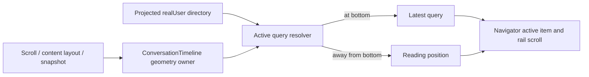

# Conversation turn navigator active query

## Rules and ownership

The shared `ConversationTimeline` owns scroll geometry. The left query navigator
derives its active item from that geometry and the current projected `realUser`
query directory. API and ACP use the same rule:

- At the bottom (including content shorter than one viewport), select the latest
  query in the directory, even if earlier queries remain visible near the top.
- Reuse `timelineScrollAnchor.isAtBottom` and its existing 48px tolerance. This is
  a geometry projection, not a change to the `following` scroll-intent owner.
- Away from the bottom, preserve the existing query-nearest-to-viewport-top rule
  and virtual-unit fallback. Never pull a reader back to the newest turn.
- Resolve the latest query from the full current directory, not mounted DOM rows.
  The final query can be outside the virtual window or part of a running live tail.
- Empty directories and unmeasured viewports cannot invent an active query.

The existing navigator scrolls its own rail to the active item. Hover/focus previews
remain independent. No Host commands, protocol changes, persisted scroll state or
new navigation store are introduced. Desktop continuous updates and mobile
replayable snapshots project through the same timeline; narrow layouts retain the
existing hidden rail rule.

## Acceptance

1. Multiple visible queries at the bottom select the latest, not the topmost.
2. Short conversations select the latest; no-query and unmeasured states are safe.
3. The latest query wins even when its DOM anchor is not mounted, including
   multiple queries in one product turn.
4. Leaving the bottom restores reading-position selection; returning to the
   bottom restores latest selection. Existing 48px tolerance is reused.
5. Shared UI E2E verifies ACP/API bottom selection, append while following,
   historical reading without auto-jump, reopening, and the rail's visible window.
6. Existing narrow mobile and share-selection behavior stays covered. Run focused
   tests/E2E, typecheck, lint, formatting and architecture checks.
