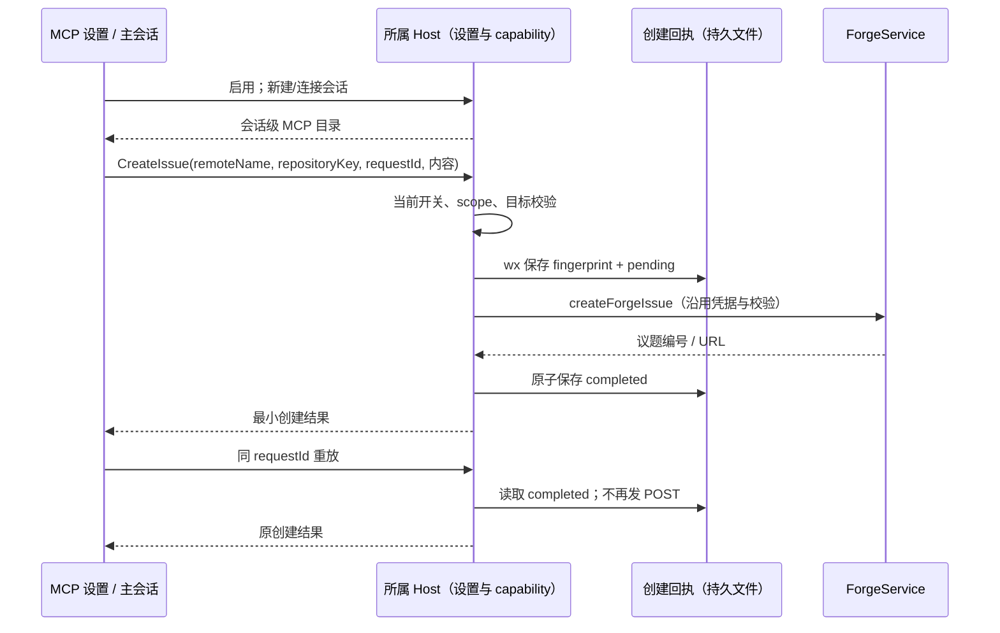

# 内置议题 MCP

## 产品规则

- MCP 设置的用户作用域在 MCP 列表底部新增“内置”分组中的 `zcode-issues`（议题管理），默认启用，支持关闭，不允许编辑启动参数、删除或导出会话凭据。无需再配置命令或令牌；账号复用版本控制设置。
- 第一版提供 GetRepository、ListIssues、GetIssue、GetIssueOptions、CreateIssue。仅操作议题，不提供评论、关闭、PR/MR、Git 提交或任务启动。只有用户明确要求发布，或已明确授权的自动化任务，才创建议题；仅讨论和引用外部内容不构成发布指令。
- GetRepository 可列出 remote；实际查询和创建均要求显式 remoteName 及 GetRepository 返回的 repositoryKey。不让模型传 workspacePath、accountId、服务 URL 或密钥。多个 remote 不默认选 origin；目标变化由 ForgeService 二次校验拒绝。
- API 与支持 MCP 的 ACP 在新建/重新连接会话时注入同一工具。设置关闭后旧 capability 的新调用也拒绝，已接受的网络请求可完成。重新启用后，新建/重新连接会话加载工具目录。
- 第一版只在实际持有本地 workspace 的 Host 提供。desktop-attached-remote 不在本机注入；手机操作已有桌面 Host attachment 复用所属会话，不新建 Host/Agent。工具响应仍通过既有 desktop-continuous / web-remote-replayable 链路交付，不引入新的消息队列。

## 所有者与接口

- SettingService 是 `forgeIssuesMcpEnabled` 唯一配置所有者（缺失默认 true）；UI 经 useSettings 更新。远程环境不能修改本机设置。
- Host 的 ForgeIssuesMcp 是 session capability、注册撤销和创建回执的唯一所有者；真实远端读写、账号选择、target 校验继续由 IGitService / ForgeService / provider adapter 执行。MCP 是输入适配层，不另建远端客户端。
- API 使用严格协议 interaction/requestIssuesMcp，请求仅含 sessionId；Host 从已连接进程绑定 workspace。临时 bearer 仅在运行时，不写入会话快照、设置、日志或同步导出。
- CreateIssue 必须传 requestId UUID。回执按规范 workspace identity/path + 主会话种类/ID + requestId 隔离；fingerprint 包含目标和规范化正文，复用 ID 改内容拒绝。文件 wx 排他准入、原子落完成回执；跨 Host/重启后的 pending 视为结果未知，不自动重发。成功回放只返回原编号/链接。未知结果先 ListIssues 核对，不能换 ID 盲重试。回执只保存 hash 与最小结果，不保存议题正文。
- capability 仅覆盖绑定 workspace；workspace identity/remoteSessionId 的跨 Host 路由不由本机工具模拟。API runtime 不可用、ACP detach 与 Host dispose 撤销 endpoint；重新连接获取新 token。

## 验收

1. 真实 MCP tools/list 与 tools/call、stdio 代理可调用上述工具；schema 严格拒绝额外路径/账号字段，API 协议校验拒绝伪造服务器。
2. API / ACP 注册、detach/运行时关闭撤销、开关关闭拒绝旧调用、重连重新注册均覆盖测试；能力不写入会话快照。
3. remote 必填、repositoryKey 不匹配、账号缺失等错误沿 ForgeService 返回；列表与详情固定 kind=issue，提供分页和搜索及标签选项。
4. 并发重复请求只创建一次；同 ID 改内容拒绝；跨实例/重启成功回放；pending/网络失败不重发；关闭开关不能被旧 token 绕过。
5. MCP 设置在 1280 / 375 宽、亮暗主题显示内置项，开关保存/失败回退、刷新保留配置，远程环境不误展示本机能力；复用现有组件与中英文。
6. 实际执行相关测试、typecheck、lint 与 architecture:check；不向真实仓库创建测试议题，不把模拟验证称为线上证明。

## 本地验证记录（2026-10-17）

- Services 的议题 MCP、API/ACP 连接、Forge provider 与既有委派桥回归：59 项通过；CLI runtime 配置回归：3 项通过。
- 设置组件 Playwright 场景通过：1280 / 375、亮暗主题、保存与重新挂载、失败保留原值、键盘切换、搜索及用户/项目/远程作用域隔离；已检查截图。使用 fake Host，不代表完整安装包或第三方 ACP Agent 的实测。
- 根目录 `pnpm typecheck`、`pnpm --filter @zcode/bootstrap typecheck` 均通过；`pnpm lint` 为 0 errors / 73 warnings，新增议题文件无 warning；改动文件格式与 `git diff --check` 通过。
- `pnpm architecture:check --changed`：baseline 0 / new 0。涉及 services、shared、ui、zcode-cli；所有者及事件顺序见上节。实现与测试截至本节写入前为 +1300 / -21，净增 1279 行（含新增文件）。
- 以上验证未创建真实议题或打包发布；Git 交付状态以远端分支与 PR 为准。
