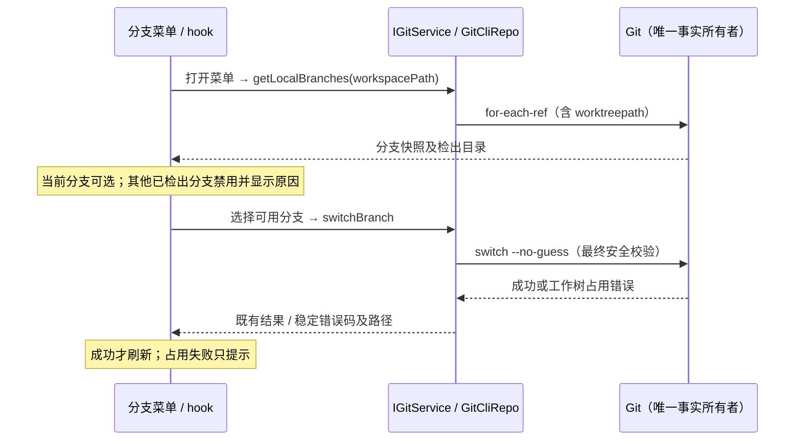

# Git 分支菜单与工作树占用

Issue #89：长分支名被截断，悬停无法读取；目标分支已被另一棵工作树检出时仍可点击，部分 Git 版本的错误直接以英文显示。

## 规则与所有者

- 触发器保留紧凑截断布局，鼠标悬停和键盘聚焦时通过共享 tooltip 展示完整名称，长中英文名称在视口内换行。桌面分支行通过原生 `title` 展示完整名称，避免低于菜单层级的自定义 tooltip 被菜单遮挡；粗指针手机环境直接换行显示完整名称。选项保留完整的无障碍名称与 cmdk 键盘导航。
- Git 是分支检出位置的唯一事实来源。`IGitService.getLocalBranches` 的 `GitLocalBranch` 新增可选 `worktreePath`，由已有 `for-each-ref` 查询的 `%(worktreepath)` 生成；未被检出的分支为 `null`。记录边界使用 NUL，目录中的换行不得被解析成另一条分支。旧 Host 不返回字段时仍允许正常尝试切换，由 Git 校验。
- 当前分支仍可选择，沿用 no-op 语义。其他分支有检出路径时禁用选择，显示本地化占用说明与完整路径（窄屏可换行）；悬停仍可读完整名称，鼠标、Enter、Tab 均不发切换请求。
- 上述禁用仅适用于普通分支切换；“新建工作树”的来源选择可以读取被占用分支来派生新的独立分支，详见 `git-worktrees.md`。来源选择不调用 `switchBranch`。
- UI 不强制检出、不删除/解锁工作树，也不自动导航或创建会话。释放占用后重新打开菜单，重新读取 Git 事实。
- 菜单快照不作为最终授权：选择后原生 `git switch --no-guess` 仍负责安全校验。兼容 `is already used by worktree at` 和 `is already checked out at` 两种错误，将其归一为既有 `branch-in-other-worktree`，提取检出路径并展示本地化的分支名和目录；不得进入提交辅助流程或刷新成切换成功。
- 分支列表及切换事实仍由 Git 服务持有，hook 只持有现有 UI 投影和请求状态。公开接口仅新增可选读字段，无持久化迁移；本地/远程均沿用当前 ServiceProvider 路由，不改变 workspace identity、attachment、owner/lease 或 Desktop continuous / mobile replayable 链路。

## 验收

1. 桌面与手机宽度、明暗主题：触发器完整长名称 tooltip 不越出视口；分支行原生 `title` 与完整分支名一致，手机名称直接换行；占用目录在菜单内可读。原生 tooltip 由浏览器绘制，不以 headless 截图中的自定义 tooltip 冒充验证。
2. 真实 Git 仓库：当前、空闲、另一工作树检出的分支返回准确路径；中文及空格目录保持完整；占用切换返回稳定错误，两个工作树的 HEAD 与文件不变；释放占用后可正常切换。
3. E2E：占用选项被禁用，点击/Enter/Tab 不调用切换；其他选项正常切换；当前分支可选；重新打开菜单刷新占用；缺少新字段的旧 Host 可用。
4. E2E：读取列表后发生占用，切换返回中文分支及路径提示，不显示原始英文错误，不刷新 Git，也不打开提交辅助对话框。两种 Git 文案都纳入解析回归测试。
