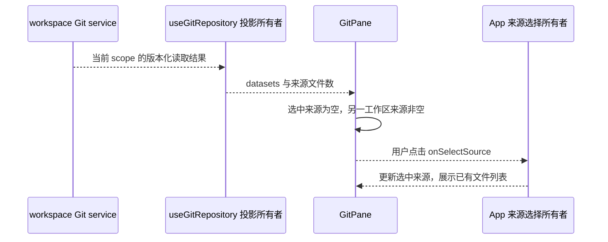

# Git 审查来源可见性

## 问题与规则

关联 issue #158。聊天 Git 摘要汇总已暂存与未暂存改动，审查面板仅显示所选来源。
已暂存为空而未暂存有文件时，原有通用空提示无法直接指出改动在哪个来源。
截图支持来源错位的判断，但不能证明原现场文件是否实际写入。

- 来源选择器显示每个来源的文件数，包括 0；计数使用既有 `sourceOptions.count`，不按新增/删除行数判断，兼容二进制、重命名和零行变化。
- 当前选择为已暂存或未暂存、当前无文件且另一工作区来源有文件时，空提示明确展示另一来源名称和文件数，并提供一次点击切换入口。
- 不自动切换用户选定的来源；刷新、文件暂存/取消暂存也不强制改选。
- 读取中、读取失败、非 Git 仓库、Git 不可用以及上一轮/分支来源不显示该工作区来源建议，保留既有状态提示。
- 只展示当前 workspace 既有读取投影，不根据智能体文字认定文件已修改，不补造 diff，也不发起 Git 写操作。

## 所有者与边界

`useGitRepository` 继续持有 Git 读取投影、版本校验与 workspace 隔离；App 与既有 side pane memory 持有用户来源选择；GitPane 从同一投影派生空态建议，经现有 `onSelectSource` 请求切换。无新状态、协议、服务或持久化格式。Desktop 与手机 Web 使用同一组件和既有 Host 读取路径，不改变 continuous/replayable 语义、owner/lease 或重连规则。

## 验收

真实 GitPane 和 useGitRepository 配合模拟 Host 读取：

1. 已暂存 0、未暂存 1（+56）：已暂存保持选中，空态提示未暂存有 1 个文件，点击显示真实文件行；下拉列表和触发器显示计数。
2. 未暂存 0、已暂存 1：反向建议可用，刷新不自动改变用户选择。
3. 改动为二进制/零行变化时仍能通过文件数找到来源；两边都空时没有切换建议。
4. loading/error/非仓库/Git 不可用不显示来自旧投影的建议；上一轮和分支来源不出现工作区建议。
5. 桌面与窄屏、深浅主题及中英文均可使用；计数、提示和按钮不造成页面横向溢出。不启动智能体、不提交/暂存文件。

## 本地验证

- `gitReviewSources.e2e.mjs`：修改前在截图对应的已暂存空态缺少切换入口处失败；修改后全部场景通过。使用真实组件与 hook、模拟 Host，不代表原现场文件或生产部署已验证。
- `pnpm typecheck`：首次因新 worktree 缺少工作流包生成声明而失败；执行 `pnpm --filter @zcode/dynamic-workflow-runtime... build` 后重跑通过。
- `pnpm lint`：0 错误、74 个警告；改动文件单独检查为 0 警告、0 错误。格式检查与 `git diff --check` 通过。
- 架构检查前后均为 0 违规；仅修改 ui 模块，未新增跨模块依赖。源码净增加 52 行，状态所有者与请求时序保持上述规则。
