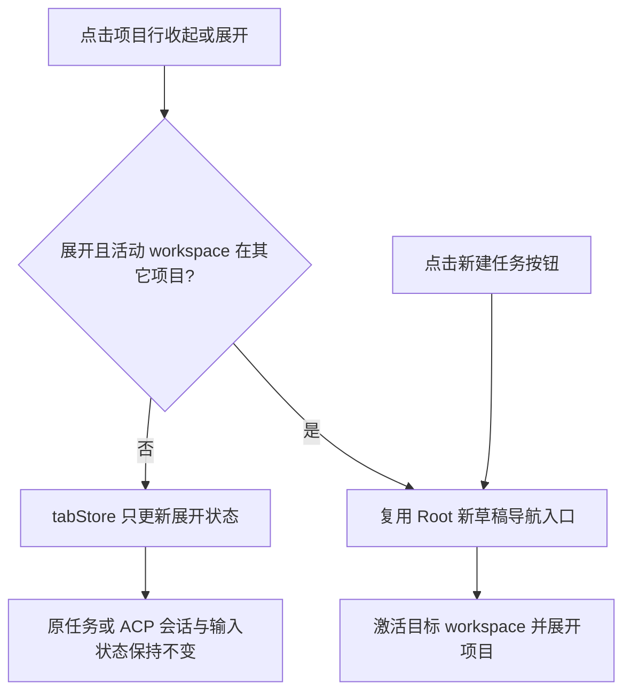
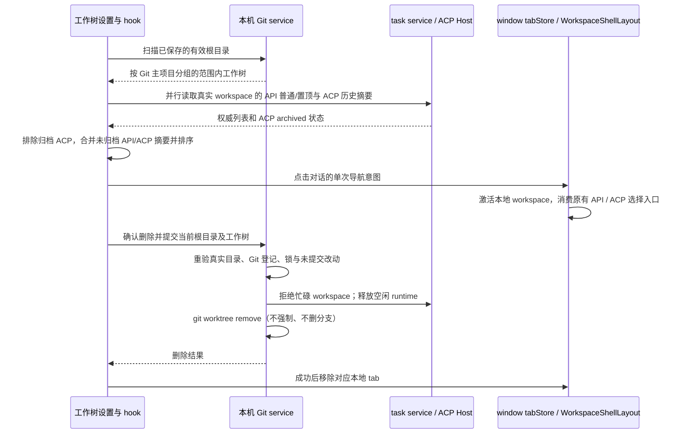

# Git 工作树

## 行为

在设置页增加独立的“Worktrees”分区，维护全局工作树根目录。默认根目录按本机 host 的用户 home 动态计算为：

```text
<用户 home>/.code/worktrees
```

用户可以在设置页修改并保存该目录。新任务输入框上方的 Git 分支菜单提供“新建工作树”：点击后在同一菜单进入“选择工作树来源分支”列表，用户必须明确选择一个本地分支，才将当前草稿切为工作树模式。此步骤只读取分支，不切换当前分支、不创建目录或会话。已被其他工作树检出的分支仍可作为派生来源；它们不能在普通切换模式中被选中。用户可搜索、鼠标或键盘选择，取消来源选择保持原草稿。选定后触发器显示“新建工作树 · <来源分支>”，完整名称通过提示可读；再次打开菜单可更换来源或取消工作树模式。只保存分支名称，绑定当前 workspace 身份与草稿代次，不持久化。远程 workspace 和历史会话仍不提供该入口。

首次点击发送时，先读取当时已保存的根目录，再由 Git 服务把所选本地分支的 `refs/heads/<来源分支>` 解析为提交，冻结本次创建的起点，再自动生成四位十六进制随机标识（如 `ec86`），执行：

```text
git worktree add -b worktree/<随机标识> -- <worktreeRoot>/<随机标识>/<仓库名> <来源提交>
```

创建成功后把本次草稿正文、编辑器状态、模型及模式选择移交给新工作树，保留原 workspace 和 Git 分支不变；通过 Root 现有的新草稿入口在当前窗口打开新目录，等目标 Composer 就绪后自动发送**一次**。不能在原目录先发送或要求用户再次点击。目标目录成为独立 workspace tab，不能继承原 workspace 的历史对话。ACP 首发保留所选智能体，但只在目标 workspace 创建其新会话。

选择与发送之间来源分支前进时使用发送时的提交；当前目录被外部切换不影响已选来源。随机名冲突重试时仍使用同一提交，不能再次跟随分支移动。来源为空、非法、已删除、只有同名标签/远端分支时返回稳定 `target-branch-not-found`，显示来源分支不可用的本地化提示，保留原草稿和来源选择，不创建工作树或会话，不静默退回 `HEAD`。`GitCreateAutomaticWorktreeRequest` 新增可选 `sourceBranchName`；未提供字段的旧调用保留当前 HEAD 的兼容语义，新 UI 必须提供所选本地分支。不改变显式 `createWorktree(startPoint)` 或待办任务的持久来源配置。

项目侧边栏按 Git 返回的主工作树路径展示关联关系：主仓库已经作为本地项目打开时，主仓库与关联工作树的 API、ACP 对话平铺在同一个项目下，不再显示工作树目录、分支名、子项目标题或第二层展开控件。复用现有跨 workspace 对话列表及普通单行对话样式，统一按用户选择的创建/更新时间排序，运行中的对话保持既有运行优先规则。分页属于这个项目的合并列表；置顶对话仍进入既有置顶区域。工作树对话在静止状态下于右侧显示小分支图标；悬停、键盘聚焦、归档确认或触屏无 hover 环境时隐藏图标，由同一右侧区域显示置顶/取消置顶与归档操作，离开后恢复图标。显示规则直接复用会话行既有交互状态，图标不加入 Tab 顺序，真实目录保留在行的无障碍描述中；普通主仓库对话不显示该图标，图标不执行新建、跳转或 Git 操作。多个工作树共享同一个顶层项目；主仓库未打开时，工作树仍作为独立项目可见，已确认的工作树对话保留图标。同名但 Git 仓库关系不同的项目不合并，远程项目不参与本地关系解析。顶部项目的收起/展开控制全部对话是否可见；激活新建工作树后，其父项目自动展开一次。任务查询、草稿、导航、文件树、菜单操作与 Git 操作始终使用实际工作树路径和原有 workspace identity，不能把子工作树会话写入主仓库。

主项目与关联工作树的合并对话列表位于同一个侧栏折叠内容区域。包含工作树的项目使用 `forceMount` 保留列表及订阅实例，收起与展开随同一高度和淡出动画进行，不能重建工作树会话订阅或关闭已打开的对话。工作树 tab 及真实 workspace 身份仍由 tab store 持有；旧的子工作树展开状态不再决定平铺对话是否显示，也不迁移或删除历史数据。置顶区域和时间线复用同一图标，置顶后工作树身份仍可辨认。工作树完整清单、创建与删除入口继续由设置页管理。

项目内没有 API 或 ACP 对话时，普通项目和工作树聚合项目的“暂无任务”提示使用相同的缩进、字号及弱提示文字颜色，以现有 `TaskList` 为准。`WorkspaceTimelineTasksSection` 通过已有 `taskRowVariant` 决定展示：`default` 使用普通项目空提示，`timeline` 保留时间线的展示规则。此规则由 UI 列表组件持有，不增加状态、接口或数据写入；加载状态继续由既有查询负责。

点击项目行展开时，只有当前活动 workspace 既不是该项目、也不是该项目的工作树子项目，才启动该项目的新草稿导航；当前项目或子工作树已有选中任务/ACP 会话时，展开操作只改变项目显示状态，不能调用新草稿入口或覆盖活动会话。

### 设置页管理

“工作树”设置页在目录输入框下按 Git 登记的主项目路径分组显示工作树。只展示已保存的有效根目录内真实存在、且被 Git 登记为 linked worktree 的目录；兼容该根目录的直接子目录和自动创建的 `<标识>/<仓库>` 目录。不依赖已打开的 tab，也不展示主工作树、其它根目录中的工作树、同名前缀目录或经符号链接逃出根目录的路径。目录为空使用本机 `<home>/.code/worktrees`；`~` 和相对路径沿用创建工作树的解析规则，相对目录以当前本地项目为基准。根目录不存在展示空状态，不自动创建；读取失败展示可重试错误。

每棵工作树显示分支、完整路径、“在此工作树中新建对话”和“删除”入口。下方只显示该真实 workspace 的未归档 API 与 ACP 历史对话（包含置顶记录），按最近更新时间倒序；空会话草稿不列入，读取失败与没有对话区分。归档状态仍由 task service / ACP Host 持有，设置页仅投影读取结果：API 并行读取普通与置顶列表，不查询归档列表；ACP 复用既有 workspace 历史投影并排除 `archived` 会话，包含同时置顶和归档的记录。每次进入设置页或刷新时使用服务当前结果；归档入口继续提供归档历史，不迁移或删除会话数据，不修改工作树登记。只有归档会话时保留工作树卡片并显示原有无对话提示；普通、置顶或 ACP 读取失败仍显示错误及其余成功结果。点击对话复用现有 API task 或 ACP Host id 的选择事务，必要时补开本地 workspace tab，退出设置后进入对应历史对话；同路径的远程 tab 不能夺取本地工作树导航。不把 ACP id 送进原生 task 路由，不自动发送或创建 Agent 会话。

点击历史对话时，先通过本机 `IWorkTaskService.list` 读取 Git 主项目的待办绑定。仅当项目 scope、实际执行目录、会话 kind/id（ACP 还包括智能体）均匹配，且任务仍在待办看板可见时，进入该项目的对应待办任务及内嵌对话；不补开工作树项目 tab 或走普通聊天选择。普通对话、已归档/取消的任务及合并专用会话保留历史对话入口。旧 Host 不提供待办服务时沿用普通入口；绑定读取失败保留设置页并显示已有读取失败提示，不能把未知归属当作普通对话。快速连点只接受最后一次导航，切目录/卸载/Host 改变后迟到读取无效。

任务事实仍由 Host 持有；项目及任务选择由既有 `workTaskNavigationStore` 持有，设置页只提交一次导航意图。先保存项目/任务选择并补齐本地主项目 tab，再标记显式待办导航、选择待办主视图并激活 tab；从待办进入设置后再点击同一个待办也必须保留显式导航。无需持久格式迁移，不改变会话、owner/lease、队列或实时/恢复链路，不发 Agent 或任务写命令。

```text
设置页点击 -> 本机主项目待办绑定读取 -> 最后点击/当前目录校验
  匹配 -> workTaskNavigationStore（唯一选择 owner）-> 本地主项目 tab -> 待办内嵌对话
  未匹配 -> 既有 API/ACP 聊天入口
desktop/mobile: 复用目标页面已有 continuous/replayable 链路，不创建 Host 或会话
```

验收：API/ACP 命中正确任务；同 id 不同目录/kind/智能体/远端 scope 不串任务；父项目未打开或存在同路径远端 tab 时仍补齐本地主项目；从待办设置往返及重复点击保留选择；普通历史对话、新建对话、归档/取消任务保留原入口；失败可重试，快速连点/目录切换/卸载忽略迟到结果，全部导航零业务写命令。

删除需要一次确认，说明将删除工作树目录、保留 Git 分支和应用保存的对话历史。服务在删除时重新校验真实根目录、linked worktree 登记及主项目关系，拒绝根目录本身、主工作树、未登记或目录外目标。存在未提交文件、锁定、子模块或运行中的 API/ACP 对话时不强制删除，给出明确原因。删除通过 `git worktree remove` 执行，不用递归文件删除模拟 Git 注销，不删除分支或对话；释放空闲 runtime 后执行，成功才从管理列表和本地 tab 移除。删除失败保留该工作树和设置页；只清理已经空的随机标识父目录，不清理邻居目录。

工作树可能包含大量被忽略的依赖与构建文件，Git 删除目录的耗时不适用普通查询的 15 秒预算。仅 `git worktree remove` 使用独立的 2 分钟超时，前置查询继续使用原预算；超时或非零退出仍返回失败，不提前归档。删除期间持续持有原 workspace 启动屏障及同目标互斥，完成后才释放。此调整防止正常目录清理在 15 秒被中断，不承诺缩短磁盘删除耗时，也不增加自动重试、后台任务或持久状态。

验收：模拟一次需要 16 秒的删除，在原查询预算下会被中断；删除专用预算允许其成功注销工作树，保留分支和邻居，期间禁止 runtime 重启。真正超过删除预算时仍失败并释放屏障；脏目录、锁定、错误归属和忙碌检查维持原行为。

目标路径规则为（仓库名取 Git 解析出的仓库根目录名，不能用可能指向仓库子目录的 workspacePath 推断）：

```text
<worktreeRootDirectory>/<四位随机标识>/<仓库名>
```

生成的分支名为 `worktree/<四位随机标识>`。服务在执行 Git 前检查随机标识对应的目录是否已存在；目录或分支撞名时换一个标识重试，最多八次，不覆盖已有目录或分支，耗尽则返回明确失败。根目录设置为相对路径时相对于当前 workspace 解析，`~` 只展开为本机 host 的用户 home。现有显式指定分支名和路径的 Git service 接口继续可用，已有工作树不重命名。

默认目录从 `<用户 home>/.codex/worktrees` 调整为 `<用户 home>/.code/worktrees` 后，只影响未显式配置目录的新建工作树；已保存的自定义目录（包括用户主动设置的旧路径）继续生效，不迁移已有工作树或更改其 Git 注册信息。

## 状态所有者与边界

- Worktrees 设置页持有 `worktreeRootDirectory` 的编辑草稿，保存通过 `ISettingService.update` 写入全局 `AppSettings`；未保存的草稿不影响 Git 创建流程。
- Worktrees 设置页的目录输入采用失焦自动保存：输入框失去焦点后提交去空格后的值；空值或默认目录删除显式配置并在输入框回显 `<用户 home>/.code/worktrees`，即使原先已处于默认状态、没有发生设置写入也要回显。不提供保存或恢复默认按钮；保存中禁用输入框并标记忙碌，成功不打扰用户，失败保留草稿并提示错误。
- 工作树目录行只显示标题、简短的 `text-ui-sm` 说明和当前目录输入框；右侧输入区域在桌面宽度约占一半，让完整路径更容易查看，窄屏时独占一行。默认目录由输入框直接展示，不在说明下方重复显示“默认目录：…”路径。加载时仍以输入框占位提示用户目录正在读取。
- 壳层只持有当前 `workspaceKey + draftFocusVersion + sourceBranchName` 的工作树选项及一次性目标续发意图；Composer 持有发送中的互斥状态和冻结草稿。分支菜单只持有来源选择页面和搜索文本，不另存已确认来源。已选模式不持久化，普通历史会话和远程 workspace 不提供此选项；显式取消则清除模式。
- 壳层通过 `useWorktreeDraftSelection` 持有来源和创建状态，复用 `WorktreeDraftIntent` 传给 Composer；设置读取期间若切换 workspace/草稿/Host，拒绝尚未执行的创建。Git service 复用既有 `resolveLocalBranch` 严格本地分支解析，自动名称分配 Repo 仅接收冻结的 `startPoint`，不新增第二条来源解析路径。
- Worktrees 设置的持久值在真正发送时解析，`IGitService` 是创建工作树的唯一写入路径。新工作区的草稿由既有 Composer draft store 持有，Root 的新草稿入口持有 workspace tab；没有第二份会话/任务队列。
- Git 仓库状态、仓库根目录、随机名分配、冲突重试、目标目录校验、`git worktree add` 执行结果和稳定错误码由 `IGitService`/`GitCliRepo` 持有。
- 自动续发意图仅在成功创建后建立，绑定准确的本地目标路径和一次请求 ID。目标 Composer 在已恢复草稿、模型/ACP 已可发送时消费一次；用户改动目标正文、切到其他对话或就绪失败时不得拿迟到请求发送。普通 API 与 ACP 都走各自现有 Composer 发送路径。
- `workspaceIdentity?.trim() || workspacePath` 继续作为 workspace 关联 key；本地创建的工作树不产生远程 identity。
- Git service 的 `getWorkspaceRepositoryInfo` 负责从 Git 查询 linked worktree 的主工作树路径；侧边栏只持有针对当前本地 tab 的异步关系投影，并由现有 tab store 持有 tab 顺序、项目展开状态和持久化。分组投影给出每个项目的真实 workspace scopes 及已确认的工作树身份；合并列表复用 `WorkspaceTimelineTasksSection`、window Host Controller task list 与 ACP Host 摘要，UI 不维护第二份会话索引或菜单写入路径。查询失败或目录已失效时保留各自项目行，不用名称或目录约定猜测关联；移除任一 tab 不删除 Git 工作树或其会话。
- 关系 hook 的单一查询快照绑定本机 Git service 与本地路径集合，派生分组和加载状态；路径集合或 Host 变化后忽略旧响应。侧边栏和任务面板统一读取已解析的分组投影 `resolvedGroups`；仓库面板读取同一 hook 的解析结果。启动恢复或新增项目时，未确认 Git 关系的本地路径不能先作为独立项目渲染；首次解析且没有可展示项目时使用既有“加载中”文案，完成后才显示项目或“暂无项目”。新增路径解析期间保留同一 Git service 已确认的项目及对话列表组件，远端项目不等待本地关系查询。主仓库未打开、非 Git 目录和关系查询失败的路径在查询结束后仍独立可见，不按目录名称猜测归属，不永久隐藏。项目切换不重启关系查询，关联工作树仅用于主项目的选中标记，不改变实际 workspace scope。

```text
tab store 恢复/新增路径 → 关系 hook（绑定 Git service + 路径集合）
  → 解析中：resolvedGroups 保留已确认项目，暂缓新本地路径
  → 当前查询完成：Git 归属投影 → 侧边栏按主项目展示
  → 过期路径集合/旧 Host 响应：不能写入当前投影
```

此变更仅调整侧边栏的读投影与首次加载提示；tab、会话、草稿和 owner/lease 的所有者不变，不新增持久化或业务写命令。Desktop 与手机 Web 共用侧边栏投影；desktop-continuous 与 web-remote-replayable 链路保持各自既有语义。

- Git 操作只在当前 workspace 对应的本地 Git service 中执行；带 `workspaceIdentity` 的远程 workspace 不显示创建工作树入口。设置页和选项均不调用平台目录选择器。
- 管理列表是本机 Git service 对当前配置根目录的只读投影；目录范围校验和删除幂等由 Git service/repo 持有，会话事实分别由现有 task service 与 ACP Host 持有。UI hook 只保存加载、确认和删除状态；目录变更和卸载使旧查询结果失效，不建立另一份持久工作树索引。
- 设置到对话的导航是一次 renderer 意图，由 window-scoped tab store 激活目标并交给既有 WorkspaceShellLayout 选择入口消费一次；新建对话沿用 Root 的新草稿入口。设置页不写入业务 session 状态、不调用 Repo。
- 删除前通过 Git service 注入的 runtime 准备端口检查 API/ACP 活动状态并释放空闲进程；ACP 的 workspace release 只断开连接、保留已接受的历史，不能调用会话删除接口代替。
- 附件和图片以及代码评论、网页/PPT/划词、分享上下文属于原 workspace；当前没有跨 workspace 的安全转移契约。这类草稿发送时先阻止创建并提示保留原草稿，不能把旧目录的引用悄悄送到新工作树。

## 失败语义

服务返回结构化结果，不把 Git 原始 stderr 作为 UI 状态判断依据。至少归一化以下错误：

- 自动分配名称八次仍碰撞；显式创建时分支名无效或分支已存在；
- 分支已经被其他工作树占用；
- 目标路径无效、已存在且非空；
- 当前 Git 操作进行中；
- Git 命令超时或返回未知错误；
- 当前 workspace 不是 Git 仓库。

创建失败时留在原工作区及工作树模式，保留正文和配置，不打开新 workspace、不发送。成功返回真实分支及绝对路径；若打开 workspace 失败，Git 创建不可回滚，保留目标工作树路径和未发送的草稿并提示用户，不自动重建第二棵工作树。目标 Agent/模型不能启动时只保留目标草稿，不能回到原目录重发。

## 事件顺序

```text
设置页输入目录并失焦 → 自动保存根目录
分支菜单选择新建工作树 → 只读来源列表 → 用户选本地来源 → 壳层保存当前草稿来源（不写 Git）
用户首次发送 → Composer 校验并冻结纯文本草稿 → Git service 解析根目录/仓库和来源提交并分配随机标识
  → 冲突重试 → worktree add → 目标路径写入草稿、绑定一次性续发意图
  → Root 新草稿入口激活新 workspace tab → 目标 Composer 恢复草稿和模型/ACP
  → 目标 Composer 消费意图 → 原有 API createSession/sendText 或 ACP prompt
项目侧边栏观察到本地 tab → Git service 查询主工作树路径 → 丢弃过期 tab 查询结果
  → 投影为一个项目的真实 workspace scopes → 复用跨 workspace 对话列表平铺排序
  → 各行保留真实 workspace key → API / ACP 既有选择和菜单命令
```





发送中的互斥状态阻止双击并发创建；同一次提交中的随机名只由服务分配，不在客户端预生成。用户在创建中离开原草稿时，迟到结果不能发到旧 workspace；只有匹配目标草稿的续发意图能提交一次。Git 的分支创建保证同名分支不会被覆盖；当前 workspace 的 dirty changes 不阻止创建。

## 验收场景

1. 设置页首次打开且没有已保存配置时，输入框显示 `<用户 home>/.code/worktrees`；说明文字为次级小字号，不出现单独的默认目录提示行；输入自定义目录并离开输入框后自动保存，刷新设置仍保持该目录。
2. 清空目录并离开输入框；断言显式配置被删除，目录恢复为 `<用户 home>/.code/worktrees`，且不出现保存按钮、恢复默认图标或成功 toast。
3. 桌面设置页检查工作树目录行：输入框占据右侧宽列而非被图标挤压；窄屏时输入框换到标题说明下方并填满可用宽度，不发生水平溢出。
4. 在本地 Git workspace 的新任务选择“新建工作树”：先显示可搜索的来源列表，包括被其他工作树检出的分支；选定后触发器显示来源名称，无目录选择、无 Git 切换/创建。更换来源或取消只改草稿；点击历史任务/重新新建任务/切换 workspace 也不沿用旧来源。迟到列表不得串到新目录。
5. 用普通 API 纯文本首发：生成 `worktree/ec86` 一类分支及 `<根目录>/ec86/<仓库名>` 一类路径，目标 HEAD 等于发送时所选来源提交，打开目标新工作区并自动发送一次；原目录不生成会话，正文和模型选择无丢失。选来源后外部切换原目录，仍从所选分支派生。
6. 选 ACP 智能体并首次发送：同样先创建工作树，在目标路径创建对应智能体的新会话并自动发送一次，不会复用原 workspace 的 ACP 会话。
7. 从仓库子目录发起创建，断言末级目录仍是 Git 仓库名而非子目录名；生成目录自动由 Git 创建（此前根目录可以不存在）。
8. 某个随机标识对应的目录或分支已存在时换一个标识，不覆盖已有内容；八次均碰撞时显示失败，正文和当前 workspace 不变。
9. 显式指定分支和路径的原有服务调用仍正常校验空/非法分支、非空目录及分支冲突，不改变已有数据。
10. 当前仓库有未提交改动；断言仍可创建工作树，当前 workspace 的分支和改动不变。
11. 附件或绑定旧目录的结构化上下文首发；断言提示不能转移，不创建工作树，不清除草稿。
12. 非 Git workspace、Git 命令超时、连续点击发送；断言最多一次创建、不打开错误 tab、不发送到原目录，并显示错误。
13. 升级前显式配置了旧目录时，仍在该目录下新建工作树；未配置目录时，新工作树派生到 `<用户 home>/.code/worktrees`，已创建的工作树路径保持不变。
14. 主仓库与新工作树都已打开时，只有一个顶层项目；主仓库与多棵工作树的 API、ACP 对话直接平铺，统一排序和分页，不出现工作树子目录标题、分支名称、额外缩进或子项目展开按钮。点击工作树对话激活真实工作树路径；旧的工作树展开状态为收起时，该对话仍显示。
15. 重启恢复 tab 后再次从 Git 解析关系并得到相同层级；主仓库 tab 未打开或查询失败时工作树仍独立可见；两个恰好同名但无 Git 关联的仓库，以及本地与远端同路径的项目，不合并。
16. 主项目与工作树均有任务且已展开时，点击主项目收起：合并对话列表在父项目动画期间及动画结束后都保留组件实例，下一项目随父项目高度逐帧上移，对话被折叠区域隐藏；再次展开后主仓库和工作树对话一起出现，已打开的 ACP 对话保持选中。仅普通项目的收起动画保持原样。
17. 选中工作树中的 API 或 ACP 会话后收起主项目，再展开主项目；活动 workspace、任务/ACP 会话和输入状态保持不变，不打开主项目新草稿。活动会话在主项目自身时也遵守同样规则；从其它项目点击一个收起的项目，才打开该项目的新草稿。
18. 根目录内存在多个项目的工作树且 tab 都未打开；设置页仍按主项目路径列出它们。目录外、同名前缀目录、主工作树、符号链接指向目录外的目标均不显示；修改根目录后旧列表立即失效，迟到响应不能覆盖新目录。
19. 工作树内同时有 API 普通、置顶、归档会话与不同 ACP 智能体会话；只显示未归档会话（包含置顶），ACP 同时置顶和归档也不显示，更新时间倒序、API 重复 id 去重，不调用 API 归档查询。只有归档会话的工作树仍显示卡片与原有无对话提示，归档数据保持可从归档入口读取。归档/取消归档后刷新设置页，列表按当前服务结果隐藏/恢复；读取失败保留错误与其它成功结果。点击可见 API / ACP 对话分别进入原有对应会话界面，工作树路径正确且不发送模型请求；未打开的 workspace 能补开并只消费一次导航。
20. 从工作树管理点击新建对话，退出设置并进入该工作树的新草稿，历史不加载、不发送。窄屏卡片和完整路径换行，不出现横向滚动；深浅主题与已有设置卡片一致。
21. 删除干净工作树：确认前不执行 Git，取消不修改目录；确认后 Git 注册和目录消失，Git 分支和 API/ACP 对话文件仍存在，已打开的本地 tab 移除；重复提交不会删除其它目录。
22. 删除含未提交/未跟踪文件、锁定或运行中对话的工作树，断言明确阻止、文件与注册保留；直接调用服务删除目录外、根目录本身、主工作树或未登记目录也被拒绝。并发删除同一目标只执行一次，失败不先移除 UI 行。
23. 工作树 API 与 ACP 对话静止时右侧显示小分支图标（包括已置顶行），普通主仓库对话无图标；hover/focus/归档确认/触屏时图标与操作组互斥，离开交互后恢复图标，不增加行高、横向溢出或隐藏图标的 Tab 停靠点。行的无障碍描述保留真实目录，右键复制任务路径、在分屏打开和重命名等操作保持真实工作树目标。
24. 在桌面和窄屏、深浅主题检查平铺行：标题与普通对话对齐，图标无额外行高或横向溢出；收起并展开父项目保留活动 API/ACP 对话、未发送输入和 Composer 实例。不启动智能体、不创建新会话、不迁移旧对话。
25. 普通项目与包含工作树的项目都没有 API/ACP 对话：两处“暂无任务”的文字左边缘、字号、行高和颜色一致。桌面/窄屏及深浅主题均无横向溢出，时间线展示仍沿用已有模式；验证复用真实列表组件和空查询，不创建会话或调用模型。
26. 启动恢复主项目和关联工作树，延迟 Git 关系响应：解析期间不渲染任一本地独立项目行，也不显示“暂无项目”；显示加载提示，响应后只出现主项目。用 DOM 变更记录断言关联工作树项目行从未挂载。
27. 已确认主项目与工作树后新增项目/工作树并延迟响应：原项目行和对话列表实例保持挂载，活动会话保持选中，新增工作树从未出现独立项目行；新普通项目仅在解析后出现。快速新增/移除 tab 及切换 Git service 后，迟到结果不能改变当前列表；远端同路径项目始终独立可见。
28. 主项目未打开的工作树、非 Git 目录、单路径查询失败在解析结束后仍独立展示；桌面/窄屏和深/浅主题遵守相同规则。验收只读取模拟 Host，不调用模型、不写 Git 或真实用户数据。

## 空提示样式验证

- 所属模块为 ui，使用已有 `taskRowVariant` 派生展示；源码净新增 7 行，没有新增状态、协议或持久化写入。
- 真实列表组件的页面验证先复现文字左边缘相差 22px、颜色透明度不一致，再通过修复后的宽/窄窗口和深/浅主题四个场景。既有工作树 API/ACP 行、置顶、归档确认、路径选择、排序及分页场景同时通过。
- 根目录类型检查通过，Lint 为 0 errors、72 warnings；架构检查 baseline/current/new 均为 0，改动文件格式及 `git diff --check` 通过。
