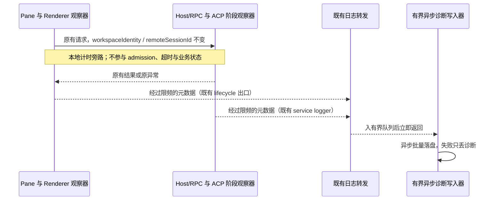

# 本地慢加载与异常诊断

## 规则与所有者

- 用于 issue #46 的后续取证，不预设卡顿根因。诊断只观察，不能更改业务结果、错误对象、超时、重试、队列、权限、连接选择或进程退出方式。
- RPC 中间件记录加载类方法的服务端耗时；ACP Host 记录连接阶段；Pane 记录 list/create/refresh 的客户端等待；Renderer 记录可见页面长任务、事件循环延迟及未处理异常。业务状态仍由原有 Host/runtime/store 持有，诊断计数器只由各进程的采集器持有。
- 操作超过 1000 ms 或失败时记录一次结果；超过 5000 ms 尚未完成时记录一次 pending，完成时可记录终态。记录开始时间、发生时间、进程侧、操作名、局部关联 id、最后阶段及阶段耗时。pending 是观察事实，不是请求超时。
- 操作采集器最多跟踪 64 个在途操作，用一个 1 秒检查定时器；空闲清除定时器，Node 定时器 unref。5 分钟后释放仍未完成操作的诊断槽位，不取消操作；每分钟最多输出 20 条，后续输出带 suppressed 数量。所有 sink 异常都吞掉，原异常原样抛出。
- 不采集 RPC 参数/结果、消息正文、附件内容、命令、工作区路径、URL、环境变量和凭据。操作及阶段是源码内的静态标签。错误只记录白名单类型、固定原因分类及去路径的行列号，不记录任意错误正文。
- ACP 连接标记 spawn、initialize、MCP 转换、session/new 或 session/load、原生 usage 读取；Host 的 MCP 设置、启动配置、插件能力和工作流注册单独计时，保留原来的并行顺序。记录 Adapter 退出的 PID、exit code、受控信号和是否由本应用主动关闭，不读取 stderr、不将受控关闭误判为崩溃。
- Renderer 每 10 秒最多汇总一次超过 200 ms 的 longtask 和超过 250 ms 的事件循环延迟。1 秒检查仅在页面可见时计量，后台计时节流和可见性切换不计为卡顿；不采集 DOM、对话或 PerformanceEntry 原文。全局异常监听不调用 preventDefault、不改变已有错误边界和 ARMS 上报。
- Main 也每秒观察一次超过 250 ms 的事件循环延迟，使用同样的限频旁路；应用退出时停止。它不能区分 CPU 热点、系统暂停和调度延迟，不能据此认定根因。
- Main 未捕获异常通过 `uncaughtExceptionMonitor` 旁路观察；已有 unhandledRejection handler 内补充相同的固定分类。不新增会吞掉异常或阻止默认退出的 uncaughtException handler。
- React 错误边界通过既有 `logger.lifecycle` 记录同样的有界异常分类；复用 `packages/ui/src/logger.ts`，不由组件直接访问平台桥。

## 文件与崩溃证据

- 新诊断通过 `[diagnostics]` 标记进入独立 `logs/YYYY-MM-DD.diagnostics.log`；Main 是唯一文件写入者。异步批量 append，不在业务调用中同步 mkdir/stat/write，不影响原主日志格式和写入策略。
- 队列最多 256 KiB、每行最多 8 KiB、每批最多 32 KiB，延后 100 ms 合并写入。单日文件最多 5 MiB（包含本次写入），溢出或磁盘失败丢弃诊断；恢复后记录丢弃数量。沿用 14 天保留期和现有日志导出目录。
- 原有 native crash reason/exit code、OOM dump 注解及本地 crash archive 继续是崩溃取证来源，不新增重复 crashReporter 或退出处理器。Main 崩溃前未写完的诊断可能丢失，不能承诺每次硬退出都有最后一条日志。分类 unknown 时必须继续结合 dump/profile 调查，不能伪造根因。
- 无协议、持久业务 schema 或历史迁移；Desktop continuous 与手机 replayable 不变。手机/Web 没有本地桌面日志桥时不额外上传用户信息。

## 验收

1. 快调用不增加诊断输出；慢、失败、未完成请求能够按时间/关联 id 定位，失败对象和返回值保持一致。sink 抛错、槽位/限频溢出及迟到完成不改变操作结果。
2. 并行源读取与既有连接握手顺序不变，恢复仍沿用原权限、生命周期和超时；pending 不触发取消、重试或新会话。
3. Renderer 长任务只汇总数值，后台不误报；观察器不支持/创建失败/sink 失败时页面仍可用；stop 清除监听、observer 和 timer。
4. 错误包含私有路径、URL、凭据时新诊断不输出它们；React 错误边界保持原有恢复与上报。
5. 异步写入在慢盘、写失败、日期切换、队列和单文件超限时有界；调用不等待磁盘，恢复可写且保持已接受诊断的顺序；旧日志仍按原保留期清理。
6. 执行针对性单测、已有 ACP composer 交互 E2E、`pnpm typecheck`、`pnpm lint` 和 changed architecture；报告环境限制。安装包上的真实卡顿闭环需后续构建运行日志，不把 synthetic 验证当成生产修复。

## 本地验证（2026-10-10）

- Node 24.14.0、pnpm 10.33.2；先安装锁定依赖并构建已有 dynamic-workflow / dynamic-workflow-runtime 产物。主 `pnpm typecheck` 通过；lint 0 errors；changed architecture current/baseline/new 均为 0。
- 新增 13 项单测通过：RPC 返回值/原异常、pending/阶段/限频/过期槽位、生产 Renderer 出口、后台节流、观察器失败、有界慢盘队列、真实异步文件写入、保留期、Main monitor 清理与实际子进程致命异常仍正常失败退出。
- 新诊断 E2E 在 1280/375px 通过：真实 ACP hook + synthetic Host，挂起 list 产生 pending；日志 bridge 抛错后继续就绪并保留草稿；全局异常不被吞掉；React scoped 错误边界仍隔离故障，新诊断不含错误里的路径/测试凭据。
- 现有 3 组 E2E 通过：ACP 会话等待隔离/直接 admission、草稿连接复用、配置预览。旧草稿复用脚本固定 5174，首轮访问了另一工作树；临时副本改为本次 5196 并等待 fixture 初始化后执行，副本已清理，未修改原脚本。
- ACP 相关现有单测 40/41 通过。失败的 `ACP goal persists while prompt blocks and attachment bytes never enter the snapshot` 预期对象缺少完成时新增的 `endedAt`；用 HEAD 原始 service 实现单独复测得到同样失败。本次不改该断言。连接工厂整理后另跑 stdio 10/10 通过。
- 额外 Desktop main/renderer 类型检查仍失败：当前与隔离 HEAD 源码各 210 条诊断，按文件/错误码比较无新增组，涉及 rootDir、浏览器类型和已有 Window/CSS 声明等。该检查不计为通过；清理了本次 compiler 产生的附带输出。
- 10,000 次 synthetic 快调用耗时约 79 ms、无新增记录、结束时 active=0。这只衡量本机辅助器的合成开销，不是已安装应用的端到端性能结论。
- 未构建、替换或重启已安装 CodeVori，未提交、推送或修改远端 issue。新日志需在包含本次源码的运行实例中验证；默认路径为 `~/.zcode/v2/logs/YYYY-MM-DD.diagnostics.log`，数据目录覆盖沿用既有配置。
