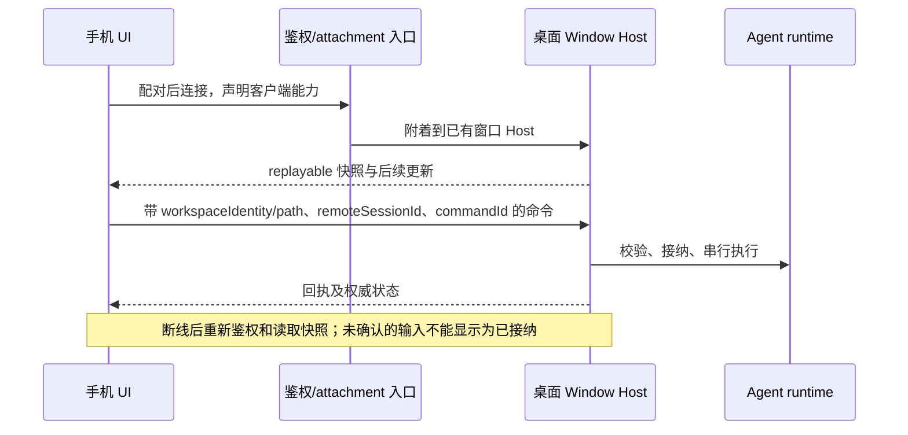
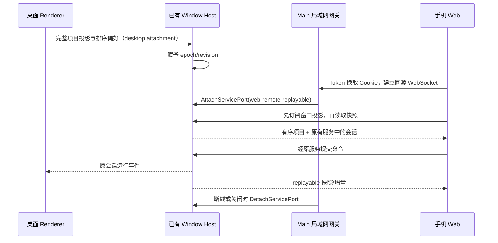

# Issue #146：手机 App 开发方案草案

## 条目与当前证据

- `caiqiqqq/zcode-private#146` 是开放的 enhancement，标题为“手机app的开发”，正文只问“想开发这个的手机app，应该怎么做”。它没有指定 iOS/Android、功能范围、是否脱离桌面独立运行或发布渠道。因此本文件是待确认的产品方案，不把它当作已复现的缺陷或已批准的实现需求。
- 实现前仓库已有 `packages/web` 的 React 入口、共享 `packages/ui`、WebSocket RPC 和窄屏布局，没有手机工程。本次新增 Expo 手机壳，但协议 `clientHello.clientKind` 的 `mobileRemote`/`mobileApp` 枚举值仍不能证明原生远控协议已实现。
- 普通 Web 入口连接 `/ws`；`/ws/remote/:id` 目前只暴露部分服务，Web 平台的 `connectRemote` 明确返回不支持。已有桌面 Window Host 的 attachment 和 `web-remote-replayable` 会话恢复语义，可以作为手机端接入的边界，但仓库中尚未确认完整的手机配对、鉴权、离线重连和发行链路。不能把浏览器可显示窄屏 UI 等同于可发布的手机 App。

## 建议的首期产品规则（待产品确认）

以“手机作为桌面 ZCode 的随身客户端”为首期假设：查看项目和会话、收发消息、处理待答复输入与权限请求、查看任务状态。代码执行、项目文件、Agent 和会话的权威状态仍在目标桌面 Window Host；手机不在本地启动第二套 Agent/Host。桌面未运行、目标 Host 不可达或身份过期时，展示明确的只读/断连状态，不把手机缓存的草稿当成已接纳命令。首期是否允许手机在桌面关闭时独立运行，必须另行决定；若允许，需要重新设计运行时、存储和同步方案。

建议先用现有 Web UI 完成真实手机浏览器连接的纵向验证，再决定采用可安装 Web 体验、Web 容器（例如 Capacitor）或原生 UI。若首期要求应用商店上架、后台推送或系统级能力，应先确定目标平台和审核/通知约束，再选择打包方式。当前仓库没有这些框架依赖，不预设它们已经可用。

## 状态所有者与接口

| 事实                       | 唯一所有者                            | 手机端职责                                              |
| -------------------------- | ------------------------------------- | ------------------------------------------------------- |
| 项目、任务、会话和命令接纳 | 目标 Window Host / 现有 Agent runtime | 经共享服务接口提交命令、显示回执与权威快照              |
| 未发送文本、交互草稿       | 手机 UI                               | 断连时保留为未发送，重连后由用户明确提交                |
| 配对/撤销与连接授权        | 待定的受信连接入口                    | 保存最小设备凭证；失效时重新认证，不在 URL/日志泄露凭证 |
| 客户端展示偏好             | 手机本地设置                          | 不覆盖 Host 的运行时事实                                |



沿用 `workspaceIdentity?.trim() || workspacePath` 隔离身份，`workspacePath` 仅用于目标 Host 的文件操作和展示；远端项目保留 `remoteSessionId`。保留 owner/lease、旧 run 守卫和 `CommandInbox` 的接纳边界。桌面 `desktop-continuous` 与手机 `web-remote-replayable` 分别验证；外部转发层只负责授权、心跳、转发与 attachment 调度，不持久化任务队列或会话快照。平台能力由 `IPlatformService` 注入，不让共享 UI 直接调用原生 API。

## 分阶段实施与验收

### 当前实现范围：局域网 WebView 壳

首个版本放在独立的 `apps/mobile` workspace，只做手机壳，不接管桌面 Agent 或 Host。它连接的是当前 Web 服务（例如独立运行的 `zcode --web`），不是桌面 Electron 窗口的远控二维码；两者未证明共享同一个 Window Host 或运行中会话：

- 用户分别输入 Web 根地址和必填访问 Token；以一份受保护的手机 SecureStore 记录保存，不把 Token 写入普通设置。首次页面请求按现有 Web 服务接口附带查询参数，服务将其交换为 HttpOnly cookie；局域网明文 HTTP 会暴露传输中的 Token，必须局限于可信网络。
- WebView 只允许继续访问已配置的同源地址；外部 HTTPS 链接交给系统浏览器。
- 当 Web 工作区实际宽度低于 768px（包括手机浏览器和手机 WebView）时，外层桌面侧栏在首次布局时自动收起，主内容占满可用宽度；侧栏显隐仍由 `useAppPanels` 的既有状态所有者管理，桌面宽度和用户手动显隐不受影响。Web 窄屏始终保留侧栏切换入口，工作任务看板再按自身容器宽度切换单栏/双栏。
- 移动 Web 使用 HTTP 局域网地址时，浏览器可能提供 `crypto.getRandomValues` 但不提供 `crypto.randomUUID`；所有 UI 临时 ID 必须通过共享 UUID 工具生成，不能直接调用 `crypto.randomUUID()`。UUID 能力差异不能阻断首屏渲染、输入框交互或会话初始化。OAuth nonce 保留现有安全随机源要求，不使用非安全随机降级。
- 回归场景：在 375px 手机视口禁用 `crypto.randomUUID`、保留 `getRandomValues`，验证真实输入组件可聚焦、可输入且发送按钮可用，提交仅由合成服务接纳；同时保留桌面有 `randomUUID` 的场景。Agent 未就绪时继续遵守连接门禁，不能为了恢复输入绕过该状态。
- 断线展示重试，断开连接只删除手机凭据，不删除 Web 服务的会话。清除凭据后旧 WebView 立即卸载；WebView 的 Cookie 应按发行前的设备退出语义进一步验证。
- 仅允许私有 IPv4 或 `.local` 主机使用 HTTP，其他地址须为 HTTPS。iOS ATS 和 Android manifest 为本地开发开启明文能力，应用层校验仍拦截公网 HTTP；这不是公网部署方案。
- 该壳加载现有 Web 服务地址，不把 `packages/web` 静态资源复制成第二份，也不新增手机侧 Agent、任务队列或会话事实。
- Web 当前 OAuth 配置的回调与局域网 Web 服务地址可能不一致；如果该 Web 页面要求重新登录，手机壳不保证能完成登录。首期验收以手机浏览器能够在同一个地址完成真实操作为前提，OAuth 回调需要另案验证。

事件顺序：

```text
手机输入根地址/Token → 本地格式校验 → SecureStore 保存 → WebView 加载
                                                   └→ 同源页面 /api、/ws
断线 → 手机显示重试 → 重新加载同一地址；旧草稿不伪装成已接纳命令
退出 → 删除手机凭据 → 返回连接页；Web 服务状态不变
```

1. **连接可行性**：在隔离测试环境用真实手机浏览器验证独立 Web 服务的地址、Token、工作区选择、会话恢复和命令回执。若希望连接桌面 Window Host 的 `/remote/v4` 配对，需要另做兼容入口与鉴权；`/ws/remote/:id` 只暴露部分服务，不能直接充当完整 App 入口。
2. **核心流程**：局域网壳先验证手机视口、触控、键盘、安全区、主题和中英文；原生文件选择等不支持能力给出明确入口或限制。行为变更先更新本 spec，并补对应测试及交互 E2E。
3. **发行选择**：纵向链路稳定后为现有 Expo 工程补图标、签名和发布配置；通知、后台运行、附件选择与深链接分别立项验收，不能从浏览器能力推断原生行为。

| 场景                     | 操作                                         | 应验证的结果                                                       | 状态 |
| ------------------------ | -------------------------------------------- | ------------------------------------------------------------------ | ---- |
| Web 服务和手机在线       | 手机打开已有项目、发消息、处理一次待答复请求 | 同一 Web 服务接纳一次，手机与浏览器显示相同权威会话                | 计划 |
| 网络中断并重连           | 在流式回复中断网，再恢复                     | 快照补播不重复命令、消息或权限答复；草稿仍未提交                   | 计划 |
| 授权撤销或 Host 关闭     | 打开旧客户端并尝试提交                       | 明确拒绝和恢复入口，无本机 Host 回退                               | 计划 |
| 两个远端身份共享同一路径 | 切换项目并发送                               | `workspaceIdentity` 和 `remoteSessionId` 隔离，不串会话            | 计划 |
| 375px、明暗主题、中英文  | 输入、查看长输出和权限弹层                   | 可触达、无横向溢出，键盘与安全区不遮挡提交控件                     | 计划 |
| 375px 工作区首次进入     | 打开待办任务或聊天视图                       | 外层侧栏自动收起，主内容无固定桌面栏挤压；任务看板按窄容器单栏显示 | 计划 |

上述完整链路仍为计划场景，未执行手机实机、配对链路或发布构建验收。已执行局部自动化验证：`node packages/ui/test/composerSubmissionScope.e2e.mjs` 在 1280px/375px、明暗主题下验证真实输入组件及合成提交；375px 场景明确禁用 `crypto.randomUUID` 并保留 `getRandomValues`。局域网 HTTP 的 390px Chromium 手机模拟也已验证可聚焦、文字保留及发送按钮启用，没有发送真实模型请求。这些结果不等同于 iOS/Android 实机验收。

## 局域网连接桌面窗口（本次已授权）

目标是手机浏览器显示所选桌面窗口的同一项目列表和会话事实。新增桌面局域网入口，明确区别于独立 `zcode --web`；不启动第二套 `createLocalServices`、Agent 或远端连接。

- 桌面窗口的 Renderer 是打开项目及顺序、侧栏排序偏好的输入源；通过现有 WindowController 服务发布完整窗口投影。Host 为该投影赋予 epoch/revision，并向手机提供读取与变更事件。Web attachment 不能发布投影。
- 手机连接时先订阅再读取，按 epoch/revision 丢弃迟到快照，精确替换项目成员与顺序；保留仍存在的手机当前选择、草稿和稳定 tab id。手机不把派生项目列表写回 `lastWorkspaceSession`，也不能在桌面投影之外创建或关闭项目。
- 会话标题、归档、置顶、运行和权限状态继续来自所选窗口已有 services。手机发消息仍通过同一个 Host 的 admission，不复制会话或队列。
- 远端工作区使用桌面已有 `remoteSessionId`、`workspaceIdentity`、`workspacePath` 创建 replayable attachment；完整三元组校验失败、远端断线、窗口关闭或 Host 退出时拒绝，不回退本地服务，也不在手机自动重建远端连接。
- Main 的 LAN 网关仅持有鉴权与 socket/MessagePort 关联，复用 `AttachServicePort`/`DetachServicePort`。桌面 attachment 保持 `desktop-continuous`，手机固定 `web-remote-replayable`，网页参数不能提升为桌面权限。
- 入口显式启用，生成随机访问 Token，以 HttpOnly、SameSite Cookie 授权。拒绝未授权 HTTP/WebSocket、跨源 WebSocket、无效 scope；关闭入口后断开所有 attachment。Token 不进入日志，不开放新的公网 relay。
- 每个 WebSocket 消息必须携带一个完整 RPC 帧，最大 16 MiB；慢速客户端的待发送数据最多 32 MiB，超限断开并通过重连恢复，不能在 Main 无限累积缓冲。
- 桌面发行构建携带同版本 Web 静态资源。独立 Web 服务继续保留，不伪装成桌面窗口连接；旧手机壳可以输入新的局域网地址及 Token。



验收：未授权及跨源连接拒绝；手机不能发布窗口投影；相同路径不同 identity 隔离；桌面增删和排序后手机收敛且选择/草稿不丢；迟到快照不能回滚新 revision；Host/远端退出后 fail closed；两端提交仍经过既有 admission；独立 Web 入口行为不变。使用合成服务的 HTTP/WS 集成测试和真实共享 UI E2E 验证，不发送付费模型请求。

本次本地验证：

- `node --import tsx --test packages/server/test/desktopLanGateway.test.ts packages/desktop/tests/windowWorkspaceProjection.test.ts`：真实 HTTP/WebSocket 鉴权、同源限制、只读投影、同 owner 命令、scope 拒绝、畸形帧及 attachment 清理。
- `node packages/desktop/tests/desktopLanAccess.electron.test.mjs`：隔离 profile 下的真实 Main IPC、MessageChannelMain、utilityProcess Host；验证共享状态、重复开关清理、Host 退出。Host 为合成服务，不启动 Agent 或访问用户会话。
- `node packages/ui/test/desktopWindowSession.e2e.mjs`：配合 Desktop Vite 开发服务，390px/1280px 验证真实同步 hook 和输入组件、旧快照拒绝、identity 隔离、排序后草稿保留及越界工作区禁止创建。
- 根目录 `pnpm typecheck`、`pnpm lint`、`pnpm architecture:check --changed`，Web 及 Desktop Main/Host/Preload/Renderer 构建已通过。独立 Desktop Main/Preload/Renderer 子工程的额外类型检查仍有错误（包括缺失导出、rootDir 和 Window 类型声明），不视为通过。

以上不等于安装版本已升级、当前用户 Host 已联通或 iOS/Android 实机验收；旧的 5173/3030 独立入口不会因此自动切换。

## 后续范围

1. 当前桌面入口依赖运行中的窗口及 Host；桌面关闭后的手机独立执行不在本次范围。
2. 首发 iOS、Android 还是双平台？需要商店上架、推送通知和后台能力吗？这决定 PWA、容器与原生路线。
3. 首期开放哪些写操作（聊天、审批、任务、终端、Git、文件编辑）？高风险写入应逐项定义权限和审计边界。
4. 当前使用设置页地址及 Token 配对、关闭入口撤销访问；自动发现、逐设备撤销和跨公网连接仍需另行定义。

当前 feature graph 已补充桌面 LAN 网关及窗口投影节点；原生发行能力仍不能从协议枚举或 Web 测试推断。
