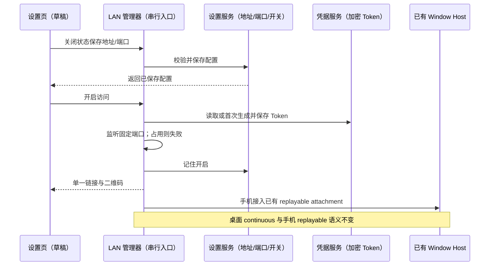
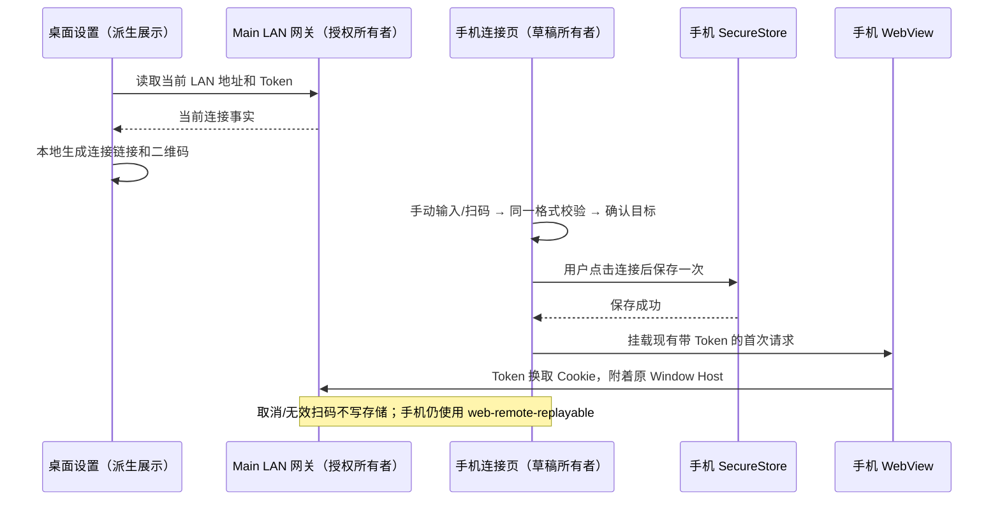
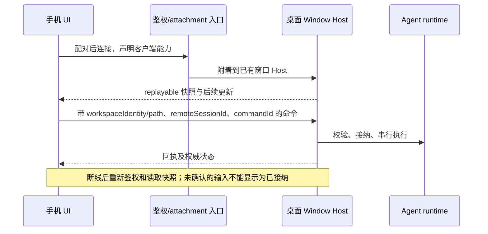
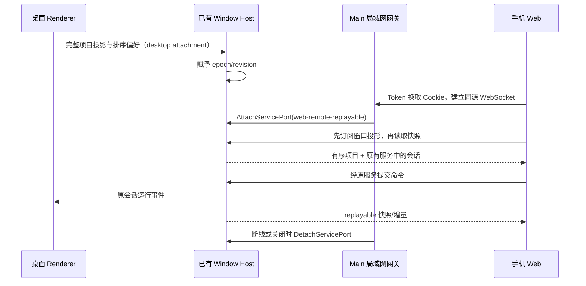
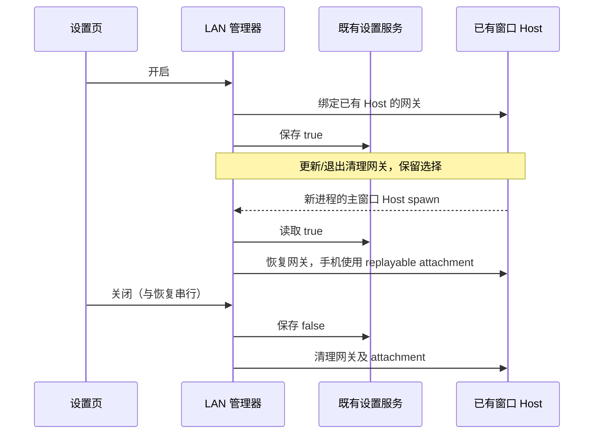
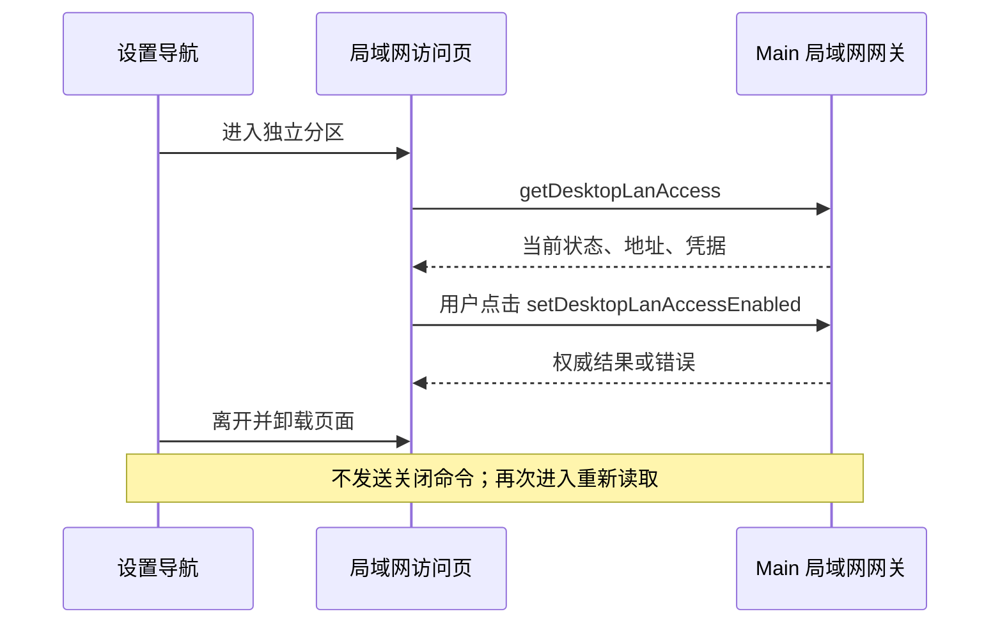

# Issue #146：手机 App 开发方案草案

## iOS WebView HTTP 连接

- 原生 ATS 策略由 Expo `app.json` 的 `ios.infoPlist.NSAppTransportSecurity` 提供；保留本地网络能力，使用 `NSAllowsArbitraryLoadsInWebContent` 显式支持 WebView 加载用户配置的 HTTP 地址，不使用被 `NSAllowsLocalNetworking` 覆盖的通用 `NSAllowsArbitraryLoads`。iOS 10 及以上两键并存会导致通用开关失效，真机已捕获 `NSURLErrorDomain -1022`。
- 仅调整原生网页传输策略，不改变地址解析、Token、SecureStore、同源导航或桌面 Host/会话所有者；HTTPS 连接继续正常验证证书，不增加任意证书信任逻辑。桌面 `/pair` 的来源校验是独立问题，不在本次修改范围。
- 既有未跟踪的 iOS 工程需同步 Info.plist 后重新构建安装，避免重建工程覆盖本机签名。后续新生成的工程从 Expo 配置继承策略，Metro 更新不能替换原生网络配置。
- 验收先复用真机已保存的连接捕获失败，再检查 Expo 生效配置与 Release `.app` 中 ATS 键，覆盖安装后读取 WebView 成功/失败回调；`-1022` 消失与网页实际加载成功分开报告。连接解析与同源限制的既有单测保持通过，根目录类型、Lint 与架构检查必需。

## 自定义域名连接

- 桌面固定地址与手机 HTTP 配对共同接受有效的自定义 DNS 域名（含 `.local`）、既有私有 IPv4；域名后缀不能作为是否属于局域网的判断。例如用户将 `codevori.example.test` 解析到电脑地址时，可以保存该域名并使用 `http://codevori.example.test:52235` 连接。
- 主机部分的格式校验由 shared 的无 IO 工具唯一提供，手机通过公开子路径读取，不引入 Node、DNS 查询或整包设置 schema。桌面仍只保存主机与端口，拒绝协议、路径、查询、fragment、用户密码、通配符、空标签及畸形 IPv4；不扩大 HTTP 数字 IP 的原有范围。手机保留 HTTPS 地址兼容，以及根路径、单 Token 和参数冲突校验。
- 通过校验只表示可以保存地址，不证明 DNS、端口或网络已连通。桌面 Main 仍只放行保存的主机与本机回环，不增加 `*` 白名单；Token、同源 WebSocket 和 WebView 同源导航规则不变。配置、凭据、Host 及会话状态所有者不变，不增加公网 relay，也不自动配置 HTTPS。
- 手动地址加 Token、完整链接粘贴、扫码、SecureStore 恢复均复用原手机解析路径；域名不再因 HTTP 协议被错误提示为无效地址。桌面设置文案与手机使用说明更新为可填写自定义域名。
- 验收：手机解析单测和真实 App 交互覆盖 HTTP 域名的手动连接、粘贴、扫码确认及恢复，域名场景继续拒绝无 Token、额外参数、URL 凭据和跨源导航；桌面设置 E2E 覆盖域名保存与单二维码，真实设置服务/原生 IPC 覆盖域名持久化和网关仅允许配置域名。使用保留测试域名与本地合成 Host，不访问用户真实域名或会话。

## 固定局域网连接配置（替代随机端口和临时凭据）

- 设置页仅展示一个地址输入、一个端口输入、保存按钮及已启用时的一份链接/二维码。地址填写局域网 IPv4 或解析到电脑的自定义域名，不含协议、端口、路径或凭据；端口是 1–65535 的整数，初始建议 3030。不会枚举全部网卡生成多份二维码，也不会以随机端口兜底。
- `AppSettings.desktopLanAccessConfiguration` 是地址和端口的唯一持久化所有者，沿用现有用户目录与设置服务，独立于构建产物。Main 通过平台接口读取/保存配置，Renderer 仅拥有未保存表单草稿。保存成功才更新事实与启用条件；校验/写入失败不替换原配置。旧版本缺少配置时显示待配置并暂停自动恢复，用户保存一次后可重新开启，之后按原开关偏好恢复。
- Main 仍只拥有监听器、鉴权及已有 Host attachment。入口监听 `0.0.0.0` 的配置端口，Host 白名单仅接受配置地址及本机回环；配置地址用于手机访问，不宣称替用户修改路由器、DNS 或 DHCP。电脑 IP 由网络分配时，需在路由器保留地址或使用可解析的 `.local` 名称，软件更新不会主动重写配置。
- 同一桌面进程最多一个固定 LAN 监听器，仍绑定开启它的窗口 Host；其他窗口不能抢占配置或启用另一份入口。自动恢复只为首个主窗口执行，保留 Host spawn、代次及迟到恢复防护。开启中锁定表单，需先关闭访问再修改；不通过保存自动断开现有会话。
- 访问 Token 使用现有加密 CredentialService 的独立 key，由 Main 读取或首次生成后保存；不进入普通 AppSettings、日志或构建产物。读取/保存凭据失败则不开监听器，不随机生成替代已有凭据。关闭、开启、Host 重建、桌面更新/重启保持 Token；关闭期间撤销所有 socket，已保存凭据不授予关闭入口的访问权。保持现有同源和鉴权规则。
- 开启失败（端口占用等）保留固定配置及开启偏好供显式重试，不自动换端口；关闭时即使偏好写入失败也停止监听。配置保存与手动开关/自动恢复使用 Main 同一串行操作路径。保存失败只报告失败，不能展示新二维码或丢失旧表单。
- 验收：配置 schema、真实设置服务重读；真实 Electron IPC 的固定端口、加密凭据跨进程重启、相同链接/Token、占用失败无随机端口、缺配置迁移、多窗口隔离、保存/凭据失败、Host 重建与关闭清理；真实设置页交互覆盖保存、非法输入、失败保留、开启中锁定、单二维码、重挂载及中英/明暗/窄屏。



## 手机聊天输入的键盘缩放

- 共享 Lexical 聊天编辑器及其占位文字在窄屏使用已有 `text-mobile-input-safe`（16px）；触屏主指针设备横屏超过桌面断点时仍保持该字号，避免 iOS 因聚焦小字号编辑区自动放大页面。桌面精细指针设备在桌面断点继续跟随界面字号设置。
- 字号由共享输入组件的 CSS 唯一决定，不在手机壳复制样式、不新增键盘/缩放状态，不改会话、草稿、Host 或 attachment 协议。保留 viewport 和用户主动捏合缩放，不在 blur 时强制重置用户缩放或刷新网页。
- 验收：真实 Lexical 组件覆盖手机竖屏/横屏、明暗主题、界面字号 12/14/18px 下聚焦、输入、失焦及再次聚焦；手机字号保持 16px，草稿不丢失且页面无水平溢出，桌面跟随字号。浏览器测试证明字号条件；iOS 键盘自动缩放的最终效果需更新桌面端 Web 资源后在真机复测，不能用桌面模拟当成真机证明。

## 2026-10-17：后台断线恢复与可拖动连接入口

- 桌面 LAN Web 的连接关闭不再笼统显示“Web 启动失败”。Web 启动所有者释放旧基础连接及 remote follower，显示“与电脑的连接已断开”，前台且在线时以 1/2/4 秒间隔最多自动尝试三次；回到前台、网络恢复或用户重试可开启新一轮。重试串行，卸载时取消计时与请求；晚到结果不得挂载旧 Root。退避仅用于失败请求的限流，不作为就绪条件。
- 重连重新鉴权并解析 `/api/desktop-window`，只允许附着原桌面 LAN 入口；401/403 显示需要重新连接的说明并停止自动尝试，不回退独立 Web 服务。电脑关闭、网络不可达时保留可重试状态。健康连接回前台不重载网页，不重发用户输入；新 attachment 仍为 `web-remote-replayable`，桌面 `desktop-continuous` 不变。
- 手机 App 从后台回到 active 只通知网页恢复事件，不无条件 reload。iOS 回收 WebView 内容进程时才重新挂载网页；不删除 SecureStore 连接。网络错误页的原生“重新加载”继续可用。
- 连接按钮由独立原生组件拥有位置和拖动状态，44px 触摸区，位移超过 6px 才转为拖动，拖动结束不触发设置。轻点仍打开设置。位置限制在内容安全区内；旋转/键盘/尺寸变化时重新限制边界，本次只在当前 App 会话保留位置，不写入连接凭据。
- 验收：重连组件覆盖隐藏暂停、前台/online 恢复、三次上限、连续事件不并发、终止错误、迟到成功取消；手机真实组件 E2E 覆盖轻点、拖动不打开设置、四边限制、改变尺寸后仍可点击、恢复前台不刷新及内容进程终止恢复。使用合成服务，不操作用户任务；真实长时间后台与网络切换仍需 iPhone 复测。

```text
WebSocket close → Web 启动所有者 dispose 旧 attachment → 重连页（串行退避）
前台/网络恢复 ──────────────────────────────────────┘
重连 → 同一 LAN 鉴权 → 新 replayable attachment → 原 Window Host 快照
App active → 通知恢复事件；健康网页不变
拖动 → 浮动按钮局部位置；轻点 → 原连接设置弹层
```

## 2026-10-16：手机与桌面统一品牌

- 手机桌面显示名、连接页和权限提示使用共享 `PRODUCT_NAME`（当前 `CodeVori`）；名称通过 `@zcode/shared/product-brand` 公开入口读取，Expo 动态配置覆盖静态配置，不再另存手机专用产品名。
- 手机应用图标由同一公开入口的 V 字形生成，沿用 PC 黑底白 V；1024px 正方形不留透明边、不预裁系统圆角，iOS/Android 使用同一派生资源。生成脚本只写手机资源，不修改桌面图标。
- 既有 bundle ID/package、URL scheme、SecureStore key 和原生工程内部名称保持兼容，覆盖安装而非卸载，不迁移用户连接或会话。原生生成目录不提交；Expo prebuild 后验证显示名、图标目录和签名 Team。
- 验收：连接页真实组件 E2E 核对共享产品名并保留 320/390px 明暗主题验证；Expo 解析配置与生成后 Info.plist 的显示名一致；图标可解码、1024px、全部像素不透明，Release 包含 AppIcon。签名构建及原位安装分别记录，不把编译成功当作手机主屏已目测确认。

## 2026-10-16：已连接页面收起原生连接栏

- 已连接后移除 WebView 上方常驻的主机地址和“更换连接”栏；Web 内容在安全区内占满高度。不改网页自身导航或桌面 UI。
- 右侧中部保留 44px 的“连接设置”悬浮入口，不占布局行、不覆盖顶部侧栏/终端按钮或底部输入区。只在主动打开的原生弹层展示主机与端口，不展示 Token 或完整鉴权链接。
- RemoteScreen 唯一持有弹层显隐、清除中状态与错误；App 仍是 connection 所有者，SecureStore 仍通过原 clearConnection 路径清除。打开/取消弹层不卸载或重载 WebView、不改变凭据与会话。
- 弹层说明更换只清除手机保存的连接；用户点击“更换连接”才执行清除。清除中禁止重复提交/关闭；成功才卸载旧 WebView 并返回连接页，失败留在弹层显示原因并允许重试。加载失败页也复用同一弹层。

```text
连接设置入口/加载失败页 → RemoteScreen 打开弹层 → 取消 → 继续原 WebView
                                          └→ 确认更换 → App.clearConnection → SecureStore
                                                                        ├→ 成功 → connection=null → 连接页
                                                                        └→ 失败 → 原 WebView + 弹层可重试
```

验收：真实 App 的原生适配 E2E 验证 320/390px、明暗主题下无常驻地址栏、入口可点击且不占 WebView 高度；弹层只显示 host、不泄露 Token；打开/取消保持同一 WebView 实例与凭据；更换成功、失败重试、清除期间重复点击和加载失败页的更换入口。原生安全区与实机观感另行验证。

## 2026-10-16：手机地址输入与局域网扫码连接

- 手机首次进入显示连接页：可输入根地址与 Token，也可粘贴桌面局域网访问页面的完整 `http(s)://host:port/?token=...` 链接。完整链接自动提取 Token；同时填写的 Token 若不一致则报错，不猜测使用哪一份。
- 桌面“设置 → 局域网手机访问”在每个当前连接链接旁生成同内容二维码。二维码仅派生自 Main 返回的地址和 Token，不产生第二份配对状态；关闭访问立即卸载二维码，重新开启/Token 变化后不得展示旧二维码。生成失败保留手动链接入口。二维码不得发送给外部生成服务。
- 手机“扫描二维码”仅在用户主动选择后使用摄像头；只扫描 QR，不申请麦克风权限。拒绝授权、摄像头不可用、App 进入后台、取消扫码均不阻断手动输入；永久拒绝提供系统设置入口。
- 扫码后先关闭相机并填入地址与 Token，展示目标主机，用户点击“连接桌面端”才保存到现有 SecureStore 并挂载 WebView。同一轮扫码最多消费一次结果，无效二维码展示原因并允许重新扫描，不自动重试或覆盖已保存连接。
- 扫码与手动粘贴复用同一解析器及 HTTP/HTTPS、同源导航限制；HTTP 自定义域名按本文规则接受。仅接受根路径、单个非空 `token` 参数，不接受额外参数、fragment、URL 用户密码、旧 `/remote/v4` 二维码或 Expo 开发链接。错误文案不回显完整凭据。
- 手机表单支持安全区、键盘避让和纵向滚动；地址与 Token 有可访问标签。保存期间禁止重复提交，失败保留输入供重试。连接事实仍只由手机 App 的 connection 状态及 SecureStore 持有，Host/Agent/服务协议不变。



验收：解析器覆盖完整链接编码、冲突/重复/缺失 Token 及不支持的二维码；交互场景覆盖手动连接、扫码填入后确认、权限拒绝/取消、无效码重扫、重复扫码、保存失败重试及保存期间重复点击；桌面原设置 E2E 增加二维码内容、Token 更新与关闭后的旧码消失，并保留明暗主题、中英文及窄屏。原生摄像头和 iPhone 安装需单列实机验证，浏览器中替代原生接口的 E2E 不作为实机证明。

## 条目与当前证据

- `caiqiqqq/zcode-private#146` 是开放的 enhancement，标题为“手机app的开发”，正文只问“想开发这个的手机app，应该怎么做”。它没有指定 iOS/Android、功能范围、是否脱离桌面独立运行或发布渠道。因此本文件是待确认的产品方案，不把它当作已复现的缺陷或已批准的实现需求。
- 实现前仓库已有 `packages/web` 的 React 入口、共享 `packages/ui`、WebSocket RPC 和窄屏布局，没有手机工程。本次新增 Expo 手机壳，但协议 `clientHello.clientKind` 的 `mobileRemote`/`mobileApp` 枚举值仍不能证明原生远控协议已实现。
- 普通 Web 入口连接 `/ws`；`/ws/remote/:id` 目前只暴露部分服务，Web 平台的 `connectRemote` 明确返回不支持。已有桌面 Window Host 的 attachment 和 `web-remote-replayable` 会话恢复语义，可以作为手机端接入的边界，但仓库中尚未确认完整的手机配对、鉴权、离线重连和发行链路。不能把浏览器可显示窄屏 UI 等同于可发布的手机 App。

## 建议的首期产品规则（待产品确认）

以“手机作为桌面 ZCode 的随身客户端”为首期假设：查看项目和会话、收发消息、处理待答复输入与权限请求、查看任务状态。代码执行、项目文件、Agent 和会话的权威状态仍在目标桌面 Window Host；手机不在本地启动第二套 Agent/Host。桌面未运行、目标 Host 不可达或身份过期时，展示明确的只读/断连状态，不把手机缓存的草稿当成已接纳命令。首期是否允许手机在桌面关闭时独立运行，必须另行决定；若允许，需要重新设计运行时、存储和同步方案。

建议先用现有 Web UI 完成真实手机浏览器连接的纵向验证，再决定采用可安装 Web 体验、Web 容器（例如 Capacitor）或原生 UI。若首期要求应用商店上架、后台推送或系统级能力，应先确定目标平台和审核/通知约束，再选择打包方式。当前仓库没有这些框架依赖，不预设它们已经可用。

## 状态所有者与接口

| 事实                       | 唯一所有者                            | 手机端职责                                              |
| -------------------------- | ------------------------------------- | ------------------------------------------------------- |
| 项目、任务、会话和命令接纳 | 目标 Window Host / 现有 Agent runtime | 经共享服务接口提交命令、显示回执与权威快照              |
| 未发送文本、交互草稿       | 手机 UI                               | 断连时保留为未发送，重连后由用户明确提交                |
| 配对/撤销与连接授权        | 待定的受信连接入口                    | 保存最小设备凭证；失效时重新认证，不在 URL/日志泄露凭证 |
| 客户端展示偏好             | 手机本地设置                          | 不覆盖 Host 的运行时事实                                |



沿用 `workspaceIdentity?.trim() || workspacePath` 隔离身份，`workspacePath` 仅用于目标 Host 的文件操作和展示；远端项目保留 `remoteSessionId`。保留 owner/lease、旧 run 守卫和 `CommandInbox` 的接纳边界。桌面 `desktop-continuous` 与手机 `web-remote-replayable` 分别验证；外部转发层只负责授权、心跳、转发与 attachment 调度，不持久化任务队列或会话快照。平台能力由 `IPlatformService` 注入，不让共享 UI 直接调用原生 API。

## 分阶段实施与验收

### 当前实现范围：局域网 WebView 壳

手机壳放在独立的 `apps/mobile` workspace，不接管桌面 Agent 或 Host。推荐连接下文“局域网连接桌面窗口”的入口以共享当前 Window Host；也可连接独立 `zcode --web`，但后者有独立状态。局域网二维码与旧 `/remote/v4` 二维码不兼容：

- 用户输入根地址和 Token、粘贴完整连接链接或扫描局域网二维码，具体规则见顶部 2026-10-16 规格；以一份受保护的手机 SecureStore 记录保存，不把 Token 写入普通设置。首次页面请求按现有 Web 服务接口附带查询参数，服务将其交换为 HttpOnly cookie；局域网明文 HTTP 会暴露传输中的 Token，必须局限于可信网络。
- WebView 只允许继续访问已配置的同源地址；外部 HTTPS 链接交给系统浏览器。
- 当 Web 工作区实际宽度低于 768px（包括手机浏览器和手机 WebView）时，外层桌面侧栏在首次布局时自动收起，主内容占满可用宽度；侧栏显隐仍由 `useAppPanels` 的既有状态所有者管理，桌面宽度和用户手动显隐不受影响。Web 窄屏始终保留侧栏切换入口，工作任务看板再按自身容器宽度切换单栏/双栏。
- 手机宽度低于 768px 时，新建会话输入框下的场景快捷入口自动换行，全部入口直接可见，不依赖横向滑动；项间距为 8px，单个长标签限制在容器宽度内。推荐区槽位随内容增高，不能固定为一行导致遮挡下方内容。桌面继续单行居中及溢出时横向滚动，办公模式的主动推荐列表不变。列表及顺序仍由现有 Client Scenes 服务提供，点击继续走同一草稿填入/插件流程，不创建第二份推荐状态。
- 快捷入口布局验收：使用真实推荐组件及容器、合成 Client Scenes 的五个项目，在 320px/375px/390px、明暗主题和中英文下验证全部按钮位于可见宽度内、无重叠、容器包住所有行、末尾两项可点击且写入原草稿请求；1280px 保留单行。覆盖长英文标签及桌面宽度不足时的横向滚动，不发起真实模型请求。
- 移动 Web 使用 HTTP 局域网地址时，浏览器可能提供 `crypto.getRandomValues` 但不提供 `crypto.randomUUID`；所有 UI 临时 ID 必须通过共享 UUID 工具生成，不能直接调用 `crypto.randomUUID()`。UUID 能力差异不能阻断首屏渲染、输入框交互或会话初始化。OAuth nonce 保留现有安全随机源要求，不使用非安全随机降级。
- 回归场景：在 375px 手机视口禁用 `crypto.randomUUID`、保留 `getRandomValues`，验证真实输入组件可聚焦、可输入且发送按钮可用，提交仅由合成服务接纳；同时保留桌面有 `randomUUID` 的场景。Agent 未就绪时继续遵守连接门禁，不能为了恢复输入绕过该状态。
- 断线展示重试，断开连接只删除手机凭据，不删除 Web 服务的会话。清除凭据后旧 WebView 立即卸载；WebView 的 Cookie 应按发行前的设备退出语义进一步验证。
- HTTP 接受私有 IPv4 和有效自定义域名，不根据域名后缀推断网络范围；HTTPS 保持兼容。iOS ATS 使用上文的 WebView 专用明文配置，Android manifest 保持已有明文能力。
- 该壳加载现有 Web 服务地址，不把 `packages/web` 静态资源复制成第二份，也不新增手机侧 Agent、任务队列或会话事实。
- Web 当前 OAuth 配置的回调与局域网 Web 服务地址可能不一致；如果该 Web 页面要求重新登录，手机壳不保证能完成登录。首期验收以手机浏览器能够在同一个地址完成真实操作为前提，OAuth 回调需要另案验证。

事件顺序：

```text
手机输入根地址/Token → 本地格式校验 → SecureStore 保存 → WebView 加载
                                                   └→ 同源页面 /api、/ws
断线 → 手机显示重试 → 重新加载同一地址；旧草稿不伪装成已接纳命令
退出 → 删除手机凭据 → 返回连接页；Web 服务状态不变
```

1. **连接可行性**：在隔离测试环境用真实手机浏览器验证独立 Web 服务的地址、Token、工作区选择、会话恢复和命令回执。若希望连接桌面 Window Host 的 `/remote/v4` 配对，需要另做兼容入口与鉴权；`/ws/remote/:id` 只暴露部分服务，不能直接充当完整 App 入口。
2. **核心流程**：局域网壳先验证手机视口、触控、键盘、安全区、主题和中英文；原生文件选择等不支持能力给出明确入口或限制。行为变更先更新本 spec，并补对应测试及交互 E2E。
3. **发行选择**：纵向链路稳定后为现有 Expo 工程补图标、签名和发布配置；通知、后台运行、附件选择与深链接分别立项验收，不能从浏览器能力推断原生行为。

| 场景                     | 操作                                         | 应验证的结果                                                       | 状态 |
| ------------------------ | -------------------------------------------- | ------------------------------------------------------------------ | ---- |
| Web 服务和手机在线       | 手机打开已有项目、发消息、处理一次待答复请求 | 同一 Web 服务接纳一次，手机与浏览器显示相同权威会话                | 计划 |
| 网络中断并重连           | 在流式回复中断网，再恢复                     | 快照补播不重复命令、消息或权限答复；草稿仍未提交                   | 计划 |
| 授权撤销或 Host 关闭     | 打开旧客户端并尝试提交                       | 明确拒绝和恢复入口，无本机 Host 回退                               | 计划 |
| 两个远端身份共享同一路径 | 切换项目并发送                               | `workspaceIdentity` 和 `remoteSessionId` 隔离，不串会话            | 计划 |
| 375px、明暗主题、中英文  | 输入、查看长输出和权限弹层                   | 可触达、无横向溢出，键盘与安全区不遮挡提交控件                     | 计划 |
| 375px 工作区首次进入     | 打开待办任务或聊天视图                       | 外层侧栏自动收起，主内容无固定桌面栏挤压；任务看板按窄容器单栏显示 | 计划 |

上述完整链路仍为计划场景，未执行手机实机、配对链路或发布构建验收。已执行局部自动化验证：`node packages/ui/test/composerSubmissionScope.e2e.mjs` 在 1280px/375px、明暗主题下验证真实输入组件及合成提交；375px 场景明确禁用 `crypto.randomUUID` 并保留 `getRandomValues`。局域网 HTTP 的 390px Chromium 手机模拟也已验证可聚焦、文字保留及发送按钮启用，没有发送真实模型请求。这些结果不等同于 iOS/Android 实机验收。

## 局域网连接桌面窗口（本次已授权）

目标是手机浏览器显示所选桌面窗口的同一项目列表和会话事实。新增桌面局域网入口，明确区别于独立 `zcode --web`；不启动第二套 `createLocalServices`、Agent 或远端连接。

### 手机资源加载与推理控件

- 小于 768px 的手机视口不显示推理强度的绿色竖条，保留 Brain 图标、当前档位的可访问名称及原有选择菜单；桌面继续沿用已有强度显示。控件仍从原配置读取当前值，用户选择只调用原回调，不新增档位或推理状态。
- 桌面 LAN 网关在鉴权及路径安全检查后才能提供静态资源或返回 304。HTML、配对、错误、API 继续 `no-store`；带内容哈希的 `/assets/` 文件使用浏览器私有长期缓存，其他静态文件私有缓存但每次验证，避免共享缓存存储受保护内容。
- 可压缩且不小于 1KiB 的文本或 WASM 资源按 `Accept-Encoding` 协商 gzip，显式 `gzip;q=0` 不使用 gzip；设置 `Vary: Accept-Encoding`、正确的 `Content-Encoding` 和 `Content-Length`，HEAD 保留同 GET 的元信息但无响应体。压缩使用异步 IO/线程池，不在 Main 同步压缩大文件，不建立新的资源状态所有者。
- 可缓存静态资源以内容摘要作为 ETag，匹配 `If-None-Match` 时返回无响应体的 304；源文件变化后验证失效。响应失败不能返回成功内容，鉴权、Host/Origin、目录穿越及符号链接边界保持原规则。缓存只覆盖构建资源，不覆盖会话、Token 或 API 响应。
- Web 构建使用当前 Rolldown 支持的依赖分组策略合并图标等过碎的共享模块，降低首屏请求数；保留动态导入和重型预览懒加载，不通过关闭所有预加载或内联整个应用掩盖问题。以构建产物和通过真实 LAN 网关的冷/热加载测量验收，不能把本机模拟当成 iPhone 实测。

验证：真实推理控件在 320px/390px/桌面、中英文及明暗主题下可操作且手机无绿色条；HTTP 测试覆盖 gzip/禁用压缩/HEAD/ETag/修改失效/鉴权后 304、HTML/API 不缓存及原 RPC 隔离；构建后检查入口资源数、压缩体积、浏览器第二次访问的资源缓存命中和运行时模块错误。已有手机列表、返回和侧栏修复保持不变。

2026-10-15 本地验证：`mobileThoughtLevel.e2e.mjs`、`desktopLanStatic.test.ts` 和原有 `desktopLanGateway.test.ts` 通过。Web 生产构建的入口资源从 283 个降至 49 个；通过真实 LAN 网关、390px Chromium、10Mbps/20ms 模拟网络，冷加载资源传输 2,897,963 字节，第二次访问的 49 个资源全部命中浏览器缓存。此结果仅覆盖静态资源加载和生产模块初始化，不代表真实工作区就绪时间或 iOS/Android 实机表现；安装中的桌面版本未因此自动更新。

- 桌面窗口的 Renderer 是打开项目及顺序、侧栏排序偏好的输入源；通过现有 WindowController 服务发布完整窗口投影。Host 为该投影赋予 epoch/revision，并向手机提供读取与变更事件。Web attachment 不能发布投影。
- 手机连接时先订阅再读取，按 epoch/revision 丢弃迟到快照，精确替换项目成员与顺序；保留仍存在的手机当前选择、草稿和稳定 tab id。手机不把派生项目列表写回 `lastWorkspaceSession`，也不能在桌面投影之外创建或关闭项目。
- 会话标题、归档、置顶、运行和权限状态继续来自所选窗口已有 services。手机发消息仍通过同一个 Host 的 admission，不复制会话或队列。
- 远端工作区使用桌面已有 `remoteSessionId`、`workspaceIdentity`、`workspacePath` 创建 replayable attachment；完整三元组校验失败、远端断线、窗口关闭或 Host 退出时拒绝，不回退本地服务，也不在手机自动重建远端连接。
- Main 的 LAN 网关仅持有鉴权与 socket/MessagePort 关联，复用 `AttachServicePort`/`DetachServicePort`。桌面 attachment 保持 `desktop-continuous`，手机固定 `web-remote-replayable`，网页参数不能提升为桌面权限。
- 入口显式启用，生成随机访问 Token，以 HttpOnly、SameSite Cookie 授权。拒绝未授权 HTTP/WebSocket、跨源 WebSocket、无效 scope；关闭入口后断开所有 attachment。Token 不进入日志，不开放新的公网 relay。
- 每个 WebSocket 消息必须携带一个完整 RPC 帧，最大 16 MiB；慢速客户端的待发送数据最多 32 MiB，超限断开并通过重连恢复，不能在 Main 无限累积缓冲。
- 桌面发行构建携带同版本 Web 静态资源。独立 Web 服务继续保留，不伪装成桌面窗口连接；旧手机壳可以输入新的局域网地址及 Token。



验收：未授权及跨源连接拒绝；手机不能发布窗口投影；相同路径不同 identity 隔离；桌面增删和排序后手机收敛且选择/草稿不丢；迟到快照不能回滚新 revision；Host/远端退出后 fail closed；两端提交仍经过既有 admission；独立 Web 入口行为不变。使用合成服务的 HTTP/WS 集成测试和真实共享 UI E2E 验证，不发送付费模型请求。

本次本地验证：

- `node --import tsx --test packages/server/test/desktopLanGateway.test.ts packages/desktop/tests/windowWorkspaceProjection.test.ts`：真实 HTTP/WebSocket 鉴权、同源限制、只读投影、同 owner 命令、scope 拒绝、畸形帧及 attachment 清理。
- `node packages/desktop/tests/desktopLanAccess.electron.test.mjs`：隔离 profile 下的真实 Main IPC、MessageChannelMain、utilityProcess Host；验证共享状态、重复开关清理、Host 退出。Host 为合成服务，不启动 Agent 或访问用户会话。
- `node packages/ui/test/desktopWindowSession.e2e.mjs`：配合 Desktop Vite 开发服务，390px/1280px 验证真实同步 hook 和输入组件、旧快照拒绝、identity 隔离、排序后草稿保留及越界工作区禁止创建。
- 根目录 `pnpm typecheck`、`pnpm lint`、`pnpm architecture:check --changed`，Web 及 Desktop Main/Host/Preload/Renderer 构建已通过。独立 Desktop Main/Preload/Renderer 子工程的额外类型检查仍有错误（包括缺失导出、rootDir 和 Window 类型声明），不视为通过。

以上不等于安装版本已升级、当前用户 Host 已联通或 iOS/Android 实机验收；旧的 5173/3030 独立入口不会因此自动切换。

## 局域网访问设置入口与布局

### 开关在更新和重启后保留

- 在既有 `AppSettings` 中新增 `desktopLanAccessEnabled` 保存最近一次用户选择，缺省为 false。Main 通过现有设置服务异步读写，网关仍仅拥有监听器及 attachment；地址/端口与 Token 的持久化已由本文“固定局域网连接配置”规则替代；仍不保存项目或会话副本。
- 启动后只为首个主应用窗口恢复入口，等待该窗口已有 Local Host 的进程 spawn，再检查保存的选择；帮助、更新等非工作区窗口不参与。其它新窗口不自动开放。手动在另一窗口开启时，该窗口成为本进程后续 Host 重建的恢复目标。
- 同一 Main 管理器串行处理恢复和手动开关，保持既有 generation/Host 校验；迟到的启动不能覆盖关闭。GET 等待在途恢复/设置操作后返回实际监听状态。每次开启成功后再保存 true；保存失败关闭新入口并报错。关闭即使保存失败也必须关闭监听器并报错。
- 手动关闭保存 false；窗口关闭、Host 退出、应用退出只清理监听器，不清除用户选择。恢复失败记录诊断并保持实际关闭，不启动另一 Host 或定时重试。退出时取消等待 spawn 的恢复工作，不留下监听器。
- 开关操作失败时设置页重新读取 Main 实际状态，同时保留原错误，避免关闭监听器后页面仍显示已开启。读取也失败时不推测状态。
- 固定连接配置保存后，重启或更新继续使用同一地址、端口和加密保存的 Token。旧版本尚无固定配置时需先保存一次地址与端口，再开启访问。



验收：缺省关闭；启用后重建 Main 管理器/重启进程自动恢复；手动关闭后重启仍关闭；新窗口不自动开放；Host 重建仍绑定当前 Host；退出和关闭期间的恢复不得残留监听器；设置读写失败可见、入口实际关闭；固定配置和加密 Token 在恢复后保持一致。继续执行原有真实 Electron IPC/MessagePort/Host 测试，服务均为合成服务，不操作真实用户会话。

2026-10-15 验证：`desktopLanAccess.electron.test.mjs` 通过，包含三次隔离 Electron 启动、缺省关闭、启用恢复及关闭后不恢复、真实 Host spawn/重建、旧 Host 的迟到恢复、新窗口隔离、恢复与关闭顺序、设置读写失败及关闭/退出清理；原有 HTTP/WebSocket 同 Host 测试保持通过。`desktopLanAccessSettings.test.ts` 通过真实设置服务验证 true/false 持久化、重新读取及非法值拒绝。`desktopLanSettings.e2e.mjs` 通过，并覆盖写入失败后重新显示实际关闭状态且保留错误。根目录类型检查、Lint（0 错误、74 条警告）、架构检查（0 违规）和 Desktop Main/Host/Preload/Scheduler 构建通过。未安装到当前程序，未进行手机实机或真实更新安装验收。

- 设置左侧「基础设置」新增独立的「局域网手机访问」菜单，不再嵌入「常规」。仅拥有局域网读取、开关平台接口的桌面客户端显示；Web 或不支持该能力的平台收到此分区的历史偏好/导航意图时回到常规。
- 页面复用设置页标题和内容宽度。访问开关、手机浏览器地址、手机 App Token 分组展示，卡片内容至少保留 16px 水平内边距。每个地址显示根地址及可选中的完整连接链接，Token 使用独立的密码输入框；长链接、多个网卡地址和英文文案不撑破窄屏布局。
- Main 局域网网关仍是访问状态和凭据的唯一所有者。页面挂载读取当前状态，读取完成前不能操作开关；只在显式点击时调用现有平台开关接口，错误显示在页内。离开菜单不会关闭访问，返回时重新读取真实状态，不持久化 Token 到 UI 设置。
- 本次不调整网关、Host、attachment 或网卡筛选语义；桌面 continuous 与手机 replayable 链路不变。



验收：桌面菜单可达且常规页不重复；Web 隐藏入口并回退历史落点；开启/关闭、失败重试、菜单往返保持网关状态；长链接及多个地址在 375px/桌面、明暗主题、中英文下有内边距且无横向溢出。使用合成平台的共享 UI 交互 E2E，不修改真实桌面访问状态。

验证入口：`TSX_TSCONFIG_PATH=packages/ui/tsconfig.json node --import tsx --test packages/ui/test/desktopLanSettingsNavigation.test.ts`；`NODE_OPTIONS='--import tsx' node packages/ui/test/desktopLanSettings.e2e.mjs`（自行启动并关闭隔离的 Vite 测试服务）。

## 后续范围

1. 当前桌面入口依赖运行中的窗口及 Host；桌面关闭后的手机独立执行不在本次范围。
2. 首发 iOS、Android 还是双平台？需要商店上架、推送通知和后台能力吗？这决定 PWA、容器与原生路线。
3. 首期开放哪些写操作（聊天、审批、任务、终端、Git、文件编辑）？高风险写入应逐项定义权限和审计边界。
4. 当前使用设置页地址及 Token 配对、关闭入口撤销访问；自动发现、逐设备撤销和跨公网连接仍需另行定义。

当前 feature graph 已补充桌面 LAN 网关及窗口投影节点；原生发行能力仍不能从协议枚举或 Web 测试推断。
