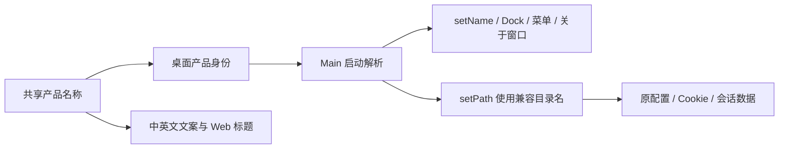

# CodeVori 产品名称

## 产品规则

- 本分支应用的用户可见名称为 `CodeVori`，各语言均使用此拼写。
- 正式版为 `CodeVori`，预览版为 `CodeVori Preview`，开发版为 `CodeVori Dev`。
- 桌面菜单、Dock/托盘、关于窗口、窗口标题、Web 页面标题、欢迎/设置/输入框文案、安装包文件名和系统“在应用中打开”菜单使用新名称。
- 产品图标使用 CodeVori 的 `V` 字母：白色几何字形配黑色圆角底，沿用现有紧凑比例。应用、Dock/托盘、安装器、启动页、关于页、导航标志与网页 favicon 使用同一字形；首页装饰使用同一字形的浅色线框/深色渐变版本。
- 供应商、API 模型和 ACP 智能体的第三方图标不跟随产品改名；保留原作者和许可证。

## 所有者与接口

- `packages/shared/src/product-brand.mjs` 唯一维护产品显示名，通过 `@zcode/shared` 与构建脚本专用的 `@zcode/shared/product-brand` 公开入口提供。
- `desktop-product-identity.mjs` 维护 production/preview/development 的桌面身份映射，并通过纯函数解析显示名与存储目录名。Main 在启动时应用结果，不引入新的设置字段、缓存或持久化写入路径。
- 各平台的已有标题、菜单、国际化和打包入口消费显示名；Host、会话服务与数据仓库继续使用原来的身份和路径。
- ACP initialize 的 clientInfo 与 Codex API 接入配置的供应商显示名使用新名称，协议字段、供应商 key 与版本保持原值。
- 共享 `product-brand.mjs` 同时拥有产品字形及 viewBox。UI 与 Main 关于页通过公开入口读该字形；异步图标生成脚本从同一源导出桌面 PNG/ICO/ICNS、Linux 各尺寸、UI 图标及 Web favicon，并同步 HTML 启动标志。派生资源保留已有路径以兼容现有打包和平台命令。
- macOS 开发副本安装自己的产品 ICNS，Info.plist 明确指定它。开发 bundle 缓存命中后仍检查图标内容并幂等同步，不修改 node_modules 原始 Electron，不因图标变化重拷整套运行时，不改变 bundleId、URL scheme 或用户数据目录。

## 兼容与失败边界

- Electron userData 默认目录仍为 `ZCode`、`ZCode Preview`、`ZCode Dev`，sessionData 仍位于对应目录的 `session`；应用显示名改变不能创建一套空配置。
- `ZCODE_DESKTOP_APPLICATION_NAME` 继续同时覆盖测试显示名和默认 userData 目录名；显式 userData/sessionData 环境变量及 Electron 默认目录测试开关保留原语义。
- appId、开发 bundleId、Windows AppUserModelId、Linux 安装身份/命令、URL scheme、Windows 注册表键、Finder workflow 文件路径、原生 Helper 身份保持兼容。仅更新这些入口的展示文案，不重复注册一个并行入口。
- `.zcode` 数据、项目目录、Worktrees 设置、包名、协议方法、配置键、环境变量、模型/智能体 ID、账号端点和已有第三方链接不做全局替换。
- 保留原作者和许可证信息。没有新官网或新发布源时，不虚构域名或更改升级来源。
- 名称解析是无 IO 的启动前决策；缺失 flavor 仍沿用现有 production/preview 规则。目录不存在时继续由既有存储启动链创建，不迁移、不删除旧目录。

## 验收场景

1. 正式/预览/开发身份分别显示新名称，同时仍返回各自旧 userData 目录名及原 appId。
2. 生产后端 + Preview 身份仍为 Preview；测试后端不能解析为正式身份。
3. 显式应用名覆盖仍隔离测试数据；输入为空白时仍使用默认身份。
4. macOS Dev bundle 的 CFBundleName/CFBundleDisplayName 为 CodeVori Dev，bundleId 与 zcode scheme 保留，启动路径为 CodeVori Dev.app。
5. 中英文关于/托盘菜单、欢迎语和新对话输入框均出现 CodeVori；实际 `.zcode/v2` 路径提示与协议键不变。
6. 正式/预览安装包名称由新的 productName 生成；Windows/Linux 配置及 macOS 权限提示使用相同名称。
7. 页面验证覆盖中文和英文、宽屏和手机宽度、深浅主题；标题和品牌文案没有截断或横向溢出。
8. 重启本地桌面开发版后，系统应用名、窗口名及菜单可见新名称，主进程读取的 userData/sessionData 与重启前一致。
9. 应用和安装图标在 16px 至 1024px 均显示 V，macOS ICNS 和 Windows ICO 包含所需尺寸；网页 favicon 和导航/启动/关于/草稿装饰与它一致。深浅主题和手机宽度下无破图，不改供应商/智能体品牌。
10. 首次生成开发 bundle、运行时缓存命中与图标更新后均使用产品 ICNS；相同内容不重复写文件，图标同步失败明确报错。重启通过原 LaunchServices 路径，确认 Dock 已使用 V，历史配置仍使用原目录。

## 验证

- 桌面产品身份和 Dev Info.plist 的 Node 测试；中英文菜单与目录兼容断言。
- 现有 Vite 上的品牌文案页面验证，以及本机 Electron 重启后的只读名称/数据目录核对。
- `pnpm typecheck`、`pnpm lint`、`pnpm architecture:check --changed` 与改动文件格式检查。

## 本次验证记录

- 改动模块：shared、desktop、services、ui、web。产品名由共享常量唯一维护，Main 同步解析显示名和兼容目录后再启动窗口与 Host；没有新增业务状态、迁移队列或远程事件。
- 本次改名涉及 50 个代码、配置和测试文件，净新增 215 行（不含本 spec）；保留此前其他功能的本地改动。
- 桌面身份/启动与 ACP 配置/stdio 共 19 项测试通过。页面验证通过中文/英文、375/1280 宽度、深浅主题共 8 个场景，覆盖实际帮助菜单和输入框提交。
- 根目录 `pnpm typecheck` 通过；Lint 为 0 errors、72 warnings；架构检查 baseline/current/new 均为 0；桌面 production 构建成功。
- 额外 Desktop Main 子工程类型检查仍有既有失败；使用改名前源码快照进行无写入诊断比对，未发现本次新增问题，没有将该额外检查记为通过。
- 本机重启后应用和进程显示 `CodeVori Dev`，窗口标题为 `CodeVori`，Renderer 已挂载；主进程继续打开原 `ZCode Dev` userData 目录，未使用 `CodeVori Dev` 新数据目录。

## V 图标验证记录

- 改动模块为 shared、desktop、ui、web；共享字形是唯一源，其余图标均为派生产物，没有新增业务状态或协议。
- 图标更新与桌面品牌兼容共 7 项 Node 测试通过，覆盖首次安装、缓存命中、内容不变及图标更新；原 Electron 副本来源、bundleId 和 URL scheme 保持兼容。
- 实际组件页面验证通过中文/英文、375/1280 宽度、深浅主题共 8 个场景，检查 V 字形、图片解码、主题装饰互斥、无横向溢出及输入框提交。SVG 可由 Vite 内嵌，验证实际内容而非资源 URL。
- PNG、ICO、ICNS 实际解码通过；应用及网页 ICO 包含 16、24、32、48、64、128、256 尺寸，ICNS 可解码至 1024，透明四角保留。
- 根目录类型检查通过，Lint 为 0 errors、72 warnings；架构检查为 0 violations，16 个相关文本文件格式检查及 `git diff --check` 通过。
- 桌面 production 构建通过，并通过现有 LaunchServices 路径重启。本机运行副本的 `CFBundleIconFile` 指向 `codevori.icns`，图标内容与构建资源一致，窗口正常加载；主进程仍打开原 `ZCode Dev` userData/sessionData，没有新建 CodeVori 数据目录。
