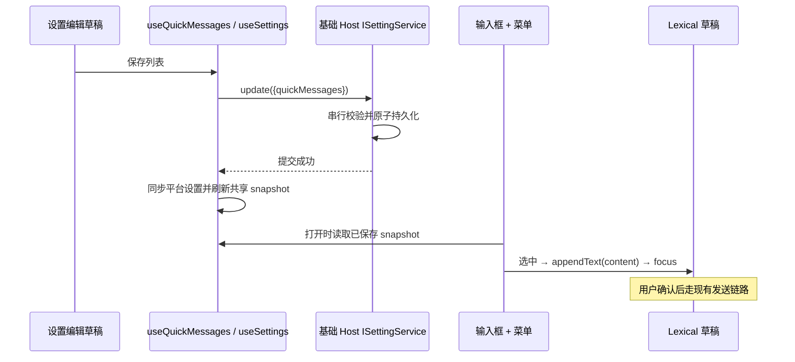

# 快捷消息

## 产品规则

- 设置页增加「快捷消息」基础设置分区，Desktop 与 Web 均可用。
- 左侧按标题或内容搜索并选择消息，右侧编辑标题和多行内容；支持新建、保存、取消、删除确认、拖动和键盘排序。
- 标题去除首尾空格后必须非空（最多 100 字符）；内容保留原始空格和换行，但不可全为空白（最多 20,000 字符）；最多保存 200 条，每条具有唯一稳定 ID。
- 编辑草稿仅归设置组件所有，显式保存成功后才成为可选消息；切换/新建前确认放弃未保存编辑。保存失败保留草稿并显示错误，写入期间禁止重复操作。
- 搜索期间禁用排序，避免对部分列表排序而改变隐藏项顺序。正常列表顺序就是菜单顺序。
- 输入框「+」菜单独立显示快捷消息分区；没有消息时显示空状态。支持点击、方向键和 Enter 选择。
- 选择后通过现有 Lexical `appendText` 接口追加普通文本到草稿尾部（沿用该接口的空格分隔规则），保留既有文字/提及，恢复输入焦点，不自动发送。API 和 ACP 输入框均可用，filesOnly 菜单不显示。

## 所有者与接口

- 唯一已保存事实源：基础 Host 的 `ISettingService` / `AppSettings.quickMessages`（`{id,title,content}[]`），与具体 workspace、SSH Host、Agent 无关；手机使用所连接 Host 的应用设置。
- 复用现有设置写入队列、JSON 原子写入、设置校验和平台设置变更通知；不新增 Repo、RPC 通道或任务状态。
- Desktop Main 收到已持久化的 quickMessages patch 后，通过现有 SettingsChanged 通道通知所有应用窗口刷新，不承载消息状态。设置读取/写入日志仅记录路径、字段名，不记录消息正文。
- `useSettings` 允许显式指定服务 accessor；`useQuickMessages` 始终使用 `useBaseWorkspaceServices`，与设置页和远端输入框保持同一 owner。
- UI snapshot 仍由既有按 settingService 实例隔离的设置 store 管理；不新增重复的 Zustand 设置状态。菜单打开时固定消息快照，避免配置变化引起键盘索引错位。
- 读取旧配置缺少该字段时默认空列表；patch 缺少该字段不影响已有列表，显式空列表删除所有快捷消息。schema 拒绝无效形状、重复 ID、空白文本和超限数据。

本功能不改变 desktop-continuous 或 web-remote-replayable 会话投递、owner/lease、命令 admission 与重连语义；快捷消息成为草稿后走原有发送路径。

## 验收

1. 首次进入为空；创建多行消息并保存，重新挂载后仍存在；中文/英文标签完整。
2. 编辑/取消、删除确认、标题与内容搜索、清空搜索、指针/键盘排序，排序在菜单同步。
3. 空白标题/内容不可保存；schema 拒绝重复 ID 等非法 patch；失败不显示保存成功且草稿可重试。
4. API/ACP 的 + 菜单选择消息保留已有草稿，不触发提交；键盘选择恢复输入焦点；刷新配置后再次打开菜单可见最新内容。
5. 远端 workspace 的 settingService 不被读写，快捷消息仍使用基础 Host；不同基础 Host 的 snapshot 不串写。
6. 窄屏无横向溢出、编辑和主操作可达，深浅主题均使用现有语义 token。
