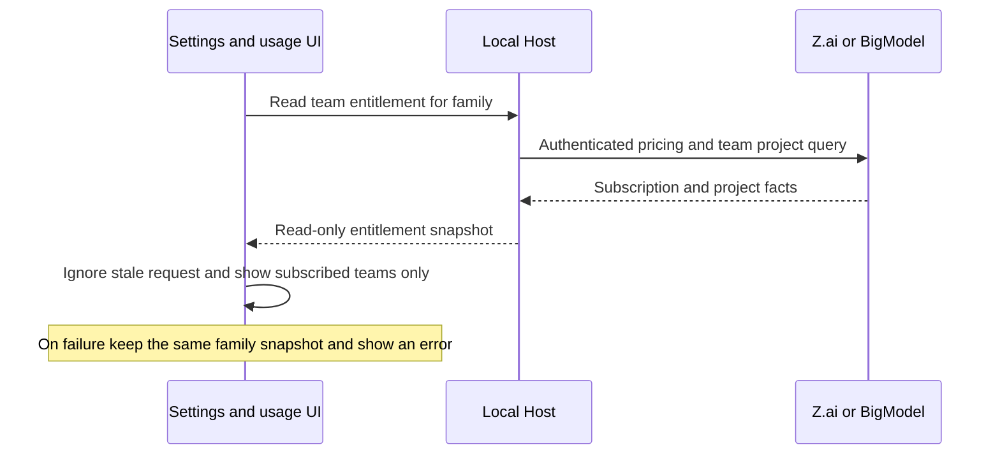

# Remove in-app purchases

## Behavior

ZCode does not advertise, open, or execute a Coding Plan purchase, renewal,
upgrade, or payment flow. Model-provider settings remain usable for API keys and
for connecting an existing Z.ai/BigModel plan. Existing subscription and quota
status remain visible because the provider owns those entitlements, not ZCode.
Exhausted quota still reports the provider error; it must not offer an in-app
purchase action. Off-peak eligibility continues to follow the provider's
entitlement rather than pretending that a missing subscription is available.
The Plugin Store does not display a Coding Plan badge or a paid-plan tooltip on
catalog cards or the plugin detail title, even when a legacy marketplace
listing contains `requiresPaidPlan: true`. That optional catalog field remains
readable for compatibility with existing marketplace snapshots, but it does
not affect visibility or install actions. Update availability remains visible.

## Ownership and boundaries

- Provider settings and the local Host remain the source of model configuration
  and provider entitlement. Removing sales UI does not alter saved credentials,
  selection, or existing sessions.
- The UI has no checkout target or purchase-completion state. It never launches
  a payment webview or deep link as a response to a quota/error message.
- Desktop does not register a purchase webview bridge, payment callback channel,
  or payment deep-link route. Ordinary browser tabs, OAuth callbacks, workspace
  links, and share import keep their existing behavior.
- The provider's authenticated enterprise pricing response is used only as an
  entitlement and team-project read source. Only subscribed products enter
  the settings and usage lists; a failed read retains the previous snapshot for
  the same account snapshot and shows an error, with no public SKU fallback.
- An enterprise read pins the provider OAuth credential for pricing, team
  project enrichment, and project-key prewarming. The UI keys each result by
  the current provider-settings revision/access fingerprint; when an account
  changes, the prior result and any late response cannot enter the new view.
- The local Host owns provider credentials and project-key prewarming. The UI
  reads their status and must not infer an entitlement from a sales catalog.
- This change does not migrate or clear persisted settings, credentials, or
  sessions. An old payment deep link has no in-app consumer.
- Marketplace catalog parsing owns legacy `requiresPaidPlan` data. The Plugin
  Store owns only its visual projection and ignores this field; installing,
  restoring, and updating use the existing plugin service commands.

## Acceptance

1. Model settings show API-key and existing-plan connection, status, quota, and
   disconnect, but no price, subscribe, renew, upgrade, or purchase links.
2. Composer, session quota/error, and automation entitlement notices have no
   purchase action; normal configuration and retry actions still work.
3. A provider with a valid existing Coding Plan can still authenticate and use
   its models. A provider without one remains unavailable rather than bypassing
   provider-side billing or entitlement checks.
4. Desktop and Web compile; the removed flow is not mounted at startup, and
   existing user settings and sessions are not migrated or deleted.
5. A team subscriber remains visible when the former static catalog is absent;
   a non-subscriber is not promoted to a purchasable team card.
6. During a same-family account switch, a delayed enterprise response from the
   first account cannot display in the second account, and a single in-flight
   read does not combine their pricing, projects, or project-key authorization.
7. In both Chinese and English, a plugin with `requiresPaidPlan: true` has no
   Coding Plan badge or tooltip in its list card or detail header. Its install
   button remains available, and a genuine update badge still appears.

## Interactive acceptance scenarios

- Desktop: start without an app login, open model settings, configure an API
  key, then connect an existing Coding Plan. Settings and usage show only the
  provider's active plan and quota; no purchase dialog, checkout webview, price
  card, or upgrade action appears.
- Desktop: exhaust a plan or open a subscription-only automation. The notice
  explains the provider entitlement and offers retry or configuration where
  appropriate, with no payment action. An old `zcode://payment/callback` link
  does not open a payment UI.
- Desktop and mobile Web: open a workspace and switch between providers and
  team accounts. Only the selected account's subscribed team projects appear;
  delayed results from the previous family cannot replace current results.
- Desktop and narrow mobile Web: open the Plugin Store, find a previously
  marked plugin in the public list and open its detail. Neither surface has the
  plan badge or its tooltip, while install and update controls still render
  according to their own states. Repeat in both locales and after catalog
  refresh, with a legacy listing that still carries `requiresPaidPlan: true`.
