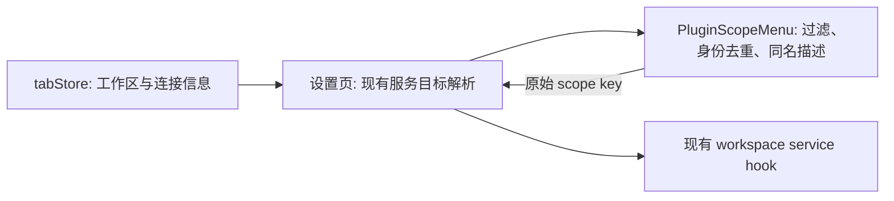

# 设置工作区作用域菜单

## 规则与所有者

- `tabStore` 继续拥有已打开工作区和连接信息；设置页通过已有 hooks 获取服务目标。
- `PluginScopeMenu` 仅派生展示选项，不修改 tab、工作区身份或持久化配置。
- 工作区身份遵循 `workspaceIdentity?.trim() || workspacePath`。同一身份最多展示一次，保持首次可用项的顺序和元数据；不同身份不能按名称或路径误合并。
- 保留现有可用性规则：失效本地目录和没有 session 的远程工作区不显示。先过滤再去重，不能由断开的旧项遮住当前可用项。
- 同名但身份不同的工作区保留各自入口，显示路径作为第二行；远程项附带现有连接目标展示文字。没有连接元数据时用身份 key 区分。
- 无同名冲突时保持单行名称。存在冲突的当前选项在触发器中提供完整描述的 title。
- 显式 `workspaceOptions` 和由 `workspaceTabs` 派生的选项均遵循相同去重规则；选择回调始终传递原始身份 key。

## 边界

这是 ui 模块内部的展示修复，不改变服务路由、Host owner/lease、连接 session 或 Desktop/Web 流式语义，不执行数据迁移。

## 验收

1. 重复 tab 或显式选项的相同 key 只出现一次；顺序不变。
2. 两个不同路径的 `zcode` 都能选择，第二行显示各自路径；不影响唯一名称项。
3. 相同路径但不同远程 identity 的项目保持独立，连接目标或身份文字可区分；重连 session 不增加入口。
4. 断开项/失效目录不出现，断开旧项不遮住同 identity 的可用项。
5. 桌面与手机 Web、明暗主题下菜单可读，无横向溢出；鼠标和键盘选择回调返回正确 key，当前项勾选唯一。

验证入口：`packages/ui/test/pluginScopeWorkspaces.test.ts` 和 `packages/ui/test/pluginScopeMenu.e2e.mjs`，另执行根目录 typecheck、lint 和 changed 架构检查。
