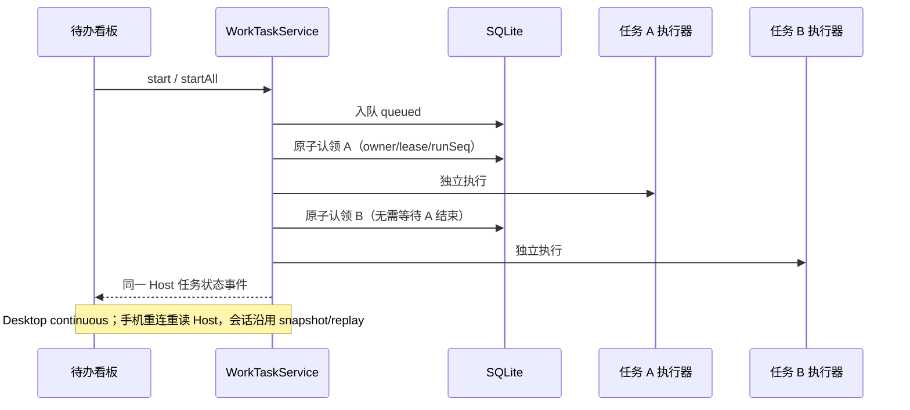

# 待办任务

## 范围

### 已完成任务归档并删除工作树

已完成（`done`）、未归档且持有任务工作树的菜单，在原“归档”后增加“归档并删除工作树”。直接分支任务不提供此项；断连、远端、不支持清理的 Host、忙碌或停止待确认时不得执行。原归档继续只修改归档事实。

点击先展示确认弹窗，列出任务名称及准确的任务工作树路径，说明目录将被删除、分支和会话历史保留，未提交改动会阻止删除。取消无写入；确认期间禁止重复提交和关窗，失败保留弹窗、任务及错误，可显式重试。窄屏、两主题、中英文复用现有菜单/AlertDialog。

`WorkTaskService` / SQLite 是任务事实唯一所有者；扩展原 `archive` 合约的可选 `removeWorktree`，仅允许 `archived=true` 与本地 done 任务。Host 注入清理端口，使用持久化分配（不接受 UI 路径），核对注册工作树项目及分支后复用 Git `removeManagedWorktree` 的范围、脏目录、锁定、API/ACP 活动检查及非 force 删除。仅删除任务自身工作树，不清理合并处理工作树、不删分支、不删会话、不提交或推送。删除成功后才保存归档，原分配作为历史保留；已删除且已注销的目录重试视为成功，不重建工作树。Git 删除与 SQLite 不能成为同一事务，若进程在两者间中断，任务仍可见并由用户显式重试收口。

同任务清理命令在 Host 内互斥，重复请求拒绝；完成态不可被原 start/edit/merge 重新准入，清理后归档前再次读取当前任务并检查状态。UI 仅持有确认/提交临时态，通过原 scoped hook 发命令及共享读取投影刷新，不保存删除事实。沿用 identity/path/remoteSessionId 隔离，远端禁止清理且不回落本机；desktop continuous 与 mobile replayable 仍由同一 Host 的原任务通知/重读恢复投影。

```text
菜单 -> UI 确认态 -> scoped archive(removeWorktree=true) -> Host WorkTaskService
  -> done/本地/分配校验 + 同任务互斥 -> 注入清理端口
  -> Git 注册/项目/分支/活动/脏目录检查 -> 非 force worktree remove
  -> 重读任务 -> SQLite archive -> 原 Host 通知/共享投影 -> 看板移除
失败 -> 保留任务与确认弹窗；已删除未归档 -> 显式重试 -> 归档
```

验收：原归档零 Git 写入；API/ACP done 菜单可用，其他状态/直接执行不显示；取消零命令；确认仅一次 scoped archive、失败不隐藏且可重试、成功清除当前选择；窄屏两主题与中英文。服务测试覆盖本地/远端/跨 scope、非 done/缺失分配、重复提交、删除失败/成功/归档顺序及 RPC 严格校验；临时 Git 测试覆盖脏目录、分支归属、干净删除、保留分支/相邻目录与已删除重试。

### 再次进入恢复项目与任务

离开待办页面后再次进入、页面重新挂载或重新加载时，恢复上一次可用项目及该项目上一次查看的可见任务。各项目分别记忆任务；切换项目不会清除另一个项目的选择。没有历史偏好或已关闭的项目沿用当前主项目/第一个可用项目的现有默认规则；不为恢复偏好自动打开项目。

`workTaskNavigationStore` 是 UI 导航偏好的唯一所有者，保存在版本化本地存储中，仅记录项目 key 和任务 id，不复制任务记录、会话、草稿或业务执行状态。项目 key 使用 `workspaceIdentity?.trim() || workspacePath`，并结合 remoteSessionId 隔离本地与远端 Host。旧版本没有此偏好时无需迁移；存储损坏或不可用时用默认值/当前窗口内存选择，不阻断页面。偏好属于当前客户端，不广播给其他窗口或手机。

先等待现有 Git 项目关系解析，再按偏好选择项目；任务列表首次成功返回后才确认任务有效性。加载、后台重读失败、断连期间不能清除记忆；成功读取后发现任务已删除、归档或取消则清除对应任务选择，不自动选择其他任务。用户关闭任务查看也清除该项目选择；旧 pane 的迟到关闭事件不能清除新选择。恢复只复用原 list/会话观察链路，不 start、create、merge 或发送输入，不改变全局主视图的导航规则。

```text
用户选择 -> UI navigation store（唯一偏好所有者） -> 本地保存
重新进入 -> 已确认 Git 项目 -> 匹配偏好/默认项目 -> 原 Host list
  -> 成功：恢复可见任务；不可见则清除该项目任务 id
  -> 加载/失败/断连：保留偏好，等待原读取链路恢复
desktop / mobile：各自 UI 偏好；业务仍由同一 Host 管理，沿用 continuous / replayable
```

验收：非当前项目及 API/ACP 任务在重挂载/刷新后恢复；项目切换各自恢复、相同路径的远端 identity/remoteSessionId 隔离；首次列表延迟及失败不丢选择；归档/取消/删除/主动关闭后不复活旧任务；不可用项目及损坏存储安全回退；零业务写入。使用导航 store 单测及合成 Host UI E2E。

### 启动项目选择与共享读取

项目选择器与侧栏统计复用同一窗口、同一 Git Service 的工作树关系读取。关系尚未确认时，待办项目选择器禁用并显示原加载占位，不把主项目和 linked worktree 临时当作两个可选项目，也不查询临时 worktree 的任务。确认后沿用 Git 主项目归组；不同路径或远端 identity 的同名项目保留独立选项，并显示路径（远端补充 identity）作为辅助信息，不能按名称去重。Git 查询失败仍保留独立项目，不猜测归属。

`WorkTaskService` / SQLite 继续是唯一任务事实所有者。UI 的共享读取投影按 Service 实例、`workspaceIdentity?.trim() || workspacePath`、remoteSessionId 和 includeArchived 隔离；侧栏统计、面板及详情共享一次首读和一个 Host 事件订阅，不保存新的执行队列。首次读取显示加载态；已有看板在后台重读时保持内容及所选任务，失败保留旧内容并显示错误。并发读合并；在途读取期间收到 Host 新事件或未收到通知的 mutation 完成，立即发起新读并丢弃迟到旧结果，不能等待旧 RPC 返回或用旧结果覆盖更新。

最后一个观察者卸载时释放 Host 订阅、清空投影并使迟到结果失效。换项目、换 Service、远端断连和重连不得展示旧 Host 的任务或回落本机。桌面 continuous 与手机 replayable 会话链路、任务命令、owner/lease/runSeq 及持久化格式保持原协议。

新增或关闭其他项目、工作树而触发关系重读时，保留同一 Git Service 已确认的项目投影和当前看板；新路径在确认前不加入待办候选或统计 scope。仅暂时禁用项目切换，不能重挂载当前任务或丢失草稿。换 Git Service 则立即撤销旧投影。

```text
恢复 workspace tabs -> 共享 Git 关系读取 -> 确认主项目 -> 可选项目 / 侧栏 scope
所选项目 -> 同 Service + scope 的共享 UI 读取 -> 原 Host list / onDynamicChanged
Host mutation / 事件 -> 在途旧读失效 -> 立即重读 -> 看板与侧栏同时更新
最后观察者卸载 -> 释放订阅 + 清空投影；新 Host -> 独立读取
```

验收：延迟 Git 返回期间不存在重复可选项或 worktree 看板请求；同名独立/远端项目可区分；侧栏与面板同 scope 只首读一次、订阅一次；加载中事件不丢更新；后台读取与失败不清空已有看板；关项目和 Host 切换丢弃迟到结果并释放订阅。通过读取投影单测及合成 Host UI E2E 验证，不连接 Agent、不修改真实仓库。

第一阶段提供项目待办看板、任务创建/编辑、手动开始/批量开始、编辑保存后重新开始、取消、失败重试、审阅后继续修改、确认完成、归档和关联会话跳转；已开始的独立任务不设项目并发上限。同时支持 ZCode/API 与已启用且已安装的 ACP 智能体。创建、打开编辑器和选择智能体只保存草稿，不启动 Agent、不登录、不发送消息。

定时执行、无人值守自动执行、项目验收脚本、PR 交付、自动清理工作树及任务模板不在本阶段。普通确认完成为用户明确接受结果，不代表已合并代码；另提供用户明确触发的本地“提交并合并”。分支、工作树和会话全部保留，不自动推送远程。非 Git 项目不能执行。远端断连不得回退到本机；本阶段不提供远端工作树执行。

## 来源分支与审查合并

### 保存反馈与列表刷新

新建任务只有附件保存及原 `create` 持久化成功后才关闭编辑器，但不再等待全量列表读取；已有任务仍先 `update`、再按原规则 `start`，两者成功后关闭。命令失败保留草稿及错误，不自动重发；列表读取失败只影响看板/侧栏投影，不把已成功保存的任务报告为保存失败，也不阻止再次新建任务。

Host / `WorkTaskService` 仍是唯一已接受任务状态所有者。UI 的 共享读取投影按 service 实例（Host/连接）、`workspaceIdentity?.trim() || workspacePath`、实际 path、remoteSessionId 和 includeArchived 隔离；同 scope 看板与侧栏共用一个订阅和最新在途列表读取，不新增任务写入、持久化缓存或 optimistic 任务。变更发生在读取中时立即重读并丢弃旧结果，不能等待旧 RPC 或用固定延时防抖漏掉新事实。命令返回后，若期间已收到通知则复用通知读取；否则发起一次后台补读。失败读取保留上次投影并显示错误，下次通知或显式刷新可恢复。

最后一个消费者卸载时释放订阅、清空投影并使旧请求失效；切项目/Host、断连重连均不得采纳旧结果或回落本机。仅改变 UI 读取和保存反馈，不修改公开协议、SQLite、owner/lease、CommandInbox 或原执行时序；desktop continuous 通知和 mobile replay/reconnect 后的全量重读仍由同一 Host 事实驱动。

```text
编辑器草稿 -> 附件事务 -> 原 create / update(+start) -> Host 持久化/准入 -> 关闭编辑器
                                      └-> 变更通知 -> 同 scope 共享读取投影 -> 看板 + 侧栏
命令返回且未收到通知 -> 后台补读；读取中的新通知 -> 立即重读 + 旧响应失效
最后消费者退出 / Host 切换 -> 释放订阅 + 清空投影 + 旧请求失效
```

验收：至少 20 条任务、API/ACP、桌面/320px 窄屏和两主题下，延迟列表响应不阻塞保存成功后的关窗；附件/命令失败保留草稿、已有任务 update/start 顺序及连续提交锁不变。看板+侧栏同 scope 共用读取和订阅；延迟读取中多次变更最终显示最新事实；保存后读取失败可见且不重复创建。Host/identity/remoteSessionId/includeArchived 隔离、最后订阅释放、旧响应丢弃及重订阅重新读取均有可控请求测试。

### 任务编辑器与直接分支执行

新建和编辑弹窗移除任务名称输入；新任务用描述折叠空白后的前 200 个字符作为看板标题，编辑保留既有标题。描述仍必填，附件、智能体与执行配置规则不变。

来源分支下方新增“使用工作树”开关，新任务默认开启，旧记录缺失 `useWorktree` 等同开启。关闭时说明将在项目目录的所选分支直接修改代码，不隔离改动；只允许选择实际本地分支。选择、开关和保存仍是草稿操作，不切换分支或调用 Agent。

`WorkTaskService` / SQLite 仍是唯一任务状态所有者，UI 只持有草稿。`useWorktree?: boolean` 贯穿原 create/update 合约；直接执行首次开始先校验本地 Git 项目和分支，再通过现有 Git switch（不 force、不 stash、不 reset）切换，复检当前分支，持久化 `directBranch` 后才创建/绑定 API 或 ACP 会话，cwd 使用原 workspacePath。无分支、分支不存在、切换失败或归属校验失败不发送输入。已有同分支改动保留，切换时 Git 拒绝覆盖的改动保留并报错。

工作树已分配或直接分支已固定后，执行方式与来源分支不可更改。直接执行重试复用会话和分支；外部已切走分支时明确失败，不自动切回。直接执行不伪造工作树分配，不提供“提交并合并”，普通确认完成和归档不产生 Git 写入。原会话被动观察及任务工具目录支持直接项目路径。

为防止多个任务交错切换共享目录，SQLite 在原 owner/lease 事务内串行认领直接执行任务（同一 Host 任务数据库最多一个直接执行任务）；隔离工作树任务保持并发。此锁不控制用户在其他程序中的 Git 操作。取消、过期 run、Host 中断沿用原收口规则，不回滚用户文件、不自动清理。远端执行仍明确拒绝。

```text
编辑器草稿（useWorktree 默认 true） -> 原 create/update -> Host SQLite
开始 -> 原 owner/lease 原子认领（直接执行串行）
  -> 开启：原来源提交固定 -> 持久化工作树 -> 原 API/ACP admission
  -> 关闭：项目/本地分支校验 -> 原 Git switch -> 复检 -> 持久化 directBranch
          -> 原 API/ACP admission（workspacePath） -> 原任务事实与会话投影
重试 -> 固定目录/分支校验 -> 原绑定；分支变化 -> failed，零 Agent 输入
desktop: 原 continuous；mobile: 同一 Host 任务重读及原 replay，远端新执行仍拒绝
```

验收包括：无名称输入且描述即可保存、默认开启、关闭及分支选择持久化、关闭重开恢复、保存零 Git/Agent 写入；真实临时 Git 验证直接 cwd/所选分支、无新分支或工作树、改动保留、缺失分支及切换冲突、重试分支变化失败、API/ACP 原入口；SQLite 验证直接执行串行、已固定配置锁定及旧记录兼容；UI E2E 覆盖两种模式和窄屏/两主题。

新建任务在现有编辑器增加来源分支选择，读取当前项目 Host 的本地分支，默认当前分支；展开列表、选择和保存均不切换项目分支、不创建工作树、不连接或认证 Agent。保存可选 `sourceBranch`，首次执行读取所选本地分支的最新提交并保存到 `worktree.baseCommit`。分支不存在明确失败，不回落 HEAD。既有未分配且没有该字段的任务沿用 HEAD；已分配任务沿用原提交/工作树，来源分支不可更改。来源分支不属于智能体偏好，不从历史任务推测默认值。分支读请求按项目/Host 和 generation 丢弃迟到结果。

待审查任务增加本地目标分支选择（默认来源分支；旧任务默认主项目当前分支）及“提交并合并”，不能以任务分支为目标。普通确认完成及归档保持零 Git 写入。点击合并只提交该任务自己的工作树内未忽略的改动，不自动提交、暂存、stash、reset 或切换主项目。Git 用户身份缺失、已有 Git 操作、目标工作树脏、任务会话忙碌及归属异常均明确拒绝。

合并入口复用右上角现有侧边面板中的“审查”标签，放在文件变更列表上方。待审查且已分配工作树的任务、或已有合并记录的任务，在侧栏收起时点击原有面板开关直接打开“审查”；侧栏展开时沿用面板顶部的关闭入口。仅选择任务不自动展开侧栏。对话顶部和详情不再提供重复合并入口，保留完整消息与输入框空间。

`workTaskNavigationStore` 持有所选任务 id，`WorkTasksBoard` 仍是合并分支草稿的唯一所有者，`useWorkTasks` 通过同 Service / scope 的共享读取投影访问 Host 事实。原合并组件留在看板组件树中，按任务 id 隔离分支草稿，仅通过 React portal 投影到现有 Git 标签的 UI 插槽；侧栏不另建合并订阅或复制任务状态，不增加 tab 类型、业务协议或 Git 写入入口。关闭/重开侧栏或审查标签、详情开关和响应式布局变化均不重挂载草稿所有者或当前对话。切换任务重置分支草稿，切项目、关闭查看及归档当前任务撤销合并投影。插槽未挂载时不展示控件，重开后读取最新任务记录。

合并进度、结果提交、冲突文件和失败提示同样在审查标签上方展示，长记录限高滚动，为文件变更保留空间。文件变更继续跟随当前实际展示的原任务或合并处理会话目录；目标分支仍只读取任务所属主项目。合并准入失败保留分支草稿；活跃合并不可重复提交，完成后隐藏可编辑入口。选择分支、开关侧栏、打开详情及布局变化只读，不触发 Agent 登录、执行或合并。桌面和窄屏均复用原侧栏布局及关闭入口，不新增确认弹窗。

```text
选中任务 -> workTaskNavigationStore -> WorkTasksBoard / 原 useWorkTasks -> 原合并组件（唯一分支草稿）
右上角面板开关 -> 原 useAppPanels 打开审查 -> Git 标签 UI 插槽 <- portal
点击提交并合并 -> 原 panel.merge -> 同一 Host WorkTaskService
关闭标签/侧栏 -> 仅隐藏投影，保留分支及对话草稿；切任务 -> 新任务草稿
```

“提交并合并”使用现有 Button 的 32px 控件规格，与目标分支选择框等高、同为 8px 圆角；通过语义 accent 底色、icon-blue 细边框及合并图标强调操作，不使用大面积纯色或额外卡片。悬停/按下只改变颜色，不移动或缩放控件；键盘焦点有可辨认的边框，禁用状态以中性底色和弱文字/图标显示，不能改变可用性规则。桌面同行对齐，窄屏自然换行，保留完整按钮文案和分支草稿；来源分支选择框的原有规格不变。

`WorkTaskService` 仍是唯一业务所有者；任务保存可选合并记录（操作 id、规范项目路径、目标分支、阶段、源/目标提交、隔离工作树、冲突文件、处理会话、结果提交及错误），由原 SQLite/owner/lease/runSeq 和调度队列持久化。UI 仅持有分支草稿与只读投影。合并使用原 queued/preparing/running/awaiting_input 状态，显示合并阶段；同仓库同目标分支跨窗口串行执行。重复提交同一活跃合并返回既有操作，改变目标被拒绝。运行、取消、归档、确认完成不得越过合并所有权。

Git 适配器先校验实际注册工作树/分支与规范项目归属，再提交任务改动并固定 sourceCommit、targetCommit；在原 Worktrees 根目录下分配独立 `merge/<id>` 工作树。正常三方合并在此进行，不使用 ours/theirs 覆盖冲突，不修改原任务会话绑定。非冲突不调用模型；文本冲突使用任务保存的同一 API 模型/模式或 ACP Agent/config，通过已有 V4/ACP admission 创建合并处理会话，发送包含任务上下文、固定提交及冲突路径的输入，不重发任务附件。保留权限/问题等待及既有 stop/stale run 边界，不提升权限；二进制及 submodule 冲突明确失败。处理会话在现有右侧 SessionPane 展示，允许原权限交互，不另建聊天页面。非活跃合并可在原对话与处理对话之间选择，工具路径跟随实际展示会话。

Git 校验包括未合并 index、原冲突文件的残留冲突标记、diff --check、源提交和目标提交可达性、处理分支/项目归属，以及目标 ref 未变化。此校验不是项目测试通过的证明；Agent 可以在既有权限内执行项目可用检查，但不伪造自动验收结果。校验不通过不得更新目标。保存结果提交及 applying 阶段后再发布：目标通过 expected-old update-ref 实现不丢并发提交的 fast-forward；已检出目标同时持有真实 index 锁，用 alternate index 和原生 read-tree 校验/同步文件，再原子安装 index，不切换分支或强制 reset。更新文件失败只回退仍等于本操作结果的 ref，不覆盖第三方后续提交。发布后确认结果可达才标记 done/completion=merged，保留路径和提交记录。

取消 preparing/resolving 先撤销运行资格，再停止对应处理轮次，结束后回到 review；applying 阶段拒绝取消，避免已发布代码被显示成已取消。失败/Host 中断保留分配、会话、结果提交和错误，回到 review，不自动重发模型请求。用户重新合并建立新显式操作；目标已包含源提交时是无模型、无重复提交的成功，不覆盖已有冲突修复。原任务会话的被动状态观察不能把合并轮次当作普通开发轮次；操作结束后恢复原观察。新普通开发输入清除旧合并投影但不删除文件/会话，旧合并终态不能覆盖新 runSeq。

```text
分支草稿 -> 原 create/update -> Host SQLite（sourceBranch）
首次开始 -> 原 owner/lease -> 来源 ref -> 固定 baseCommit -> 原任务工作树
审查选择目标 -> merge 命令 -> 同一 Host 队列/原子认领（任务 + 仓库目标）
  -> 目标干净/归属/会话校验 -> 提交任务改动 -> 固定源/目标 -> 隔离合并
  -> 文本冲突：保存合并会话绑定 -> 原 V4/ACP admission -> 权限等待/处理
  -> Git 校验 -> 保存 resultCommit/applying -> 目标发布及可达确认 -> done
  -> 失败/取消/中断：review + 合并错误，不更新未发布的目标
desktop: 原会话 continuous + 任务事实事件；mobile: 同一 Host 重读 + 原 snapshot/replay
```

发布前重新读取原任务和处理会话的权威状态；API 的后台工作、待处理命令、队列及权限交互均视为忙碌，ACP 的运行及待授权状态同样拒绝发布。API 快照只接收本次订阅 id，订阅 ACK 前到达的帧暂存后按 ACK 筛选，不使用其他窗口或旧订阅的空闲投影。原冲突文件不能被替换成二进制、链接或通过父目录链接逃逸处理工作树。目标 ref 在发布时推进、新文件在 checkout 前出现或 index 被其他 Git 操作锁定，均保留第三方内容并报错，释放本次持有的锁。

合并的工作树状态查询只需要“有无未提交改动”，统一由 Git 适配器的存在性查询负责。查询使用 NUL 分隔的 porcelain 状态和 `--untracked-files=normal` 折叠未跟踪目录，显式关闭分支与 stash 头部，不为判断布尔值列举每个未跟踪文件，也不把状态显示配置产生的头部当作改动。命令执行器的显式 `stdoutCapture: "first-byte"` 仅保留首个 stdout 字节，其余输出继续排空；必须等命令正常完成，stderr 配额、超时、退出码与进程清理规则保持不变。普通 Git 命令仍默认捕获完整输出及原有配额，不改变审查文件列表或 diff 读取。

此查询用于目标干净校验、任务是否需要提交、来源/处理工作树的最终校验，以及持有目标 index 锁后的再次检查。大输出本身不能成为 `git status output exceeded limit`，但非零退出、超时和 stderr 超限仍失败，不能把错误或截断解释成干净。任意未忽略的未跟踪文件或目录仍算脏；目标脏时在提交任务前拒绝，保留 `work-task.merge-target-dirty`，不自动忽略、暂存、stash、提交或删除用户文件。任务状态、Host owner/lease/runSeq、API/ACP 准入与合并发布顺序不变。

```text
原 Host 合并认领 -> Git 存在性查询（首字节 + 等待真实退出）
  -> 干净：继续原提交/隔离合并/发布前复检
  -> 有改动：任务工作树按原规则提交；目标工作树立即拒绝
  -> Git 失败/超时/stderr 超限：原失败收口，不发布目标、不自动重试
```

### 合并验收场景

后台工作记录的 `failed/cancelled` 是历史终态，不阻止合并；`running/resultPending` 和已准入但未结束的命令继续视为忙碌。未分配任务可以将指定来源改回当前 HEAD，保存必须真正清除旧 `sourceBranch`，不能沿用旧值。

失败或取消后重新打开审查，默认保留上一次合并目标；原操作记录仍可查看，新点击才建立新操作。只有没有合并记录时才默认来源分支/当前主项目分支。

Host 在 `applying` 或已保存 `merged`、尚未完成任务收口时中断，仍按合并操作恢复为 review，保留源/目标/结果提交和处理会话，记录中断而不自动重发或自动确认成功。恢复不得把这类记录当成普通开发失败；用户明确重新合并时由 Git 判断目标是否已包含源提交。

| 场景        | 设置/动作                                                            | 必须断言                                                                         | 证据                           |
| ----------- | -------------------------------------------------------------------- | -------------------------------------------------------------------------------- | ------------------------------ |
| 来源选择    | 当前 main，选择另一分支后保存并运行 API/ACP                          | 工作树内容来自选中分支；主项目分支不切换；重试不追随来源的新提交                 | 临时真实 Git + UI E2E          |
| 旧记录/编辑 | 无 sourceBranch 的任务和已有工作树任务                               | 旧任务仍用 HEAD；已分配任务更改来源被拒绝；附件和配置保存不变                    | 服务单测                       |
| 无冲突合并  | 任务有未提交改动，选择非当前目标分支                                 | 仅任务工作树被提交；目标包含结果；零模型调用；不推送/删除                        | 临时真实 Git + UI E2E          |
| 自动处理    | API 与 ACP 文本冲突                                                  | 同一执行配置、独立处理绑定、固定输入；右侧复用原聊天/权限交互；成功发布          | Git 测试 + 可控 Agent + UI E2E |
| 失败保护    | 脏目标、目标推进、二进制/残留冲突、身份缺失                          | 显式错误；目标既有内容/提交保留，不误报 done                                     | 临时真实 Git                   |
| 大状态输出  | 状态输出超过配额、未跟踪目录含大量文件、发布前目标变脏               | 来源可按原规则提交；脏目标在提交来源前拒绝；锁后复检生效；查询失败不当作干净     | 临时真实 Git + 命令执行器单测  |
| 并发/迟到   | 两 Host/两 scope 同仓库目标、重复点击、取消、过期 owner              | 目标串行；只执行一次；迟到结果不更新新 runSeq；applying 不可取消                 | 临时 SQLite + 可控端           |
| 恢复/兼容   | Host 重启、已合并源、普通完成、开发续聊                              | 不自动重发；重新合并可无操作成功；普通完成零 Git；原绑定不丢                     | 服务单测                       |
| 布局与错误  | 审查侧栏、详情/标签开关、任务切换、长分支名、320px、两主题、异步失败 | 对话和详情无重复入口、无横向溢出、关闭重开保留草稿、切任务正确投影、不认证 Agent | synthetic Host E2E             |

迁移只增加可选 JSON 字段并扩展 completion 枚举，不改旧任务身份、已保存分配或普通会话协议。验证使用临时 Git/SQLite、可控 API/ACP 和 synthetic Host，不操作用户真实仓库或付费模型。

## 所有权和边界

- `WorkTaskService` 是任务状态、运行批次和调度的唯一业务所有者。`WorkTaskRepo` 在目标 Host 的独立 SQLite 文件保存任务、事件和项目设置，不修改现有会话索引的状态语义。
- 每个任务保存项目作用域、标题、正文、执行配置、状态、排序、`runSeq`、工作树/分支和绑定会话。配置以 ZCode/API 与 ACP 的可区分联合类型表达；每次执行使用保存的配置，不读取 Renderer 的当前选择。
- 作用域 key 统一使用 `workspaceIdentity?.trim() || workspacePath`。记录始终携带实际路径；所有读写命令校验任务作用域。
- SQLite 原子认领 `queued -> preparing`，不以同项目活跃任务数限制认领。多个已开始的 API/ACP 任务可在前一任务结束前同时执行，批量开始超过 8 项也不受项目数量上限阻塞；不同窗口仍不能重复认领同一任务。同仓库同目标分支的合并继续串行。
- 开始、取消及运行收口发出立即调度信号，已有 tick 期间收到的信号必须保留，不能等轮询补偿丢失的唤醒。禁用执行的远端 Host 只提供读写契约，不认领或恢复本地队列。
- 活跃任务保存 Host owner 和有效期，Host 定期续租。只恢复已过期 owner 的任务；打开另一个窗口不能把仍由其他 Host 执行的任务标记中断。Host 关闭撤销自己的运行资格，停止自己的执行，不处理其他窗口任务。
- 每次开始、重试或继续修改增加运行批次；晚到事件只可按任务 id、owner 和 `runSeq` 更新当前运行。取消先撤销资格，再停止实际执行。不能用定时器推测任务已完成。
- 状态写入期间发生取消时，写入返回后先检查取消信号，再判断所有权；普通取消保持 canceled，实际停止失败仍显示 failed，不能把已取消误报为所有权错误。
- 任务队列只调度整项工作，不替代 CLI `CommandInbox` 或 ACP admission。API/ZCode 通过已有 V4 createSession/sendText/stop 执行，ACP 通过已有 ACP create/config/prompt/stop 执行。
- 新任务建立独立会话；重试/继续修改可复用该任务原会话，但不能加载别的任务的历史。会话与工作树绑定先保存，再发送消息。发送结果未知时标记失败并保留关联，不自动换 command 重发。
- API 订阅必须取得首份权威快照再准入，忙碌/预热、暂停队列及未完成交互不能被待办重试覆盖。ACP 复用前同样检查会话状态。相同运行状态不重复落盘或增加事件。
- 停止仅针对当前执行标识；停止失败或执行标识未知时显示失败原因，重试必须再次验证原会话空闲，不能盲目取消后续无关轮次。握手失败也必须释放 task attachment。
- UI 通过 hooks 访问目标 Host 服务，仅持有表单草稿、所选任务 id 和看板投影。离开看板不停止任务；右侧对话复用现有 SessionPane/ConversationTimeline/ConversationComposer 和 workspaceConnectionRegistry，不新增会话运行时或消息存储。

### 项目并发兼容与调度

`WorkTaskService` 仍是唯一调度所有者。`WorkTaskBoard.concurrency`、`setConcurrency`、既有 1–8 校验与 SQLite `work_task_projects.concurrency` 列保留原读写行为，仅供旧客户端兼容，不参与任务认领；未设置时返回的 1 不代表执行上限。旧项目设置为 1 或其他数值均不阻塞任务，不迁移或删除任务、会话、工作树及历史数据。UI 不新增并发入口，委派任务与 ACP 工作流的并发规则不变。

`queued` 保留为等待 Host 认领或合并目标锁的状态；普通任务不因同项目其他任务执行、等待权限或直接续聊而持续排队。认领仍在同一事务中分配 owner/lease、递增 runSeq 并生成 commandId；取消及迟到结果按原守卫处理，Host 重启不重发失去 owner 的执行。



```text
新建/编辑 -> UI 草稿 -> Host 校验 -> SQLite 待办记录
开始 -> Host 入队 -> SQLite 原子认领和续租 -> 工作树/会话绑定
                                          +-> V4 命令 -> CLI CommandInbox
                                          +-> ACP admission -> Agent
执行事件 -> owner + runSeq 校验 -> 状态和事件落盘 -> 看板/关联会话

desktop-continuous: 现有会话实时流
web-remote-replayable: 现有会话 snapshot/replay；待办重连后重读 Host 记录
```

## 状态和界面

| 看板分区 | 任务状态                       |
| -------- | ------------------------------ |
| 待办     | todo, queued                   |
| 进行中   | preparing, running             |
| 等你处理 | awaiting_input, review, failed |
| 已完成   | done, canceled                 |

待办页面只提供看板，不显示列表视图或看板/列表切换控件；重新进入页面、切换项目和窄屏均保持看板布局。移除列表仅改变 UI 投影，不修改 Host 接口和已保存的任务，也不持有视图切换状态。

### 侧栏任务数量

左侧“待办任务”导航入口右侧按数量显示紧凑的图标加数字计数：播放图标表示执行中，时钟图标表示等待处理，不显示常驻文字标签。已知数量大于 0 时显示对应图标和数字；数量为 0 时整项隐藏，两项都为 0 时不渲染右侧计数区、不保留占位空间。图标与数量同一行，数字使用现有小号字体，悬停及无障碍文案明确说明含义。汇总范围是看板项目菜单中所有已打开的主项目，不随当前普通对话或看板项目选择变化；项目收起仍计入，关闭项目后移除。不计非项目对话目录及独立工作树，重复项目按 `[remoteSessionId?.trim() || "", workspaceIdentity?.trim() || workspacePath]` 去重。API/ZCode 与 ACP 使用同一口径。

执行中只计未归档的 preparing、running，与看板“进行中”一致；等待处理只计未归档的 awaiting_input、review、failed，与看板“等你处理”一致，不把已完成数量改名后继续显示。todo、queued、done、canceled 和归档任务均不计入这两个数量。没有项目或所有项目均成功读到空列表时，两项数量为 0 并隐藏；首次读取中显示占位，任一项目断连、Host 不支持或读取失败时也显示占位并说明数量暂不可用，不能把未知数量当成 0。只有 remoteSessionId 的旧版远端作用域在断连后仍是远端目标，不回落本机。之后成功的 Host 事件重读及重连可恢复计数。

零计数验收：0/1 时只显示等待处理，1/0 时只显示执行中，0/0（无项目、空列表、仅已完成或归档任务）时两项均隐藏；Host 事件使数量由 0 变为正数时自动显示，回到 0 时立即隐藏，不改统计或订阅逻辑。读取中和读取失败时继续显示两个 `-` 占位。

WorkTaskService 及 SQLite 仍是任务状态唯一所有者；入口的逐项目只读投影复用 useWorkTasks 的 list、onDynamicChanged 和目标服务解析，不查询普通会话、不持有第二套任务业务状态，不新增 Host 接口、轮询、持久缓存或执行命令。useWorkTasks 已持有显式项目作用域，通过既有 workspaceServiceResolver 解析对应 Host，不用当前活动对话的路径自动推断目标；同路径本地项目仍查本机，远端按 identity/attachment 精确解析。监听在待办页面关闭时仍保留，项目关闭时释放；作用域/Host 切换及卸载后迟到结果按原 hook 的 owner/request 序号丢弃，远端断连不回落本机。导航与计数读取均不启动 Agent、不登录、不发消息。桌面 live 事件更新计数，手机仍使用相同 Host，连接恢复后重读任务记录，不改会话 continuous/replay 语义。

```text
已打开主项目 -> 去重作用域 -> 原 useWorkTasks -> 对应 Host list + 变更订阅
Host 状态落盘 -> 变更事件 -> 原 hook 最新请求投影 -> 纯计数 -> 侧栏汇总
关闭项目/Host 变化 -> 释放旧订阅/失效旧结果 -> 新作用域只读投影
桌面 live / 手机重连 -> 同一 Host 权威任务记录（无任务或 Agent 写入）
```

左侧顶部保留“待办任务”标题和项目选择，下一行仅保留“全部开始”和“新建任务”两个图标加文字按钮，下面显示四个看板分区。状态筛选、搜索、刷新、显示归档、显示已取消、项目并发，以及静态项目必选/远端执行提示均不显示，也不移到其他位置。UI 不再持有对应筛选状态，固定隐藏归档和已取消任务，仍通过已有 Host 事件自动刷新。已保存的并发设置、任务记录和服务能力不变。实际读取或写入失败仍在看板内容区显示错误，任务创建/编辑失败保留草稿；没有错误时不为错误反馈保留空白区域。

“新建任务”复用 WorkTaskEditor，通过 useWorkTasks.create 保存当前所选项目的任务；“全部开始”通过原有 useWorkTasks.startAll 提交所选项目，不在 Renderer 自行遍历启动或持有执行队列。初始读取、写操作忙碌及没有项目时按钮禁用；没有未归档 todo 任务或项目不可执行时，全部开始禁用。打开编辑器和配置选择不启动、认证或连接 Agent，批量开始不改变右侧当前选择，不重置并发设置。

待办工作台在可用内容宽度不少于 768px 时采用左侧窄看板、右侧对话的布局。左栏默认宽度 320px，允许通过共享分隔线在 260px 至 480px 之间调整，右侧保留至少 380px 的会话空间；宽度偏好使用独立的本机布局 key，不写入 Host。窄屏同一时刻只展示看板或所选任务内容，隐藏的是实际分栏外层，不留下空白占位；右侧提供返回看板入口。切换窗口尺寸不重挂载仍打开的会话，临时窄屏布局不覆盖桌面宽度偏好。

窄屏隐藏另一分栏后，可见的分栏外层必须填满容器宽度，不沿用分栏库在 resize 后留下的小于 1 的 flex-grow。此覆盖仅为窄屏 CSS 投影，不重写库的布局状态或已保存的桌面比例；恢复桌面后继续使用原宽度偏好。

左侧看板按待办、进行中、等你处理、已完成从上到下排列为四个全栏宽分区，不改为横向多列。标题左侧分别使用中性色、蓝色、警告色和成功色标记，标题右侧显示筛选后的数量。标题固定在各自分区顶部，空状态在内容区居中；每条任务使用固定 `h-9` 的紧凑单行，依次显示智能体图标、任务标题、状态和更多菜单，行间距为 4px。智能体名称通过图标悬停提示及无障碍文本保留；标题过长时单行省略，悬停可查看完整标题，状态和菜单不能被挤出或换行。描述、失败原因和智能体文字不再独占列表行，完整内容仍由右侧对话及原有任务详情展示，不删除保存数据。原有操作收进更多菜单，选中任务有明确高亮。任务详情通过显式按钮在原有弹窗打开。操作菜单采用非模态方式，不能与随后打开的编辑/详情弹窗叠加页面点击锁；关闭弹窗后看板仍可立即操作。

点击任务行的标题、智能体图标、状态或选择按钮内的空白区域均更新当前项目的本地选择；选择入口使用原生按钮，支持 Enter/Space，不能在按钮内嵌套操作按钮。更多菜单及其选项与选择入口隔离，打开菜单、执行命令不改变任务选择。选择不导航离开待办工作台、不创建会话、不登录、不发送消息。有绑定会话的任务在右侧按工作树实际路径打开对应 API 或 ACP 会话；ACP Host id 不进入原生 session 路由。Host 保存工作树和会话绑定后，已选中任务自动切换为该会话，无须再点击；其他任务的绑定或失败事件不能抢占当前选择。切换项目、归档/取消当前任务或关闭查看时，旧会话不再显示；迟到事件不能关闭另一个已选中任务。关闭查看只释放观察订阅，不取消任务执行。

右侧始终采用原有聊天布局：顶部一行紧凑任务标题、状态，以及任务详情、更多菜单和关闭查看按钮；窄屏另保留返回看板入口，API 和 ACP 均不显示“在主窗口打开会话”双箭头按钮。移除该入口只改变顶部 UI，不改变选择、观察订阅、任务执行或绑定会话，详情中的关联会话入口仍在右侧打开。消息区与底部输入框使用原有响应式宽度和滚动容器。未开始、准备中或准备失败且没有有效会话绑定时，复用 ConversationTimeline 的用户消息气泡展示任务正文（已运行任务展示当前 runText），消息尾部展示真实准备状态或错误，底部复用 ChatPromptEditor，但编辑、发送和配置控件均禁用。此时只投影任务记录，不将任务正文写入会话消息存储，不伪造助手回复、会话 id、运行轮次或智能体能力。配置控件仅显示该任务保存的 API 模型/权限/推理档位或 ACP 智能体/已保存选项，不读取全局当前选择作为任务配置，不为展示进行预热、认证、配置写入或会话附件操作；关闭 mention/slash 插件和拖拽入口。绑定到达后卸载只读投影，继续由原有 SessionPane 持有真实对话的消息、草稿、权限交互与发送逻辑；已有的桌面连续流和手机 snapshot/replay 语义不变。准备失败时仍保留完整对话布局，可通过原有任务操作重试，不因选择自动重试。

项目选择只取已打开的项目 tab，不使用非项目对话 tab 作为可执行项目。优先恢复上次可用项目；无有效历史偏好时，当前打开的是普通对话则优先显示已打开项目中的当前主项目，否则选择第一个项目；没有项目时，项目菜单显示未选择项目并禁用，新建任务、全部开始及卡片和详情中的开始、重试和继续执行均不可用，不额外显示项目必选提示。默认目录中的旧任务仍可查看错误、取消或归档，不自动迁移任务或绑定。执行适配器在任何 Git 查询、工作树分配和 Agent 连接前，通过 Host 统一路径规则拒绝默认非项目对话目录（包括路径别名及已有分配的旧任务），返回 `work-task.project-required`。不改变通用 Git 仓库发现语义，真实项目的仓库内子目录仍可执行。

右侧保留现有消息、工具、输入框、权限交互和模型设置的会话语义。详情中的继续修改和归档仍通过 WorkTaskService 执行；原有会话 fork 操作仍进入主对话导航。远端任务执行仍不在本阶段，不能将远端任务路径交给本机创建或恢复会话。

### 外部确认完成入口

普通“确认完成”从详情弹窗移到任务对话顶部，使用现有紧凑 Button、Check 图标与文字；任务行的 `…` 菜单也提供同一操作，可完成未打开的任务且不改变当前对话选择。详情保留内容、事件、继续修改及其他既有操作，不再嵌套完成确认弹窗。API/ZCode、ACP 和没有会话绑定的待审阅任务使用同一入口与行为；只显示未归档的 `review` 任务，停止未收口和活跃合并不可完成。运行、等待授权/回答、失败、取消和已完成的任务不提供此入口，不能以完成绕过权限或合并状态。

`WorkTasksBoard` 只保存待确认的任务 id，使用同一原 `useWorkTasks` 读取最新任务并持有唯一完成确认弹窗；不复制任务事实、不增加服务订阅。弹窗显示目标任务标题和既有“普通完成不合并”的确认说明。打开、取消、Escape 和关闭零写入；只在明确确认后调用原 `panel.complete(id)`。弹窗按项目和任务 id 隔离，任务变成不可完成、归档、消失或切项目即撤销确认；迟到响应不能关闭另一任务的新确认。连续点击只提交一次；提交中禁用确认/取消，失败保留弹窗并显示原 hook 的错误，可原入口重试。

完成成功继续由 Host 写入 `done/completion=accepted_without_merge` 后发事件，看板自动移到“已完成”；原工作树、会话及已选对话的输入草稿不删除、不关闭、不重新挂载。完成过程不提交、合并、推送、归档或启动/认证/发送 Agent 消息。顶部工具与完成按钮在窄屏自然换行，任务列表保持固定单行高度；中文/英文、深浅主题和 320px 均可通过外部入口操作。既有“提交并合并”仍独立保留在审查侧栏，语义和准入不变。

```text
对话顶部 / 任务行菜单 -> WorkTasksBoard 待确认 id -> 最新任务可完成性 -> 同一确认弹窗
明确确认 -> 原 useWorkTasks.complete -> 同一 Host 校验 / SQLite done -> 原事件重读 -> 已完成
取消 / 状态失效 -> 丢弃本地确认，零命令；失败 -> 保留确认及错误，显式重试
desktop: 原连续事件；mobile: 同一 Host 事实及原重读链路，不另建完成通道
```

验收覆盖两个外部入口的取消/确认、API/ACP 完成、未选任务不抢占对话、失败重试和重复点击、确认时状态改变、归档与切项目、活跃合并禁用、完成后原会话/草稿保留，以及两主题/两语言/桌面与 320px 布局。使用 synthetic Host UI E2E 与真实临时 SQLite 服务测试，不操作用户任务。

### 对话工作区工具

所选任务的右侧对话顶部复用 `WorkspaceHeaderActionSection`，在任务详情、更多菜单和关闭查看之后显示原有 Finder/编辑器打开按钮及下拉菜单、终端和右侧面板开关，不显示帮助按钮或占位。API、ACP 和未绑定的只读任务使用同一组工具；没有选中任务时不显示工具。不引入分享发布、主窗口跳转或额外窗控。右侧面板打开后仍由面板顶部提供关闭入口。

任务选择唯一所有者仍是 `WorkTasksBoard`。它只向 App 发布工具目标投影（任务 id、实际目录、identity/remoteSessionId、原生会话 id、侧栏 owner），不发布或复制任务正文、执行配置、状态和消息。工具目标本地有工作树时使用 `task.worktree.path`，尚未分配时使用该任务的项目目录；远端始终保留原作用域，不能把远端保存的工作树路径当成本地目录。切换项目、关闭查看、归档/取消或页面卸载同步撤销旧投影；旧页面的迟到清理不能覆盖新页面目标。

App 中现有 `useAppPanels` 继续唯一持有工具面板的 tabs、显隐和偏好，现有 Git hook 使用相同目标；Shell 只编排原有终端及侧面板。工具目标不修改主窗口活动项目/会话，不进入会话导航，不建立第二套面板、浏览器 Guest 或运行时。终端只在用户显式展开时创建，cwd 是目标目录；工作树没有项目 tab 时也保留当前工具目标的终端，切换后按既有回收规则释放不再打开的目标。普通对话和待办之间切换保留共享面板承载层，原有浏览器 Guest 不因路由变化卸载。远端服务解析继续经 hooks 和连接注册表，断连拒绝操作，不回落本机。

标题与任务操作在紧凑布局保留，窄屏允许工具组另起一行，不横向溢出。开关、Finder/编辑器菜单及调整面板大小只操作布局或平台，不创建/启动/重试任务、不认证、不发送模型消息、不丢失当前对话草稿。桌面连续流和手机 snapshot/replay 语义不改变。

```text
任务选择 id -> Host 最新任务投影 -> 工作树/项目工具目标
                                   -> App 只读目标 -> 原 useAppPanels + Git hook
工具点击 -> 原 platform/hook 命令 -> 同一目标终端/侧栏（无任务或 Agent 写命令）
关闭/归档/切项目 -> 撤销工具目标，不取消任务、不重建对话
```

分区间使用共享 `ResizablePanelGroup` 提供鼠标、触摸和键盘调整高度，分隔线中央显示拖动抓手；默认等分，最小高度保留标题及可滚动的内容区。看板保留最小总高度，窗口较矮时只在看板内容区域纵向滚动，不挤压顶部标题和项目选择。每个分区的任务内容独立滚动，不把标题一起滚走，也不产生横向滚动条。共享分隔线只渲染调用方明确传入的内容，不为原有工作区分屏增加抓手。

分区尺寸由共享面板组件作为唯一 UI 布局所有者，通过其已有 localStorage 持久化保存，所有项目复用同一版本化布局 key。此偏好只属于当前设备，不写入任务数据库，也不触发任务创建、开始或状态变更。重新进入或切换项目恢复布局；不迁移旧的四列布局。

```text
拖动/键盘 -> 共享可调整面板 -> 本机布局尺寸 -> localStorage
Host 任务/变更事件 -> useWorkTasks -> 固定隐藏归档和取消/分组 -> 左栏任务卡片
已打开项目 tab -> 项目选择投影 -> 无项目：禁用新建/执行；旧任务只读查看
新建任务 -> WorkTaskEditor 草稿 -> useWorkTasks.create -> Host 保存 -> 看板刷新
全部开始 -> useWorkTasks.startAll -> Host 无项目并发上限原子认领 -> 任务变更事件
点击任务 -> 当前项目所选 id -> 最新 Host 任务投影 -> 右侧内容
                                         +-> 无绑定：原时间线任务气泡 + 状态 + 禁用输入框
                                         +-> API：工作树 scope + 原生 session id
                                         +-> ACP：工作树 scope + ACP Host id + Agent
已绑定右侧 -> V4PaneConversationProvider -> 既有会话数据层 -> SessionPane
未绑定右侧 -> 任务只读投影 -> ConversationTimeline + ChatPromptEditor（无会话 IO）
归档/取消/切项目 -> 选择投影失效 -> 释放观察订阅，不停止执行
执行 -> Host 默认目录校验 -> 真实项目 Git/工作树 -> 会话绑定 -> prompt
                         +-> 默认对话目录：project-required，不查询父仓库
```

看板默认隐藏取消和归档任务。按更新时间倒序展示，队列按保存的排序先后执行。任务内容可在 todo/failed 编辑；运行后禁止切换执行器，防止用不同 Agent 加载已有会话。审阅后可输入反馈继续修改；取消任务可重新入队。

### 编辑后重新开始

在已选且可执行的本地项目中，用户保存已有 todo/failed 任务时，复用 `useWorkTasks` 的同一次忙碌操作，先向原目标 Host 提交 `WorkTaskService.update`，成功后仅调用一次原有 `start`。编辑按钮显示“保存并重新开始”，新建任务和不可执行项目的编辑仍显示“保存”，只保存记录。取消编辑、配置选择、Host 事件、重新进入页面及客户端恢复均不能触发开始。

任务状态、owner/lease 和 runSeq 仍由 Host 服务及 SQLite 原子认领管理；项目并发设置只保留兼容读写。UI 不持有执行队列，不因任务状态变化在 effect 中重新开始，不使用延时。保存和开始使用同一个捕获的 Host/项目 scope，不在断连时切换到本机。更新命令保留原任务 id、工作树及会话绑定，重置 runText 为编辑后的描述；开始仍按原有入队和 admission 规则执行，API/ACP 使用已保存配置。当前选择、右侧对话和本机新建偏好不因编辑保存被重置。

编辑器在一次提交返回前拒绝重复点击、Enter 和 form submit，整个更新/入队过程禁用保存、取消及表单控件。更新失败不调用 start，并保留草稿及错误；更新成功但入队失败时不回滚已保存内容，同样保留编辑器、草稿和真实错误，等待用户明确重试或取消，不静默重发。无项目及远端不可执行时保留原有只保存能力，不调用 start；实际本地 Git/工作树/Agent 校验失败仍按原有失败状态收口。

```text
保存已有任务 -> 编辑器提交锁 -> useWorkTasks 单次忙碌操作
                               -> 原 Host update 成功 -> 原 start 入队
                               -> SQLite 认领 -> 原 API/ACP 执行
保存/入队失败 -> 保留草稿和错误，无自动重试
新建/不可执行项目的编辑 -> 原 create/update 保存，不入队
```

### 绑定会话直接继续

失败、待审阅或已完成任务的绑定会话通过原有输入框发送新消息时，Host 在收到实际执行开始事实后立即把任务改为 running，并清除上次失败原因及 completion；左侧移入“进行中”，右侧状态同时更新。普通确认完成和已合并完成均适用；新轮结束仍进入 review，须再次明确确认完成或合并。沿用原任务、工作树和开发会话，已有 Git 提交、会话历史及完成/合并事件保留，当前 merge 投影按原续聊规则清除，不自动合并或推送。仅打开、编辑草稿、修改配置、发送被拒绝、历史重放及恢复界面不能触发状态变化。继续发送仍由原 SessionPane/ConversationComposer 和 API CommandInbox/ACP admission 处理，附件、模型选项、权限和插件不改道；观察端不 create、config、prompt 或重新排队，不重复发送正文。

`WorkTaskService` 仍是状态唯一所有者。通过内部 `WorkTaskConversationPort` 被动订阅本地已绑定任务的真实事件，按工作树路径、会话 kind/id 及执行器校验；观察订阅由任务库派生，Host 启动和绑定落盘后建立，关闭 UI 不释放 Host 观察。新消息实际开始后 SQLite 原子认领观察 owner/lease，增加一次 runSeq，使用实际 commandId；多个 Host 只允许一个认领，同一命令不能重复认领。已有调度执行的事件仍由原执行上下文处理。直接继续已由会话准入，不重新排队；观察租约继续防止重复认领，但不阻塞同项目其他独立任务。

开始、等待交互、正常完成和异常中断分别投影为 running、awaiting_input、review 和 failed；仅当前 commandId、owner 和 runSeq 可更新或收口，迟到终态不能覆盖新轮。观察 failed/review/done 的新开始，todo、已取消、归档、远端和未绑定任务不被自动激活。done 仍不能通过 start/edit/merge 自动重新准入；只认领原会话中晚于完成时间且不同 commandId 的实际新开始，旧命令的运行更新或单独终态不能撤销完成。Host 重启恢复 done 的被动监听，不发送输入；归档后释放监听，清理工作树仍沿用活动会话检查及归档前状态复检。观察期间取消先撤销资格，再通过实际执行标识停止对应轮次；ACP stop 增加可选 expectedCommandId 的严格校验，API turn.started 增加可选 foregroundExecutionId，旧调用保持兼容，无标识时不能无条件停止其他轮次。Host 关闭释放监听和自己的观察租约，不停止其他 Host 的任务，不在恢复时重发。

```text
原输入框发送 -> 原会话 admission -> 新轮实际开始
   -> 被动会话事件 -> WorkTaskService -> SQLite 原子认领观察 owner/lease/runSeq
   -> failed/review/done 转 running，清除旧错误/完成标记 -> 原变更事件 -> 看板与右侧状态
同一 command 的交互/结束 -> owner + runSeq 校验 -> awaiting_input/review/failed
desktop: 本地 live 事实；mobile: 仍发送到同一 Host，重连后重读任务记录
```

任务编辑器显式显示“智能体 / 模型”字段，菜单复用现有模型选择控件，兼容 API/ZCode 和已启用且已安装的 ACP；新建和编辑使用同一组件。ACP 配置目录由目标 Host 的 AcpService 只读投影：优先使用同 workspaceIdentity/path 的最新配置快照，其次使用同一 Host 其他项目及工作树中该智能体的最新快照，也包含 Host 内存中已有的临时会话。只返回智能体、配置选项和模式，不返回来源会话 id、路径、正文、凭据或日志；不连接、认证、恢复会话、启动 CLI 或修改历史快照。不混用不同智能体或不同 Host 的目录，不硬编码模型、权限或思考强度列表。

配置目录一次读取全部已知智能体；切换智能体从本次目录投影立即显示对应选项。Host 配置变更和移除通知触发重读，普通消息或工具更新不触发目录重读；菜单再次打开也可重读。UI 只保存目录投影和任务草稿，按 Host/项目所有者及请求序号丢弃迟到结果。读取失败保留草稿和已知目录，明确显示错误并提供重试，不降级查询本机。只有目录查询成功后才订阅新配置事件；订阅建立后立即补读消除查询/订阅间隙。旧 Host 缺少新查询接口时不注册未知事件，不影响已有 API 界面；重试成功后恢复配置事件订阅。桌面连续流和手机 replay 链路不改变，重连后按目标 Host 重读目录。

每个已知选项均可选择“智能体默认配置”；历史当前值不被当成新任务默认值，避免继承别的会话的模型或高权限。只有用户显式选择的 configId/value 写入任务，boolean 保留布尔类型；切换智能体清除旧智能体的选择。编辑已有任务时保留已保存值，目录刷新不覆盖草稿；选择默认值仅删除该项覆盖。只有旧 modeState 而无 configOptions 时复用既有权限模式控件。无任何已知目录时明确展示默认配置状态，仍可选择该智能体和保存任务，不伪造配置，不在编辑器里预连接。已有任务的未知或已失效配置不得静默删除或替换，仍保存原值并由实际智能体在执行时验证。执行前向实际会话应用保存的配置；不支持的选项明确失败且不发送 prompt。

### 新建任务执行偏好

新建任务记住当前项目、当前目标 Host 下最后一次主动选择的完整执行配置：API provider/model、权限模式和推理档位，或 ACP 智能体及显式 configId/value 覆盖。选择即保存，取消弹窗、重新进入页面和客户端重启后仍恢复；标题、描述、历史会话、凭据和任务状态不属于此偏好。选择“智能体默认配置”删除该项覆盖并同步记住，不冻结配置目录的历史当前值。切换智能体依然清除之前智能体的覆盖，不把 Codex 的配置应用给 Claude 等其他智能体。

`workTaskExecutionPreferenceStore` 是本机偏好的唯一所有者。按 `[remoteSessionId?.trim() || "", workspaceIdentity?.trim() || workspacePath]` 隔离，复用安全浏览器存储接口，通过版本化 key 保存，仅在用户配置选择事件中写入。初始化、目录重读、任务保存及编辑历史任务不产生偏好写入；不改变普通对话的全局模型选择，不写入 Host 任务库或设置，不新增同步协议。读取时使用共享 `workTaskExecutionSchema` 校验；损坏数据忽略，存储不可用时当前客户端以内存偏好继续工作，不阻断表单操作。每次打开新编辑器重新读取本机存储，避免其他窗口最近保存的选择被旧缓存覆盖。

新建时优先使用仍可用的已记住智能体或 API 模型，否则采用现有 API 默认配置；智能体必须已启用且已安装，API 模型必须存在于目标 Host 当前目录。异步目录到达仅补全尚未主动选择的默认草稿，不覆盖已操作的草稿，不将临时加载状态或回退值保存为偏好。未设置偏好时沿用原有 API 默认值，不从历史任务或 ACP 会话推测选择。编辑已有任务始终使用该任务保存的 execution，任何编辑或取消均不改变新建偏好；未知配置保持原样，由原有执行路径校验。

```text
主动配置选择 -> UI 草稿 + workTaskExecutionPreferenceStore -> 本机版本化存储
下次新建 -> 当前项目/Host 偏好 + 可用目录 -> 初始草稿 -> 原有任务保存命令
目录迟到/刷新 -> 只读候选投影，不覆盖显式草稿、不写偏好
编辑已有任务 -> 该任务 execution -> 原有更新命令，不写新建偏好
```

```text
既有 ACP 会话 -> AcpService 权威快照 -> 只读配置目录（同项目优先 / 同 Host 兜底）
                       +-> 配置变更通知 -> useWorkTaskModels 重读 -> 最新请求投影
新建任务 -> 选择智能体 -> 对应目录 + 本地显式覆盖 -> WorkTaskService 保存
开始运行 -> 工作树 -> 实际 ACP create -> config 校验/应用 -> prompt
                        +-> 不支持所选配置：失败，不发送 prompt
```

工作树在首次执行时读取 Worktrees 保存目录，默认 `<home>/.code/worktrees`，格式 `<root>/<随机标识>/<项目>`。工作树分配先记录，失败重试沿用记录；只复用 Git 确认属于该项目、且分支匹配的工作树。不存在的根目录在创建时自动创建，不触碰同名无关目录或分支。
路径归属检查使用实际文件系统规范路径，兼容 macOS `/var` 与 `/private/var` 别名，不把同一工作树误判为无关目录。

任务执行适配器还必须拒绝用户主目录仓库：任务路径本身或已保存的 `worktree.projectPath` 等于 Host 用户主目录时，在任何 Git 查询前返回 `work-task.home-repository`；新分配通过既有 `getWorkspaceRepositoryInfo` 只读发现仓库，若解析出的主项目根目录等于用户主目录，同样拒绝。路径比较先规范化，覆盖符号链接和 linked worktree 的主仓库归属。拒绝发生在读取工作树设置、查询提交、保存分配、全量 Git status、创建工作树及 API/ACP 连接之前，不以延长超时或自动迁移路径掩盖错误。
失败由现有 owner/runSeq 路径保存和发布，中文及英文界面显示对应的本地化原因，提示用户打开真实项目并在正确项目下新建任务。旧任务的错误、工作树分配和会话绑定仍保留，不猜测同名目录、不重写 scope、不重置绑定、不删除已有目录或 `.git`。用户目录下拥有独立 Git 仓库的项目及其子目录、正常 linked worktree 继续可用；通用 Git 仓库发现、15 秒超时和项目菜单语义不变。

```text
Host 认领 queued -> preparing（owner + runSeq）
  -> 规范路径校验：默认对话目录 / 用户目录 / 旧分配指向用户目录 -> failed
  -> 轻量仓库发现：主项目根目录为用户目录 -> failed
  -> 合法项目：沿用既有分配、Git 工作树、会话绑定、配置和 prompt 顺序
failed -> 同一 Host SQLite 收口和通知 -> Desktop 连续投影 / 手机重连后重读
```

智能体正常回复完成进入 review，权限/问题等待进入 awaiting_input，解除等待恢复 running。用户确认完成后进入 done；确认完成/归档不自动删除会话或工作树。失败显示实际原因并可重试。取消后迟到回复不能变成 review/done。

### 任务描述与附件

新建和编辑任务的描述复用 `ChatPromptEditor` 和现有附件采集 hook，不再使用纯文本 Textarea。保留多行编辑、添加菜单、文件选择、剪贴板图片/长文本、外部文件拖放、项目文件拖放和 `@` 文件引用；Enter 换行，只有保存命令提交任务，不产生嵌套 form。智能体/模型及配置选择和偏好规则不变。任务编辑器关闭时释放自己的草稿附件/object URL，不影响普通对话草稿。创建、选择文件、引用文件及预览均不启动、预热、认证或配置 Agent。

UI 只拥有尚未保存的描述、Lexical 状态和附件。`WorkTaskService` 是保存后的任务及附件引用的唯一所有者；附件存放在 Host 数据目录 `work-task-attachments`，SQLite JSON 只保存不可变引用、名称、MIME 和字节数，不保存 base64。保存时本地文件复制为内容快照，无本地路径的浏览器文件和粘贴内容通过有界 begin/chunk/commit/abort 上传；复用现有附件事务校验和分片发送，不使用伪会话或 Agent artifact 上传。最多 8 个附件，每个最多 20 MiB；二进制文件不得仅保存元信息或静默丢弃内容。校验大小、校验和、分片顺序和 scope，目录与损坏/不可读文件明确失败。未完成上传在失败、取消和 Host 关闭时清理；已提交快照不因编辑删除而删除，避免破坏已有会话引用。附件保存失败保留描述、引用和附件草稿，不创建/启动任务；任务保存失败可复用已提交快照重试。远端未支持任务附件时明确拒绝，不能回落本机或混用 Host。

任务记录增加可选 `attachments`、`workspaceFiles`、`promptEditorState` 和 `runUsesPromptAssets`，兼容旧 JSON。最多 20 个项目文件引用，只接受项目内相对路径，执行时相对于任务自己的工作树解析，不引用主项目的旧内容；编辑时恢复真实 mention 节点，删除引用后同步更新保存结果。API 继续通过原 V4 `sendText` 发送附件引用，ACP 继续通过原 `prompt` 发送附件路径和 workspaceFiles，由各自运行时处理能力差异和拒绝，不新建运行通道。原始描述、新编辑描述及其失败重试携带对应附件；显式文字反馈将运行输入切为反馈并关闭原附件/文件引用，再次失败重试仍只重试该反馈。未绑定任务消息和任务详情也展示保存的附件，真实会话仍复用既有时间线。

任务详情和编辑器的图片附件自动显示真实缩略图，不要求先点击。已有草稿 object URL 直接复用；只有 Host 文件路径时，通过当前 scope 的 `fileService.stat/readFileRange` 有界读取（每片不超过 384 KiB、总计不超过 20 MiB），不启动 Agent，不改变保存引用或上传状态。视频和 PDF 仍在点击时加载，不新增远端支持，断连或不支持的远端不得读取本机文件。

每个附件组件的预览 hook 是临时资源的唯一所有者，同一附件的缩略图、放大预览和在途请求共用资源；关闭放大预览不释放仍供缩略图使用的 URL。加载显示本地化状态，文件缺失、非法大小、分片错误和图片解码失败显示明确错误；用户点击失败附件才重试，不在渲染或通知时自动重试。附件移除、任务/Host 切换及组件卸载使旧请求失效，释放 hook 自建的 URL，不能释放编辑器拥有的草稿 URL。hook 只拥有 UI 临时资源，不成为任务、内容或会话状态的第二写入路径；公开协议及 SQLite 格式不变。

```text
Host 不可变附件（内容所有者） -> 当前 scope 的 fileService 分片读取
  -> 预览 hook（临时资源所有者，合并同附件请求） -> 缩略图 / 放大预览
关闭放大预览 -> 保留缩略图资源；移除/任务或 Host 切换/卸载 -> 请求失效 + 自建 URL 释放
desktop: 当前本地 Host 只读；mobile/remote: 保留现有不支持边界，断连不回落本机
```

```text
选择/粘贴/拖放 -> 编辑器独立草稿（零 Agent IO）
保存 -> WorkTaskService 附件事务 -> Host 不可变文件 -> SQLite 任务引用 -> 原任务变更事件
开始 -> 原 owner/lease/runSeq 准入 -> 工作树 -> 原 API sendText / ACP prompt（文本 + 附件/引用）
失败重试 -> 当前 runText + 同一 runUsesPromptAssets；文字反馈 -> 新 runText + 不重发原附件
desktop: 本地 Host 连续事件；mobile: 同一 Host 保存/读取，断连不降级到本机
```

## 验收

1. 创建 API/ACP 待办后重启，任务仍存在；创建/选择阶段没有 Agent create/prompt/config 调用。
2. 两个 Host 同时开始同一任务，只执行一次；默认设置及已保存并发为 1 时，第二项在前一项结束前启动。混合 API/ACP 批量开始超过 8 项全部可认领；等待权限与直接续聊不阻塞其他独立任务。同仓库同目标分支合并仍排队串行，取消、过期租约和迟到结果守卫继续有效；synthetic Host E2E 验证多个进行中任务及状态事件刷新。
3. API/ZCode 保存的 provider/model/reasoning/mode 随 V4 命令发送；ACP 保存的 configId/value 先应用到新会话，再 prompt。未安装/禁用的 ACP 不在菜单出现。
4. 工作树使用当前设置的根目录并自动建立父目录；重试沿用该任务的工作树和会话。无 Git、同名无关目录、远端断连都明确拒绝。
5. 权限等待、成功、失败和取消正确投影到看板；离开看板不影响后台执行。
6. 取消后重试，上一批次的成功/失败/权限事件不能更新新批次。
7. Host 重启只处理已失去 owner 的任务，保留历史、错误和工作树，不静默重发。
8. 点击任务或详情中的关联会话在待办工作台右侧打开工作树中的 API/ACP 对话，不离开看板；历史和样式复用现有界面，原有会话 fork 操作仍可进入主对话。API/ACP 的对话顶部均没有“在主窗口打开会话”按钮；桌面及窄屏保留任务详情、更多菜单、关闭查看和窄屏返回入口，不新增 Host 写命令或影响执行中的任务。
9. 审阅后继续修改仍使用该任务会话；普通确认完成需用户明确确认，不提交、不合并、不删除分支。另由明确的“提交并合并”命令执行上述本地合并流程。
10. 归档和已取消任务固定隐藏；手机窄屏和两种主题可操作且无布局溢出。失败的写操作保留表单草稿，读取和卡片操作失败仍有错误反馈。
11. API 首份快照到达前取消不发送 prompt/stop；快照恢复失败、会话 id 不匹配或停止被拒绝时释放 attachment 并明确显示错误。状态写入和取消交错时不再继续执行命令。
12. 待办页面没有列表视图、视图切换和原来的筛选工具区；空项目、有任务、重新进入和切换项目后均保留标题、项目选择、全部开始/新建任务及四个看板分区，不显示筛选、搜索、刷新、归档/取消开关、项目并发和静态项目必选提示。新建 API/ACP 任务与批量开始使用原有命令，全部开始仅提交当前项目，空项目和不可执行时禁用；页面切换不自动创建或执行任务。已有卡片操作及右侧聊天不变，Host 事件仍自动刷新，已保存并发值不被重置，不产生并发设置命令。
13. 桌面和手机的四个分区均全宽纵向排列，空状态居中，色标及数量与任务分组一致；窄屏、矮窗口和两种主题均无横向溢出。分隔线可通过拖动和键盘调整，重新进入后恢复尺寸；调整布局没有 Host 写命令，任务内容滚动不移动分区标题。
14. 宽窗口左栏默认 320px、右栏展示所选任务会话，横向拖动及恢复不修改任务状态；窄屏可在看板和所选任务间返回，恢复宽窗口不丢失仍打开的会话。选择未开始任务没有 create/prompt/config 调用；绑定到达后按正确工作树自动打开对应 API/ACP 会话，快速切换不混入旧任务。归档或切换项目后右侧不显示被隐藏任务，迟到的关闭事件不影响新选择。
15. 点击运行中任务行主体、智能体图标或状态均打开右侧对应会话；Enter/Space 同样可选择。打开其他任务行的更多菜单或执行菜单命令不抢占当前选择，无嵌套交互按钮；选择产生零 Host 写命令。
16. 选择 preparing 且仅有工作树分配的任务，右侧立即展示原有用户消息气泡、准备状态和底部禁用输入框；模型/智能体及配置以该任务保存值为准。其他任务绑定不抢占；当前任务绑定到达后自动打开正确会话。Git 准备失败时保持所选任务并在消息尾部显示实际错误，输入框和聊天布局仍在，不创建占位会话。选择、Enter、禁用控件和尺寸/主题切换均产生零会话 create/prompt/config/附件调用；320px 窄屏和两种主题下气泡、状态及输入框均无横向溢出。
17. 无项目时新建任务和全部开始禁用，不显示额外筛选工具或项目必选提示，但默认目录的历史失败任务可查看；当前普通对话存在已打开项目时选择真实项目。临时父 Git 仓库中的默认对话目录和其符号链接均在 Git/Agent 调用前被拒绝，已有错误分配的任务重试也不扫描父仓库；真实项目子目录执行与现有重试复用不受影响。
18. 无当前项目 ACP 历史时，同 Host 其他项目/工作树的真实配置仍可选择；Codex、Claude 和 API 切换时目录和配置不串用。模型、权限、思考强度、boolean 和旧 modes 均按实际目录展示；显式选择保存原 configId/value，默认项不冻结历史当前值，编辑/刷新保持草稿。未知目录显示默认状态，禁用/未安装智能体不显示。创建、取消及所有配置操作产生零 ACP create/refresh/config/prompt/认证/CLI 调用。
19. 目录查询返回元数据而无会话内容，历史文件原样保留，Host 重启后可恢复目录；同项目优先，workspaceIdentity 隔离，不跨 Host。配置通知/删除更新目录，普通消息不重读；项目切换、重连和并发重读丢弃迟到结果。失败可重试，草稿及 API 选择不丢失；窄屏及两种主题下所有控件可操作且无横向溢出。实际执行顺序为 create、绑定、配置、prompt；无显式覆盖时零配置写入，不支持选项时明确失败且零 prompt。
20. API/ACP、失败及等待处理任务均保持固定单行高度；长中英文标题、长描述和长错误不撑高任务行。至少 20 条任务时分区仍独立滚动、标题固定；260px 桌面左栏、320px 手机及两种主题下图标、标题、状态和菜单不重叠、不横向溢出。图标悬停可识别智能体，完整标题可查看；只调整展示和布局不产生 Host 写命令，右侧及详情仍能查看完整正文和错误。
21. API/ACP 的任务目录继承临时用户目录 Git 仓库、任务直接位于用户目录及其别名、任务位于该仓库的 linked worktree、旧分配指向用户目录或其别名时，均返回 `work-task.home-repository`；没有提交/设置/分配/工作树/Agent/prompt 副作用。直接用户目录及旧分配在 Git 查询前拒绝，其他情况只允许轻量仓库发现。拒绝不改写任务已有分配或绑定；真实项目位于用户目录下时仍正常创建工作树，并且重试沿用原工作树及会话。右侧未绑定任务对话显示本地化错误、禁用输入框且不自动重试或连接 Agent。
22. 新建任务主动选择 Codex/Claude、API 模型、权限、推理及 boolean 后，取消重开、页面重载及切回同项目均恢复最后配置，标题/描述仍为空；默认项删除覆盖并正确恢复。不同项目、workspaceIdentity 与远端 Host 不串用；编辑已有任务不覆盖新建偏好。损坏存储、不可用存储、禁用/未安装智能体和已移除 API 模型安全回退，已保存任务不受影响。目录刷新不覆盖主动选择，偏好恢复、配置选择及取消过程没有 ACP create/config/prompt、认证、任务开始或全局模型写入；只有用户明确保存已有任务时执行编辑后重新开始规则。
23. API/ACP 的已有任务保存后先 update 再 start，自动使用新描述及配置执行，保留原工作树/会话并仅增加一个运行批次；todo 编辑保存也入队，新建仍只创建。延迟更新和入队期间控件持续禁用，连续 submit 不重复保存或开始。取消和更新失败零 start；入队失败保留已保存内容、草稿和错误，重试不新建任务或清空绑定。无项目及远端不可执行时只保存，既有 owner/lease、忙碌会话校验和迟到事件防护不变。桌面及窄屏、深浅主题下新按钮文案不溢出，操作仅由用户保存触发，重载不自动开始。
24. API/ACP 失败、待审阅及已完成任务在原会话输入“继续”后，实际开始使任务立即进入进行中并清除旧错误/完成标记，正常结束为 review，再次失败显示新原因，等待权限为 awaiting_input。覆盖普通确认完成、已合并完成、Host 重启后的 done 续聊及完成后旧命令/历史事件零写入。保留任务/工作树/会话，不重复发送或新建；取消、无匹配绑定、其他会话/智能体、旧命令/迟到终态及归档均不被重新激活。多个 Host 只认领一次，观察租约不阻塞同项目其他任务，取消仅停止当前轮次，停止失败仍报告失败。服务重启恢复被动监听而不发消息，远端只读 Host 不观察；UI E2E 覆盖 done 移入进行中、标题/看板同步及原对话/草稿保留。
25. API/ACP 和未开始任务顶部均有原有 Finder/编辑器及下拉菜单、终端和右侧面板入口，没有帮助按钮或占位；Finder/编辑器打开路径、底部/侧栏终端 cwd 和 Git 查询均指向当前任务工作树，未分配时指向所选项目。关闭查看、归档、切项目/任务及页面卸载不残留旧目标；远端 identity/Host 隔离和断连不回落本机。工具切换不重挂载当前会话，不丢草稿，不产生任务或 Agent 写命令。普通对话工具仍可用，320px 窄屏和深浅主题下标题、任务操作、工具和面板无横向溢出。

26. 侧栏入口仅使用播放和时钟图标加数字表示“执行中”和“等待处理”，不显示常驻文字标签，悬停和无障碍描述保持含义明确；分别汇总所有已打开主项目的 API/ACP preparing、running 及 awaiting_input、review、failed；todo、queued、done、canceled 和归档不串入计数。离开待办页面后开始、继续、等待、审阅、失败、确认完成和归档仍更新；项目收起不影响，关闭项目释放订阅并移除计数。重复 scope 不重复读取/计数，远端 identity/Host 隔离、断连不查询本机，快速关闭项目及旧请求迟到不恢复旧数。空项目显示 0，读取中及失败显示占位，恢复后计数正确；中英文、深浅主题、紧凑侧栏和 320px 窄屏图标及数量无重叠或横向溢出，所有统计和导航操作产生零任务/Agent 写命令。

27. 新建 API/ACP 任务可用添加菜单选择文件、粘贴图片、拖入外部文件及通过 `@`/文件树插入项目文件引用；附件可预览/移除，Enter 只换行。保存后关闭、重新打开和 Host 重启仍保留正文、真实文件引用及附件内容；草稿清理不影响普通对话。创建和采集零 Agent create/prewarm/config/prompt 调用。桌面/320px 窄屏及深浅主题无横向溢出、嵌套 form 或重复保存。
28. 本地文件和无路径二进制附件均保存完整内容；20 MiB/8 个附件边界、文件夹、丢失文件、无效分片/base64/校验和、scope 不匹配与远端均有明确错误。上传/任务保存失败保留草稿，可重试；取消/失败的未完成上传被清理，已发送附件不因编辑删除而失效。分片物理请求低于协议 frame 上限，不把完整大附件放进任务 create/update RPC。
29. API/ACP 实际命令均携带保存的附件，项目文件引用指向新工作树；失败重试保持一致，编辑移除/新增后执行使用新输入。文字反馈及其失败重试不重复携带原附件，旧纯文本任务按原行为运行；owner/lease、取消、忙碌校验和迟到事件防护不变。未开始消息和详情展示附件，选择/预览不连接 Agent。
30. API/ACP 保存后打开未绑定的待办对话、详情、重新打开编辑器及重载后，图片无需点击便有可解码的缩略图，放大复用同一资源和在途读取；多图片独立加载，关闭预览不使缩略图失效。缺失/损坏图片及不合法读取结果有本地化错误，点击可重试；快速切换任务、移除及加载中关闭不会串图或泄漏 object URL，也不释放外部草稿 URL。深浅主题、桌面及 320px 窄屏无横向溢出，视频/PDF 仍点击加载，全部预览零 Agent 调用。

### 未绑定待办对话的附件预览

任务附件内容继续由 Host 保存，未绑定消息中的附件展示通过 `ConversationRowRenderContext.renderUserInputAttachments` 注入已有 `WorkTaskAttachments`，复用 `useWorkTaskAttachmentPreview` 的目标 Host 文件读取、大小限制、解码、重试及资源清理。不为满足会话附件读取条件伪造 sessionId，也不把任务附件交给 API/ACP 的会话读取接口。未注入时普通已绑定对话保持现有展示与读取路径；项目文件等上下文引用仍由原消息组件展示。

每个已挂载的预览组件只持有自己生成的临时 URL。任务/Host 切换或消息投影卸载后旧读取失效，不发布迟到图片；绑定到达后卸载任务预览，由原 SessionPane 接管真实消息。`runUsesPromptAssets=false` 的文字反馈不重新展示原附件。远端/断连继续拒绝读取，不回落本机，无持久格式迁移或任务/会话写入。

```text
选择任务 -> Host 任务投影 -> 未绑定消息行 -> WorkTaskAttachments（唯一临时资源所有者）
  -> 既有目标服务解析 -> FileService stat / 分片读取 -> 解码 -> 缩略图 / 点击放大
切任务 / 换 Host / 绑定会话 -> 释放临时 URL，迟到读取失效
desktop: 不连接连续会话流；mobile: 不连接 replay 流，不新建 Agent/Host
```

合成 Host E2E 覆盖 API/ACP 未绑定对话的多图片、点击放大、关闭重开/重载、缺失及损坏后点击重试、Host 切换、延迟读取时切任务、文字反馈附件排除，以及深浅主题/桌面/320px；核对零 Agent 调用与任务写入。

31. 已绑定的 API/ACP 待办会话复用普通聊天右上角状态小窗及展开/收起偏好。Git 摘要、行数、刷新和审查入口由宿主现有 `useGitRepository` 唯一管理，读取所选任务（或合并会话）的工作树；会话不另建 Git 读取。传入的 workspace key 必须与绑定目录匹配，切换任务/项目、迟到数据或远端 identity 不匹配时不显示旧 Git 事实，也不提供旧 Git 操作。未绑定任务保留原有准备态，干净仓库、不可用 Git 和 Office 模式遵循现有可见性规则。目标/计划等仍只来自当前 API/ACP 会话。点击更改打开同一工作树的审查面板，刷新复用宿主路径；小窗交互不重挂载会话、不丢草稿、不开始任务或发送 Agent 消息。桌面/窄屏及深浅主题无横向溢出。

```text
所选任务/合并会话 → 已保存绑定目录 → 宿主工具目标 → useGitRepository（唯一 Git owner）
                                                        ↓ scoped facts/actions
当前 API/ACP Host → 会话目标/计划 ─────────────→ workspace key 校验 → 共用状态小窗
                                                                └→ 原审查/刷新入口
```

Git 面板扩展数据由开到关时不发新读取，也不能撤销当前工作区仍在途的读取；新工作区、服务端口更换、显式刷新、断连或卸载通过请求版本使旧结果失效。验收包含已打开审查标签后从 API 切到 ACP 的任务场景，不能停留在永久 loading 或丢失小窗。

接通 UI 投影并修复宿主 Git 读取失效边界，不改变 Host owner/lease、事件顺序及 desktop-continuous / web-remote-replayable 链路；无数据时保持原有空态。

服务测试使用临时 SQLite 和可控执行端；执行适配器测试核对真实命令参数。UI E2E 使用 synthetic Host，不调用付费模型或用户仓库。必须执行 typecheck、lint 和 architecture:check，并区分模拟验收与真实 Agent 运行证据。
