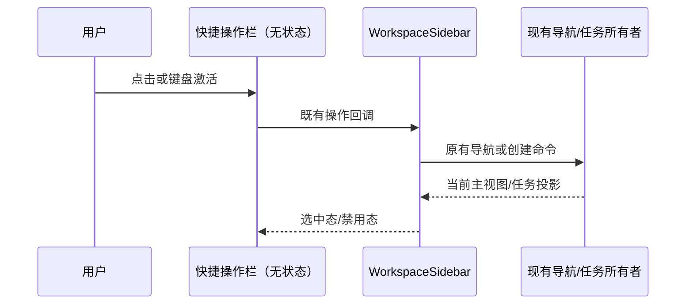

# 工作区侧栏快捷操作栏

## 产品规则

- 将截图红框内的「新建任务、搜索、自动化、插件市场」从项目列表上方提取到侧栏最左侧的独立竖向图标栏，顺序保持不变。Agent 看板、仓库面板继续位于列表区域上方；所有对话与原待办共用任务列表和状态，不再提供独立新建待办入口，见 `unified-workspace-conversations.md`。
- 点击项目名称打开 Agent 看板并筛选到该项目；项目文件夹图标独立控制项目下任务列表的展开/折叠。名称按钮不执行折叠操作，文件夹按钮不导航或启动草稿。
- 图标栏宽 48px，与列表区域以语义边框分隔；总宽度继续由现有侧栏宽度控制。项目、任务列表使用剩余宽度和独立滚动区域。
- 手机远控与设置复用同一图标栏的底部槽位，布局与平台可见性见 `sidebar-utility-rail.md`。
- 图标按钮使用现有 Button 和 Tooltip；提供国际化可访问名称，悬停及键盘聚焦显示名称，搜索和新建任务提示原有快捷键。自动化、插件市场保留选中态。
- 新建任务复用现有 telemetry、只读禁用判断和 grouped draft / project 创建回调；不新增创建或导航路径。图标模式以 `aria-disabled` 保留禁用按钮的键盘焦点和原因提示，既有操作 guard 拒绝鼠标及键盘创建。
- 文件树展开时快捷栏仍可见，文件树和任务列表仅在右侧内容区切换。整个侧栏收起时快捷栏一起收起；顶部浮层仅在侧栏收起时补充新建入口，不再因文件树展开而重复展示。
- 桌面、宽屏 Web 和手机 Web 共用布局。保留顶部原生窗口拖动留白以及手机现有侧栏抽屉和关闭行为；支持浅色、深色、中英文。窄屏 Web 的侧栏最大宽度为容器减 48px，保留外侧关闭区域；任务工具栏不足一行时换行，避免新增快捷栏挤掉过滤操作。

## 所有者与接口

- `WorkspaceSidebarActionRail` 负责顶部四个操作的展示及可选 `footer: ReactNode` 槽位，接收现有回调、选中态和只读原因，不持有导航或任务状态。
- `WorkspaceSidebar` 继续拥有 grouped draft 创建选择以及文件树局部状态。主视图、快捷键、任务状态和计数继续由现有所有者管理。
- 项目列表折叠状态继续由 `tabStore.expandedWorkspacePaths` 拥有；项目名称导航复用 `handleOpenAgentBoard` 的 workspace identity 路由，Agent 看板筛选继续由 `agentBoardStore` 拥有。
- `NewTaskButtonGroup` 增加可选 `iconOnly` / `disabledReason` 展示参数，复用同一创建操作并以原生按钮提供键盘支持。现有文本入口保留。
- 不修改服务、协议、远程身份、持久化或 Desktop / mobile 的事件交付语义。

## 验收场景

1. 四个按钮仅在独立竖栏出现一次，列表区不再保留四行入口；Agent 看板等入口仍在列表区。
2. 新建、搜索、自动化、插件市场分别调用原有回调一次；Enter/Space 可操作，自动化和插件市场正确反映选中态。
3. 只读时新建禁用且展示原因，其他导航入口仍可用；新建任务 telemetry 和快捷键提示保留。
4. 文件树切换后四个快捷入口仍可操作；分组视图新建继续使用当前 grouped draft 回调。
5. 点击项目名称后主视图进入该项目的 Agent 看板，项目筛选匹配 workspace identity；项目名称不调用折叠操作。
6. 点击文件夹图标只展开/折叠项目下列表，不切换主视图、不启动草稿；键盘 Enter/Space 行为一致。
7. 中英文、浅深主题、桌面和 320px/390px 手机视口下无横向溢出，按钮可见、可点击且列表不覆盖快捷栏。
8. 运行专用 Playwright 交互场景、相关现有侧栏回归、`pnpm typecheck`、`pnpm lint` 和架构检查；如有环境或既有失败，如实报告。
