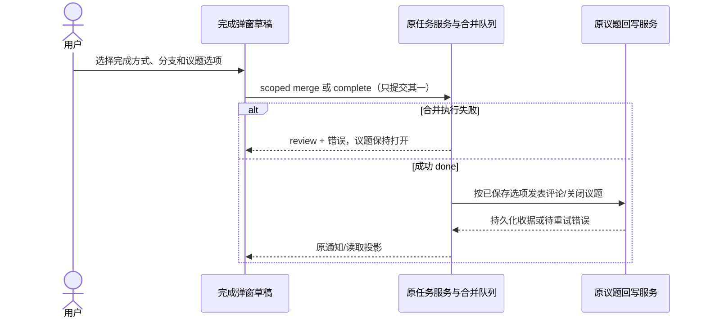

# 任务完成弹窗合并入口验证

截图来自本次源码的真实组件浏览器运行，使用合成 Host/Git/议题数据；未向真实议题、Forge 或模型发送写入。当前分支为 worktree/62fd，本次代码尚未提交、推送或合并。

## 行为

- 点击完成后，工作树任务可选“合并并完成”或“不合并，确认完成”。
- 有未提交改动或新提交推荐合并；证实 HEAD 与 baseCommit 相同且工作树无变更时推荐直接完成；读取不确定时保守推荐合并。
- 合并选择目标本地分支，复用原分支组件及目标草稿 hook。
- 可勾选同时关闭关联议题、编辑或取消结果评论。
- 合并失败保留 review；合并成功 done 后才进行议题回写。

## 所有者与事件顺序

修改模块：ui。文档同步工作任务 spec 与功能图。没有新增协议、后端服务、数据库迁移或持久化字段。

UI 只持有弹窗草稿与只读 Git 推荐，Task/SQLite、owner/lease/runSeq、合并队列和回写收据仍由既有 Host 服务持有。切 scope/轮次后旧读取失效，手动选择不被迟到读取覆盖。Desktop continuous 与手机 replayable 复用相同任务命令及投影。

## 验证

- pnpm typecheck：通过。
- pnpm lint：0 errors、73 个已有 warnings。
- pnpm architecture:check --changed：0 baseline、0 new violations。
- 修改及新增文件格式检查、git diff --check：通过。
- 功能图校验：55 个唯一节点、92 条有效边。
- 52 项相关测试全部通过，包含临时真实 Git 仓库合并测试。
- UI E2E：acceptance、completion、branches-merge、forge-completion 全部通过。
- 原 completion/branches-merge 合成场景运行时出现 React 重复 key 控制台警告，断言通过；新增 acceptance 场景未出现该警告。此项未作为本次功能修复结论。
- acceptance 覆盖 API/ACP、取消、重复点击、失败、晚到读取、分支消失、320px、桌面、中英文及两主题。
- 本次源文件与测试文档总计 +599/-30 行，净增 569 行，包含 4 个新增文件，不计 output。

## 实际效果图

- [桌面合并并完成](desktop-merge.png)
- [手机深色合并并完成](mobile-merge.png)
- [无改动直接完成](desktop-complete.png)
