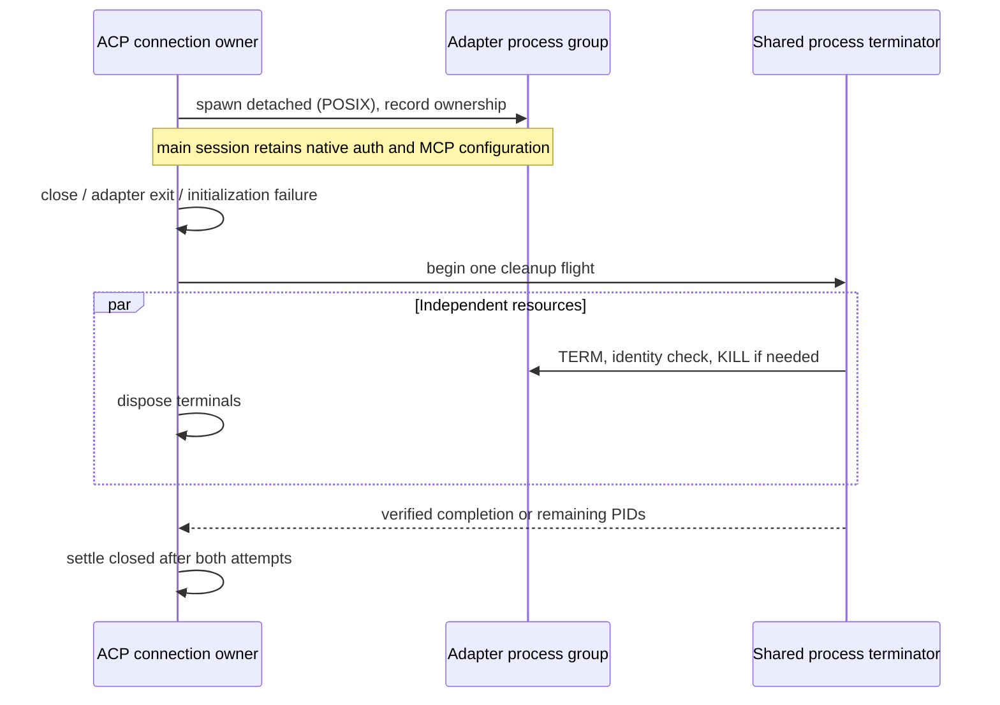

# ACP process lifecycle

## Rules and ownership

- An ACP connection owns its adapter process group and Host-created terminals. `close()` admits cleanup once; `closed` settles only after both cleanup attempts finish. Adapter exit and initialization failure use the same path. Root exit alone is not proof that MCP descendants exited.
- Reuse the API runtime's identity-checked `terminateProcessTreeAndWait` boundary: graceful termination, force escalation, then verification. Cleanup errors and remaining processes reject `closed`; they are observed and logged even when the caller cannot await. Never signal an unrelated PID or process group.
- The agent manager owns launch preparation. For managed `@agentclientprotocol/codex-acp` 2.5.0, disable the adapter's unused internal title and suggestion generation. Those generators create ephemeral native threads which inherit user MCP configuration; unsubscribing a thread does not reliably reclaim that runtime's MCP processes.
- Generate a content-addressed sibling entrypoint from the original bundle, gated by adapter version and the two exact call-site signatures. Preserve the upstream file, license, relative dependency resolution, main prompt, native authentication, and AIR failure capabilities. Write atomically and validate an existing generated copy. A signature mismatch fails launch explicitly. Concurrent preparations of the same content are idempotent.
- `CODEX_ACP_PROMPT_SUGGESTIONS=false` is the upstream switch and is forced for Codex launches after user environment merging. The title compatibility change is limited to managed 2.5.0; system installations and other versions are not rewritten. Changing that version boundary requires another reviewed compatibility rule and tests.
- Host auxiliary Codex text generation continues through the existing isolated native CLI path: copy only provider/model/auth, no business MCP/hooks, read-only, ephemeral, cancellation and awaited process-tree cleanup. Do not substitute an API provider or share stateful MCPs across sessions.

## Delivery and failure boundary

This changes Host process ownership only. Desktop continuous streams and mobile replayable streams retain the same session owner, lease, queue, and sequence semantics. There is no new session persistence or recovery owner. A forcibly killed Host cannot run JavaScript cleanup; outer supervisor recovery remains a separate boundary.

## Acceptance

1. A root exits before a TERM-resistant child with independent stdio: `closed` still waits for force cleanup and the child is gone. An unexpected root exit triggers the same cleanup without a second caller action.
2. Repeated close calls share the same promise; initialization failure waits for cleanup before rejecting. Both terminal and process cleanup are attempted even if either fails.
3. A synthetic 2.5.0 adapter still executes the main turn, but invokes neither internal generator. Preparation preserves the original file, sibling imports and native configuration; concurrent preparation returns the same validated path. A missing/duplicated signature rejects, and other versions are not transformed.
4. Existing isolated native text tests prove provider/auth preservation, no MCP/hooks, read-only execution and cancellation cleanup. Real installed adapter compatibility is verified in a temporary copy, without changing the running installation or making a model request.
