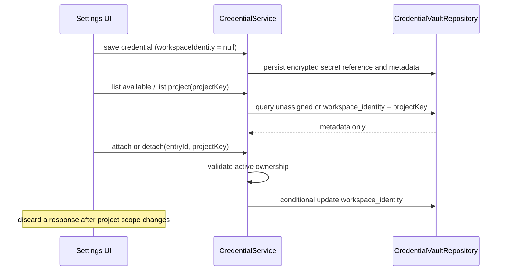

# Project Credential Scope

## Behavior

- A credential is created in the Host vault without a project identity. Creating it from project settings does not attach it to that project.
- A project explicitly selects an unassigned credential to attach it. A project can have many credentials; one credential can be attached to at most one project at a time. Detaching returns it to the unassigned pool so another project can select it.
- A project's list shows only credentials attached to its canonical identity. The unassigned pool is available for explicit selection and is not treated as project data.
- `workspaceIdentity?.trim() || workspacePath` is the canonical project identity. The environment field is only the credential's target classification (`development`, `test`, `staging`, or `production`).
- The Host owns vault persistence, encryption, and attachment state. UI receives metadata and `hasSecret`, never secret values.

## Ownership and interface

- `CredentialService` owns credential records and their single-project attachment. It validates project identity for attach, detach, project list, edit, rotation, and delete operations.
- `CredentialVaultRepository` persists the nullable attachment in the existing `workspace_identity` column; no parallel project store or copy of credential values is introduced.
- The settings UI creates unassigned records and issues explicit attach/detach commands using the current project's canonical identity.

## Invariants and failure behavior

- New records have `workspaceIdentity: null` until a project attaches them.
- Attach succeeds only for an active unassigned credential. A credential attached to another project cannot be listed or mutated through this project's scope.
- Detach succeeds only when the supplied project identity matches the current attachment.
- Missing identity fails closed for project operations. An unassigned credential can be created and listed without a project identity.
- A delayed project list response is discarded after the active identity changes.
- Existing records are unchanged by initialization. Existing non-null identities remain attached to their current project; existing null identities appear in the selectable pool.

## Acceptance scenarios

1. A credential can be created without an active project and appears in the unassigned pool.
2. Creating a credential while viewing project A leaves it unassigned until the user explicitly selects it for A.
3. Project A can attach an unassigned credential and then list, edit, rotate, detach, or delete it.
4. Project B cannot list, attach, detach, edit, rotate, or delete a credential attached to A.
5. After detaching from A, the credential returns to the unassigned pool and can be attached to B.
6. The target environment remains visible but does not determine project ownership.
7. Secret values never appear in list responses or rendered UI.
8. A delayed project A list response is discarded after switching to project B.
9. Existing non-null attachments and unassigned records retain their current values.

## Migration boundary

No data migration is required. The current table already stores nullable `workspace_identity`; new UI writes use `NULL` on create, while explicit project commands set or clear that column. Existing records retain their current identity.
