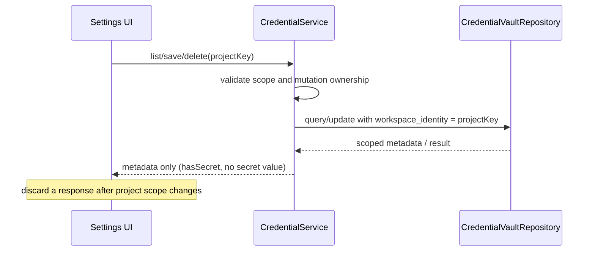

# Project Credential Scope

## Behavior

- Credential vault entries created from project settings belong to the current project. The UI derives identity from `workspaceIdentity?.trim() || workspacePath`; users do not enter the project identity manually.
- List, edit, secret rotation, and delete operations are scoped to that identity. A project switch must not expose another project's entries.
- The environment field remains as a target classification (`development`, `test`, `staging`, or `production`) and does not determine project ownership.
- Existing unscoped credentials remain stored as-is, are excluded from project-scoped lists, and are not silently assigned to a project.
- The Host owns vault persistence and encryption. UI receives credential metadata and `hasSecret`, never the secret value.

## Ownership and interface

- `CredentialService` owns the encrypted credential vault and checks project identity on every project-scoped operation.
- The settings UI provides the current project key through the existing credential service contract.
- No second project credential store is introduced and no credential values are copied into another record.

## Invariants and failure behavior

- The canonical identity is `workspaceIdentity?.trim() || workspacePath`.
- Missing or blank scope fails closed.
- A mismatched project cannot list, edit, rotate, or delete an entry.
- A delayed list response is discarded after the active project changes.
- Existing records are not rewritten; unscoped entries remain unscoped.

## Acceptance scenarios

1. Creating a credential stores the current project's canonical identity without asking the user to enter it.
2. Project A can list, edit, and delete its credential; project B cannot view or mutate it.
3. The target environment remains visible, but does not act as project ownership.
4. Secret values never appear in list responses or rendered UI.
5. A delayed project A list response is discarded after switching to project B.
6. Existing unscoped records are not silently assigned to the current project.

## Migration boundary

No records are migrated. Existing workspace identity values and unscoped records retain their current values. New UI writes use the active project's canonical identity.
