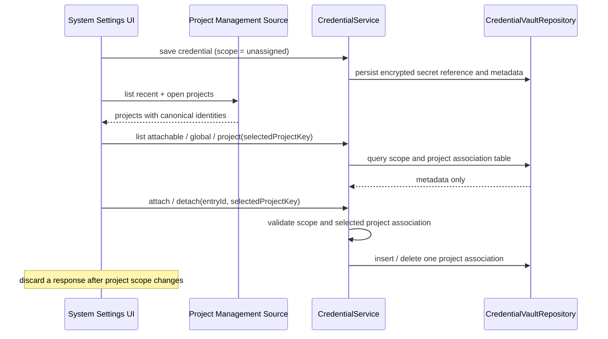

# Project Credential Scope

## Behavior

- Credential management is a system-level settings surface, independent of the currently active workspace. It lists every known project from the shared project-management source (recent projects plus open project tabs), and the user selects a project to inspect and manage its attachments.
- The scope list also contains a Global entry. Global credentials are listed and managed only in Global settings. Runtime credential resolution may still use global credentials for any project.
- Credentials are created in the Host vault as unassigned. Creating one does not attach it to the selected project or Global.
- A project explicitly selects an unassigned or already project-assigned credential to attach it. A project can have many credentials and one project-scoped credential can be attached to many projects. Detaching removes only the selected project's association; when the last project association is removed the credential returns to the unassigned pool.
- Global explicitly selects an unassigned credential to make it available to all projects. Detaching it from Global returns it to the unassigned pool.
- The selected project's list shows only credentials explicitly associated with that project. The attachable pool remains visible and contains unassigned credentials plus project-scoped credentials not yet associated with the selected project. Global credentials never appear in project settings or the attachable pool.
- `workspaceIdentity?.trim() || workspacePath` is the canonical project identity. The environment field is only the credential's target classification (`development`, `test`, `staging`, or `production`).
- The Host owns vault persistence, encryption, and attachment state. UI receives metadata and `hasSecret`, never secret values.
- The system settings layout uses a compact bordered scope navigator and grouped credential lists, following the existing plugin and Agent settings surfaces. Selected scope and available entries must remain visually distinct without adding decorative cards around individual page sections.
- Use the settings page title once, with a short usage description beside the add action. Long project lists scroll inside a bounded navigator; narrow screens stack the navigator and credential groups, with row actions below metadata. Metadata uses the shared type scale, environment badges, and monospace addresses in both light and dark themes.

## Ownership and interface

- `CredentialService` owns credential records and their unassigned/global/project scope. It validates scope and project identity for attach, detach, project list, edit, rotation, and delete operations.
- `CredentialVaultRepository` persists credential scope and project associations separately. A normalized association table maps one project-scoped credential to many canonical workspace identities.
- The settings UI owns the selected project or Global view as local state, creates unassigned records, and issues explicit scope commands. The project list comes from the existing shared project-management hook.

## Invariants and failure behavior

- New records have `scope: unassigned` and `workspaceIdentity: null` until explicitly attached to a project or Global.
- Attach succeeds only for an active unassigned or project-scoped credential that is not already associated with the selected project. Reattaching to the same project is idempotent.
- Global attach succeeds only for an active unassigned credential. Global records are readable by runtime project resolution but never included in settings project lists; they are only mutable through the Global scope.
- Detach removes only the association matching the supplied project identity. Other project associations remain active.
- Global detach succeeds only for a global credential and returns it to unassigned.
- Missing identity fails closed for project operations. An unassigned credential can be created and listed without a project identity.
- A delayed project list response is discarded after the selected identity changes; a selection change also closes any dialog opened for the previous project.
- Existing records are unchanged by initialization. Existing non-null identities are migrated to one project association; existing null identities remain unassigned.

## Acceptance scenarios

1. A credential can be created without an active project and appears in the unassigned pool.
2. Creating a credential while viewing project A leaves it unassigned until the user explicitly selects it for A.
3. Project A can attach an unassigned credential and then list, edit, rotate, detach, or delete it.
4. Project B cannot list, attach, detach, edit, rotate, or delete a credential attached to A.
5. After detaching from A, the credential returns to the unassigned pool and can be attached to B.
6. The target environment remains visible but does not determine project ownership.
7. Secret values never appear in list responses or rendered UI.
8. The settings page lists all known projects and a Global scope even when the active workspace changes.
9. Attaching a credential to Global makes it visible only in Global settings, while project runtime lookup can still resolve it.
10. A project cannot list or mutate a global credential through project settings; global edits and removal are available in Global.
11. A delayed project A list response is discarded after switching to project B or Global.
12. A project-scoped credential can be associated with A and B; detaching from A leaves it available to B, and detaching from B returns it to the unassigned pool.
13. Existing project attachments remain attached to their prior project and existing null-identity records remain unassigned after migration.
14. The scope navigator and credential groups use the shared settings card, border, selection, and typography tokens, and remain readable at narrow mobile widths.

## Migration boundary

Add a checked `scope` column and a project-association table. During initialization, existing rows with a non-null `workspace_identity` become `project` and get one association row; rows with null identity become `unassigned`. Existing global scope remains global. No credentials or secret values are rewritten; the legacy identity column is no longer the active association source.
