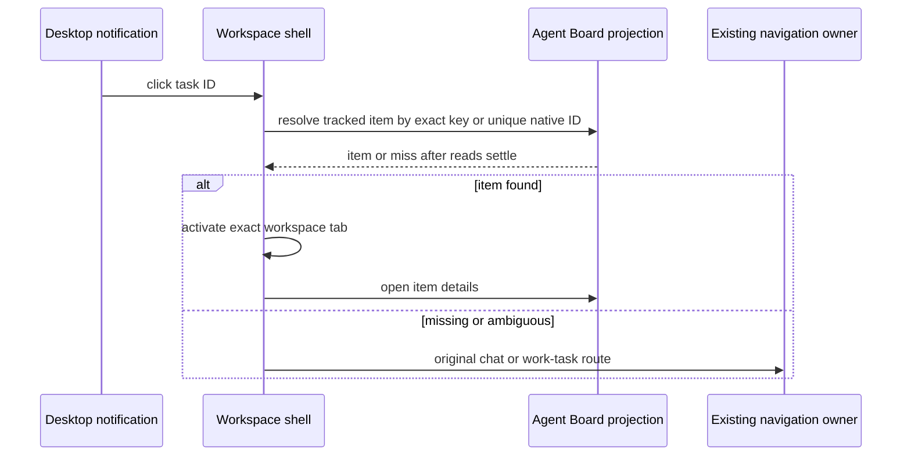

# Task notification navigation

## Rule

Clicking a desktop task notification opens its exact conversation in Agent Board when that
conversation is present in the board's current data and included by the board tracking rules.
The board opens the conversation details and reveals the item even when a saved view, project,
agent, or search filter would otherwise hide it. If the item is absent, excluded, or the board
read fails, the existing conversation or work-task navigation runs unchanged.

## Ownership and order

- The Host owns sessions and work tasks. Agent Board owns only its local tracking and display
  preferences. Notification handlers carry the session's workspace identity and entity kind.
- On click, the current workspace shell reads the board projection, then resolves the exact
  workspace/kind/id key. It accepts a board destination only after all sources finish loading.
- Legacy native notification IPC carries only a task ID. If the renderer task cache cannot
  identify its workspace, the board may resolve it only when exactly one tracked native item
  has that ID. Ambiguous IDs preserve the previous no-navigation outcome.
- On a match, the shell enters Agent Board and the board selects the item. On a miss, the shell
  sends the same target through the existing navigation owner. A newer click supersedes an
  unresolved older click; no task or board membership is written by this decision.
- Remote identities and remote session IDs must remain exact. Same-path or same-ID sessions
  in other workspaces cannot satisfy a notification.

## Acceptance

- Tracked native, ACP, and work-task notifications open their board details.
- Excluded or missing items follow their previous chat or work-task route.
- A saved filter cannot hide the selected board item.
- Same-name paths, equal session IDs, and remote attachments remain isolated.
