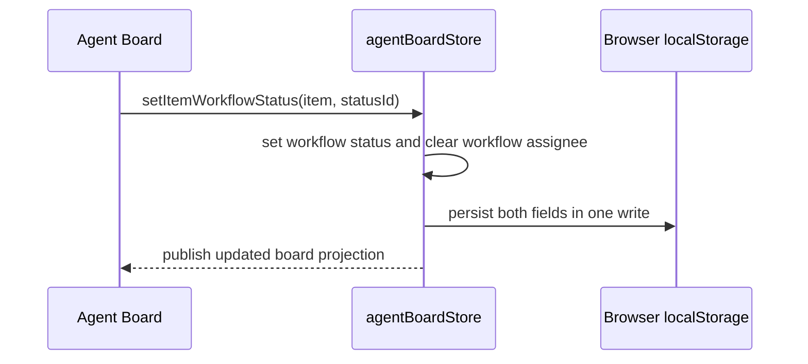

# Agent Board Workflow Statuses

## Behavior

- The Agent Board supports a configurable workflow for every native conversation, ACP conversation, and work task shown on the board.
- Users can create, rename, reorder, enable, disable, and remove workflow statuses. The initial workflow contains 待办, 进行中, 审核中, 已阻塞, 已完成, and 已取消.
- The workflow is the Agent Board's default grouping. Existing runtime filters remain based on actual session/task lifecycle state.
- Legacy preferences migrate to workflow grouping unless the user had explicitly selected status grouping.
- Returning from a scoped project/category view to all projects restores workflow grouping.
- An item can be moved between enabled workflow statuses from the board. Changing workflow status never changes whether its underlying session or task is running, waiting, failed, archived, or completed.
- Entering a workflow status clears the Agent Board's workflow assignee for that item. The owner field is local board metadata; it never writes the WorkTask execution lease, Host task ownership, or session identity.
- When a status is disabled or removed, items assigned to it move to the first enabled status. Reordering statuses does not change item assignments.
- Status configuration and item assignments persist in the existing Agent Board preference store in browser-local storage. Invalid or unavailable storage falls back to the default workflow without affecting Host-owned session/task state.

## Ownership and invariants

- `agentBoardStore` is the sole owner of workflow configuration and per-item workflow status assignments. Components issue store actions and render the resulting projection.
- `agentBoardStore` also owns per-item workflow assignees. Status entry, assignee clearing, and persistence are one synchronous store command and one storage write.
- Item assignment keys use the existing `BoardItem.key`, which includes the workspace identity and entity identity; workspace paths remain file-operation values and are not substituted for identity.
- Runtime status remains derived from the Host/session/task projections in `agentBoardModel`. Workflow status is an independent user annotation and must not feed into runtime commands, task execution, or session state.
- The store validates status IDs, labels, ordering, and assignments when reading persisted data. Unknown or malformed entries are discarded without resetting unrelated board preferences.
- Removing a status and migrating its assigned items is one store update and one persistence write.

## Acceptance scenarios

- A user can configure statuses and assign native, ACP, and work-task cards to them; reloading restores both configuration and assignments.
- Disabled statuses are absent from the board and cannot receive assignments; items already assigned there are migrated atomically.
- Reordering statuses changes board column order while preserving assignments.
- Moving an assigned board item into another workflow status clears its workflow assignee and persists both changes together, without changing its underlying task/session owner.
- Underlying runtime status changes continue to render correctly and do not overwrite workflow assignments.
- Corrupt workflow preferences recover to defaults without crashing the Agent Board or changing Host-owned state.

## Design decision

The existing UI store and local-storage adapter remain the single owner because these statuses organize the local Agent Board rather than govern execution. The board reads runtime facts from its existing data hook and joins user-owned workflow status and assignee metadata by `BoardItem.key`; drag/drop sends one store command. Desktop continuous updates and mobile replayable recovery keep their existing transport semantics because no stream or remote protocol state changes.

