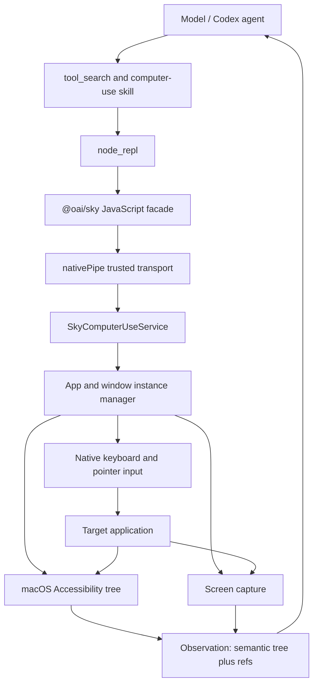
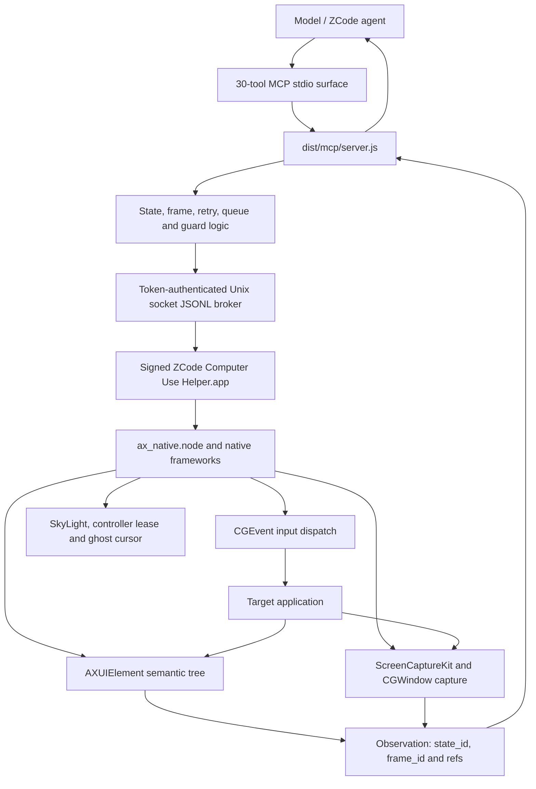

# Compatibility With ZCode CUA 0.5.12

## Conclusion

The implementation is wire-compatible at the MCP tool-schema level and
reproduces the core macOS architecture: AX-first observation and action,
short-lived state/frame capabilities, screenshot provenance, target
revalidation, serialized mutations, and delivery-aware failure handling.

It is not a byte-for-byte clone of ZCode's signed helper and does not contain
ZCode proprietary source.

## Source Lineage Versus Design Lineage

There are two different meanings of "based on Codex":

- Source lineage: there is no evidence that the official ZCode CUA is a fork
  of OpenAI's proprietary Codex implementation. Its JavaScript MCP server,
  helper application, native addon, broker protocol, and controller model are
  independently packaged.
- Design lineage: ZCode CUA clearly follows the same Computer Use shape as
  Codex: semantic accessibility observations, screenshot fallback, stable
  element references, native input dispatch, and a model-facing action loop.
- This open implementation does have explicit source lineage from the MIT
  `open-codex-computer-use` project in its Swift native layer. The ZCode MCP
  compatibility layer, state/frame registries, broker protocol, and 30-tool
  schemas were implemented separately from observed ZCode 0.5.12 behavior.

## Codex Computer Use Architecture

The important boundary is that the model does not speak MCP directly. Codex
loads a trusted JavaScript facade, which calls a native service owned by the
desktop application.

## ZCode CUA 0.5.12 Architecture

ZCode therefore resembles Codex at the capability and control-loop level, but
adds an explicit MCP compatibility surface and a separate signed helper/broker
boundary. That is architectural reimplementation, not demonstrated source
forking.

## Verified

| Area | Result |
|---|---|
| Tool inventory | Exact 30/30 names and ordering |
| Input schemas | Exact structural match after excluding prose descriptions and `$schema` |
| MCP transport | `initialize`, `ping`, `tools/list`, and `tools/call` over stdio |
| AX observation | Real ChatGPT and native fixture observations |
| Window screenshot | Real PNG capture with frame binding and SHA-256 |
| Element click | Real fixture counter changed through AXPress |
| Coordinate `auto` click | Real window and full-display coordinates hit-tested to AXPress |
| `set_value` | Real fixture text value changed through AX |
| State lifecycle | Superseded, spent, expired, unknown, and bounded cases tested |
| Kill switch | Latched and tested |
| Subagent guard | Rejected before native startup |
| Native build | Debug and release Swift builds |

## Intentional Differences

| ZCode CUA | Open implementation |
|---|---|
| Signed helper app and tokenized Unix-socket broker | Child-process JSONL host with per-session capability registries |
| macOS, Linux, and Windows backends | macOS only |
| Streamable HTTP option | stdio only |
| Product PiP and ghost cursor | Not included |
| Controller lease across multiple clients | One MCP process owns one native session |
| Private ZCode native addon | MIT Swift implementation using public APIs plus optional SkyLight support |

## Raw Pointer Boundary

AX-backed actions are the preferred and verified path. Raw PID-targeted
CoreGraphics delivery is application-dependent and cannot prove that a control
handled the event merely because macOS accepted it.

Physical-pointer operations are disabled by default. Set
`OPEN_ZCODE_CUA_ALLOW_GLOBAL_POINTER=1` to enable:

- `mouse_move`
- `left_mouse_down`
- `left_mouse_up`

This opt-in trades ZCode's background-pointer guarantee for reliable system
pointer semantics. The server still validates the source frame and owning
window before dispatch.

Pointer modifiers are currently rejected rather than silently ignored.

## Is ZCode A Codex Skin?

No, not in the strict implementation sense.

The evidence supports a stronger claim than ordinary similarity: ZCode contains
an explicit `Codex get_app_state` comment and follows the same unusual product
choices around AX-first control, screenshot provenance, stale-target rejection,
background window input, and post-action observation.

The evidence does not support source-copying:

- The process architecture differs.
- The public API differs substantially.
- The native symbols and product-specific subsystems differ.
- No meaningful long identical source passages or Codex-private type names were
  found.

The defensible conclusion is: ZCode CUA is behaviorally modeled after Codex
Computer Use, then independently wrapped in ZCode's own MCP/broker/product
architecture.
